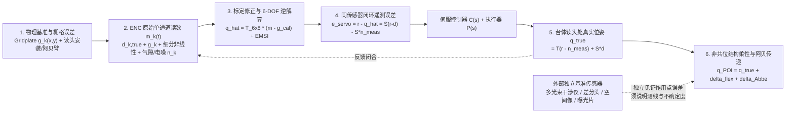
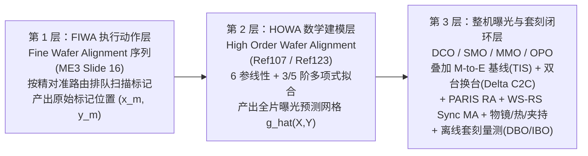
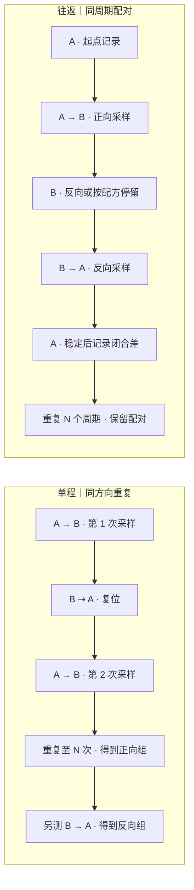

# ENC、AA 与 WS/RS 重复性及分级验收专项答复

[仓库首页](../../README.md) · [成果索引](../README.md) · [变更日志](../../changes/2026-11-26-enc-aa-stage-repeatability-acceptance_v1.md) · [参考文献总目](../../REFERENCES.md)

2026-11-26 · Antigravity（反重力 agent）主笔，Codex 核对原图、统计口径和归档。

本报告评价 OV4 当前 NXT:1965Ci 设计预算和专项验收定义。文献实测按来源机型、工况及统计量引用，OV4 给出的目标值属于工程预算。专项验收 L1/L2 沿用提问中的从部件到集成动作的分法。整机报告使用自顶向下的 L0–L3 预算层级。 [NXT:1965Ci 主报告](NXT1965Ci套刻目标_SMO2.5_MMO4.5_整机L0-L3拆解与九大子系统验收规格报告_v1.md) · [九大子系统说明书 v2](NXT1950i-1970i套刻目标_九大核心子系统验收指标推导与计算说明书_v2.md) · [WS–RS 同步调研报告 v2](WS-RS同步策略与单台重复性误差专项调研报告_v2.md)

## 目录

- [0. 执行摘要与九大问题逐项结论/验收矩阵](#sec-0)
- [1. 【ENC】编码器测量链、曝光窗滤波、分级体系与 Gridplate 机理](#sec-enc)
  - [1.1 ENC-1：`WS-ENC X/Y` 实质核查、六层观测链拆解与仓库指标修订命名](#sec-enc-1)
  - [1.2 ENC-2：原始宽带重复性 vs 曝光窗/滑动剂量加权 `MA`/`MSD`、静止等效窗与防重复计数](#sec-enc-2)
  - [1.3 ENC-3：用户分级（L1/L2）评价、与整机 `L0–L3` 体系映射及 `L2` 完整验收定义](#sec-enc-3)
  - [1.4 ENC-4：Gridplate 物理架构、误差/切换/标定/热漂、三类概念辨析与专利/实机区分](#sec-enc-4)
- [2. 【AA】多波长工艺鲁棒性、单标记静/动态重复性定义与 L1/L2 分级评估](#sec-aa)
  - [2.1 AA-1：SMASH/ORION 一手证据核查、五类统计量拆分与 OV4 定限方法](#sec-aa-1)
  - [2.2 AA-2：单标记静态与动态重复性定义、五类测试平台能力矩阵与采样独立性证明](#sec-aa-2)
  - [2.3 AA-3：用户分级（L1/L2）评价、离线仿整机流程与 `FIWA` / `HOWA` / 曝光套刻层级](#sec-aa-3)
- [3. 【WS/RS】同向单程与交替往返重复性并排定义及同步放宽边界分析](#sec-stage)
  - [3.1 WS/RS-1：同向单程 vs 交替往返并排图示、六大数学量、空间配准与可执行验收矩阵](#sec-stage-1)
  - [3.2 WS/RS-2：重复性/跟随误差/位姿稳定性辨析、误差协方差分析与六项条件有条件放宽流程](#sec-stage-2)
- [4. 一手文献、专利、标准与官方手册精确出处总表](#sec-refs)
- [5. 待验证项与开放工程问题清单](#sec-open)

---

## 0. 执行摘要与九大问题逐项结论/验收矩阵

[返回目录](#contents)

针对本次关于 **ENC（编码器与 Gridplate）**、**AA（多波长对准与网格拟合）** 与 **WS/RS（单/往返重复性与同步放宽边界）** 的 9 项核心工程评审问题，先以验收矩阵给出逐项明确判定、与现行 `OV4` 基线的衔接结论以及核心验收动作：

| 题号 | 答复与验收方法 |
| :--- | :--- |
| ENC-1 | `WS-ENC X/Y` 当前指曝光窗等效的计量链噪声预算。实际停位波动另验，同时记录 ENC 遥测和独立参考。 |
| ENC-2 | 用同一组原始时序交付带内噪声、PSD 及配方窗口结果。原始量用于带宽和异常诊断，窗口用于评估对曝光的贡献。 |
| ENC-3 | 专项 L1 验 ENC 本体与装机计量链，专项 L2 验 ENC 反馈下指定台体的在位稳定性。 |
| ENC-4 | Gridplate 是台体 ENC 读取的实体光栅尺，需验标定残差、热漂和切换。 |
| AA-1 | 文献支持跨波长择优及对不对称偏差进行加权。每色重复性、读出可用率、跨色偏差和融合性能分别定限。 |
| AA-2 | 固定标记测试信号稳定性，参考扫描测试完整单标记测位，生产扫描测试 AA、WS 及同步的组合性能。 |
| AA-3 | 专项 L1 按通道验单标记，专项 L2 按离线 FIWA 类流程验 HOWA 网格。用留出点验证场边及跨次预测。 |
| WS/RS-1 | 单程按同向统计，往返按同一周期配对。分别报告正向、反向、反向差、闭合、停位及联机窗口 MA/MSD。 |
| WS/RS-2 | 台体同口径误差的正相关可减小同步误差。放宽只考虑经实机配对证明有余量的 E-side 匀速横向分量。 |

---

## 1. 【ENC】编码器测量链、曝光窗滤波、分级体系与 Gridplate 机理

[返回目录](#contents)

### 1.1 ENC-1：`WS-ENC X/Y` 实质核查、六层观测链拆解与仓库指标修订命名

#### （1）先核对仓库实际文件：当前 `WS-ENC X/Y` 到底是什么？

在判断 `ws-enc-x`、`ws-enc-y` 含义之前，先直接核对 `OV4` 当前两份活跃正式报告及配套规格表中的**原始对象、数据处理方式与测试工况**（不凭变量名望文生义）：

1. **在现行唯一权威 `NXT:1965Ci` 主报告**（[NXT:1965Ci 主报告 v1 §4.2](NXT1965Ci套刻目标_SMO2.5_MMO4.5_整机L0-L3拆解与九大子系统验收规格报告_v1.md#sec-4-2)）中：
   - 明确写为 **`WS-ENC X / Y 曝光窗重复性 (~64 Hz)` = `≤ 0.13 nm`**；
   - 其输入来自 `Ref009 Fig. 4` 的 **NXT:1950i X 向短光程编码器测量噪声**（`0.22 nm 3σ @ 1000 Hz`），数据处理方式是对该宽带噪声按 `30%` 低频有色 + `70%` 高频白噪经过 `5.5 mm @ 0.70 m/s` 狭缝等效带宽 `B_ENBW = 63.64 Hz` 滤波算得 `0.130 nm`，功能定位是作为 **ENC 测量子系统底噪**。`0.13 nm` 略高于 `0.38/3 ≈ 0.127 nm`。若采用严格 1:3 规则，须先统一统计量、参考点和带宽，再由实测数据核定。
2. **在历史基线**（[九大子系统说明书 v2 §3.2](NXT1950i-1970i套刻目标_九大核心子系统验收指标推导与计算说明书_v2.md#sec-3) 与 `Excel v2` `02_1-4` 页第 4.1–4.16 行）中：
   - 同类条目为 `4.1 WS-ENC X 曝光窗重复性 (~64 Hz) ≤ 0.12 nm`、`4.2 WS-ENC Y ≤ 0.12 nm`、`4.7 WS-ENC 宽带测量噪声 (1000 Hz) ≤ 0.20 nm`、`4.8 WS-ENC 读数头切换 (Handover) ≤ 0.15 nm`、`4.9 Gridplate 网格板 7 天稳定性 ≤ 0.18 nm`，以及 `4.10–4.16 RS-ENC (4×)`。
   - 而**台体自身的 6-DOF 定位/跟踪重复性**则单独列在 **第 1 章 `WS`（`1.1 WS-X ≤ 0.32 nm`、`1.2 WS-Y ≤ 0.36 nm`；在 `NXT:1965Ci` 主报告 v1 §4.1 中为 `WS-X ≤ 0.38 nm`、`WS-Y ≤ 0.39 nm`）** 与 **第 2 章 `RS`** 中。

> **明确结论**：当前 `OV4` 仓库中的 `WS-ENC X`、`WS-ENC Y` **不是**“台体在位伺服稳定性”，而是 **“配置在晶圆台（WS）上的 2D 编码器测量子系统在曝光狭缝等效通带内的测量链重复性/噪声预算”**。之所以容易引发误读，是因为命名以 `WS-ENC-` 开头、未在标识符中把 **“传感测量链底噪”**、**“同传感器闭环伺服遥测误差”** 与 **“外部基准测得的台体真实位姿稳定性”** 强制切分。

#### （2）六层观测物理量的数学解耦与信号链

在高精度磁浮光刻工件台中，传感器读数与曝光点真实位姿之间存在严密的物理传播与反馈闭环耦合（参见 Butler `[094]`、Heertjes `[019, 147]`、Dirkx/ASML `[173]`）：

各层物理量精确定义与差异如下：

1. **第 1 层 — ENC 原始单通道读数 $m_k(t)$**：第 $k$ 个读数头通道（如 4 角 45° 切向 + Z 向共 8 通道 `[009 §3.2]`）的瞬时原始输出：

$$
m_k(t) = d_{k,\mathrm{true}}(t) + g_k\big(x(t),y(t)\big) + \delta_{\mathrm{interp},k}\big(d_k(t),v_k(t)\big) + n_{\mathrm{air},k}(t) + n_{\mathrm{elec},k}(t)
$$

   其中 $g_k$ 为光栅栅格板静态/热变形位置误差，$\delta_{\mathrm{interp},k}$ 为电子相位细分周期非线性（速度相关，`[060 Fig.7]`），$n_{\mathrm{air},k}$ 为 `< 15 mm` 短光程气隙折射率湍流，$n_{\mathrm{elec},k}$ 为光电探测器与 ADC 宽带电子噪声。
2. **第 2 层 — 几何 / 标定 / 安装误差传播**：包括读数头 45° 安装方位角误差、卡盘与读数头相对热漂（`[009 Fig.6]` 四个正交漂移模态 `Tx, Ty, RwS, EMSI`）、读数头测量点与硅片曝光面高度差形成的阿贝臂 $\Delta z_{\mathrm{Abbe}}$（放大倾角 $`R_x, R_y`$ 误差）、以及 Gridplate 标定残差 $\delta g_{\mathrm{cal}}$ 与读数头过缝切换（Handover）残差。
3. **第 3 层 — 6-DOF 刚体逆解算 $\hat{\mathbf{q}}(t)$**：经标定查找表与几何雅可比矩阵 $\mathbf{T}_{6\times N}$（如 ASML 4 角、部分位置 3 头有效 `[009 Fig.7]`，或专利 `[210]` Fig. 7 的 3 单元最小 6-DOF 解算）合成台体 6-DOF 观测位姿：

$$
\hat{\mathbf{q}}(t) = \mathbf{T}_{6\times N}\,\big(\mathbf{m}(t) - \hat{\mathbf{g}}_{\mathrm{cal}}\big), \qquad \mathbf{\Sigma}_{\hat{q}} = \mathbf{T}_{6\times N}\,\mathbf{\Sigma}_m\,\mathbf{T}_{6\times N}^T
$$

   注意此处不同轴向噪声会被几何基线放大或缩小（例如两对角 Z 通道差分得倾角 $`\sigma_{Rx} \propto \sqrt{2}\sigma_Z / L_{\mathrm{base}}`$，而四通道均值可对独立白噪降噪 $1/\sqrt{N}$，但对共模气隙/框架振动不降噪）。
4. **第 4 层 — 同传感器闭环遥测误差 $e_{\mathrm{servo}}(t)$**：运动控制器直接读取的闭环跟踪误差 $e_{\mathrm{servo}}(t) = r(t) - \hat{q}(t)$。设开环增益 $L(s) = P(s)C(s)$，灵敏度函数 $S(s) = (1+L)^{-1}$，互补灵敏度函数 $T(s) = L(1+L)^{-1}$，将总测量等效误差记为 $`n_{\mathrm{meas}} = \delta_{\mathrm{cal}} + n_{\mathrm{ENC}}`$，折算到被控对象位置输出端的扰动记为 $d$，则有单轴线性反馈关系：

$$
e_{\mathrm{servo}}(s) = S(s)\big(r(s) - d(s)\big) - S(s)\,n_{\mathrm{meas}}(s)
$$

$$
q_{\mathrm{true,head}}(s) = T(s)\,r(s) + S(s)\,d(s) - T(s)\,n_{\mathrm{meas}}(s)
$$

   由此导出真实跟踪误差 $`e_{\mathrm{true,head}}(s) = r(s) - q_{\mathrm{true,head}}(s)`$ 为：

$$
e_{\mathrm{true,head}}(s) = S(s)\big(r(s) - d(s)\big) + T(s)\,n_{\mathrm{meas}}(s)
$$

   **闭环计量的影响**：在伺服闭环带宽内（低频 $|S| \to 0,\; |T| \to 1$），**测量链自身的低频噪声、热漂与栅格标定残差 $n_{\mathrm{meas}}$ 在同传感器遥测 $e_{\mathrm{servo}}$ 中被 $S(s)$ 压成近乎于零**，却在物理世界中被 $T(s) \approx 1$ **原封不动地反向写进了台体的真实位移 $q_{\mathrm{true,head}}$**。
5. **第 5–6 层 — 外部独立基准测得的真实曝光点（POI）稳定性 $q_{\mathrm{true,POI}}(t)$**：如 ASML 控制团队 Dirkx、Mooren 与 Oomen（`[173]` Sec. I–II）所严格阐明的**非共位推断控制（Inferential Motion Control）**机理——编码器读头位于卡盘四角（测量变量 $y_p$），而真正决定套刻与成像的是硅片曝光狭缝中心（不可直接实时测量的性能变量 $z_p$）。受高速加减速激励的卡盘内部柔性模态形变 $\delta_{\mathrm{flex}}(t)$ 与阿贝臂倾角耦合影响：

$$
q_{\mathrm{true,POI}}(t) = q_{\mathrm{true,head}}(t) + \delta_{\mathrm{flex}}(t) + \delta_{\mathrm{Abbe}}(t)
$$

   借助**独立于闭环反馈的外部基准**（如多光束激光干涉仪、独立差分传感头 `[060 Fig.7]`、或整机 TIS/PARIS 空间像与光刻胶双次曝光），可交叉核验由以下各项共同形成的量 $S(r-d)$、$T\,n_{\mathrm{meas}}$ 与非共位形变 $\delta_{\mathrm{flex}}$。

#### （3）“理想 ENC + 差伺服”与对称反例的严格证明

- **反例 A（用户提出：理想 ENC + 差伺服）—— 严格成立**：设 ENC 为绝对理想传感器（$n_{\mathrm{meas}} \equiv 0$），此时 相对真值的 ENC 随机测量误差为零；但如果伺服控制器带宽不足、前馈模型失配或外扰（液浸拖拽、电缆拉力、地面微振）未被抑制，导致通带内 $|S(j\omega)|$ 仍大，则 $`e_{\mathrm{true}} = e_{\mathrm{servo}} = S(r-d)`$ 可达数纳米甚至数十纳米——**ENC 完美达标，台体在位伺服稳定性却完全不合格**。
- **反例 B（工程中更具欺骗性：极好伺服 + 差 ENC）—— 同样严格成立**：设伺服环极硬（低频 $|S| \approx 0, |T| \approx 1$），但 ENC 存在 `0.8 nm` 气隙低频湍流或 `1.0 nm` 栅格未标定热漂。此时查看控制器内部 `e_servo` 遥测曲线，数值接近 `0 nm`（看似“台体极其稳定”），但真实硅片位置已跟着假读数偏移了 `0.8–1.0 nm`！这正是 Nikon `[060 Fig.7]` 必须用**双固定编码器差分测试**剥离台体运动、以及 ASML `[009, N7]` 必须用**外部参考片曝光**闭环核验整机网格的根本物理原因。

#### （4）为何“测量原理不按台体拆分，但整条测量链必须按实际配置验收”？

- **原理层共性**：2D/1D 衍射光栅短光程干涉细分原理（见 `[009 §3.1]`、`[210]` `US 7,362,446 B2`）本身不因装在 WS 还是 RS 而改变，单读头光学干涉对比度、光电暗噪声与插值芯片本底可在通用部件 bench 上做共性原理验证。
- **整链配置级验收的不可替代性**：将同一测量原理落地到 WS 与 RS 两条工程测量链时，以下 6 项配置差异会彻底改变最终 6-DOF 性能边界，必须按各自实际配置独立验收：
  1. **原生坐标与光学换算**：WS 位于晶圆侧，RS 位于掩模侧。横向按投影倍率和实测符号换算。Z 和转角按经验证的光学模型及场点灵敏度换算。
  2. **扫描速度与电子细分多普勒频率差 4 倍**：WS 扫描 `0.70–0.80 m/s`，RS 扫描 **`2.80–3.20 m/s`**，同等栅距下 RS 信号载波频率高 4 倍，动态电子细分滞后与高加速度（`150 m/s²`）下机械微振耦合远严于 WS；
  3. **几何基线与 6-DOF 放大系数不同**：WS 四角读头基线约 `~320 mm`（OV4 工程估算），RS 传感基线约 `~180–200 mm`（历史报告中的工程估算，实际传感器类型和布置待确认），相同单通道噪声解算出的 $`R_x, R_y, R_z`$ 角噪不同；
  4. **读数头拓扑与切头机制不同**：WS 在 `0.8 × 0.8 m` 4 拼接 Gridplate 上运动，涉及双台换台与 3-of-4 过缝 `EMSI` 切换 `[009 Fig.5–7]`；RS 为单长行程往返，无双台换台但承受极高折返冲击；
  5. **局部微环境完全不同**：WS 邻近液浸头（水膜蒸发冷缩、潜在微液滴风险、10 mK 气幕 `[009 §3.2]`）；RS 处于掩模侧 `5 mK` 水平气幕与掩模吸热对流环境（`ME3 08-TT-L3-RSbook`）；
  6. **标定闭环链路不同**：WS Gridplate `< 15 mm` 靠供应商+机台传感自标，`> 15 mm` 靠 `13×19` 基准片多移位曝光 `[N7 Fig.11]`；RS 则需结合 TIS/PARIS 掩模对准建立相对像面基准。

#### （5）当前 OV4 仓库 ENC 实际指标清单与建议修订命名对照表

| 仓库现行条目（`NXT:1965Ci 主报告 v1 §4.2` / `说明书 v2 §3.2`） | 旧 `v2` 限值 | **现行 `NXT:1965Ci v1` 限值** | 真实物理对象与口径核定 | 证据属性 | **建议修订规范变量名（消除歧义）** |
| :--- | :---: | :---: | :--- | :---: | :--- |
| `4.1 / 4.2 WS-ENC X / Y 曝光窗重复性 (~64 Hz)` | ≤ 0.12 nm | **≤ 0.13 nm** | ENC 测量链在 `5.5 mm @ 0.70 m/s`（`B_ENBW = 63.64 Hz`）等效通带内的合成噪声重复性（30% 有色 + 70% 白噪） | OV4 工程预算（基于 `[009 Fig.4]` + `[N8]` 滤波推导） | `ENC-WS-XY-SlitMA`（测量链曝光窗重复性） |
| `4.3 WS-ENC Z 曝光窗重复性` | ≤ 0.35 nm | **≤ 0.38 nm** | 2D 光栅 Z 向通道测量链曝光窗重复性（约 3× XY 灵敏度） | OV4 工程预算 | `ENC-WS-Z-SlitMA` |
| `4.4 / 4.5 WS-ENC Rx / Ry 曝光窗重复性` | ≤ 3.0 nrad | **≤ 3.2 nrad** | 四角 Z 通道差分 6-DOF 解算倾角噪声（基线 ~320 mm，2× 余量） | OV4 解析估算 | `ENC-WS-RxRy-6DOF-SlitMA` |
| `4.6 WS-ENC Rz 曝光窗重复性` | ≤ 1.5 nrad | **≤ 1.6 nrad** | 四角 45° 切向通道差分 6-DOF 解算偏航噪声（基线 ~320 mm） | OV4 解析估算 | `ENC-WS-Rz-6DOF-SlitMA` |
| `4.7 WS-ENC 宽带测量噪声 (1000 Hz)` | ≤ 0.20 nm | **≤ 0.22 nm** | 宽带测量噪声。论文仅披露 X 向、`0.22 nm (3σ)`、时序经 `1000 Hz` 滤波 | **一手实测直接对标**（`[009 Fig.4]` 实测 `0.22 nm @ 1000 Hz`） | `ENC-WS-XY-RawBB-1kHz` |
| `4.8 WS-ENC 读数头切换 (EMSI Handover)` | ≤ 0.15 nm | **≤ 0.15 nm** | 3-of-4 过缝/切头在线一致性标定残余跳变 | OV4 工程预算（机理源于 `[009 Fig.6–7, 062]`） | `ENC-WS-EMSI-Handover` |
| `4.9 Gridplate 网格板 7 天稳定性` | ≤ 0.18 nm | **≤ 0.20 nm** | 装机定位网格在规定测法下的一周稳定性 | **一手实测直接对标**（`[062 Fig.11]` 原型试验约 0.2 nm） | `ENC-Gridplate-7dStab` |
| `4.10 RS-ENC X` | ≤ 0.32 nm | ≤ 0.37 nm | 掩模侧 X 测量噪声 | OV4 工程预算 | RS 配置 ENC 的 X 等效噪声 |
| `4.11 RS-ENC Y` | ≤ 0.36 nm | ≤ 0.39 nm | 掩模侧 Y 测量噪声 | OV4 工程预算 | RS 配置 ENC 的 Y 等效噪声 |
| `4.12 RS-ENC Z` | ≤ 2.50 nm | ≤ 2.60 nm | 掩模侧 Z 测量噪声 | OV4 工程预算 | RS 配置 ENC 的 Z 等效噪声 |
| `4.13 RS-ENC Rx` | ≤ 25 nrad | 未单列 | 掩模侧 Rx 测量噪声 | 历史几何估算 | RS 配置 ENC 的 Rx 等效噪声 |
| `4.14 RS-ENC Ry` | ≤ 20 nrad | 未单列 | 掩模侧 Ry 测量噪声 | 历史几何估算 | RS 配置 ENC 的 Ry 等效噪声 |
| `4.15 RS-ENC Rz` | ≤ 2.5 nrad | ≤ 2.8 nrad | 掩模侧 Rz 测量噪声 | OV4 工程估算 | RS 配置 ENC 的 Rz 等效噪声 |
| `4.16 RS-ENC 宽带` | ≤ 0.60 nm | ≤ 0.68 nm | 掩模侧带内噪声 | OV4 工程预算 | RS 配置 ENC 的宽带噪声 |
| *对比项（非 ENC）：`1.1 / 1.2 WS-X / WS-Y`* | *≤ 0.32 / 0.36 nm* | ***≤ 0.38 / 0.39 nm*** | **晶圆台自身动态定位/跟踪重复性**（含伺服 + 内嵌 ENC，动态往返曝光窗 MA 3σ） | OV4 工程预算（锚定 `[009 Fig.10]` `Sync 0.47/0.49 nm`） | 拆为 `WS-Servo-InLoop-XY` 与 `WS-Pose-ExtRef-XY` |

---

### 1.2 ENC-2：原始宽带重复性 vs 曝光窗/滑动剂量加权 `MA`/`MSD`、静止等效窗与防重复计数

#### （1）原始数据与窗口结果的用途

同一组覆盖所需带宽、带有参考通道和工况标记的原始时间序列，可以同时计算宽带重复性和曝光窗等效重复性。只有一个宽带标准差时，无法可靠复算窗口值。用于成像预算的是作用点运动，须由实际闭环传递或独立参考确定。

**核心判定：单靠 ENC 原始宽带重复性不够，但单靠曝光窗滤波值同样不够——两者在物理上互补，缺一不可。**

- **为什么仅靠原始宽带重复性（如 `0.22 nm @ 1000 Hz`）不够？**
  1. 宽带标量把 `0.1 Hz` 到 `1000 Hz` 全部能量混在一起，**无法区分误差最终去往套刻（`MA`）还是去往成像对比度模糊（`MSD`）**：同样的 `0.22 nm` 宽带噪声，若 90% 能量集中在 `5–30 Hz` 气隙湍流，则曝光窗 `MA` 高达 `0.21 nm`（严重超标，破坏 1:3 计量原则）；若 90% 能量为高频电子白噪，则 `MA` 仅 `~0.08 nm`（套刻极优，但推高 `MSD` 与伺服高频推力）。
  2. 无法跨扫描配方（不同扫速 $v_w$ 或不同狭缝宽 $L_s$）进行定量折算。
- **为什么仅靠曝光窗滤波后的 `MA` 同样不够？**
  1. 曝光窗滑动平均在 $`f_i = i / \tau_{\mathrm{slit}}`$（`5.5 mm @ 0.70 m/s` 处首零点为 **`127.3 Hz`**）及其以上频段具有强衰减，会衰减高频成分，只有零点频率被完全抑制；
  2. 然而在真实伺服闭环中，ENC 噪声经互补灵敏度进入真实台体运动，再影响成像 `MSD`，并经 $C(s)S(s)$ 传递至执行器控制量，造成**短行程执行器发热、推力饱和及高频柔性模态激励**；此外，M-side 静态单点采样与快速整定诊断也不经过曝光狭缝积分。
- **曝光窗滤波后的量实际用在哪里、何时有必要？**
  - **必要场景**：① 整机套刻（Overlay）误差预算分配与 `1:3` 计量比核算；② 扫描曝光过程同步性能与成像对比度评估（`MA` 对应套刻平移、`MSD` 对应像面高斯模糊与 LER/CDU `[094, 257, N8]`）；③ 不同机型/配方（如 `5.5 mm @ 0.70 m/s` vs `0.80 m/s` PEP 提速 vs 干式 `8.0 mm` 狭缝）之间的传感器噪声折算。
  - **禁用/不适用场景**：伺服环路稳定裕度（Bode/Nyquist）调校、电机电流/热耗评估、高频机械共振诊断、以及单次瞬态跳变（如过缝读头切换 `EMSI` 尖峰）抓捕——上述场景必须查看**未滤波原始时域 + 全频带 PSD/CPS**。

#### （2）四套核心数学口径：原始 PSD、均匀狭缝 `MA/MSD`、滑动剂量加权 `MA/MSD`、静止等效窗

1. **原始带宽与单边自功率谱密度（PSD / CPS）**（依据 Heertjes `[N8]` Eq. 7–8）：设采集采样率 $f_s$（工业工件台通常 `5–10 kHz`，`[N8 §IV]` 实测为 `5 kHz`），评估带宽 $`[f_{\min}, f_{\max}]`$（如 `0.1 Hz–1000 Hz` 或 `2000 Hz`），单边功率谱密度 $G_{ee}(f)$ 与宽带均方根噪声、累积功率谱（CPS）满足：

$$
e_{\mathrm{BB}}^{\mathrm{rms}} = \sqrt{\int_{f_{\min}}^{f_{\max}} G_{ee}(f)\,df}, \qquad \mathrm{CPS}(f) = \sqrt{\int_{f_{\min}}^{f} G_{ee}(\nu)\,d\nu}
$$

2. **均匀矩形曝光狭缝的连续时间 `MA` 与 `MSD`**（Butler `[094]` Eq. 4–5；Heertjes `[N8]` Theorem 2.1、Eq. 8–15）：对扫描速度 $v_w$、狭缝宽度 $L_s$（`NXT:1965Ci` 为 `5.5 mm`，经 Zeiss `[N1 Table 3]` 与 `ME3 12-TT-L3-L3-ME` p.70 确证），曝光时间窗 $`\tau_{\mathrm{slit}} = L_s / v_w`$（`0.70 m/s` 下为 **`7.857 ms`**）：

$$
e_{\mathrm{MA}}(t) = \frac{1}{\tau_{\mathrm{slit}}}\int_{t-\tau_{\mathrm{slit}}/2}^{t+\tau_{\mathrm{slit}}/2} e(\tau)\,d\tau, \qquad e_{\mathrm{MSD}}(t) = \sqrt{\frac{1}{\tau_{\mathrm{slit}}}\int_{t-\tau_{\mathrm{slit}}/2}^{t+\tau_{\mathrm{slit}}/2} \big[e(\tau) - e_{\mathrm{MA}}(t)\big]^2\,d\tau}
$$

   在频域中（`[N8]` Eq. 2, 9, 13–15），`MA` 是精确的归一化辛格低通滤波器（而非一阶 RC 滤波，且在 $`f_i = i/\tau_{\mathrm{slit}}`$ 处严格归零并伴随 $0^\circ / -180^\circ$ 相位翻转），`MSD` 的均方根能量则严格服从互补高通谱 $\gamma(f) = 1 - \mathrm{sinc}^2(f\tau_{\mathrm{slit}})$：

$$
\left(e_{\mathrm{MA}}^{\mathrm{rms}}\right)^2 = \int_0^{\infty} \mathrm{sinc}^2(f\tau_{\mathrm{slit}})\,G_{ee}(f)\,df, \qquad \left(e_{\mathrm{MSD}}^{\mathrm{rms}}\right)^2 \approx \int_0^{\infty} \big[1 - \mathrm{sinc}^2(f\tau_{\mathrm{slit}})\big]\,G_{ee}(f)\,df
$$

   其等效砖墙噪声带宽为 $`B_{\mathrm{ENBW}} = \int_0^{\infty}\mathrm{sinc}^2(f\tau_{\mathrm{slit}})\,df = \frac{1}{2\tau_{\mathrm{slit}}} = \mathbf{63.64\text{ Hz}}`$（首零点 **`127.3 Hz`**）。

3. **滑动剂量加权（Dose-Weighted / Trapezoidal Slit & Pulsed Laser）`MA` 与 `MSD`**：
   实际曝光可用测得的扫描向强度剖面及脉冲位置和剂量加权。下述以 6 kHz 仅作脉冲数示例。设归一化扫描向光强权重函数为 $w(\tau) \ge 0$，满足 $`\int_{-\tau_{\mathrm{slit}}/2}^{\tau_{\mathrm{slit}}/2} w(\tau)\,d\tau = 1`$（或离散 $`N_{\mathrm{pulse}} = f_{\mathrm{laser}}\tau_{\mathrm{slit}} \approx 6000 \times 0.007857 \approx \mathbf{47}`$ 个激光脉冲的归一化剂量权重 $`w_i = D_i / \sum_{j=1}^{N_{\mathrm{pulse}}} D_j`$），则物理上更精确的**滑动剂量加权 `MA` 与 `MSD`** 为：

$$
\mathrm{MA}_w(t) = \int_{-\tau_{\mathrm{slit}}/2}^{\tau_{\mathrm{slit}}/2} w(\tau)\,e(t-\tau)\,d\tau \;\approx\; \sum_{i=1}^{N_{\mathrm{pulse}}} w_i\,e(t_i)
$$

$$
\mathrm{MSD}_w(t) = \sqrt{\int_{-\tau_{\mathrm{slit}}/2}^{\tau_{\mathrm{slit}}/2} w(\tau)\,\big[e(t-\tau) - \mathrm{MA}_w(t)\big]^2\,d\tau} \;\approx\; \sqrt{\sum_{i=1}^{N_{\mathrm{pulse}}} w_i\,\big[e(t_i) - \mathrm{MA}_w(t)\big]^2}
$$

   实际脉冲加权应使用已知或实测的光强剖面、位置和同步时戳。矩形窗便于预算对标。用相同全宽的梯形代替矩形时，等效噪声带宽与权重分布有关，应按实际权重重新积分。对零均值平稳误差和固定权重，MA 的方差等于单边 PSD 与窗口幅频响应平方乘积的积分。MSD 的均方量对应互补功率权重。切换瞬态和非平稳事件直接用时序计算。

4. **静止测试中的等效曝光窗（Stationary Equivalent Window）**：
   - **定义与用法**：当台体静止锁死（$v_w = 0$）或在独立光学平台上测试 ENC 静态重复性时，并不存在物理扫过狭缝的运动，但可以在采集的原始高频时间序列 $m(t_k)$ 上，**事后施加与标称曝光等长的时间窗 $`\tau_{\mathrm{eq}} = L_s / v_{w,\mathrm{nom}} = 7.857\text{ ms}`$**（例如采样率 `5 kHz` 时窗宽 `39` 点，`10 kHz` 时 `79` 点），计算滑动平均序列 $`m_{\mathrm{MA}}(t_k)`$ 的 `3σ` 作为“静态时间噪声的曝光窗等效重复性”。
   - **必须明示的物理盲区**：静止等效窗**只能测出固定点的时间噪声**（光电暗噪、电子细分固定相位噪、静态气隙湍流、平台环境微振），**完全测不到与运动速度 $v_w$ 强耦合的空间与动态误差**——包括光栅周期细分非线性（主频 $`f = v_w / p_{\mathrm{grid}}`$，如 `1 μm` 周期在 `0.70 m/s` 下为 `700 kHz`、多阶谐波混叠）、光栅刻写空间误差（经狭缝空间平均后残留 `[060 Fig.6]`）、高速多普勒跟踪延迟、读数头过缝切换跳变以及台体高速扫动诱发的局部气隙风压湍流！因此静止等效窗用于固定点时间噪声验收，绝不能替代动态差分扫描测试（如 Nikon `[060 Fig.7]` `700 mm/s` 双头差分测试）。

#### （3）白噪声、有色噪声、长期漂移与空间误差四域边界及防重复计数归口

| 误差类型 | 典型频段 / 空间尺度 | 经 `7.86 ms` 狭缝窗后的透射特性 | 在套刻与成像中的真实归宿 | 防止预算重复计数的归口规则 |
| :--- | :---: | :--- | :--- | :--- |
| **高频白噪声**（光电散粒噪、前置放大热噪） | `> 64 Hz` 至 Nyquist | 93.6% 方差被 `MA` 滤除（假设理想 1 kHz 平坦带宽，`0.22 × √(63.64/1000) = 0.0555 nm`，仍是 3σ）。真实台体运动另经闭环传递 | 对真实运动的贡献取决于闭环传递。在理想白噪示例中，约 6.4% 输入方差保留在 MA 内 | **内嵌于 `WS/RS` 闭环**（按 1:3 计量比校验），**严禁**在 `L0` 顶层与 `WS` 再次相加 |
| **低频有色噪声**（气隙折射率湍流 `0.5–50 Hz` `[009 §3.1]`、$1/f$ 闪烁、低频微振） | `0.1 Hz – 64 Hz` | 远低于首零点时接近全通。若假设 30% 方差落在近直流，余下为宽带白噪，估算合成约 `0.13 nm (3σ)` | 经闭环 $T(s) \approx 1$ 直接写进真实台体位移，构成 ENC 对 `MA` 套刻的主贡献 | 同上，归入 `WS/RS` 闭环随机预算；FAT 必须交 PSD/CPS 防止厂商用白噪下限冒充 |
| **中长期热/机械漂移**（Gridplate 慢热胀、读头/卡盘慢蠕变） | 分钟 ～ 7 天（时间常数数小时 `[009 Fig.5]`） | 在单次 `7.86 ms` 曝光内近乎直流（100% 透射），但低阶分量可被每片 `AA + EMSI` 在线归零 | 未被每片清零的短期残余入 `M-to-E` 基线（`L1-S2`）与跨日稳定性；原型的一周试验为约 0.2 nm `[062 Fig.11]` | **严禁**把 7 天漂移并入单次扫描瞬时噪声；单列为长期稳定性/校准周期约束 |
| **静态空间位置误差**（光栅写入非线性、拼接误差） | `< 15 mm`（Grid map）vs `> 15 mm`（多移位 `[N7 Fig.11]`） | 同一晶圆点在相同布局两次曝光下高度共模（同卡盘 `DCO` 大部分抵消）；移位/跨机/双卡盘下暴露 | 主入跨机网格匹配 **`L1-M1`（BMMO `2.00 nm`）** 与双卡盘差 **`L1-S7`（`ΔC2C`）** | **严禁**将静态空间误差重复算进动态随机重复性，也严禁在 `DCO` 与 `MMO` 间重复计账 |

---

### 1.3 ENC-3：用户分级（L1/L2）评价、与整机 `L0–L3` 体系映射及 `L2` 完整验收定义

#### （1）对用户分级（L1 / L2）的客观评价与命名防撞车对照

用户提出将 ENC 相关验收分为两级：**L1 = ENC 原始及曝光窗口等效重复性**，**L2 = ENC 反馈下 WS 在位伺服稳定性**。

- **工程合理性（充分肯定）**：这两级切分非常务实地对应了子系统交付链路中的两个核心验收节点——先证明“尺子本身够安静够准（ENC 测量链独立达标）”，再证明“用这把尺子做闭环反馈时工件台能稳得住（ENC + WS 闭环集成达标）”，非常适合作为 **ENC–WS 专项集成验收级别**。
- **层级定义**：
  1. **层级方向与命名防撞车**：用户此处的 `L1 → L2` 是**自底向上的专项测试验证级别**，而 `OV4` 整机采用的是承袭 `Ref146 Fig. 3` 的**自顶向下预算拆解体系**（`L0 整机套刻 → L1 子系统功能域 → L2 执行动作中间层 → L3 底层原生指标`）。表中同时注明专项级别与整机层级。建议将用户的专项验收级显式命名为 **`ENC-T1`（传感测量链级）** 与 **`ENC-T2`（单台闭环在位级）**（整机另验双台同步和曝光），其精确映射关系如下表：

| 用户专项验收分级 | 建议规范代号 | 对应 `OV4` 整机 `Ref146` `L0–L3` 层级 | 对应 `143 §7.2` 四层验证金字塔 | 覆盖物理对象与核心缺口提示 |
| :---: | :---: | :---: | :---: | :--- |
| **用户 L1**（ENC 原始及曝光窗等效重复性） | **`ENC-T1`** | **`L3-x03`（2D 光栅编码器原生指标）** | Tier 1（部件级） | 覆盖单通道/6-DOF 宽带噪声、PSD/CPS、曝光窗 `MA`/`MSD`、高速差分细分重复性及 `EMSI` 切头跳变；**缺口**：不检验伺服动力学与外部非共位形变。 |
| **用户 L2**（ENC 反馈下 WS 在位伺服稳定性） | **`ENC-T2a`**（同传感遥测） **`ENC-T2b`**（外部独立真值） | **`L3-x01`（WS 单台 6-DOF 定位）** （若含 RS 则映射 `L3-x02`） | Tier 2（子系统级） | **关键补强**：必须拆为 `T2a` 与 `T2b`！仅测同传感遥测（`T2a`）会掩盖 ENC 低频漂移、Gridplate 标定残差与卡盘柔性形变 `[173]`；用外部基准（`T2b`）交叉验证，报告其带宽、几何和不确定度。 |
| *（向上延伸补齐）* | **`ENC-T3`** | **`L2-f1`（WS–RS Sync MA）→ `L1-S1` → `L0`** | Tier 3（整机参考片曝光） | 联机双台同步扫描（`Sync MA / MSD`）+ `13×19` 基准片多移位网格校准 `[N7]` + 同卡盘 `DCO` / 双卡盘 `SMO` 闭环验证。 |

#### （2）`L2`（即 `ENC-T2`：ENC 反馈下台体在位伺服稳定性）必须标明的六要素验收框架

为使 `L2` 成为无歧义、可签字的工程验收规范，测试大纲必须强制写明以下 **6 项要素**（以 `WS` 为例，RS 同理按 4× 单独建表）：

1. **被测台体与物理状态**：明确区分 `WS1`（Chuck 1）/ `WS2`（Chuck 2）或 `RS`；标明短行程/长行程双级闭环状态、平衡质量块（BM）状态、载荷（空卡盘 / 300 mm 标定硅片）、环境态（干态 vs 浸没湿态供水 `±3 mK`）。
2. **控制模式与耦合开关**：明确静止锁定（Standstill / Dwell）vs 恒速扫描（`0.25 / 0.50 / 0.70 / 0.80 m/s`）vs 步进后整定（`ΔX = 26 mm`, `T_settle ≤ 15 ms`）；明确 **`SWLF/SRLF`（物镜加速度前馈）开/关**、**`Stages Error Coupling`（跨台同步耦合）置 `Off`**（独立台体考核时必须断开跨台耦合，参见 `ME3 TT-PM-WS-3v1 Fig. 2.4`）、**`EMSI` 与 `iHOPC` 开/关状态**。
3. **参考坐标系声明**：明确误差定义在何种参考系下——① 相对 Gridplate 标定坐标（同传感 `T2a`）；② 相对计量框架 MF 刚体基准；③ 相对投影物镜光轴与曝光焦面（最终决定套刻与离焦的真值基准 `T2b`）。
4. **全 6-DOF 逐轴报告口径（遵守 `UP-003`）**：必须逐轴报告 `X`、`Y`、`Z`（单位 `nm`）与 `Rx`、`Ry`（单位 `μrad`）、`Rz`（单位 `nrad` 或 `μrad`），且每轴同步给出三项统计量：① 原始宽带 `3σ` 及 `0.1 Hz–2 kHz` PSD/CPS；② 曝光窗 `7.86 ms` 滤波后 `MA (3σ)`（对应套刻/焦面偏移）；③ 曝光窗内 `MSD (1σ / 3σ)`（对应对比度模糊）。
5. **`L2a` vs `L2b` 双轨验证方法**：
   - **`L2a`（同传感器闭环遥测）**：从实时伺服控制器记录 `e_servo(t) = r(t) - q_hat(t)`，用于评估控制器带宽、扰动抑制、电机推力脉动、步进整定尾及单/往返伺服跟踪重复性；
   - **`L2b`（外部独立真值交叉验证）**：在离线子系统台架上引入**独立外部多光束激光干涉仪**（测量硅片等价面反射镜，配气压/温度补偿或短程校准）或**外置电容/光学差分传感器**；在整机阶段通过 **TIS/PARIS 空间像静态/准静态稳定性** 与 **不卸载双次曝光（Stage Repeatability，如 Nikon `[063 Fig.15]`）** 交叉核验硅片真实曝光点的位姿稳定性。若要分辨 `T·n_ENC` 与卡盘非共位柔性形变，应另做有独立敏感度的试验以区分 $\delta_{\mathrm{flex}}$。
6. **判定门限性质**：`OV4` 当前针对 `NXT:1965Ci` 给出的 `WS-X/Y ≤ 0.38/0.39 nm`、`Z ≤ 4.80 nm`、`Rx/Ry/Rz ≤ 0.20 μrad / 0.10 μrad / 14 nrad`（`MSD-XY ≤ 2.0 nm`）属于 **OV4 工程预算**。专项 L2 在位门限需要用固定指令试验独立定限。

---

### 1.4 Gridplate 是编码器读取的实体栅格基准

在公开的 **NXT:1950i 晶圆台架构**里，Gridplate 是支承在隔振计量框架上的二维光栅板。卡盘角部的读头感知相对该板的面内投影位移和垂向距离。通过已标定的读头方位、安装位置和有效通道组合，解算台体 6-DOF。论文图 7 给出了读头重叠区和 EMSI 一致性校正。切换验收应保留补偿前后的位姿跃变、恢复时间、数据有效性，并检查不同位置、方向和头组合。 [Castenmiller 等，2010，§3、图 4–7](https://doi.org/10.1117/12.847025) · [de Jong 等，2009，图 5、9](https://doi.org/10.1117/12.814254)

| 对象 | 所在位置或形式 | 测量用途 |
| :--- | :--- | :--- |
| Gridplate | 装机的实体光栅板 | 给 ENC 提供台体位移的物理参考。 |
| AA 对准标记 | 晶圆上随工艺形成的标记 | 给 AA 提供前层位置观测，读出受膜堆及标记形貌影响。 |
| HOWA 晶圆拟合网格 | 从多枚标记位置估计的数学位移场 | 确定本片晶圆的高阶对准修正。 |

栅格板及其安装链分别验收刻写节距、局部非线性、面形与气隙敏感性、拼接偏置、缺陷和热漂。Mulkens 等给出的约 15 mm 分界指**空间误差尺度**。较短尺度由供应商和机台设置阶段标定，较长尺度还涉及其他整机源，通过参考晶圆多移位曝光校准。de Jong 等的一周约 0.2 nm 结果是原型定位系统的网格试验，使用同一未卸载晶圆，每 12 小时测量并扣除平均指纹。它给出特定方法下的量级参考，适用范围为该原型和工况。 [Mulkens 等，2014，§4.2、图 11](https://doi.org/10.1117/1.JMM.13.1.011006) · [de Jong 等，2009，§6、图 11](https://doi.org/10.1117/12.814254)

ASML 专利公开了二维编码、多读头冗余和栅格缺陷检测的实施例。NXT:1965Ci 的读头内部光路、有效头组合、栅格节距、拼缝尺寸和原厂验收门限，仍需该机型资料确认。 [ASML EP2264409A2 实施例](https://patents.google.com/patent/EP2264409A2/en)

---

## 2. 【AA】多波长工艺鲁棒性、单标记静/动态重复性定义与 L1/L2 分级评估

[返回目录](#contents)

### 2.1 AA-1：SMASH/ORION 一手证据核查、五类统计量拆分与 OV4 定限方法

#### （1）核心结论先行：为何不能简单用“多波长重复性小于某值”来覆盖工艺信号损耗？

用户的核心工程关切是：**多波长对准（如 4 色 SMASH / ORION）的重复性应控制在某阈值以下，才能覆盖不同工艺对光栅信号造成的损耗**。这一直觉抓住了低 `WQ` 弱信号会放大测量噪底的真实风险，但**在物理机制上把三个问题合并成了单一指标**：
1. 薄膜堆叠相消干涉导致的**信号跌落（`WQ → 0`）**，靠多波长的**通道冗余可用率**绕开（某色相消时另几色仍有强信号），而不是靠“把快要归零的那个颜色的静态重复性硬压下去”；
2. 刻蚀/CMP/沉积导致的**标记形貌不对称（Mark Asymmetry）**，造成的是**系统性偏置（`APD`，几纳米到十几纳米）**而非单纯随机抖动，靠多波长/多偏振通道呈现**不同甚至相反的色散斜率**，再通过线性加权融合（`OCW`）把系统偏置相消；
3. 真正对**单色随机重复性与跨色稳定度提出较高要求**的数学深层原因，是 **`OCW` 允许使用大于 `1` 或为负数的权重（$\sum w_c = 1$ 但 $\sum w_c^2 \gg 1$）**，这会把各单色通道的随机重复性按权重增益因子 $`G_w = \sqrt{\sum w_c^2}`$ **放大**。

#### （2）一手论文逐篇核查：SMASH / ORION / ATHENA 论文究竟证明了什么？

| 一手文献 / 专利（精确出处与 DOI） | 实验对象与工艺场景 | **论文真正证明了什么（严格按原文）** | **论文并未证明 / 未公开什么** |
| :--- | :--- | :--- | :--- |
| **`[252]` Menchtchikov, Socha, Aarts 等 (ASML & imec)** *Proc. SPIE* 10587, 105870C (2018) DOI: [`10.1117/12.2297493`](https://doi.org/10.1117/12.2297493) | imec 钨金属 `W-CMP` 过抛（20 片 4 组 split，碟形顶面倾斜不对称），**ORION** 4 色 × 2 偏振 = 8 通道 | ① 实测证明跨色偏置 KPI（`C2A`）在过抛组中增大（Fig. 2），； ② 实测证明**实测版 OCW** 比“最优单色配方”把对准引入的片间套刻波动压低 **`1.2 nm (X) / 1.0 nm (Y)`**（整片片间套刻降 `0.8 nm`，Fig. 3–4）；叠加 WAMM 降 **`1.3 nm (X) / 1.2 nm (Y)`**（Fig. 13–14）； ③ 证明 OCW **允许负权重与 $> 1$ 权重**，即使单个通道对不对称敏感也可通过线性组合相消 `APD`（§4）。 | 未公开 ORION 各单色在标定片上的出厂重复性合同门限；未给出 `NXT:1965Ci` SMASH 硬件参数。 |
| **`[006]` Wim de Boeij (ASML)** *IWAPS 2018* (Xiamen, Oct 2018), Slides 6–9 （与 `143 §6.1` 图 131–134 核验一致） | `SMASH`（~2010）→ `SMASH 3.3`（~2016）→ `ORION`（2018）三代 NXT 传感器跨工艺实测汇总 | ① Slide 8 左图（已核原图）：在 `WQ ≈ 0.01%` 处，`SMASH` 红点 `Repro` 发散超 `1–2.4 nm`，`SMASH 3.3`（加零级光阑 `Zero-order block`）压稳在 `~0.15–0.45 nm`； ② Slide 8 右图（对数纵轴，已核原图）：`ORION` 在弱信号区（`WQ < 0.1%`）整体下移于 `SMASH 3.3`，强信号区（`WQ ≥ 1%`）两者散点交叠；图中标出三段绿色阶梯界线（`WQ ≥ ~0.8–1%` 约 `0.14–0.15 nm`、`0.012%–0.8%` 约 `0.22–0.25 nm`、`< 0.012%` 跳至 `~4.5 nm`）； ③ Slide 9（已核原图）：顶面倾角 `±2 nm` 下 Green/Red/NIR/FIR 呈不同斜率（NIR 正斜、FIR 负斜），线性融合 $`a x_{\mathrm{NIR}} + b x_{\mathrm{FIR}} \approx 0`$ 消零。 | Slide 8 右图纵轴仅标 `Repro [nm] - log scale`，未在图面明写是 `1σ` 还是 `3σ` 以及对应的具体单标记扫描次数。 |
| **`[015]` de Graaf 等 (ASML)** *Proc. SPIE* 9780, 978011 (2016) DOI: [`10.1117/12.2220589`](https://doi.org/10.1117/12.2220589), Sec. 2.6 & Fig. 10 | `NXT:1970Ci`（SMASH，黑点）vs `NXT:1980Di`（对比度增强 SMASH 3.3，绿点），跨多标记/多工艺膜堆 | **已视觉核验原图 Fig. 10**：纵轴 `REPRO [nm]`（`0–3.5 nm` 线性），横轴 `WQ [%]`（`0.001%–100%` 对数）。直接证明：① `WQ ≥ 1%` 时两者大多落在 **`0.15–0.25 nm`**；② `WQ = 0.01%–0.1%` 时黑点升至 `0.3–1.5 nm`（`0.004%` 处达 `3.4 nm`），而对比度增强版（绿点）将良好重复性下限**向下拓展近 2 个数量级**至 `~0.002%`。 | 图注说明为对比度光学改造扩展低 `WQ` 读出鲁棒性，并非单靠“多波长平均”降低白噪。 |
| **`[120]` Staecker (Infineon) & Mos / van Haren 等 (ASML)** *Proc. SPIE* 4689 (2002), Sec. 3.4 & Fig. 8 | 300 mm 晶圆，单层胶 vs 双层胶 + 有机平坦化 `BARC`，`TWINSCAN 750` `ATHENA`（红/绿双色 + 1–7 级） | **直接证明多波长克服薄膜相消信号损耗**：对双层胶和有机 `BARC` 晶圆，红光配方出现片边额外缩放指纹（`AH53 5th` 3σ 残差 `X 13.8 / Y 7.3 nm`），换用绿光后该试验的片边指纹消失（残差降至 `6.4 / 4.4 nm`）。 | 早期双色 `ATHENA` 实证，未涵盖后续 4 色 `SMASH`。 |
| **Miyasaka 等 (ASML 等)** *Proc. SPIE* 6518, 65180H (2007), DOI: [`10.1117/12.711059`](https://doi.org/10.1117/12.711059) **A. J. den Boef (ASML)** *Surf. Topogr.* 4(2), 023001 (2016), DOI: [`10.1088/2051-672X/4/2/023001`](https://doi.org/10.1088/2051-672X/4/2/023001) | SMASH（65–55 nm）与 ORION（先进节点）传感器光学架构与工艺鲁棒性综述 | 阐明 `ATHENA → SMASH → ORION` 物理演进：自参考干涉仪（`[209]` `US 6,961,116 B2`）支持多波长（532/635/780/850 nm）与小划片槽多标记，配合双偏振（`[188]` `US 11,175,593 B2`）同时应对**膜堆干涉信号损耗**与**标记形貌不对称 APD**。 | 均未公开 `NXT:1965Ci` 各颜色出厂验收的单项定量合同门限。 |

#### （3）严格拆分五类易混淆的对准统计量

| 序号 | 统计量类别 | 物理含义与数学表达 | 典型主导误差源 | 在验收与工艺优化中的正确角色 |
| :---: | :--- | :--- | :--- | :--- |
| **①** | **每色随机重复性** | 第 $c$ 通道在给定信号强度 `WQ_c` 下多次独立重测同标记的随机离散度 $`\sigma_{\mathrm{rep},c}(\mathrm{WQ}_c)`$ | 光子散粒噪、杂散零级光漏泄、电子暗噪、扫速与同步抖动 | **硬件分级验收核心指标**；必须按 `WQ` 档位分段考核（而非单一不带 `WQ` 条件的数字） |
| **②** | **信号强度 `WQ` 与多色可用率** | 归一化衍射效率 `WQ_c`（相对卡盘基准标记 `[252 §2]`）及跨工艺膜堆至少 $k$ 个通道满足 `WQ_c ≥ WQ_min` 的比例 | 膜层厚度/折射率薄膜干涉相消、不透明金属/碳硬掩模吸收、槽深退化 | **覆盖工艺信号损耗的第一道防线**；多波长提供选择冗余，实际可用率需用目标工艺片验证 |
| **③** | **跨色系统位置偏差（`C2C / C2A`）** | 必须拆为两截：**（a）仪器级色差漂移** $`\Delta x_{\mathrm{inst},c_1 c_2}(t)`$（对称标准片/FTBU 上测，须极小）；**（b）工艺不对称色散** $`\mathrm{APD}_{c_1} - \mathrm{APD}_{c_2}`$（工艺片上测） | （a）多色光学色差、光纤/光束准直热漂；（b）CMP 顶面倾角、刻蚀侧壁不对称引起的衍射相移 | （a）须在硬件 FAT 严格锁紧（如 24 h 稳定度）；**（b）在工艺片上天然非零且正是 `OCW` 消除不对称的诊断输入，严禁要求工艺片上各色一致！** |
| **④** | **多色融合输出（`OCW` / 多级加权）** | $`\hat{x}_{\mathrm{OCW}} = \sum_{c=1}^{M} w_c x_c,\;\; \sum_{c=1}^{M} w_c = 1`$（权重可负可大于 1 `[252 §4]`） | 系统项：$`\sum w_c \mathrm{APD}_c \to 0`$；**随机噪声项被权重增益放大**：$`\sigma_{\mathrm{OCW}} = \sqrt{\sum w_c^2 \sigma_c^2 + 2\sum_{c<c'} w_c w_{c'} \mathrm{Cov}(x_c, x_{c'})}`$ | 当 $`G_w = \sqrt{\sum w_c^2} > 1`$（在各通道近独立且同方差时）时，融合会放大单色随机噪！这要求单色随机重复性与仪器跨色漂移必须留足 $1/G_w$ 裕度 |
| **⑤** | **真实工艺对准偏差（`True APD / OPO`）** | 最终光刻胶曝光后相对前层器件的真实对准误差（含工艺不对称残差 `WAD` + 靶标-器件偏差 `< 0.5 nm [008]`） | 未被 `OCW/WAMM` 完全抵消的高阶不对称、划片槽标记与芯片内器件的物理偏移 | 归入整机 Tier 4 产品片 `OPO` 验收与工艺集成协同优化，不能全部压在传感器单机硬件 FAT 上 |

#### （4）对 OV4 现行 AA 阈值的证据充分性判定与五维定限方法

- **证据充分性诚实判定**：
  - `OV4` 现行 [NXT:1965Ci 主报告 v1 §4.3](NXT1965Ci套刻目标_SMO2.5_MMO4.5_整机L0-L3拆解与九大子系统验收规格报告_v1.md#sec-4-3) 给出的 **`WQ ≥ 1%` 单标记静态重复性 `≤ 0.22 nm`** 与 **`WQ = 0.1%–1%` 低信号单标记重复性 `≤ 0.50 nm`**，**与一手散点图的部分区间量级相近**。`[015 Fig.10]` 的纵轴为 REPRO，图注未明确 1σ/3σ、静态台架隔离条件及单色限值，低 WQ 区也有超出该区间的散点；
  - 然而，**四色 24 h 跨色稳定性 `≤ 0.32 nm`**、**全晶圆网格重复性 `≤ 0.40 nm`** 与 **工艺标记不对称残差 `WAD ≤ 0.50 nm`**，属于 **【OV4 工程预算反推建议】**（由 `Ref009 Fig. 3` `L1-S2 = 0.970 nm` 与跨机 `MMO` 误差树反推），公开文献**并未披露** ASML 对 `NXT:1965Ci` 的原厂内部验收门限（**未公开**）。
- **如何科学定限（推荐五维定限流程）**：
  1. **分段 `Repro(WQ)` 阶梯门限（仿 `[006 Slide 8]` 绿阶梯线）**：在标准对称光栅上配合精密中性衰减片（对应 ASML `ME3 04-TT-L3-ATS-AA-2v0` p. 52 **`Attenuation Test`**，直接衰减至 `0.1%` 光强复测！），对 **4 种波长（× 2 偏振）逐通道**在 `WQ ≥ 1%`、`0.1%–1%`、`0.01%–0.1%` 三个区间分别设定 3σ 重复性上限，禁止只测最强一色；
  2. **跨膜堆 `WQ` 可用率门限**：利用 RCWA 仿真（如 `[252 §4]` D4C 思路）覆盖产线典型氧化硅/氮化硅/钨/铜/非晶碳膜厚波动，验收“任意目标工艺窗口内至少 2–3 个通道维持 `WQ ≥ 0.1%`（优选 `≥ 1%`）”；
  3. **基准对称片上的仪器级跨色稳定性**：在无不对称的刻蚀标准硅片 / `FTBU` 基准上测 24 h 内任意两色之差 $`\max_{c_1,c_2}\vert\Delta x_{c_1 c_2}(t) - \Delta x_{c_1 c_2}(0)\vert`$，确保不随环境温湿漂移而污染 `OCW` 权重；
  4. **按 `OCW` 最大权重增益 $G_{w,\max}$ 反向校核单色噪底**：给定全晶圆对准网格随机预算 $\sigma_{\mathrm{grid,rand}}$、有效独立标记数 $N_{\mathrm{eff}}$ 与设计允许的最大 `OCW` 权重放大系数 $`G_{w,\max} = \sqrt{\sum w_c^2}`$（按目标工艺及实测协方差确定），在近独立等方差通道、近独立标记和平均型估计的初步分配中，单标记单色动态重复性上限可估为：

$$
\sigma_{\mathrm{mark},c} \le \frac{\sigma_{\mathrm{grid,rand}}\,\sqrt{N_{\mathrm{eff}}}}{G_{w,\max}}
$$

  5. **工艺不对称验证片闭环验收**：选用受控工艺梯度验证片（如已知顶面倾斜/过抛 split `[252 Fig.2]`），验收 `C2A` 灵敏度与 `OCW` 融合后 `OPO` 相对最优单色的改善量，而非硬性要求未融合单色 `APD` 归零。

---

### 2.2 AA-2：单标记静态与动态重复性定义、五类测试平台能力矩阵与采样独立性证明

#### （1）物理前提：标准扫描衍射式 AA 为何需要 WS 扫过标记？

在 ASML `ATHENA`、`SMASH` 与 `ORION` 等相光栅衍射自参考干涉对准传感器中，根据 Den Boef 母专利 **`[209]` `US 6,961,116 B2`（Col. 15–16, Eq. 11–13）**：
- **标准扫描模式（Eq. 11–12）**：通过工件台（WS）带动晶圆标记以速度 $v_x$ 扫过对准光斑，将衍射级次相位差 $`\phi_k - \phi_{-k}`$ 调制到时间载波频率 $`2 k_x v_x`$ 上：

$$
I(k, t) = I_0 + I_1 \cos\!\left(\phi_k - \phi_{-k} + 2 k_x v_x t\right) \;\Longrightarrow\; x_m = \frac{\phi_k - \phi_{-k}}{2 k_x}
$$

  即**WS 的扫描运动本身是相位解调载波的物理来源**；同时，扫描过程还会沿标记全长做空间积分平均（平抑如 `[011 Fig.7]` 所示掩模电子束刻写引入的 `±2 nm` 4× 光栅局部起伏）。
- **纯静止模式的前提（Eq. 13）**：仅当传感器内部增设**可变相位延迟器（Variable Retarder）**主动施加已知相位调制 $\psi(t)$（$`I(k,t) = I_0 + I_1 \cos(\phi_k - \phi_{-k} + \psi(t))`$），或者采用静态成像相机式传感器（如 Nikon `iFIA` `[144]`）时，才能在标记完全静止时直接解出位置 $x_m$。

因此，**对于无内部相位调制器的标准扫频式 AA，绝不能把“WS 停住不动读光强”称为单标记静态重复性**，必须严格区分以下两类定义与五类测试平台：

- **单标记“静态（准静态传感本体）”重复性**：剥离或极大抑制生产级大行程加减速与跨场动力学扰动后，表征 **AA 光学头 + 探测/解调链（含同步锁存）本身**对同一物理标记重复测位的 `3σ` 离散度（对应 `OV4 NXT:1965Ci` 预算 `≤ 0.22 nm @ WQ ≥ 1%`，对标 `[015 Fig.10]`）；
- **单标记“动态（生产轨迹）”重复性**：在真实 M-side 生产扫描速度、加减速、步进整定、正反扫向及 `Z/Rx/Ry` 焦面跟随轨迹下，对同一物理标记进行 $N$ 次独立轨迹重入测得的 **AA 传感 + M-side WS 定位与同步触发**耦合 `3σ` 离散度（对应 `OV4 NXT:1965Ci` 预算 `≤ 0.38 nm`，由静态 `0.22 nm` 与 M-side WS 动态 `0.31 nm` RSS 合成）。

#### （2）五类测试平台能测到什么、盲区是什么及外部真值/同步要求

| 测试平台类型 | 实现方式 | **能测到的真实误差分量** | **物理盲区（测不到什么）** | 外部真值与同步硬要求 |
| :--- | :--- | :--- | :--- | :--- |
| **1. 固定架零运动台（Fixed Fixture）** | 标记固定于低膨治具，WS 静止（仅当 AA 有内部相位调制器或为成像式传感器时有效；扫频式仅测直流暗噪） | 光源功率/波长抖动、探测器散粒/暗噪、前置放大与 ADC 电子底噪、光学光路空气微扰与短期热漂 | **完全测不到**扫频载波速度波动、沿标记扫描空间平均效应、邻近划片槽图案串扰 `[209 Col.15]`、WS 位置同步延迟与高速动力学 | 需高刚度隔振平台 + 温控罩；对扫频式 AA 须明确声明其仅为“光电暗噪检查”，**不构成位置重复性** |
| **2. 电学 / 合成光学回放台（Replay / Synthetic Carrier）** | 注入标准合成正弦/调相光电信号或存储原始波形回放 | 解调算法数值误差、锁相环/FFT 频率跟踪精度、板卡量化与时序抖动、固件滤波链路一致性 | **完全测不到**真实光学像差、光斑过充（Overfill）、光栅衍射效率 `WQ` 耦合、散斑及机械-光学耦合 | 需高精度标准信号源（相位抖动折算 `≪ 0.05 nm`）；仅作算法与电子学回归验证 |
| **3. 独立参考扫描台（Reference Scan Stage）** | 离线超高稳气浮/磁浮参考台匀速扫过标准光栅标记，配独立外部激光干涉仪/高阶编码器真值 | **最接近“纯 AA 传感器本体扫描重复性”**：包含真实光学、载波解调、光斑扫描平均、`WQ` 衰减测试（`0.1%`）及扫描速度相关电子滞后 | 缺少整机真实 M-side 步进整定尾、双台换台机械激励与整机气液环境 | **核心硬要求**：AA 采样时钟与外部真值传感器必须经**同一硬件同步总线（类似 ASML `SyncBus`）锁存时间戳**！在扫速 $v_{\mathrm{align}} = 100\text{ mm/s}$ 时，仅 **`10 ns` 的触发时间抖动即引入 `1.0 nm` 虚假位移**（$\Delta x = v\,\Delta t$），若为时序误差分配 0.03–0.05 nm，则容许抖动约为 **0.3–0.5 ns**（对应 `≤ 0.03–0.05 nm`） |
| **4. 整机 M-side 基准标记参考扫描（`FTBU Align Repro`）** | 直接在整机 M-side 卡盘基准板（`TIS1/TIS2` 上的 `FTBU1/FTBU2` 标记）执行多次排队重扫（参见 `ME3 04-TT-L3-ATS-AA-2v0` p. 52, 120–124：`Nr of Scans = 25`, `Initial Scans = 3`） | 整机光学 + 电子 + M-side 标定 WS 短程匀速扫 + 真实 `SyncBus` 触发链路；叠加 `0.1%` 衰减片即构成原厂 `Attenuation Test` | 基准标记为理想高对称光栅，不含硅片装夹形变、工艺膜堆不对称及跨全片高速步进扰动 | 依赖已校准的 `WS ENC` 坐标与对准焦面（`ME3` 明确前置条件：AA Focus、WS XY 计量、BM-AA fine 全部已标定） |
| **5. 整机生产运动轨迹测试（Production Trajectory）** | 在真实 300 mm 标定/工艺片上运行完整 `COWA + FIWA` 高速步进、正反扫向（`SUSD`）、真实 `Z/Rx/Ry` 聚焦跟踪队列 | 完整动态耦合：AA 本体 + M-side WS 高速步进整定残差 + 聚焦/倾角串扰 + 正反扫方向差 + 划片槽邻近图案串扰 | 单纯看重测离散度时，无法直接分离传感器误差与 WS 定位误差（须与平台 3/4 联合拆解） | 须记录完整 `WS ENC` 实时 6-DOF 轨迹、触发延迟日志与扫向标签（`+Y / −Y`, `+X / −X`） |

#### （3）数学证明：为什么“单次扫描采多个样点”绝不能充当独立重复？

工程现场常见错误是：在 WS 仅扫过同一光栅标记 **1 次**的过程中，把长度为 $L_m$（如 `100–700 μm`）的周期光栅切分成 $M$ 个子窗口或采集 $M$ 个周期样点 $`x_{m,1}, \dots, x_{m,M}`$，然后直接用这 $M$ 个点计算标准差并上报为“单标记重复性”。**这种做法在统计学和物理上都是严重错误的**：

设第 $n$ 次独立扫描中第 $j$ 个子采样点的测得位置模型为：

$$
x_{n,j} = x_{\mathrm{true}} + \eta_{\mathrm{scan},n} + \delta_{\mathrm{grating},j} + \varepsilon_{n,j}
$$

其中 $\eta_{\mathrm{scan},n}$ 为整次扫描共模随机误差（涵盖本次扫描独有的台体定位偏移、触发时钟抖动 $\Delta t_n \cdot v$、该毫秒内气隙折射率低频相位、单次聚焦 Z 偏差及热漂状态）；$\delta_{\mathrm{grating},j}$ 为光栅局部刻写静差（`[011 Fig.7]` 实测 XPA 内部达 `±2 nm` 4× / `~0.5 nm 3σ` 1×）；$\varepsilon_{n,j}$ 为子窗独立高频白噪。

1. **在单次扫描（固定 $n$）内对 $j = 1,\dots,M$ 求样本方差时**：$\eta_{\mathrm{scan},n}$ 对所有 $M$ 个样点完全是同一个常数，**在减均值时被 100% 抵消归零！** 算出来的方差完全看不见台体定位、触发抖动、低频气隙漂移等真正决定层间套刻的误差，反而混入了静态局部光栅起伏 $\delta_{\mathrm{grating},j}$。
2. **若把多次扫描与扫内多点混在一起当作 $N \times M$ 个独立样本**：由于同一扫内的样点两两正相关（相关系数 $`\rho = \sigma_{\mathrm{scan}}^2 / (\sigma_{\mathrm{scan}}^2 + \sigma_\varepsilon^2)`$），真实有效独立样本数远小于 $N \times M$，置信区间被严重虚夸。

> **验收铁律**：单次扫描内的多周期采样仅用于**单次相位拟合与波形质量判据（如 ASML `MCC` 相关系数与单扫拟合残差）**；**单标记重复性必须由 $N \ge 25\text{–}30$ 次完整独立重扫（每次包含完整退出/加速/匀速重入扫过全标记，并按 ASML `ME3` 规范丢弃前 `3` 次初始预热扫）求取 scan-to-scan `3σ`**。

---

### 2.3 AA-3：用户分级（L1/L2）评价、离线仿整机流程与 `FIWA` / `HOWA` / 曝光套刻层级

#### （1）对用户 AA 分级（L1 / L2）的评价与 `L0–L3` 体系对齐

用户提议：**L1 = 单标记信号和四种颜色各自位置重复性**；**L2 = 全晶圆网格拟合（HOWA / 类似 FIWA）重复性**。

- **同意分级**。历史培训资料给出了可比较的两类试验——对应 `ME3 04-TT-L3-ATS-AA-2v0`（p. 52）的 `FTBU Alignment Repro + 0.1% Attenuation Test`（单标记信号与重复性）→ `Wafer Alignment Repro`（全片晶圆参数/网格重复性）。
- **两项结构性完善建议**：
  1. **采用专项代号 `AA-T1 / AA-T2` 防与整机 `L0–L3` 冲突**：`AA-T1`（用户 L1）对应整机 **`L3-x06`（SMASH/ORION 部件原生指标）**；`AA-T2`（用户 L2）对应整机 **`L2-f3` 中的全片对准网格重复性子项**（`NXT:1965Ci` 预算 `≤ 0.40 nm`）；
  2. **在 `L1` 与 `L2` 之间显式补齐“多色一致性与融合校验（AA 专项 L1 的多色融合检查）”**：检查四色仪器间相对漂移（24 h）与 `OCW` 权重放大后单标记融合重复性，避免单色全过但多色漂移/负权重噪声放大击穿全片网格。

#### （2）离线平台如何仿整机完整动作？四类反过拟合统计指标设计

要在离线验证平台（配备精密 300 mm 真空吸盘工件台、自动调平/预对准与 AA 传感头）上真实复现整机 M-side 全动作链并杜绝高阶模型过拟合假象，必须按以下 **4 步闭环动作 + 4 类统计量**执行：

1. **完整动作链模拟（对照 ASML 软件架构 `ME3 12e_AP-L1-SL-Software Architecture` Slide 16）**：
   - **Step 1 装载与预调平**：硅片上片吸附（区分“不重装连续循环”与“卸载–重装循环”）→ 模拟 `GLC`（Global Level Circle）与 `Wafer Map` 行程获取整片高度/倾角图，保证每个标记在真实焦面跟踪下测量；
   - **Step 2 粗对准（`COWA`）**：扫描 2–4 个粗对准标记，由线性模型算出粗平移/旋转/倍率，建立精对准捕获窗口；
   - **Step 3 精对准动作路由（`FIWA`）**：按真实量产路由队列（含 32–47 对精对准标记 `[107, 123]`、真实跨场步进加速度、**正反扫 `SUSD` 与左右步进 `SLSR` 配平序列 `[123 Case A]`**）连续采集全部标记的四个颜色及硬件支持的偏振通道原始坐标；
   - **Step 4 高阶建模（`HOWA`）**：先拟合 6 参线性模型（按正式配方定义平移、缩放、旋转及正交项），再按固定阶次和配方拟合网格。比如二维总阶数为 3 或 5 的位移多项式各含 20 或 42 个系数，数字已计入低阶项（`[107 Eq. 1–3]`），输出全片各曝光场预测坐标 $`\hat{\mathbf{g}}(X_i, Y_i)`$。

2. **四类必检统计指标（同时检查拟合与外推）**：

| 统计指标类别 | 数学定义与计算方式 | 物理暴露的问题与为何不可省略 |
| :--- | :--- | :--- |
| **① 拟合残差 vs 模型参数重复性** | 同时报告 $K$ 次重复的训练点拟合残差 $`r_i^{(k)} = y_i^{(k)} - \hat{y}_i^{(k)}`$ 的 `3σ` 与模型参数向量 $\hat{\boldsymbol{\theta}}^{(k)}$ 各分量的 `3σ` | **防过拟合关键**：当模型阶次高（如 5 阶 42 参）而标记数偏少（如 26–32 对）时，多项式会去拟合随机噪声，导致**拟合残差人为变小、但模型高阶系数 $\hat{\boldsymbol{\theta}}^{(k)}$ 剧烈抖动**！必须同时检验参数稳定性。 |
| **② 留出点（Hold-out）预测位移重复性与外推精度** | 全片密布 $N_{\mathrm{total}}$ 个标记（数量由网格阶次和边缘覆盖确定），仅取其中 $N_{\mathrm{train}}$（如 `32` 或 `47` 对 `[107, 123]`）做 `HOWA` 拟合，在**未参与拟合的留出标记（尤其是 $r > 100\text{ mm}$ 边缘场与部分边缘场）**上计算预测网格坐标 $`\hat{\mathbf{g}}^{(k)}(X_{\mathrm{val}}, Y_{\mathrm{val}})`$ 的跨次重复性 `3σ` 与预测残差 | **检验网格拟合质量的主要判据**：直接度量全片任意曝光点（包括边缘外推区）被拟合噪声扰动的真实幅值，高阶多项式一旦过拟合或边缘龙格震荡，留出点预测位移立即暴涨。 |
| **③ 不重装（In-situ）vs 重装（Unload–Reload）统计拆分** | 组 A：硅片始终吸附不卸载，连续执行 $K \ge 15\text{–}20$ 轮 `FIWA → HOWA`（得 $\sigma_{\mathrm{no\text{-}reload}}$）； 组 B：每轮完整卸载→机械手重放→重新真空吸片→`COWA → FIWA → HOWA`（得 $\sigma_{\mathrm{reload}}$） | 组 A 测得固定装夹状态的 **AA + 参考台或 M-side WS + HOWA** 重复性（对应 `OV4` `L2-f3` 网格重复性 `≤ 0.40 nm`）；两组方差做差 $`\sqrt{\sigma_{\mathrm{reload}}^2 - \sigma_{\mathrm{no\text{-}reload}}^2}`$ 在两个试验方差条件可比、重装项独立的假设下估算重装增量。它包含重放、夹持、配方重建及其他变化，需要专门试验才能归因 |
| **④ 方向混叠（`SUSD / SLSR`）专项核验** | 按 `[123 §3.2, Fig. 11–14]` 对比方向配平布局（Case A）与方向偏置布局（Case C）下的高阶系数偏移（尤其 `Gy20` 项） | 防止 M-side 步进/扫描方向系统差经稀疏采样混叠进 2–3 阶 `HOWA` 系数，并在多层光刻树中逐层放大（`[123 Fig.13]` 可累积超过 **`3.5 nm`**）。 |

#### （3）厘清 `FIWA` 动作、`HOWA` 模型与最终验机曝光/套刻之间的三层边界

| 层级 | 实体名称 | 物理本质 | 所处位置与输入/输出 | 未涵盖的下游误差（为何下层通过不等于上层通过） |
| :---: | :--- | :--- | :--- | :--- |
| **第 1 层** | **`FIWA`（Fine Wafer Alignment）** | **机电光扫描执行动作与采集队列**（ASML `KM → AC` 驱动层，`ME3 12e` Slide 16） | M-side 执行；输入 `COWA` 粗位与标记路由，输出各通道原始标记坐标与 `WQ/MCC` | 不含网格拟合外推误差、不含 M-to-E 转移及任何 E-side 曝光误差 |
| **第 2 层** | **`HOWA`（High Order Wafer Alignment）** | **高阶晶圆网格数学建模与每片校正算法**（ASML `KD` 建模层，`[107, 123]`） | M-side 曝光前实时计算；输入 `FIWA` 原始点集，输出 3–5 阶晶圆曝光坐标映射 | 不含 **M-to-E 基线漂移（`TIS`）**、**双卡盘差（`ΔC2C` / `SYCO-LOCO` `[100]`）**、**E-side 掩模对准（`PARIS`）**、**WS–RS 扫描同步**、**镜头畸变与硅片/掩模动态热变形** |
| **第 3 层** | **整机验机曝光 / 套刻（`DCO / SMO / MMO / OPO`）** | **真实双层曝光印刷与套刻量测终极结果**（`143 §7.2` Tier 3–4） | E-side 双层曝光 + 离线散射/图像套刻仪（YieldStar DBO 等）；输出全片 绝对均值 + 3σ | 包含该曝光条件下的整机误差；在产品片（`OPO`）上还叠加**靶标–器件偏差（`< 0.5 nm [008]`）**、**刻蚀偏移（ADI→AEI）**与**掩模写入误差（RWE `12%` `[168]`）** |

---

## 3. 【WS/RS】同向单程与交替往返重复性并排定义及同步放宽边界分析

[返回目录](#contents)

### 3.1 WS/RS-1：同向单程 vs 交替往返并排图示、六大数学量、空间配准与可执行验收矩阵

#### （1）并排定义示意图：同向单程（Unidirectional）vs 交替往返（Bidirectional / Meander）

<!-- OV4 验收路径示意。A、B 为同一坐标系中的固定位置。 -->

图中两种试验共享 A–B 路径，但预运动、换向和等待条件各自冻结。往返的正反向数据按相同位置配准，转向瞬态、稳速段和停位窗口分别统计。

#### （2）六大核心数学量的严格拆解（及与 ISO 230-2 统计系数的显式区分）

在共同物理空间网格 $`y_m \in [y_a,\,y_b]`$（有效稳定曝光段）上，对 $K$ 次正向（$\uparrow$）与 $K$ 次反向（$\downarrow$）测得的单台误差序列 $`e_k^{\uparrow}(y_m)`$ 与 $`e_k^{\downarrow}(y_m)`$（注：可分别对**曝光窗滤波值 $`e_{\mathrm{MA}}`$** 或**静态停位值**计算，但必须显式标明口径！），定义正反向散布、方向偏差、综合往返、闭合与停位指标：

1. **正向单程重复性（Forward Unidirectional Repeatability）与反向单程重复性（Reverse Unidirectional Repeatability）**：

$$
\bar{e}^{\uparrow}(y_m) = \frac{1}{K}\sum_{k=1}^{K} e_k^{\uparrow}(y_m), \qquad s^{\uparrow}(y_m) = \sqrt{\frac{1}{K-1}\sum_{k=1}^{K}\big[e_k^{\uparrow}(y_m) - \bar{e}^{\uparrow}(y_m)\big]^2}
$$

$$
R^{\uparrow} = \max_{y_m}\big[3\,s^{\uparrow}(y_m)\big], \qquad R^{\downarrow} = \max_{y_m}\big[3\,s^{\downarrow}(y_m)\big], \qquad R_{\mathrm{uni}} = \max\!\big(R^{\uparrow},\; R^{\downarrow}\big)
$$

   本文用 3s 报告单向散布。ISO 230-2 对单向定位的 4s 范围可作统计口径对照。 [ISO 230-2:2014](https://www.iso.org/standard/55295.html)

2. **双向均值差 / 残余反向差（Reversal Value / SUSD Mean Difference）**：

$$
B(y_m) = \big\vert \bar{e}^{\uparrow}(y_m) - \bar{e}^{\downarrow}(y_m) \big\vert, \qquad B_{\max} = \max_{y_m}\,B(y_m)
$$

   物理来源包括：拖链/电缆阻尼滞回、直线电机涡流、浸没液膜弯月面剪切反转、加速俯仰惯性力矩残留、`WT–MB` 柔顺长柱支承滞回（`US 8,269,949 B2`、`143 §5.3`），以及**传感/控制固定时间延时 $\Delta t$ 在正反扫下产生的双倍系统偏置 $2 v_w \Delta t$**（若编码器或外部参考的比较通道存在未补偿的固定时延，同一坐标点的相反速度会令这一项变号）。经机台 `SUSD` 离线标定补偿后的剩余量记为**残余反向差 $B_{\mathrm{res}}$**。

3. **交替往返综合重复性（Bidirectional Repeatability）**：
   - **工程保守线性合成口径（OV4 建议判据）**：

$$
R_{\mathrm{bi,cons}} = \max_{y_m}\Big[B_{\mathrm{res}}(y_m) + 3\max\!\big(s^{\uparrow}(y_m),\, s^{\downarrow}(y_m)\big)\Big]
$$

   先在各位置合成，再取最大值。补偿前后的反向差均应记录。用独立轨迹检验补偿效果。

4. **往返返回起点闭合误差（Return-to-Start Closure Error）**：经历 $K$ 趟往返或整片 90–100 场蛇形循环回到同一参考点 $y_0$ 后的净偏移：

$$
\Delta_{\mathrm{closure}}(K) = \big\vert e^{(K)}(y_0) - e^{(0)}(y_0) \big\vert
$$

   专门用于捕获**累加型误差**（热漂、基线变化、读数切换累计偏置或丢数）。检测夹持滑移还需测硅片或掩模相对台体的位置，是单次扫描统计极易漏检的关键指标。

5. **静止停位误差（Static Settling / Dwell Positioning Error）**：台体完成步进或扫描减速到达目标靶位 $y_{\mathrm{stop}}$、经过规定整定时间 $T_{\mathrm{settle}}$ 后，在驻留窗 $`[t_{\mathrm{settle}},\, t_{\mathrm{settle}} + T_{\mathrm{dwell}}]`$ 内的静态定位均值偏置 $\vert\bar{e}_{\mathrm{stop}}\vert$ 与静态抖动 `3σ`（直接对应 M-side 静态对准、TIS/PARIS 驻留采集及 ASML `ME3` 中的 `SWLF` / `SRSM` 静止测试）。

#### （3）七项强制测试口径与共同空间配准硬规范

1. **共同空间坐标配准（绝不可按时间索引对齐）**：正扫与反扫的时间轴方向相反，加速整定段与减速段位于相反的物理端头。必须以**计量框架/外部基准绝对空间坐标 $y_m$** 为横轴，对原始高频采样数据进行等间距空间插值重采样（例如每 `0.1 mm` 一点），确保正扫 $e^{\uparrow}(y_m)$ 与反扫 $e^{\downarrow}(y_m)$ 精确落在**同一物理硅片/掩模坐标点**上做差与统计。
2. **稳定段与运动剖面条件**：严格按 Butler `[094 Fig. 16]` 与 Heertjes `[N8 Fig. 4]` 划定运动四段——① 加速度段（WS `35–40 m/s²`、RS `150 m/s²`，高阶 Jerk/Snap 平滑）；② 整定段（`T_settle ≤ 15 ms`）；③ **有效恒速稳定曝光段**（覆盖 `33 mm` 视场 + `5.5 mm` 狭缝两端各 `2.75 mm` 积分余量，即至少 `38.5 mm` 恒速段，对应 WS 单扫总行程 `~73 mm`、RS 4× 单扫总行程 `~230–250 mm`）；④ 减速/切场步进段（`ΔX = ±26 mm`，区分 `Step Left` 与 `Step Right` `SLSR`）。
3. **静止测试 vs 动态测试严格分列**：静止锁定（$v = 0$，无加速度激励、无弯月面拖拽）测伺服在位保持与环境抗扰；动态扫描测全速运动下的跟踪重复性、切场整定尾及 `SUSD` 反向差，两者**不得混报**。
4. **全 6-DOF 逐轴报告与 RS 双尺度单位**：所有测试均须逐行报告 **`X, Y, Z`（`nm`）**、**`Rx, Ry`（`μrad`）**、**`Rz`（`nrad` 或 `μrad`）**；对 **RS 掩模台强制同时报告 4× 掩模侧原生值与 1× 晶圆侧折算值**。横向按倍率和实测轴向符号折算。Z 和转角按经验证的光学模型与场点杠杆臂折算。
5. **正反扫向、正反步进、台别、负载与速度工况矩阵**：
   - 台别：`WS1`、`WS2`（验证双卡盘一致性）、`RS`；
   - 方向：`+Y` / `−Y` 扫向、`+X` / `−X` 步进向；
   - 负载与环境：WS 区分空卡盘 / 300 mm 标准片 / `50 μm` 翘曲片，以及**干态 vs 浸没湿态（注明流量、温度及热态）**；RS 区分空吸盘 / 6 寸石英掩模（含/不含 Pellicle）；
   - 速度梯度：WS 覆盖 `0.25 / 0.50 / 0.70 / 0.80 m/s`（覆盖常规与 PEP 高速档），RS 覆盖 `1.0 / 2.0 / 2.8 / 3.2 m/s`。

#### （4）与同步扫描窗口 `MA / MSD` 口径的严格区分

| 统计量类别 | 滤波窗与物理对象 | 统计维度（单扫内 vs 跨扫间） | 物理意义 |
| :--- | :--- | :--- | :--- |
| **原始瞬时跟踪误差 $e(y_m)$** | 无狭缝滤波（`0.1 Hz–2/5 kHz` 宽带），单台 | 单扫瞬时波形 / 宽带 `3σ` & PSD | 伺服带宽、高频共振、过缝瞬态、电机推力诊断 |
| **单台扫描窗口 `MA` 空间极值** | 单台经 `7.86 ms` 曝光窗滤波 $`e_{\mathrm{MA}}(y_m)`$ | **单次扫描内部**沿场长取 $`\max_{y_m}\vert e_{\mathrm{MA}}(y_m)\vert`$ | 反映单次扫描轨迹的**系统性空间波动 + 随机偏移之和** |
| **单台扫描窗口 `MA` 重复性（本节重点）** | 单台经 `7.86 ms` 曝光窗滤波 $`e_{\mathrm{MA},k}(y_m)`$ | **多次重复扫描之间**在同一空间点 $y_m$ 统计 $R^\uparrow, R^\downarrow, B, R_{\mathrm{bi}}$ | 反映单台在曝光套刻敏感频段内的**跨次可重复精度** |
| **单台扫描窗口 `MSD`** | 单台在 `7.86 ms` 窗内标准差 $`e_{\mathrm{MSD}}(y_m)`$ | 窗口内高频抖动 `1σ`（跨扫报 99.7% 或 max） | 反映单台高频振动对**成像对比度 / CDU / LER** 的贡献 |
| **双台同步 `Sync MA / MSD`** | 两台像面差分 $`e_{\mathrm{sync}} = e_{\mathrm{WS}} - \mathbf{M}_{\mathrm{opt}} e_{\mathrm{RS}}`$ 经 `7.86 ms` 滤波 | 联机开启同步耦合后，报 `Sync MA (3σ)` 与均值偏差 与 `Sync MSD` | 直接决定 E-side 曝光印刷的**动态套刻（`MA`）与像面模糊（`MSD`）** |

#### （5）可执行的 WS / RS 分项验收测试矩阵（注：门限均为 `OV4` 工程预算建议，非 ASML 官方规格）

| 编号 | 验收项目 | 被测台与耦合态 | 运动剖面、方向与负载工况 | 核心统计口径（全 6-DOF 逐轴） | 参考门限（`NXT:1965Ci` OV4 工程预算 / 待定） |
| :---: | :--- | :--- | :--- | :--- | :--- |
| **ST-01** | **单台静止在位稳定性与停位误差** | `WS1/WS2` 或 `RS`，同步耦合 `Off` | $v = 0$（静止锁位 + 步进 `26 mm` 后经 `T_settle ≤ 15 ms` 停位），干/湿态 | 宽带 `3σ` + PSD/CPS + 静止停位 `e_stop` + 静态等效 `7.86 ms` `MA/MSD` | 按后续停位动作与测量预算定限 |
| **ST-02** | **单台同向单程动态重复性** | `WS1/WS2` 或 `RS`，同步耦合 `Off` | 5 个全片代表场 × `30` 趟同向 `+Y` 匀速扫（另验 `−Y`），空回不计；WS `0.25/0.50/0.70/0.80 m/s`、RS `2.80 m/s` | 按共同空间坐标 $y_m$ 重采样，单台曝光窗 `MA` 算 $R^\uparrow, R^\downarrow$（`3σ`）及单台 `MSD` | 按各方向散布的上置信界和最差位置独立定限 |
| **ST-03** | **单台交替往返（`SUSD`）重复性** | `WS1/WS2` 或 `RS`，同步耦合 `Off` | 示例：5 场 × `30` 次交替往返（`+Y`/`−Y` 交替，含 `+X`/`−X` 切场步进），WS 干/湿态分验，RS 带标定掩模 | 拆报 $R^\uparrow$、$R^\downarrow$、残余反向差 $B_{\mathrm{res}}$ 与保守往返 $`R_{\mathrm{bi,cons}} = B_{\mathrm{res}} + R_{\mathrm{uni}}`$（全 6-DOF + 外部基准复核） | WS X/Y/Z `≤ 0.38 / 0.39 / 4.80 nm`、Rx/Ry/Rz `≤ 0.20 / 0.10 μrad / 14 nrad`；RS 4× X/Y/Z `≤ 1.12 / 1.18 / 26.0 nm`、Rz `≤ 10 nrad`（OV4 既有预算。反向差分配须按试验和作用点重新确认） |
| **ST-04** | **全片蛇形返回起点闭合与热漂检验** | `WS1/WS2`，同步耦合 `Off` | 连续全片 `96` 场蛇形扫描 × `10` 盘，首尾回归起点 $y_0$（含不重装与重装） | 返回起点闭合误差 $\Delta_{\mathrm{closure}}$、片间漂移趋势、过缝 `EMSI` 跳变 | 记录累计闭合量和时间趋势，单列闭合门限 |
| **ST-05** | **RS `150 m/s²` 高加速度耐久与掩模微滑移** | `RS` 独立，装 6 寸测试掩模 | `2.80 m/s`、`150 m/s²`、`230–250 mm` 行程，连续 `100` 趟 × `10` 轮 = `1000` 趟正反扫 | 每 `100` 趟前后用独立光学标记复测掩模石英相对吸盘微滑移（**编码器不可见项！**） | 掩模微滑移 `≤ 0.72 nm (4×)` / `0.18 nm (1×)`（既有工程预算参考，按所用掩模和夹持方式验证） |
| **ST-06** | **双台联机同步扫描（`Sync MA / MSD`）** | `WS + RS` 联机，同步耦合 `On` vs `Off` 配对 | 满速同步曝光扫描（`0.70 / 0.80 m/s` WS 与 `2.80 / 3.20 m/s` RS），含正反扫与全片布局 | `Sync MA` 6-DOF（`3σ`）、`Sync MSD`（`1σ`）、按采样率和滤波器声明 PSD/CPS 带宽 及跨台相干函数 $\gamma_{\mathrm{WS,RS}}^2(f)$ | `Sync MA` X/Y/Z `≤ 0.47 / 0.49 / 5.35 nm`、Rz `≤ 17 nrad`、`MSD-XY ≤ 2.0 nm`（OV4 工程预算，对标 `[009 Fig.10]` `0.47 / 0.49 nm`） |

---

### 3.2 单台指标能否有条件放宽

**可以在目标设备上评估少量放宽 E-side 匀速段横向可跟踪分量。** 仍须独立验收单台的同向和往返重复性。跟随误差是单次轨迹相对指令的偏差。重复性是相同工况下同一坐标点的跨次散布。停位稳定性是固定指令和指定时段内的波动及漂移。例如每次都滞后同样的 5 nm 时，跟随误差为 5 nm，跨次散布仍可以很小。

把 RS 的横向误差按 4:1 缩小倍率和实测轴向符号转换至晶圆面。在同一坐标、采样时钟、窗口、误差定义和统计量下，对同轴配对误差有

$$
\sigma_{\mathrm{sync}}^2=\sigma_{\mathrm{WS}}^2+\sigma_{\mathrm{RS,eq}}^2
-2\rho\,\sigma_{\mathrm{WS}}\sigma_{\mathrm{RS,eq}}.
$$

$\rho$ 为两台在晶圆面上的相关系数。当 $`\rho > \sigma_{\mathrm{RS,eq}}/(2\sigma_{\mathrm{WS}})`$ 时，同步散布小于 WS。要同时小于两台单台散布，还需超过反向比例 $`\sigma_{\mathrm{WS}}/(2\sigma_{\mathrm{RS,eq}})`$。独立扰动按方差叠加。反相关可提高相对散布，上界为两台标准差之和。两台在像面同向同幅漂移时，相对误差可以很小，工件对物镜或其他参考的偏移仍存在。

Evers 等用实测轨迹和高保真模型比较耦合策略。表 1 的无耦合、标称耦合、鲁棒耦合的同步 MA（3σ）分别为 **0.565、0.108、0.200 nm**，MSD（3σ）分别为 **2.879、3.329、3.304 nm**。该例显示 MA 改善可以伴随 MSD 上升。图 12 的单台频率累积曲线与表 1 的时域 MA 口径不同。NXT:1965Ci 主报告中 WS X/Y **0.38/0.39 nm** 与 RS 原生 X/Y **1.12/1.18 nm** 为 OV4 工程预算。 [Evers 等，2019，`6、图 12–13、表 1](https://doi.org/10.1016/j.conengprac.2018.10.011) · [Castenmiller 等，2010，图 10](https://doi.org/10.1117/12.847025)

| 仍须单独控制的项 | 同步误差的局限 | 验收见证 |
| :--- | :--- | :--- |
| M-side 对准、调平、IO、换片与基准交接 | 独立动作缺少同步补偿 | 单台停位、参考扫描、网格预测和换台基线 |
| 场边界、转向和首个曝光窗 | 整定瞬态与匀速段误差不同 | 首末窗 MA/MSD、整定时间及方向差 |
| Z、Rx、Ry、Rz 及作用点形变 | 横向差分无法约束焦面、旋转、畸变采样和夹持形变 | 独立六轴计量、焦面、边缘场和图形见证 |
| 读头切换、热漂及空间标定 | 共用参考或同传感器遥测可能低估偏差 | 栅格切换事件、原始与补偿后数据、外部参考 |
| RS 跟踪余量、卡盘和掩模滑移 | 同步需额外执行器行程。台体遥测无法直接见证夹持件滑移。 | 峰值及持续电流、执行器行程、温升、鲁棒裕量和夹持标记 |

**放宽评审。** 先冻结拟放宽的轴、扫向、频段、载荷和配方，保留其他限值。用同一设备和代表场点配对采集同步开启及关闭时的 WS、RS 原生时序、外部参照及执行器状态，比较现行基线与候选条件。用配对数据估计互谱实部、相位、MA/MSD 和高分位瞬态。仅看相干度大小无法判断抵消方向。以跨扫描或跨晶圆的独立重复估计上置信界，并纳入测量不确定度。通过条件为同步 MA/MSD、峰值、非同步动作、场边及换向性能、跟踪和热裕量、实曝套刻及焦面同时满足经批准的限值。保留关闭耦合下的单台诊断可追踪退化。放宽量待目标机台数据确定。

---

## 4. 一手文献、专利、标准与官方手册精确出处总表

[返回目录](#contents)

> 全部文献严格位于允许引用边界内（`OV4` 原始库 `[003–266]`/`[N1–N8]`/`[S1–S14]` + `Overlay3` 仅限报告 `143` 及原始 `literature/` + `ME3` 官方手册 + 经核验公开标准/DOI），**零引用任何冻结 `v1` 产物或非允许报告**。

| 编号 / 代号 | 完整书目 / 专利 / 手册信息 | 精确 DOI / 专利号 / 链接 | 本文核验章节与核心图表 | 资料位置 |
| :---: | :--- | :--- | :--- | :---: |
| **`[009]`** | T. Castenmiller 等 (ASML), *Towards ultimate optical lithography with NXT:1950i dual stage immersion platform*, *Proc. SPIE* 7640, 76401N (2010) | DOI: [`10.1117/12.847025`](https://doi.org/10.1117/12.847025) | §2 Fig. 3；§3.1–3.2 Fig. 4–7（**已核原图**：X 向 `0.22 nm (3σ)`、时序经 `1000 Hz` 滤波、`0.8×0.8 m`、`10⁻⁸ m/K → 0.16 nm`、`EMSI` 4 向量与重叠十字区）；§5 Fig. 10（`0.47/0.49 nm`） | 本机 OV4 |
| **`[062]`** | F. de Jong, B. van der Pasch, T. Castenmiller 等 (ASML), *Enabling the lithography roadmap: an immersion tool based on a novel stage positioning system*, *Proc. SPIE* 7274, 72741S (2009) | DOI: [`10.1117/12.814254`](https://doi.org/10.1117/12.814254) | §2 Fig. 4–5（**已核原图** 2D 光栅与 4 角 XZ 读头）；§5 Fig. 9；§6 Fig. 11（7 天网格稳 `< 0.20 nm`） | 本机 OV4 |
| **`[060]`** | Y. Shibazaki, H. Kohno, M. Hamatani (Nikon), *An innovative platform for high-throughput, high-accuracy lithography using a single wafer stage*, *Proc. SPIE* 7274, 72741I (2009) | DOI: [`10.1117/12.813386`](https://doi.org/10.1117/12.813386) | §3.1 Fig. 5–7（**已核原图**：Bird's Eye 2 mm 距、原始光栅 `±1 μm` → 标定 `5 mm` 窗 `0.4 nm`、双头差分 `700 mm/s` 重复性 `< 0.25 nm`） | 本机 OV4 |
| **`[063]`** | H. Nakano / H. Kohno 等 (Nikon), *Latest performance of immersion scanner S620D with the Streamlign platform*, *Proc. SPIE* 7640, 76401O (2010) | DOI: [`10.1117/12.846485`](https://doi.org/10.1117/12.846485) | §2 Fig. 3 混合干涉仪接管；Fig. 14 同步 `MA/MSD`；Fig. 15 曝光级 Stage Repeatability | 本机 OV4 |
| **`[064]`** | M. Yasuda 等 (Nikon), *Stability and Calibration of Overlay and Focus Control for a Double Patterning Immersion Scanner*, *Proc. SPIE* 7973, 79730Z (2011) | DOI: [`10.1117/12.879291`](https://doi.org/10.1117/12.879291) | §2 Table 1 混合计量互补；§2.3 Fig. 8 光栅单批缩放波动 `~10 ppb ≈ 1 nm` 及干涉仪在线标定 | 本机 OV4 |
| **`[066]`** | W. de Boeij, I. Bouchoms 等 (ASML), *Extending immersion lithography down to 1x nm production nodes*, *Proc. SPIE* 8683, 86831L (2013) | DOI: [`10.1117/12.2021397`](https://doi.org/10.1117/12.2021397) | §3.1 BMMO；§3.4 PARIS 7 点 `< 0.5 nm`；§4.1 编码器主动阻尼刚度控制与陶瓷 WS `MAz` 峰 `4 nm`（Fig. 9） | 本机 OV4 |
| **`[N7]`** | J. Mulkens, P. Hinnen, M. Kubis 等 (ASML), *Holistic optimization architecture enabling sub-14-nm projection lithography*, *JM3* 13(1), 011006 (2014) | DOI: [`10.1117/1.JMM.13.1.011006`](https://doi.org/10.1117/1.JMM.13.1.011006) | §4.2 & Fig. 11–13（**已核原页**：`< ~15 mm` Grid map vs `> ~15 mm` `13×19` 基准片多移位/双移位标定，5 机 MMO `3.0–3.8 nm`） | 本机 OV4 新增 |
| **`[N8]`** | M. Heertjes (TU/e / ASML), *Frequency-domain properties of moving average and moving standard deviation with application to stage (motion) control*, *2024 IEEE ECC*, pp. 3521–3526 (2024) | DOI: [`10.23919/ECC64448.2024.10591183`](https://doi.org/10.23919/ECC64448.2024.10591183) | **已核全文 6 页**：Theorem 2.1, Eq. (1)–(16), Prop. 3.1, Fig. 1–7（`sinc²` 与 $\gamma(\omega)$ 互补谱、`5 kHz` 工业台 `τ_slit = 9.2 ms` 实测） | 本机 OV4 新增 |
| **`[094]`** | H. Butler (ASML), *Position Control in Lithographic Equipment*, *IEEE Control Systems Magazine* 31(5), pp. 28–47 (2011) | DOI: [`10.1109/MCS.2011.941882`](https://doi.org/10.1109/MCS.2011.941882) | Eq. (4)–(5) `MA/MSD`；Fig. 15–16 蛇形扫描与 `t_0..t_4` 加减速/整定/曝光四段时序 | 本机 OV4 |
| **`[173]`** | N. Dirkx (ASML), N. Mooren, T. Oomen (TU/e), *Suppressing non-collocated disturbances in inferential motion control: with application to a wafer stage*, *2021 ACC*, pp. 4333–4338 (2021) | DOI: [`10.23919/ACC50511.2021.9482883`](https://doi.org/10.23919/ACC50511.2021.9482883) | §I–II Eq. (1) 非共位性能变量 $z_p$ vs 传感器测量 $y_p$（论证同传感闭环遥测对柔性形变盲区） | 本机 OV4 |
| **`[210]`** | E. A. F. Van Der Pasch, E. R. Loopstra (ASML), *Position measurement unit, measurement system and lithographic apparatus...* (2008) | 专利号 **`US 7,362,446 B2`** · [Google Patents](https://patents.google.com/patent/US7362446B2) | Col. 6–12, Fig. 2–8, Claims 1–19（衍射编码器 + 零级反射 Z 干涉仪组合单元及 3 单元最小 6-DOF 专利实施例） | 本机 OV4 |
| **在线专利核验** | ASML Netherlands B.V. 网格板校准与异常检测相关专利族 | **`US 7,619,207 B2`** · [Google Patents](https://patents.google.com/patent/US7619207B2) **`US 2009/0237634 A1`** · [Google Patents](https://patents.google.com/patent/US20090237634A1) | 相邻网格位置校准、光栅表面颗粒/液滴/缺陷异常检测（专利实施例，已与指定实机区分） | 在线核验 |
| **`[252]`** | B. Menchtchikov, R. Socha, I. Aarts 等 (ASML & imec), *Reduction in overlay error from mark asymmetry using simulation, ORION, and alignment models*, *Proc. SPIE* 10587, 105870C (2018) | DOI: [`10.1117/12.2297493`](https://doi.org/10.1117/12.2297493) | §2–5, Fig. 1–14（ORION 8 通道、W-CMP 过抛 `C2A`、实测/仿真 `OCW` 降 `1.2/1.0 nm`、负权重规则与 `WAMM`） | 本机 OV4 |
| **`[006]`** | W. de Boeij (ASML), *Immersion and dry scanner innovations to support next generation device nodes*, *IWAPS 2018*, Xiamen (2018) | 本地原件 `006_asml_iwaps_2018_scanner_innovations.pdf` | Slides 6–9（**已核原图**：SMASH → SMASH 3.3 → ORION `Repro vs Signal` 线性/对数散点与绿阶梯线、顶面倾角多色融合消零） | 本机 OV4 |
| **`[015]`** | R. de Graaf 等 (ASML), *NXT:1980Di immersion scanner for 7nm production nodes*, *Proc. SPIE* 9780, 978011 (2016) | DOI: [`10.1117/12.2220589`](https://doi.org/10.1117/12.2220589) | §2.6 & Fig. 10（**已核原图**：`NXT:1970Ci` SMASH vs `1980Di` 对比度增强版 `REPRO vs WQ` 曲线） | 本机 OV4 |
| **`[120]`** | J. Staecker (Infineon), E. Mos, R. van Haren 等 (ASML), *Advances in process overlay on 300-mm wafers*, *Proc. SPIE* 4689, pp. 927–936 (2002) | DOI: [`10.1117/12.473421`](https://doi.org/10.1117/12.473421) | §3.4 & Fig. 8（双层胶 + 平坦化 BARC 片边红光相消失效 vs 切换绿光完全消除） | 本机 OV4 |
| **`[209]`** | A. J. Den Boef 等 (ASML), *Lithographic apparatus... (Self-referencing interferometer alignment)* (2005) | 专利号 **`US 6,961,116 B2`** · [Google Patents](https://patents.google.com/patent/US6961116B2) | Col. 15–16, Eq. (11)–(15)（SMASH 自参考干涉仪扫描载波 $`2 k_x v_x`$、静止相位调制器替代方案与奇偶不对称分解） | 本机 OV4 |
| **`[188]`** | S. R. Huisman, I. M. P. Aarts, K. Shome 等 (ASML), *Alignment sensor apparatus for process sensitivity compensation* (2021) | 专利号 **`US 11,175,593 B2`** · [Google Patents](https://patents.google.com/patent/US11175593B2) | ORION 多通道工艺灵敏度补偿传感器硬件专利 | 本机 OV4 |
| **在线 SMASH/ORION 补充** | M. Miyasaka 等 (*Proc. SPIE* 6518, 65180H, 2007)；A. J. den Boef (*Surf. Topogr.* 4(2), 023001, 2016) | [`10.1117/12.711059`](https://doi.org/10.1117/12.711059) · [`10.1088/2051-672X/4/2/023001`](https://doi.org/10.1088/2051-672X/4/2/023001) | SMASH 65–55 nm 应用、多波长抗膜堆与不对称光学综述 | 在线核验 |
| **`[011]`** | R. van Haren 等 (ASML / Zeiss / imec), *The impact of the reticle and wafer alignment mark placement accuracy on the intra-field mask-to-mask overlay*, *Proc. SPIE* 11178, 111780R (2019) | DOI: [`10.1117/12.2535900`](https://doi.org/10.1117/12.2535900) | §3.2 Fig. 7（XPA 光栅内部局部写入误差 `±2 nm` 4×，佐证扫描空间平均与单扫多点相关性） | 本机 OV4 |
| **`[107]`** | R. Wang (Inotera), J. Chen (ASML) 等, *Overlay Improvement by ASML HOWA 5th Alignment Strategy*, *Proc. SPIE* 7520, 752023 (2009) | DOI: [`10.1117/12.839816`](https://doi.org/10.1117/12.839816) | Eq. (1)–(3) 6 参 + 高阶 `HOWA` 拟合、Fig. 4–8 六种布点策略（26–94 对）与边缘改善 `30%–40%` | 本机 OV4 |
| **`[123]`** | M. Pike 等 (IBM / GF / ASML), *High Order Wafer Alignment in Manufacturing*, *Proc. SPIE* 8324, 832408 (2012) | DOI: [`10.1117/12.916483`](https://doi.org/10.1117/12.916483) | §3.2 Fig. 10–14（`SUSD/SLSR` 方向采样配平 Case A/B vs 偏置 Case C 诱发 `Gy20 > 3.5 nm` 跨层漂移） | 本机 OV4 |
| **`[075]` / `[022]` / `[147]` / `[S14]`** | Evers/ASML (*CEP* 2019)；Heertjes/ASML (*CEP* 2013 & *IFAC* 2016)；ASML `US 6,373,072 B1`（Butler & Warmerdam, 2002） | [`10.1016/j.conengprac.2018.10.011`](https://doi.org/10.1016/j.conengprac.2018.10.011) · [`10.1016/j.conengprac.2013.08.007`](https://doi.org/10.1016/j.conengprac.2013.08.007) · [`10.1016/j.ifacol.2016.07.918`](https://doi.org/10.1016/j.ifacol.2016.07.918) · [USPTO `6373072`](https://image-ppubs.uspto.gov/dirsearch-public/print/downloadPdf/6373072) | 耦合下同步 MA/MSD 变化及单台频率累积曲线、`WS = Master / RS = Slave`、双向 Double-Youla 与水床 `MSD` 代价（`2.88 → 3.33 nm`） | 本机 OV4 |
| **`[ME3]`** | ASML 官方 `TWINSCAN` Level 1/2/3 内部培训手册：`12e_AP-L1-SL-Software Architecture`、`04-TT-L3-ATS-AA-2v0`、`TT-PM-WS-3v1`、`08/09-TT-L3-RS/WSbook`、`12-TT-L3-L3-ME` | OV4 参考文献总目中的 ME3 手册索引 | `COWA/FIWA` 序列（Slide 16）；`FTBU Align Repro` / `0.1% Attenuation Test` / `25` 扫 + `3` 预热报表（p. 52, 120–124）；`TSPE Stages Error Coupling`；`SWLF/SRLF/SRSM` 实测 | 本机 ME3 |
| **`Overlay3 143` & `Ref146`** | `@github/Overlay3` `reports/md/143_scanner_overlay_control_survey.md`；Freriks 等 (*INCOSE* 2006, `Ref146`)；ISO 230-2:2014 | `Ref146` DOI: [`10.1002/j.2334-5837.2006.tb02781.x`](https://doi.org/10.1002/j.2334-5837.2006.tb02781.x)；ISO 230-2:2014（机床定位重复性与反向差标准对照） | `143 §5.1–5.3, §6.1–6.3, §7.2`；`Ref146 Fig. 3` `L0–L3` 体系与相关性/半静态预算；ISO 230-2 `4s` vs 光刻 `3σ` 口径辨析 | 本机 Overlay3 允许子集 / 公开标准 |

---

## 5. 待验证项与开放工程问题清单

[返回目录](#contents)

以下 8 项关键参数与实验边界在当前公开一手文献中**未公开**或尚依赖目标样机实测标定，列入后续工程验证闭环清单（严禁在无实测依据下拍脑袋定死）：

1. **【ENC / 变量重命名同步（待 Codex 评审归档）】**：是否将 `OV4` 正式报告与规格表中的 `WS-ENC X/Y` 等条目正式修订为 `ENC-WS-*-RawBB`、`ENC-WS-*-SlitMA`、`WS-Servo-InLoop-*`、`WS-Pose-ExtRef-*` 四组清晰命名，以彻底消除“测量链底噪 vs 台体伺服稳定性”的名称歧义。
2. **【ENC / 实测 PSD 与梯形脉冲剂量加权实算（待样机 FAT）】**：当前 `0.130 nm` 基于“30% 有色 + 70% 白噪”与均匀矩形窗假设；待获取目标编码器 `0.1 Hz–2 kHz` 实测 `PSD/CPS` 及目标照明器实际狭缝光强剖面 $w(\tau)$ 后，需按滑动剂量加权公式重新积分核定真实 `MA / MSD`。
3. **【ENC / 非共位柔性形变与外部基准标定（待台架实测）】**：`ENC-T2b` 中卡盘四角读头到硅片曝光中心之间的动态柔性偏差 $\delta_{\mathrm{flex}}(t)$ 在 `35–40 m/s²` 加减速下的量级（取决于卡盘陶瓷结构与模态频率），需在样机台架用外置干涉仪或空间像实测验证。
4. **【Gridplate / 指定机型未公开硬件细节】**：ASML `NXT:1965Ci` 确切光栅节距、单块板尺寸与拼缝宽度、单读头内部采用“零级反射干涉”还是“双衍射同时解 XY+Z”、以及出厂 `< 15 mm` Grid map 残差与 `EMSI` 内部门限均属**未公开**信息，须依据我方选型光栅尺供应商规格实测冻结。
5. **【AA / 多色分段 `Repro(WQ)` 与 `OCW` 权重增益上限 $G_{w,\max}$】**：公开文献未披露 ASML `NXT:1965Ci` 的四色 24 h 跨色门限与单色分档合同值；需结合我方目标芯片前道/后道关键膜堆（RCWA 仿真 + `0.1%` 衰减实测）确定各通道 `WQ` 可用率与 `OCW` 正则化允许的最大权重放大倍数 $G_{w,\max}$。
6. **【AA / 离线参考台 `SyncBus` 同步抖动标定】**：在离线参考扫描台上验证 AA 光学采样与外部真值传感器（干涉仪/编码器）的硬件触发延时稳定性（目标 `≤ 0.3–0.5 ns（示例分配）`，即 `100 mm/s` 下 `≤ 0.03–0.05 nm`），并开展正反扫 `2 v Δt` 反向差标定。
7. **【WS/RS / 全片蛇形返回起点闭合误差 $\Delta_{\mathrm{closure}}$ 实机基线】**：当前 `OV4` 已有单程/往返及 `EMSI ≤ 0.15 nm` 预算，但连续 10 盘 `96` 场蛇形扫描回归起点闭合误差的允许限值需结合实机水冷/气幕热平衡时间常数实测制定。
8. **【WS/RS / 单台重复性是否有条件放宽及允许放宽量（当前：待定）】**：严禁在无实机数据前预设放宽倍数；须待样机完成第 3.2 节 **同步关/开配对试验、相位及互谱、MA/MSD 和执行器裕量复核** 后，再定量评估是否仅对 E-side 匀速段低中频 `X/Y` 跟踪项实施有条件放宽。
