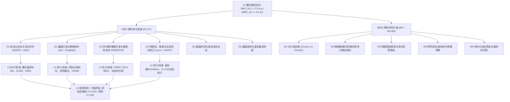

# NXT-1965Ci 套刻指标拆解报告

[仓库首页](../../README.md) · [成果索引](../README.md) · [变更日志](../../changes/2026-11-26-nxt1965ci-overlay-primary-source-report_v1.md)

2026-11-26 · Antigravity（反重力 agent）主笔，Codex 核验与归档。

> [!IMPORTANT]
> **范围**。本报告针对 ASML **TWINSCAN NXT:1965Ci** 浸没式光刻机的套刻（Overlay）指标进行独立拆解、工程预算建模与分层验收设计。全部技术依据仅限原厂公开资料以及用户文献库中的原始论文和专利。凡 `NXT:1965Ci` 原厂未公开的子系统门限、统计口径或配方细节，文中均明确标示为 **`1965Ci 原厂未公开`**；项目工程建议或预算分配均明确标示为 **`OV4 建议`** 或 **`OV4 工程分配`**。其他机型的一手研究仅用作物理机理、测试方法或量级参考，不直接等同于 `NXT:1965Ci` 实测规格。**预算演算闭环仅用于设计分配与风险暴露，不等价于实机验收合格。**

## 目录

- [1. 整机指标与验收条件](#sec-baseline)
- [2. 预算拆解与验收分级](#sec-framework)
- [3. 套刻预算与复算](#sec-budget)
- [4. 运动台定位与双台同步域（D1）验收](#sec-stage-enc)
- [5. 晶圆对准与栅格参考域（D2）验收](#sec-alignment)
- [6. 空间像、掩模对准与掩模热夹持域（D3）验收](#sec-paris-reticle)
- [7. 投影物镜、场内校正与波前验收](#sec-optics)
- [8. 温控、浸没、装夹、参考晶圆与跨机匹配域（D5 / D6 / M1–M5）验收](#sec-thermal-mmo)
- [9. 分级放行与焦面边界](#sec-gate)
- [10. 附录：核心推导与关键量纲换算](#sec-appendix)
- [11. 参考文献与一手来源清单](#sec-references)

---

## 1. 整机指标与验收条件

[返回目录](#contents)

### 1.1 ASML 官方一手规格核验

依据 ASML 官网 `TWINSCAN NXT:1965Ci` 产品页面 [R1]，该机型面向 300 mm 晶圆、20 nm 以下节点及双重/多重曝光量产需求，采用双晶圆台步进扫描浸没式架构。表 1-1 列出原厂已公开的整机指标和待确认的验收条件。

| 分类 | 参数 / 模块 | NXT:1965Ci 官方公开原文口径 | 原厂公开状态 | 证据来源与核对说明 |
| :--- | :--- | :--- | :---: | :--- |
| 光源与波长 | ArFi 曝光光源 | 193 nm，采用 6 kHz ArF 准分子激光器与气体寿命延长技术 | 已公开 | ASML 产品页 [R1] |
| 投影物镜 | 数值孔径与结构 | 最高 NA 1.35 折反式直筒投影物镜，延续 NXT:1960Bi 光学概念 | 已公开 | ASML 产品页 [R1] |
| 曝光视场 | 像场尺寸与倍率 | 26 × 33 mm 全视场，4× 缩小倍率，兼容现有掩模设计 | 已公开 | ASML 产品页 [R1] |
| 分辨率 | 生产分辨率 | ≤ 38 nm（偶极照明），40 nm（C-quad 照明） | 已公开 | ASML 产品页 [R1] |
| 产能 | 标称产率 | ≥ 250 wph（页面未披露具体曝光场数、剂量与步进图） | 已公开（条件未公开） | ASML 产品页 [R1] |
| 照明与波前 | 照明与像差操控 | FlexRay Prepared 照明器；物镜镜片配操纵器校正像差 | 已公开 | ASML 产品页 [R1] |
| 在机像差/掩模量测 | PARIS 传感器 | 配备 Parallel ILIAS（PARIS），沿狭缝并行测像差，支持更准对准、掩模热校正与在线镜头热校正 | 已公开 | ASML 产品页 [R1] |
| 运动台与浸没 | 平面双台与浸没头 | 提升刚度的平面双工件台，提速/提加并加快换台；改进浸没头以适配无顶涂低接触角光刻胶 | 已公开（数值未公开） | ASML 产品页 [R1] |
| **套刻（SMO）** | **单机单卡盘套刻** | **≤ 2.5 nm（single-machine, dedicated chuck, full-wafer coverage）** | **已公开** | **ASML 产品页 [R1]；避免改称双卡盘** |
| **套刻（MMO）** | **跨机匹配套刻** | **≤ 4.5 nm（matched-machine, to reference wafer, full-wafer coverage）** | **已公开** | **ASML 产品页 [R1]** |
| 双卡盘套刻 | 单机非固定卡盘套刻 | 原厂产品页未披露 | **1965Ci 原厂未公开** | 需由项目单独定义签字边界（见 1.2 节） |
| 焦面指标 | Focus Uniformity（FU） | 原厂产品页未披露数值 | **1965Ci 原厂未公开** | 划为独立焦面边界，不计入套刻 RSS（见 1.3 节） |
| 统计与配方 | 统计公式与 ATP 配方 | 未披露采用 $`\vert \mathrm{mean} \vert + 3\sigma`$ 还是 `99.7%`，未披露扫速、狭缝宽、场图、片数、剂量、对准策略 | **1965Ci 原厂未公开** | 需在项目验收协议中以 OV4 建议冻结 |
| 子系统代型 | 扫描速度/狭缝/AA代型/热控选件 | 未披露扫速、狭缝高、SMASH 版本；未确认是否含主动掩模冷却（NXT:1980Di [R5]）或 ORION/WHFF（NXT:2000i [R6]） | **1965Ci 原厂未公开** | 按 2013–2015 代 NXT 架构界定，实机装机核定 |

### 1.2 整机验收怎么签

| 项目 | 工程定义 | 官方公开基准 |
| :--- | :--- | :--- |
| 同机专用卡盘套刻 | 同一台机、同一卡盘，两层图形用全片布局读出。建议两只卡盘各自做专用卡盘试验。 | ≤ 2.5 nm，全晶圆覆盖。 [R1] |
| 参考晶圆匹配 | 在有校准记录的参考晶圆上，测本机曝光图形对参考图形的全片偏差。 | ≤ 4.5 nm，全晶圆覆盖。 [R1] |
| 同机跨卡盘套刻 | 两层交换卡盘，逐方向测卡盘间坐标及场形差。 | OV4 独立验证项，按合同定限。 |
| 两台机交叉套刻 | 第一层和第二层分配到指定的两台机，对此组合直接曝光测量。 | OV4 独立验证项，按合同定限。 |

签字前冻结测点布局、边缘场规则、扫向和步向、两层配方、参考晶圆及量测机、采用的校正项、排除规则和统计量。建议分别报告 X/Y 的有符号均值、3 倍样本标准差和绝对误差分位数。T3 表给出可执行方案。ASML 产品页给出的公开值作为整机对标，完整内部测试规程仍由交付文件确认。

### 1.3 独立交付边界：焦面（Focus）与产品片（T4）

- **焦面（Focus / Leveling）独立边界**：`NXT:1965Ci` 官方页面未披露焦面均匀性（FU）规格。焦面误差（Z、Rx、Ry 跟踪与调平残余）应作为 **独立交付项** 管控，**避免将焦面数值直接代入套刻 RSS 求和**。焦面仅通过两条明确物理路径向套刻传递，并在各自对应域单独入账：
  1. **照明非远心度 × 离焦** 引起图形横向位移（在光学系统域以远心度规格约束 [R8]）；
  2. **阿贝臂（Abbe arm） × 倾斜角误差（Rx、Ry）** 以及 **晶圆翘曲/吸盘不平引起的中性面弯曲应变（IPD）** 引起面内位移（分别在运动台六轴域与晶圆装夹域单独入账 [R14][R20]）。
- **产品片（T4）独立边界**：在真实晶圆厂工艺中，薄膜非均匀应力、刻蚀导致的图形偏移（etch-induced pattern shift）、CMP/刻蚀造成的对准标记不对称（APD）、两层不同掩模写入误差（RWE）与不同 Pellicle 扫描挠曲，均属于工艺/掩模耦合误差 [R4][R6][R17][R23]。整机出厂与装机验收（T1–T3）须采用标准光刻胶/参考晶圆剥离上述工艺变量；若项目扩展至产品片验证，单列为 **T4 联合工艺验证**，不与整机出厂 `2.5 nm / 4.5 nm` 混账。

---

## 2. 预算拆解与验收分级

[返回目录](#contents)

### 2.1 四层指标拆解树与功能域划分

套刻指标按 **物理因果链** 分为四层：**L0 整机目标 → L1 功能域预算 → L2 执行与校准动作 → L3 底层可量化验收项**。为避免遗漏与重复入账，将整机单机套刻链合并为 **6 个互斥物理功能域（D1–D6）+ 1 个未分配工程裕度（D7）**；跨机匹配在单机动态本底（M0）之上叠加 **5 个跨卡盘/跨机专属增量项（M1–M5）+ 1 个跨机裕度（M6）**。

### 2.2 T1 / T2 / T3（及可选 T4）验证层次定义

**验证层次（T 级）与预算拆解层（L 级）正交**：同一个 L3 底层参数或 L2 动作，可能需要在 T1 验清部件本底，再在 T2 验清装机闭环动作，最后由 T3 整机曝光闭环确认。表 2-1 明确各验证层次的测试对象、放行目的与典型误区隔离。

| 验证层次 | 名称 | 验证对象与场所 | 核心放行目的 | 典型边界要求 |
| :---: | :--- | :--- | :--- | :--- |
| **T1** | 独立部件 / 计量链验证 | 离线台架、传感器组件、光学单件、栅格板、掩模离线注册（如 PROVE）、静态/回放信号链 | 确认硬件本底噪声、标尺绝对精度与算法信号链无先天短板 | **ENC 原始带内噪声与按配方曝光窗复算的本底**、**AA 固定信号/回放本底**、栅格板出厂标定、掩模离线注册均在 T1 |
| **T2** | 装机子系统动作 / 联试验证 | 整机装配完成后的机电光热闭环子系统（无光刻胶曝光，或使用机载传感器/独立外部参考仪） | 确认闭环动力学、扫描轨迹、执行器 set-get、在机传感器稳定性与校准闭环达标 | **ENC 闭环台体六自由度在位稳定性与独立参考**、**WS/RS 单程/往返/反向差/停位/双台同步 MA 与 MSD**、**AA 扫过标记实测**、PARIS/TIS 重复性、物镜操纵器 set-get 均在 T2 |
| **T3** | 整机整片曝光验证 | 完整步进扫描浸没曝光（光刻胶单机重曝、双卡盘重曝、参考晶圆曝光、高热负荷批曝、跨日稳定性） | 确认跨子系统耦合后全片像面套刻闭环满足整机合同指标 | 最终证明 `SMO_DC ≤ 2.5 nm`、`MMO_ref ≤ 4.5 nm` 与双卡盘/热态稳定性的唯一权威依据；**T1/T2 与预算演算通过均不能替代 T3** |
| **T4（可选）** | 产品片工艺联合验证 | 实际前道/后道工艺膜层、CMP/刻蚀后变形标记、不同产品掩模与 APC/HO-CPE 闭环 | 确认整机在真实工艺叠层与量产 APC 下的产品套刻（OPO）能力 | 明确划出整机出厂套刻合同之外，用于工艺集成与量产导入 |

### 2.3 误差如何合成

先把各项换算成同一轴、同一晶圆面上的层间套刻量，再决定能否合成。

- 随机散布互不相关时，先平方相加，再开方。同一温漂、参考尺或控制链引起的多个量，应归一次账，或用配对数据估计相关性。
- 一层成像时的位置偏差要和另一层相减。两层条件相同且共享的静态指纹可以抵消。两层独立、大小相同的随机量才乘 √2。
- 已确定方向的残余偏置单列。报告用偏置幅值加随机散布的方式复算项目预算。公式和假设见附录。
- 掩模面的 X、Y 位移先按实际坐标正负转换，再除以 4。掩模面的角度和 Z 用实机光学灵敏度换算。同步 MA 是两台折到同一像面后的相对误差在曝光窗口内的平均。MSD 是同一窗口内的波动，反映对成像的影响。
- 单机对参考晶圆匹配与两台独立机交叉曝光分开验收。共用参考片时，只有两台以相同方式继承的误差才可能抵消。 [R1][R2][R11][R12][R14]

---

## 3. 套刻预算与复算

[返回目录](#contents)

### 3.1 预算分域的一手依据

Castenmiller 等在 NXT:1950i 的专用卡盘试验中，把套刻误差分为运动台定位、光学柱、晶圆和掩模对准、晶圆加热与浸没、晶圆装夹、掩模夹持与加热六类。本文用这六类检查误差链是否完整，并按 1965Ci 项目的验证动作归口。该图用堆叠色块画出预算构成，未交代每个色块的精确统计定义。下表数值为本项目工程分配。 [Castenmiller 等，2010，`2、图 3](https://doi.org/10.1117/12.847025)

### 3.2 情景 A：单机单卡盘全片套刻（SMO_DC ≤ 2.50 nm）闭环预算（OV4 工程分配）

根据上述物理域与 `NXT:1965Ci` 配备 PARIS 传感器、高刚度平面双台、物镜操纵器与改进浸没头的已公开配置，建立一套 **可手算复核的 OV4 工程分配方案**（用于项目规定的参考片重曝情景、全片覆盖、固定单卡盘、X/Y 分别校验）。

- **残余固定系统偏差（线性项）**：$`\vert \mu_{\mathrm{SMO,sys}} \vert = 0.25\ \mathrm{nm}`$（涵盖在线校准后未完全清零的均值偏置、正反扫向均值残余与热态瞬态均值偏置）。
- **随机与空间残余总上限（RSS 项）**：$`3\sigma_{\mathrm{SMO,rand}} \le 2.50 - 0.25 = 2.25\ \mathrm{nm}`$（允许总方差 $`5.0625\ \mathrm{nm}^{2}`$）。

表 3-2 列出全部 7 个一级域（D1–D7）与 17 个二级子项（均已统一折算为 **像面 1×、双层层间套刻 $3\sigma$ 贡献**），逐项标明物理传递路径、生效条件、依据类型与方差贡献：

| 域 / 编号 | 预算项名称 | 物理传递至套刻的路径 | 生效条件 / 适用范围 | 双层 1× 分配（nm） | 分量平方（nm²） | 占比（%） | 依据类型与原始参考 |
| :---: | :--- | :--- | :--- | :---: | :---: | :---: | :--- |
| **D1** | **运动台定位与双台同步域（小计）** | 编码器噪声与双台轨迹跟踪残余直接转化为像面平移/畸变 | 曝光扫描恒速窗内，正反扫向全片 | **0.90** | **0.8104** | **16.1%** | **OV4 工程分配（下分 3 项 RSS）** |
| D1.1 | ENC 曝光窗复算噪声本底 | 读数头短光程空气/电子噪声经狭缝 MA 滤波与双层叠加 | T1 复算→两层独立 $\times\sqrt{2}$ | 0.30 | 0.0900 | 1.8% | 相邻机型依据：NXT:1950i 1 kHz 原始 0.22 nm 3σ [R2 Fig. 4] |
| D1.2 | WS-RS 同步曝光窗 MA 残余 | 掩模台/4 与晶圆台同步跟踪误差的狭缝滑动平均 MA 直接偏置像位 | T2 曝光扫描窗，全片各场 | 0.70 | 0.4900 | 9.8% | 相邻机型依据：NXT:1950i 单程 MA 0.47/0.49 nm [R2 Fig. 10] × $\sqrt{2}$ |
| D1.3 | 扫向往返/反向差与整定残余 | 加减速惯性/柔性模态滞后与正反扫向（SUSD/SLSR）未抵消差 | 交替扫向步进扫描，步进整定后 | 0.48 | 0.2304 | 4.6% | 机理依据：SUSD/SLSR 机理 [R14][R22]；限值为 OV4 分配 |
| **D2** | **晶圆对准与栅格参考域（小计）** | 晶圆对准读数噪声、栅格板漂移与网格拟合误差扭曲曝光网格 | 测量侧 AA→换台→曝光侧全片 | **1.00** | **0.9950** | **19.8%** | **OV4 工程分配（下分 3 项 RSS）** |
| D2.1 | AA 四色单/多点对准重复性 | 扫描测位噪声与信号对比度波动直接引起晶圆网格定位偏差 | 标准蚀刻/显影标记，常规采样数 | 0.70 | 0.4900 | 9.8% | 相邻机型依据：NXT:1950i 实测对准贡献约 0.5 nm [R2 Sec. 6.1] |
| D2.2 | Gridplate 短期漂移与 EMSI 一致性 | 20 s 单片周期内读数头热漂移、零位恢复与四头一致性残余 | 测量侧→曝光侧连续编码器接管 | 0.45 | 0.2025 | 4.0% | 相邻机型依据：NXT 栅格周漂 < 0.2 nm [R7 Fig. 11] + EMSI 残余 [R2] |
| D2.3 | HOWA 网格拟合与采样残余 | 有限标记分布对高阶网格插值/外推（尤其晶圆边缘）的拟合误差 | 全片边缘场覆盖 | 0.55 | 0.3025 | 6.0% | 机理依据：HOWA 拟合/方向采样 [R22]；限值为 OV4 分配 |
| **D3** | **空间像/掩模对准与掩模热夹持域（小计）** | 掩模对准重复性、热胀桶形残余与夹持/Pellicle 波动引入场内位移 | 批内连续曝光，同掩模双层重曝 | **0.95** | **0.9014** | **17.9%** | **OV4 工程分配（下分 3 项 RSS）** |
| D3.1 | PARIS 掩模对准重复性 | 每轮掩模对准的重复偏差改变曝光图形的位置。点数与模型以本机配方为准 | 产品页披露 PARIS | 0.55 | 0.3025 | 6.0% | 相邻机型依据：PARIS 重复性 < 0.5 nm 3σ [R3 Sec. 3.4]；10 片均化 0.43 nm [R4] |
| D3.2 | 掩模热形变经 PARIS+操纵器补偿残余 | 吸收曝光能量引起掩模片内温升漂移（IWD）与气隙空气折射率扰动 | 标准 ATP 剂量与常规掩模透射率 | 0.65 | 0.4225 | 8.4% | 机理依据：无主动风冷下片内漂移与气隙扰动 [R3 Fig. 5][R16]（重热负荷见情景 C） |
| D3.3 | 掩模真空夹持与 Pellicle 扫描重复性 | 掩模微滑移、夹持力波动与同型 Pellicle 扫描挠曲重复性差 | 同掩模/同扫速下静共模抵消，仅留重复性 | 0.42 | 0.1764 | 3.5% | 机理依据：掩模微滑移 [R24] 与 Pellicle 扫描挠曲 [R17]；限值为 OV4 分配 |
| **D4** | **投影物镜柱、像差与场内校正域（小计）** | 物镜振动、热像差（奇阶 Zernike）与操纵器执行误差引入像面场内位移 | 1.35 NA 折反物镜 + 操纵器 + PARIS 闭环 | **0.75** | **0.5661** | **11.3%** | **OV4 工程分配（下分 3 项 RSS）** |
| D4.1 | 物镜振动残余 | 地面/台体反作用力与声学激励引起镜片相对位移 | 按实机隔振配置和负载试验 | 0.35 | 0.1225 | 2.4% | 机理依据：Airmount/PALM 振动隔离 [R13 Sec. IV] 与静音 RS [R7 Fig. 8] |
| D4.2 | 物镜热像差残余 | 透镜吸收光能激发奇阶彗差/三叶草等，经 PARIS 反馈调控后残余 | 常规 ATP 照明（重偶极热负荷见情景 C） | 0.50 | 0.2500 | 5.0% | 机理依据：PARIS 逐片闭环 + FlexWave/操纵器 [R3 Fig. 7][R8][R9] |
| D4.3 | 动态场内校正（iHOPC/操纵器）执行残余 | 按本机启用的校正模式量测命令与实际变形的差、滞回及同步残余 | 启用场内校正与动态扫描补偿时 | 0.44 | 0.1936 | 3.9% | 机理依据：动态扫描-物镜耦合校正 [R10 Table 1][R15]；限值为 OV4 分配 |
| **D5** | **晶圆热控与浸没流体扰动域（小计）** | 浸没蒸发降温、曝光吸热与液流压力场造成晶圆局部热胀与终端镜微变形 | 浸没头湿区全片扫描（含边缘） | **0.85** | **0.7150** | **14.2%** | **OV4 工程分配（下分 3 项 RSS）** |
| D5.1 | 浸没蒸发冷却与晶圆台热稳定残余 | 边缘 BES/WES 蒸发吸热与晶圆台加热区控制波动引发片间/边缘网格漂移 | 湿区全片边缘，经 CTC/热控稳定后 | 0.65 | 0.4225 | 8.4% | 相邻机型依据：批内浸没指纹变化 0.2–0.8 nm [R18][R21] |
| D5.2 | 曝光光吸收导致的片内晶圆热膨胀残余 | 扫描路径上局部曝光能量累积引发晶圆热膨胀形变 | 标准 ATP 剂量（高剂量差见情景 C） | 0.45 | 0.2025 | 4.0% | 机理依据：晶圆曝光热形变机制 [R6 Slide 13]；限值为 OV4 分配 |
| D5.3 | 浸没液流压力/折射率与终端镜微变形 | 液体更新剪切/压力梯度导致终端镜片微畸变与浸液折射率波动 | 高速恒定扫描浸液更新态 | 0.30 | 0.0900 | 1.8% | 机理依据：浸液更新压力致镜片微畸变 [R26]；限值为 OV4 分配 |
| **D6** | **晶圆装夹与套刻量测本底域（小计）** | 晶圆吸盘（Burl）微滑移/颗粒重复性及离线套刻机测量噪声进入读数 | 同一卡盘二次装夹 + 离线量测 | **0.65** | **0.4264** | **8.5%** | **OV4 工程分配（下分 2 项 RSS）** |
| D6.1 | 晶圆吸盘装夹重复性与微滑移残余 | 二次上片摩擦滞后、局部真空差异引起的不可重复面内微变形 | 标准低翘曲测试硅片（高翘曲属 T4） | 0.50 | 0.2500 | 5.0% | 机理依据：装夹面内形变与滑移 [R20][R27]；份额参照 [R2 Fig. 3] |
| D6.2 | 离线套刻量测工具重复性与采样噪声 | 验收用散射仪/成像套刻仪自身重复性（TMU）叠加进 T3 实测值 | T3 验收数据（若扣减需单列协议） | 0.42 | 0.1764 | 3.5% | 工程依据：量测匹配与噪声控制 [R15 Sec. 2]；限值为 OV4 分配 |
| **D7** | **工程裕度与未分配耦合残余** | 吸收跨子系统弱相关性、器件老化与未建模高频残余 | 整机系统级设计预留 | **0.78** | **0.6084** | **12.1%** | **OV4 工程预留** |
| **合成校验** | **随机/空间残余 RSS（D1–D7）** | **子项直接 RSS = 2.241 nm；按域圆整 RSS = 2.242 nm** | **不含 D7 标称 RSS = 2.101 nm** | **2.24** | **5.0227** | **100.0%** | **算术闭合** |
| **固定项** | **残余系统固定偏差（线性项）** | 均值漂移、扫向未清零偏置、热态系统均值残余 | 线性叠加于 RSS 之上 | **0.25** | — | — | 按 [R12] 式 (1) 线性叠加 |
| **L0 闭环** | **SMO_DC 整机估算总计** | $`\vert \mu_{\mathrm{SMO,sys}} \vert + 3\sigma_{\mathrm{SMO,rand}} = 0.25 + 2.24 = 2.49\ \mathrm{nm}`$ | **目标 ≤ 2.50 nm（不含裕度 2.35 nm）** | **2.49** | — | — | **满足 ≤ 2.50 nm 官方基线（OV4 分配示例）** |

**手算复核验证**：
- 子项方差之和：$`0.0900 + 0.4900 + 0.2304 + 0.4900 + 0.2025 + 0.3025 + 0.3025 + 0.4225 + 0.1764 + 0.1225 + 0.2500 + 0.1936 + 0.4225 + 0.2025 + 0.0900 + 0.2500 + 0.1764 + 0.6084 = 5.0227\ \mathrm{nm}^{2}`$；开方得 `2.2411 nm`，加固定偏差 `0.25 nm` 得 **`2.491 nm ≤ 2.50 nm`**。
- 去掉 D7 工程裕度（`0.6084 nm²`）后，D1–D6 标称随机方差为 `4.4143 nm²`，开方得 **`2.101 nm`**，加固定偏差 `0.25 nm` 得 `2.351 nm`。

**分项计入规则。** D1.1 的 ENC 等效本底与 D1.2 的同步动态分量按不重叠口径分配。若直接使用装机测得的完整同步残余，应将可归因于该测量链的贡献并入这一个实测项，并重算 D1。不能把原始 ENC 带内量、曝光窗复算量和闭环遥测当三项加入。D2.1 只计单标记测位噪声向网格的传播，D2.3 计在此之外的模型与稀疏采样残余。波前热漂与校正执行误差、装机及外部量测的共因按同样方法归并。在没有配对数据可以区分时，以联合见证结果核算。

### 3.3 情景 B：对参考晶圆跨机匹配套刻（MMO_ref ≤ 4.50 nm）闭环预算（OV4 工程分配）

在对参考晶圆的全片匹配试验中，单机静态网格与静态畸变不再自抵消，需在单机动态本底（M0）之外显式纳入双卡盘差、对参考晶圆静态网格残余、物镜静态畸变残余、周期漂移及参考片/量测匹配误差。

- **跨机残余固定系统偏差（线性项）**：$`\vert \mu_{\mathrm{MMO,sys}} \vert = 0.50\ \mathrm{nm}`$（涵盖跨机 BMMO 校准后残余均值漂移与跨卡盘未清零均值偏置）。
- **随机与空间残余总上限（RSS 项）**：$`3\sigma_{\mathrm{MMO,rand}} \le 4.50 - 0.50 = 4.00\ \mathrm{nm}`$（允许总方差 $`16.0000\ \mathrm{nm}^{2}`$）。

| 编号 | MMO 预算项 | 物理机制与不抵消原因 | 生效条件 | 1× 分配（nm） | 分量平方（nm²） | 占比（%） | 依据类型与原始参考 |
| :---: | :--- | :--- | :--- | :---: | :---: | :---: | :--- |
| **M0** | 单机动态与重复性本底 | 承接以情景 A 的 D1–D6 作为工程估算本底。实机应按参考晶圆协议重测本项 | 曝光、对准、热、装夹动态重复性 | **2.10** | **4.4100** | **27.7%** | 由情景 A 标称项传递（未圆整参考值 2.101 nm） |
| **M1** | 双卡盘间差残余（Chuck 1 vs 2） | 两卡盘编码器标定差、晶圆台几何差、双卡盘 LOCO/PARIS 基准差 | 签字协议包含两卡盘时 | **1.10** | **1.2100** | **7.6%** | 机理依据：双卡盘 LOCO 偏置 [R15 Fig. 9] 与 DCO/SMO 差 [R19] |
| **M2** | 晶圆网格对参考片静态残余 | 栅格板绝对非线性、量测侧与曝光侧网格差经 BMMO 多位移标定后残余 | 全片含边缘场，场图无关标定 | **2.10** | **4.4100** | **27.7%** | 相邻机型依据：NXT:1950i 校准后栅格贡献约 2 nm [R2 Sec. 6.1] |
| **M3** | 投影物镜静态畸变与场内匹配残余 | 静态镜头畸变与高阶像差经操纵器/iHOPC 匹配至标准场后的残余 | 26 × 33 mm 全视场 | **1.60** | **2.5600** | **16.1%** | 相邻机型依据：浸没机校准后静态场内畸变残余 1.2–1.6 nm [R10 Fig. 8] |
| **M4** | 跨机热态/装夹基准差与周期漂移 | 晶圆台平坦度差异、吸盘热指纹差异及 BMMO 标定周期（数日至数周）漂移 | 无中间重校连续运行周期 | **1.15** | **1.3225** | **8.3%** | 相邻机型依据：跨日稳定性与 50 天带宽 [R2 Fig. 13][R28 Fig. 9] |
| **M5** | 参考晶圆标定残余与量测机匹配 | 蚀刻参考晶圆自身校正文件（WEC）残余与跨散射仪/套刻仪匹配差 | 标准参考晶圆与认证量测机 | **0.95** | **0.9025** | **5.7%** | 机理依据：参考晶圆校正文件 [R5 Sec. 2.3] 与量测机匹配 [R15 Fig. 11] |
| **M6** | MMO 工程裕度与未分配跨机残余 | 吸收跨机弱相关耦合与长期器件老化预留 | 整机匹配系统级预留 | **1.05** | **1.1025** | **6.9%** | **OV4 工程预留** |
| **合成校验** | **MMO 空间与随机 RSS（M0–M6）** | **平方和 = 15.9175 nm²，开方 = 3.990 nm** | **不含 M6 的 RSS = 3.849 nm** | **3.99** | **15.9175** | **100.0%** | **算术闭合** |
| **固定项** | **跨机残余系统固定偏差（线性项）** | 跨机/跨卡盘均值未清零残余 | 线性叠加于 RSS 之上 | **0.50** | — | — | 按 [R12] 式 (1) 线性叠加 |
| **L0 闭环** | **MMO_ref 整机估算总计** | $`\vert \mu_{\mathrm{MMO,sys}} \vert + 3\sigma_{\mathrm{MMO,rand}} = 0.50 + 3.99 = 4.49\ \mathrm{nm}`$ | **目标 ≤ 4.50 nm（不含裕度 4.35 nm）** | **4.49** | — | — | **满足 ≤ 4.50 nm 官方基线（OV4 分配示例）** |

**两个衍生闭环口径（OV4 建议，原厂未公开）**：
1. **单机双卡盘套刻（SMO_dual）**：在情景 A（`5.0227 nm²`）基础上叠加 M1 双卡盘间差方差（`1.2100 nm²`）并增加 `0.10 nm` 卡盘均值偏置（$`\vert \mu \vert = 0.35\ \mathrm{nm}`$），得：
   - 含裕度估算：$`0.35 + \sqrt{5.0227 + 1.2100} = 0.35 + 2.497 = 2.85\ \mathrm{nm}`$（不含 D7 裕度为 `2.72 nm`）。
   - 据此 **OV4 建议** 将双卡盘单机套刻项目签字门槛定为 **≤ 3.00 nm**，独立于官方单卡盘 `≤ 2.50 nm`。
2. **两台独立机台间交叉套刻（Tool-to-Tool MMO，`M1→M2`）**：若两台 `NXT:1965Ci` 均各自标定至同一参考晶圆且达到上述标称水平（单台 `MMO_ref ≈ 4.35 nm`），则交叉曝光时，两台共享的参考晶圆误差 `M5` 抵消（$`\rho = +1`$），两层动态重复性本身已体现在 `M0` 中，而两台各自独立的静态与漂移残余（M1–M4）方差翻倍，得无特定场图协同优化下的标称随机/空间项 $`\sqrt{2.10^{2} + 2 \times (1.10^{2} + 2.10^{2} + 1.60^{2} + 1.15^{2})} = 4.84\ \mathrm{nm}`$（加 `0.50 nm` 残余均值约 `5.34 nm`）。因此，若工厂要求机台群交叉 MMO 亦逼近 `≤ 4.5 nm`，必须引入参考晶圆统一基线校验或场图相关高阶匹配（见文献 [R10 Fig. 9–10]）。

### 3.4 压力配方单独见证

量产配方的掩模透射率、剂量、照明和热态会改变套刻。先用标准参考片得到可比的全片结果，再用压力配方测冷态首片、稳态和最差片。分别记录掩模热、物镜热、晶圆热和浸没扰动的响应。掩模薄膜是否一致、两层扫速和方向也应冻结。 [R3][R6][R9][R16][R17][R18]

### 3.5 怎样给实机子项定限

1. 冻结样片、配方、温度、载荷、传感器版本、校正状态和统计量，按同一条件重复采集。对照留出场点和独立参考。
2. 实测子项每变化一个单位，曝光点会移动多少。把测试结果折算到所属域的晶圆面开支。源项会共同变化时，同时记录并做配对试验。
3. 用测试重复性和测量不确定度确认是否能分辨预算所需的变化。结合设计预算、配方最差条件和整机复测冻结工程门限。出现超差时保留调整前后数据，重新核算对应的系统预算。
4. 运动控制负责台体和编码器，计量与对准负责标记、空间像及参考片，光学负责物镜，热流体与机构负责温度、浸没和夹持。系统集成负责预算交接和实曝验证。

---

## 4. 运动台定位与双台同步域（D1）验收

[返回目录](#contents)

### 4.1 编码器本底与台体在位试验

公开的 NXT:1950i 采用短固定光程（`< 15 mm`）二维衍射光栅编码器替代传统长变光程激光干涉仪：四个编码器读数头装于晶圆卡盘四角（切向布置，各测面内平移 + 垂向 Z 间隙两自由度），面向安装在隔振量测框架（Metroframe）上的零膨胀栅格板（Gridplate）[R2][R7][R30]。在验收中必须严格隔离两个物理与验证层次：

1. **T1 部件与计量链**：在锁定/静置或独立基准台架条件下，测量 **编码器原始带内噪声**（例如相邻机型 NXT:1950i 在 1000 Hz 滤波带宽下实测 X 向 `0.22 nm 3σ`，对比 XT 干涉仪 40 Hz 下 `0.9 nm 3σ` [R2 Fig. 4]），并 **按目标曝光配方狭缝驻留时间** $`\tau_{\mathrm{slit}} = L_{\mathrm{slit}} / v_{\mathrm{scan}}`$ 离线施加滑动平均（MA）窗函数复算 **曝光窗等效噪声本底** [R31]（见附录 10.1 节）。该项仅考核传感链本底，**不反映台体伺服与机械结构扰动**。
2. **T2 台体闭环**：将编码器接入晶圆台六自由度（6-DOF）闭环伺服后，考核在机台隔振/空调/水冷运行状态下的 **六轴在位稳定性**（含伺服环带宽内抑振与环外共振），并 **必须引入独立于 ENC 的外部参考传感器**（如有可溯源不确定度的外置干涉计量，参照 Nikon S620D 混合计量比对思路 [R32]），交叉核验同传感器遥测可能低估的闭环偏移。

### 4.2 单程、往返与同步曝光

单靠静态停位误差或机载伺服自检不足以代表曝光扫描套刻。按不同物理动作分别试验 [R13][R14][R22]：

- **单程恒速扫描（Single-Pass）**：沿单一方向（仅 Scan-Up 或仅 Scan-Down）恒速扫过全视场，考核恒速段动力学跟踪误差。
- **同周期往返扫描（Same-Period Round-Trip）**：在相同时间窗口与相同热态下连续交替执行正向与反向扫描，考核滞回、齿槽力与加速度耦合的往返一致性。
- **正反扫向差与步进方向差（SUSD / SLSR）**：提取 同坐标的正反扫向和左右步向均值差。若用半差提取方向指纹，单独标注为半差，防止交替扫描引入系统性偏置或经稀疏对准混叠进高阶网格 [R17][R22]。
- **运动闭合（Loop Closure）**：晶圆台遍历全片指定路径并返回起始坐标（及测量侧→换台→曝光侧→回测量侧），考核连续编码器接管、EMSI 四头一致性与累计漂移 [R2 Sec. 3.2]。
- **步进整定与停位（Settling & Stop Position）**：步进加减速结束后经数毫秒整定进入恒速曝光窗起点，考核超调、阻尼衰减与柔性模态残振 [R13][R14 Fig. 16]。
- **双台同步曝光窗 MA 与 MSD**：在曝光有效窗口内，计算 $`e_{\mathrm{sync}}(t) = x_{\mathrm{WS}}(t) - x_{\mathrm{RS}}(t)/4`$ 的滑动平均 **MA**（决定像面中心位移即 **套刻**）与滑动标准差 **MSD**（决定像面模糊与 **CDU 对比度**，不直接等同套刻但须同步控限）[R14][R31]。

> [!NOTE]
> **局部放宽**。若个别非典型工况（如极端边缘短行程或非关键低速配方）申请放宽某项 T2 子门限，**避免预先设定固定放宽比例或放宽量**；必须以 **同口径配对实测数据**（相同配方、相同统计量、前后对比配对 T2 与 T3 全片实曝数据）证明其向 L0 整机套刻传递后的净增量仍完全被对应域预算吸收，并经系统集成团队书面评审后方可特批。

| 指标短名 | 验收级别和工况 | 怎样判定 |
| :--- | :--- | :--- |
| 台体停位偏差 | T2。按规定方向到点后等到整定 | 在独立参考下测停稳均值与指令的差，逐轴报告。 |
| 台体在位波动 | T2。固定指令及驻留时窗 | 将同窗内围绕均值的散布和跨窗漂移分别报告。 |
| 单程跟随偏差 | T2。每次同向通过同一路段 | 在共同空间点比较参考位姿与指令。记录均值和最差场点。 |
| 单程重复性 | T2。扩展到多次完整同向扫描 | 在各共同空间点算跨次散布。正向和反向分别统计。 |
| 往返方向差 | T2。同周期 A→B→A，正反都采样 | 比较共同空间点的两组均值。报告补偿前后及方向符号。 |
| 返回闭合差 | T2。规定往返次数或全片路径 | 在同一参考点测完成前后的位姿差。夹持滑移另测工件对台体的相对位移。 |
| 同步 MA | T2。两台联机曝光窗 | 对齐两台时钟、坐标和倍率，计算晶圆面相对误差的剂量加权平均。 |
| 同步 MSD | T2。与 MA 使用同一窗 | 统计相对误差围绕窗口平均值的波动，按成像准则单列判定。 |

### 4.3 ENC 与 Gridplate 底层验收项（T1 / T2）

表 4-1 按部件本底与装机闭环拆行，明确区分 T1 与 T2 验收内容。

| 编号 | 指标短名 | T 级 | 现场工程含义（测哪里、测什么、什么条件） | 采集与判定方法 | 单位与统计 | 目标 / 待定与来源 |
| :---: | :--- | :---: | :--- | :--- | :--- | :--- |
| ENC-01 | 编码器原始带内噪声 | T1 | 静止台架与正常吹扫下，测单读数头面内 X/Y 及垂向 Z 原始输出噪声 | 采样 ≥ 5–10 kHz，带通 0.5–1000 Hz 采集 ≥ 10 s，逐头评定 | nm（3σ） | 待实机定限（OV4 初值 ≤ 0.22 nm @ 1 kHz；参照 NXT:1950i [R2 Fig. 4]） |
| ENC-02 | 曝光窗复算噪声本底 | T1 | 用 ENC-01 原始时序按冻结配方狭缝窗 $`\tau_{\mathrm{slit}}`$ 离线做 MA 滤波，求像面等效噪声本底 | 离线滑动平均卷积，分别按低/高扫速两档复算并折算双层 $`\times\sqrt{2}`$ | nm（3σ） | 待实机定限（OV4 预算约束双层 ≤ 0.30 nm；方法依据 [R31]） |
| ENC-03 | 编码器插值非线性（SDE） | T1 | 在栅格单周期内以低速恒速扫描，测光电细分周期性误差 | 独立干涉仪比对或频谱提取栅格节距谐波幅值 | nm（PV / 3σ） | 1965Ci 原厂未公开；OV4 定限：单次周期谐波折算 MA 后 ≤ 0.15 nm |
| ENC-04 | 栅格板出厂面形与栅距标定 | T1 | 离线标定零膨胀栅格板 `< 15 mm` 高频栅距误差及绝对坐标误差表 | 供方出厂干涉/坐标机标定报告复核 + 上机加载校验 | nm（3σ / 残余） | 1965Ci 原厂未公开；高空间频标定边界依据 [R10 Sec. 4.2] |
| ENC-05 | 栅格板环控温度稳定性 | T2 | 整机运行时测栅格板周边恒温气流温度波动 | 布置高分辨测温探头连续监控 ≥ 24 h（对应长热时间常数） | mK（PV / 3σ） | 待实机定限（参照 NXT:1950i 栅格板周边控温 10 mK [R2 Sec. 3.2]） |
| ENC-06 | 栅格板中长期零漂稳定性 | T2 | 同一标准测试片留机每 12 h 重复读数，测 7 天栅格相对漂移 | 扣除均值指纹后统计 7 天 X/Y 全片位置漂移 | nm（3σ） | 待实机定限（OV4 初值 ≤ 0.25 nm / 7 天；参照 NXT 原型 < 0.2 nm [R7 Fig. 11]） |
| ENC-07 | 四头一致性（EMSI）与换台接管 | T2 | 在四头重叠区测第 4 读数头相对三头解算的一致性残余 $`\Delta s`$ 及换台零位恢复 | 连续执行 30 次测量↔曝光换台循环，记录 $`\Delta s`$ 与接管跳变 | nm（3σ / Max） | 待实机定限（OV4 预算约束 D2.2 合计 ≤ 0.45 nm；机理依据 [R2 Fig. 6–7]） |
| ENC-08 | 闭环在位稳定性（独立参考比对） | T2 | 晶圆台 ENC 闭环悬停于典型曝光/对准位，用独立外置干涉仪同步监测真实漂移 | 外置干涉仪与机载 ENC 同步采样 ≥ 60 s，比对差值时序 | nm（3σ） | 待实机定限（OV4 建议外置参考与 ENC 差值 ≤ 0.25 nm 3σ；思路依据 [R32]） |

### 4.4 晶圆台（WS）与掩模台（RS）六轴逐轴验收表（T2）

遵循逐明细拆行规范，将 **晶圆台（WS）单台**、**掩模台（RS）单台（原生 4× 与折算像面 1×）** 及 **WS–RS 双台同步曝光窗** 的 **6 个自由度（X、Y、Z、Rx、Ry、Rz）** 全部逐轴拆行。其中，Z、Rx、Ry 的焦面主指标归入独立焦面边界。本表列出其 **经阿贝臂或光学倍率耦合至套刻的传递关系与闭环控限**。

#### 表 4-2 晶圆台（WS）六自由度在位与扫描运动验收明细（T2）

| 轴向 | T 级 | 现场工程含义（在什么条件下测哪里的什么） | 涵盖运动工况 | 采集与判定方法 | 单位与统计 | 目标 / 待定与来源（均为 1965Ci 未公开子项，列 OV4 初值与依据） |
| :---: | :---: | :--- | :--- | :--- | :--- | :--- |
| **WS-X** | T2 | 非扫描步进轴：在曝光/对准位及恒速扫描窗内测卡盘相对量测框 X 向位置误差 | 在位稳态、单程、往返、SLSR、闭合、停位 | 同步记录遥测和独立 X 测线。扫描段另算 MA/MSD，静止段报均值和散布 | nm（MA / MSD / 3σ） | 待实机定限；OV4 初值：在位 ≤ 0.25 nm，单台扫描 MA ≤ 0.40 nm，SLSR ≤ 0.25 nm，闭合 ≤ 0.30 nm [R2][R13][R14] |
| **WS-Y** | T2 | 主扫描轴：在全片恒速扫描曝光窗内测卡盘 Y 向跟踪误差与正反扫向差 | 在位稳态、单程、同周期往返、SUSD、闭合、整定 | 同步记录遥测和独立 Y 测线。同坐标提取正反差、MA/MSD | nm（MA / MSD / 3σ） | 待实机定限；OV4 初值：在位 ≤ 0.25 nm，单台扫描 MA ≤ 0.45 nm，SUSD ≤ 0.25 nm，整定时间达配方要求 [R2][R14] |
| **WS-Z** | T2 | 垂向调平轴：扫描中测卡盘 Z 跟踪误差，按焦面验收。其对套刻的影响按实机非远心灵敏度核验 | 在位稳态、扫描调平跟踪 | 同步记录垂向参考、ENC 与调平日志。扫描段统计窗口均值及波动 | nm（MAz / MSDz） | 焦面独立边界；参考相邻机型改进台 MAz 集中于 3–6 nm [R3 Fig. 9]；乘远心度后折算套刻应 ≤ 0.10 nm |
| **WS-Rx** | T2 | 绕 X 轴俯仰角：扫描加速与调平中测卡盘 Rx 误差（经垂向阿贝臂 $`h_{\mathrm{Abbe}}`$ 耦合至 Y 套刻） | 在位稳态、扫描跟踪、SUSD 俯仰差 | 用独立角度参考交叉核验 ENC 解算 Rx。结合阿贝臂核对 $`\Delta y = h_{\mathrm{Abbe}} \cdot \mathrm{Rx}`$ | μrad（MA / 3σ） | 待实机定限；OV4 建议按实测阿贝臂反推使耦合 $`\Delta y \le 0.15\ \mathrm{nm}`$（耦合机理见 [R14 Sec. Vertical Gain Scheduling]） |
| **WS-Ry** | T2 | 绕 Y 轴滚转角：步进与调平中测卡盘 Ry 误差（经垂向阿贝臂 $`h_{\mathrm{Abbe}}`$ 耦合至 X 套刻） | 在位稳态、步进整定、扫描跟踪 | 用独立角度参考交叉核验 ENC 解算 Ry。结合阿贝臂核对 $`\Delta x = h_{\mathrm{Abbe}} \cdot \mathrm{Ry}`$ | μrad（MA / 3σ） | 待实机定限；OV4 建议按实测阿贝臂反推使耦合 $`\Delta x \le 0.15\ \mathrm{nm}`$（耦合机理见 [R14]） |
| **WS-Rz** | T2 | 绕 Z 轴偏航角：扫描中测卡盘 Rz 误差（在视场半长 16.5 mm 处直接放大为 X/Y 套刻） | 在位稳态、单程、往返、SUSD 旋转差 | 用独立角度参考交叉核验 ENC 解算 Rz，折算场边缘 $`\Delta x_{\mathrm{edge}} = 16.5\ \mathrm{mm} \times \mathrm{Rz}`$ | μrad（MA / 3σ） | 待实机定限；OV4 初值：曝光窗 MA-Rz ≤ 0.012 μrad（对应 16.5 mm 场边缘 ≤ 0.20 nm） |

#### 表 4-3 掩模台（RS）六自由度单台验收明细（T2，区分掩模原生 4× 与折算像面 1×）

| 轴向 | T 级 | 现场工程含义（在什么条件下测哪里的什么） | 采集与判定方法 | 掩模原生 4× 单位 | 像面 1× 折算关系 | 目标 / 待定与来源（1965Ci 原厂未公开，列 OV4 初值） |
| :---: | :---: | :--- | :--- | :--- | :--- | :--- |
| **RS-X** | T2 | 非扫描横向轴：在恒速扫描窗与往返工况下测掩模台 X 向跟踪误差 | 机载 RS 编码器/干涉仪日志计算 MA/MSD | nm（4×） | `÷ 4` | 待实机定限；OV4 初值：单台 MA ≤ 1.6 nm（4×），折算像面 ≤ 0.40 nm（1×） |
| **RS-Y** | T2 | 主扫描轴：以 4× 晶圆扫速与高加速度往返扫描，测掩模台 Y 向跟踪与 SUSD 差 | 均衡 SU/SD 采集恒速窗 MA/MSD 与往返差 | nm（4×） | `÷ 4` | 待实机定限；OV4 初值：单台 MA ≤ 2.0 nm（4×），折算像面 ≤ 0.50 nm（1×）；需查反作用力与声学激励 [R7 Fig. 8] |
| **RS-Z** | T2 | 垂向焦点轴：扫描中测掩模台 Z 位置误差，按本机实测轴向灵敏度评估焦面影响 | 机载 RS-Z 传感器扫描日志 | nm（4×） | 按轴向灵敏度换算 | 单列焦面门限。焦面变化引起的像位偏差通过试验单独核定 |
| **RS-Rx** | T2 | 绕 X 轴俯仰角：高加速度启停与扫描中测掩模台 Rx（引起像面扫描向焦面倾斜与微倍率） | 机载多点 Z 传感器解算 Rx | μrad（4×） | 焦面斜率耦合 | 待实机定限；主控焦面斜率与阿贝耦合至 RS-Y ≤ 0.15 nm（1×） |
| **RS-Ry** | T2 | 绕 Y 轴滚转角：扫描中测掩模台 Ry（引起像面狭缝向焦面倾斜与阿贝耦合至 RS-X） | 机载多点 Z 传感器解算 Ry | μrad（4×） | 焦面斜率耦合 | 待实机定限；主控狭缝焦面斜率与阿贝耦合至 RS-X ≤ 0.15 nm（1×） |
| **RS-Rz** | T2 | 绕 Z 轴偏航角：扫描中测掩模台 Rz（直接等角传递为像面场内旋转，半视场 16.5 mm 放大） | 机载水平传感器解算 Rz，折算像面边缘位移 | μrad（1:1 角传递） | `16.5 mm × Rz` | 待实机定限；OV4 初值：单台 MA-Rz ≤ 0.012 μrad（对应像面半视场边缘 ≤ 0.20 nm） |

#### 表 4-4 WS–RS 双台同步曝光窗（MA / MSD）六轴逐轴验收明细（T2）

| 同步轴 | T 级 | 现场工程含义（定义均折算至像面 1×） | 采集与判定方法 | 单位与统计 | 目标 / 待定与来源 |
| :---: | :---: | :--- | :--- | :--- | :--- |
| **Sync-X** | T2 | 恒速曝光窗内同步误差 $`e_{x} = x_{\mathrm{WS}} - x_{\mathrm{RS}}/4`$ 的滑动平均 MAx 与标准差 MSDx | 全片 SU/SD 场按曝光窗 $`\tau_{\mathrm{slit}}`$ 逐点计算 MAx、MSDx，并核对跨场分布与 SUSD 差 | nm（MA / MSD） | 待实机定限；OV4 初值：单程 MAx ≤ 0.48 nm（参照 NXT:1950i 0.47 nm [R2 Fig. 10]），折双层 ≤ 0.70 nm；MSDx 归成像边界（参考数量级数 nm [R14]） |
| **Sync-Y** | T2 | 恒速曝光窗内同步误差 $`e_{y} = y_{\mathrm{WS}} - y_{\mathrm{RS}}/4`$ 的滑动平均 MAy 与标准差 MSDy（含光速传播与时钟延迟标定 [R14]） | 全片 SU/SD 场逐点计算 MAy、MSDy，对比主从前馈/自整定前后残余 [R33] | nm（MA / MSD） | 待实机定限；OV4 初值：单程 MAy ≤ 0.50 nm（参照 NXT:1950i 0.49 nm [R2 Fig. 10]），折双层 ≤ 0.70 nm；同步时钟偏差按扫速折算 ≤ 0.10 nm |
| **Sync-Z** | T2 | 曝光窗内像面相对最佳焦面同步误差 $`e_{z} = z_{\mathrm{WS}} - z_{\mathrm{RS}}/16`$ 的 MAz / MSDz | 调平跟踪日志统计 MAz / MSDz | nm（MAz / MSDz） | 独立焦面边界（不计入套刻 RSS）；核对远心度折算套刻残余 ≤ 0.10 nm |
| **Sync-Rx** | T2 | 曝光窗内像面与掩模面俯仰同步差 $`e_{Rx}`$（影响扫描向焦面与阿贝 Y 误差） | 扫描窗同步角差 MA/MSD | μrad（MA / MSD） | 独立焦面边界为主；确保阿贝耦合套刻 ≤ 0.15 nm |
| **Sync-Ry** | T2 | 曝光窗内像面与掩模面滚转同步差 $`e_{Ry}`$（影响狭缝向焦面与阿贝 X 误差） | 扫描窗同步角差 MA/MSD | μrad（MA / MSD） | 独立焦面边界为主；确保阿贝耦合套刻 ≤ 0.15 nm |
| **Sync-Rz** | T2 | 曝光窗内偏航同步差 $`e_{Rz} = Rz_{\mathrm{WS}} - Rz_{\mathrm{RS}}`$ 的 MA-Rz 与 MSD-Rz | 扫描窗同步偏航角差统计，并乘半场半径 16.5 mm 校验场内旋转套刻 | μrad（MA / MSD） | 待实机定限；OV4 初值：MA-Rz ≤ 0.015 μrad（场边缘 ≤ 0.25 nm），合并受控于 D1 同步预算 |

---

## 5. 晶圆对准与栅格参考域（D2）验收

[返回目录](#contents)

### 5.1 栅格板、对准标记和拟合网格

套刻排障与验收中极易混淆三个对象，必须在测试对象与责任归口上彻底切分：

| 对象 | 物理 / 数学本质 | 所在空间与参照系 | 决定哪些误差 | 典型验证层次 |
| :--- | :--- | :--- | :--- | :--- |
| **1. 栅格板（Gridplate）** | 安装在隔振量测框架上的零膨胀物理二维光栅板 [R2][R7] | 机台固定“安静世界”（覆盖测量区与曝光区） | 机台绝对坐标系尺度、正交、高频节距非线性及长期零漂 | T1（出厂标定）+ T2（周漂/EMSI/跨机 BMMO） |
| **2. AA 标记（Wafer Alignment Mark）** | 光刻并蚀刻/加工在晶圆划片道或前层中的相位衍射光栅（如 XPA、AH 系列、SMASH 双向标记）[R2][R4][R34] | 随晶圆移动，附着于前层图形上 | 标记自身写入误差（RWE [R4]）、膜厚反射对比度（WQ）、CMP/刻蚀引起的轮廓不对称偏差（APD）[R23] | T1（掩模注册/膜系仿真）+ T2（机台扫描读出）+ T4（工艺标记失真） |
| **3. HOWA 拟合网格（Fitted Wafer Grid）** | 对采样得到的多个 AA 标记实测坐标进行高阶多项式（如 3 阶或 5 阶）最小二乘拟合后生成的数学网格模型 [R22][R35] | 算法/控制层（输入给曝光侧步进坐标生成） | 模型阶次截断误差、采样布局条件数（nMU）、边缘外推放大与 SUSD/SLSR 混叠引发的“高阶游走”[R22] | T1（离线回放/条件数仿真）+ T2（在机实采拟合残差）+ T3（多层/全片实曝验证） |

### 5.2 单标记测位与整片对准

ASML 晶圆对准传感器（自参考干涉型 SMASH 或后续 ORION）通过 **晶圆台携带标记相对光学探头匀速扫过光栅**，利用正负衍射级次（±n 级）在光瞳面干涉形成的正弦光强信号做傅里叶相位解算，从而获得标记中心位置 [R23][R29]。因此，**真实测位天然耦合了传感器光学链与扫描运动链**，验收须严格切分四类边界：

1. **固定信号 / 离线回放验证（T1）**：在固定光电信号、基准反射件（Fiducial）或实测原始波形回放条件下，验证探测电子学噪声、相位解算算法与软件拟合代码无偏差；**不代表真实扫标精度**。
2. **独立参考扫描（T1）**。用可溯源参考台带动对称标记，以独立位置参考核对各通道的重复性和偏置。装到机器后的生产扫描按 T2 考核。
3. **生产轨迹扫描验证（T2）**：按量产高速扫描轨迹、正常换台与高密度采样（如 32–45 对以上标记 [R7][R22]）执行连续测位，验证加减速残振、扫速变化与吞吐节拍下的实际退化量。
4. **晶圆级 HOWA 与场内密集 FIWA 边界区分**：常规生产对准每场仅采 1 对标记（用于 **HOWA 晶圆级场间网格**），无法观测场内高阶形变；若开展 **场内高阶对准（FIWA）**（如每场 15 个标记拟合 3 阶场内多项式 [R36]），必须单列其额外测时导致的片间冷却变化、绝对坐标中混入的前层机台静态指纹，以及在垂直绑定（vertical dedication）与非绑定模式下均值项的处理边界 [R36 Sec. 3.3 & 4]。

### 5.3 四色通道逐通道与跨色/可用率/融合/工艺偏差验收表

> [!NOTE]
> **1965Ci 对准传感器代型边界说明**：ASML 官网 `NXT:1965Ci` 产品页 [R1] 未直接写明所装晶圆对准传感器的代型与波长参数。依据 ASML 一手文献演进时间线（ASML IWAPS 2018 [R6 Slide 8] 与 NXT:1950i/1980Di 论文 [R2][R5]），2010–2016 年代 NXT 平台采用 **SMASH** 四色自参考干涉对准传感器，其基础专利 **US6961116B2** [R29] 公开四个典型波长为 **532 nm（绿）、635 nm（红）、780 nm（近红外 NIR）、850 nm（文献通道名 FIR）**；**ORION**（4 色 × 双偏振 = 8 通道 + OCW）于 2017–2018 年随 `NXT:2000i` 推出 [R6][R23]，**不能默认 1965Ci 配备 ORION 或双偏振 8 通道**。表 5-1 按四色参考方案拆行，实际中心波长以交付配置为准；若实机交付核定存在偏振分通道选件，按相同方法扩展至 8 通道，否则避免虚构通道。

| 编号 | 验收项（逐通道 / 分维度拆行） | T 级 | 现场工程含义（在什么条件下测哪里的什么） | 采集与判定方法 | 单位与统计 | 目标 / 待定与来源 |
| :---: | :--- | :---: | :--- | :--- | :--- | :--- |
| AA-01 | 固定信号噪声 | T1 | 锁定卡盘基准标（Fiducial）或注入标准正弦/回放波形，测相位解算与电子学噪声 | 连续采样 ≥ 100 次，固定信号统计幅值和相位噪声。回放用于核验解算与零偏 | 光强、相位噪声与解算零偏 | 参考扫描验收时再确认位置等效误差 |
| AA-02-G | **绿光通道（532 nm）单色重复性** | T1 | 标准蚀刻参考片上，以绿光通道匀速扫过指定 X/Y 对准标记，测重复扫描位置离散 | 独立参考台重复整次扫描，记录光强、扫向和时间戳。每次完整测位计一个样本 | nm（3σ） | 待实机定限；OV4 初值（不退片单标）≤ 0.50 nm；波长来源 [R29][R23] |
| AA-02-R | **红光通道（635 nm）单色重复性** | T1 | 标准蚀刻参考片上，以红光通道匀速扫过指定 X/Y 对准标记，测重复扫描位置离散 | 同 AA-02-G，X 与 Y 标记分轴统计 | nm（3σ） | 待实机定限；OV4 初值（不退片单标）≤ 0.50 nm；波长来源 [R29][R23] |
| AA-02-N | **近红外通道（780 nm）单色重复性** | T1 | 标准蚀刻参考片上，以 NIR 通道匀速扫过指定 X/Y 对准标记，测重复扫描位置离散 | 同 AA-02-G，X 与 Y 标记分轴统计 | nm（3σ） | 待实机定限；OV4 初值（不退片单标）≤ 0.50 nm；波长来源 [R29][R23] |
| AA-02-F | **红外 2 通道（850 nm）单色重复性** | T1 | 标准蚀刻参考片上，以 FIR 通道匀速扫过指定 X/Y 对准标记，测重复扫描位置离散 | 同 AA-02-G，X 与 Y 标记分轴统计 | nm（3σ） | 待实机定限；OV4 初值（不退片单标）≤ 0.50 nm；波长来源 [R29][R23] |
| AA-03 | **跨色偏差（C2C / C2A）** | T2 | 在对称无失真标准参考标记上，比较四色两两读数差（C2C）及各色对四色均值差（C2A） | 采集全片标记四色同步读数，剔除常数基准标定项后算跨色残差 | nm（均值 / 3σ） | 待实机定限；对称标准标上 OV4 初值 C2C 3σ ≤ 0.50 nm；KPI 定义依据 [R23 Sec. 4] |
| AA-04 | **各通道信号可用率与 WQ 下限** | T2 | 在标准片及低对比度衰减测试片上，统计四色各自的信号读出成功率与 Wafer Quality（相对卡盘 Fiducial 的归一化衍射效率 [R23]） | 逐色统计有效标记检出率（%）及低 WQ 区间重复性退化拐点 | % / WQ（无量纲） | 待实机定限；标准片测试中记录失读次数与置信界，并记录低 WQ 拐点（注意 SMASH 3.3 零级阻挡属 1980Di [R5 Fig. 10]，须实测 1965Ci 实际拐点） |
| AA-05 | **多色融合 / 加权一致性** | T1/T2 | 核验多色加权融合算法权重归一化约束（$`\sum w_c = 1`$）及融合输出对真实网格的保真度 | 离线回放验证权重和=1（防止人为缩减真位移 [R23 Sec. 4]），在机比对融合前后标准片网格残差 | nm（3σ / 网格保真差） | 权重约束 $`\sum w_c = 1`$ 强制；标准片上融合网格不得劣化单色最优值 |
| AA-06 | **工艺偏差（标记不对称 APD）灵敏度** | T2/T4 | 在含可控不对称剖面（如过抛 CMP 或倾斜刻蚀）的测试片上，测各色 APD 与 C2A 响应，评估工艺偏差隔离能力 | 按 MMM 清空参考标记法 [R34] 或 C2A-套刻相关法 [R23] 分离标记失真与真实晶圆变形 | nm（APD / OPI） | 归属工艺/T4 边界或特殊评估项；不计入标准裸硅 ATP 2.5 nm 合同，但须建立产品导入基线 |

### 5.4 HOWA / FIWA 建模与防“高阶游走”验收项

| 编号 | 指标短名 | T 级 | 现场工程含义（在什么条件下测哪里的什么） | 采集与判定方法 | 单位与统计 | 目标 / 待定与来源 |
| :---: | :--- | :---: | :--- | :--- | :--- | :--- |
| AA-07 | 生产轨迹扫描 vs 慢速参考扫描差 | T2 | 对比量产高速扫标轨迹与低速参考轨迹在同一参考片上的对齐网格差 | 同片配对测试，计算逐点差值与 6 参/高阶模型参数差 | nm（3σ） | 待实机定限；OV4 初值 ≤ 0.30 nm（3σ） |
| AA-08 | HOWA（3 阶/5 阶）拟合残差与 nMU | T2 | 在全片均衡布点（含边缘场）上拟合 3 阶/5 阶 HOWA，核验拟合残差与采样布局不确定度放大比 nMU | 留一法/密集点对照验证边缘外推误差；计算 $`\mathrm{nMU} = \sigma_{\mathrm{model}}/\sigma_{\mathrm{meas}}`$ [R15] | nm（3σ）/ 无量纲 | 待实机定限；OV4 预算约束 D2.3 拟合残余 ≤ 0.55 nm；避免边缘过拟合 |
| AA-09 | 方向采样均衡与防“高阶游走” | T2/T3 | 验证对准采样点在 Scan-Up/Scan-Down 与 Step-Left/Step-Right 场间的分布均衡性，防多层累积漂移 | 复现 [R22 Sec. 3.2] 对照法：核对均衡采样下 3 层连续对齐后的高阶漂移斜率 | nm/层（3σ 增量） | 采样图须满足 SUSD/SLSR 均衡或解耦；且 Baseliner/CPE 须与产品同阶对齐 [R22 Sec. 3.3] |
| AA-10 | 离线/密集场内对准（FIWA）边界校验 | T2/T3 | 若启用每场多点（如 15 点）场内对准，剥离绝对坐标中前层机台静态指纹与额外测时热漂移 | 对比密集 FIWA 拟合的场内 2/3 阶系数与 T3 套刻实测相关性（$`R^{2}`$）及吞吐热漂影响 [R36] | $`R^{2}`$ / nm | 选配功能边界；仅在验证垂直绑定策略与热漂扣减后启用 [R36 Sec. 3.3] |

---

## 6. 空间像、掩模对准与掩模热夹持域（D3）验收

[返回目录](#contents)

### 6.1 空间像传感与掩模对准

ASML 产品页确认 1965Ci 配备 PARIS，用于沿投影狭缝测量像差，并支持掩模对准和热补偿。在机验收先确认软件激活项、场点和掩模标记布置。若合同配置含 TIS，单独验收空间像基准及与 PARIS 的交接偏差。使用离线掩模位置图对证时，测实际参与对准的光栅。文献中的中心十字与光栅读数可存在系统差。 [R1][R3][R4]

### 6.2 PARIS / TIS、掩模热补偿与夹持/Pellicle 逐项验收表

| 编号 | 指标短名 | T 级 | 现场工程含义（在什么条件下测哪里的什么） | 采集与判定方法 | 单位与统计 | 目标 / 待定与来源 |
| :---: | :--- | :---: | :--- | :--- | :--- | :--- |
| PAR-01 | PARIS 像位重复性 | T2 | 恒温稳态下，各卡盘重复扫描标准基准标，分别测已配置场点的 X、Y 重复性 | 每卡盘连续 30 次扫描，分实际场点与 X/Y 轴统计 3σ | nm（3σ） | 待实机定限；OV4 初值 ≤ 0.50 nm（3σ，参照 NXT 实测 PARIS 7 点重复性 < 0.5 nm 3σ [R3 Sec. 3.4]） |
| PAR-02 | PARIS 波前读数重复性 | T2 | 同 PAR-01 条件下，按实机功能表测各场点、各启用波前项的读数重复性 | 连续 30 次扫描统计各阶 Zernike 重复性 | nm RMS / Fringe（3σ） | 1965Ci 原厂未公开；OV4 定限：折算奇阶灵敏度后像面噪声 ≤ 0.15 nm（3σ） |
| PAR-03 | PARIS 双卡盘传感一致性 | T2 | 同一标准掩模与稳定镜头下，对比 Chuck 1 与 Chuck 2 的 PARIS XY 及低阶 Zernike 读数差 | 两卡盘交替测量并比对 LOCO 偏置，核验卡盘匹配开关已生效 [R15 Sec. 1] | nm（均值差 / 3σ） | 1965Ci 原厂未公开；OV4 建议双卡盘读数差受控于 M1（≤ 0.30 nm 级贡献），避免拆批首片切卡盘引入 K7/K12/K13 跳变 [R15] |
| PAR-04 | PARIS 掩模对准残差 | T2/T3 | 用已标定掩模，在规定对准模型下测场内像位残差 | 比较实曝场内位置与离线光栅预测值。声明平均片数及残差统计方法[R4 Sec. 3.3] | nm（99.7% / \|mean\|+3σ） | 待实机定限；参考 NXT:1970Ci 离线-实曝残差 ≤ 0.45–0.63 nm（含 RA 均化 0.43 nm）[R4] |
| TIS-01 | TIS 基准对齐与兼容性校验 | T2 | 若合同配置含 TIS 校验，测 TIS 6 参线性重复性及与 PARIS 基准坐标偏置 | 同掩模交替运行 TIS 与 PARIS 对准，核验线性 6 参差与长期漂移 | nm（3σ / 偏置） | 选配/兼容项；若启用则 TIS 重复性与 TIS–PARIS 零偏须单独冻结标定 |
| RET-01 | 掩模热形变动态补偿（标准/重热双档） | T2/T3 | 连续满载曝光（标准 ATP 档 + 暗场低透射高剂量重热档），测掩模热桶形与片内漂移残余 | 比对首片（冷态）与末片（饱和态）及片内首末场场内残余 [R3 Fig. 5][R16 Fig. 6] | nm（99.7% / 3σ） | 标准 ATP 档受控于 D3.2（≤ 0.65 nm）；重热负荷档（如 `< 5%` 透射、30 mJ/cm²）单列摸底定限（参考无主动风冷 1970Ci 为 1.5/1.9 nm [R16]） |
| RET-02 | 掩模-物镜间气隙热扰动噪声 | T3 | 在重热负荷连续批曝下，提取各场扫描末段（end-of-scan）点对点随机套刻噪声 | 分离场平均指纹后的高频点对点残差 [R16 Sec. 3] | nm（3σ） | 1965Ci 原厂未公开；随 RET-01 联合表征（参考无主动风冷 1970Ci 约 1.1/0.7 nm [R16]） |
| RET-03 | 掩模真空夹持重复性与防滑移 | T2 | 多次卸载重装同一掩模及高速高加扫描后，测掩模相对掩模台的微滑移与夹持畸变重复性 | 卸载重装 ≥ 10 次 + 高加扫描前后测掩模标记相对台体的位移 | nm（4× / 折 1×） | 待实机定限；OV4 初值：重装重复性 ≤ 1.6 nm（4×）/ 0.40 nm（1×），扫描滑移 ≤ 0.4 nm（4×）/ 0.10 nm（1×）[R24] |
| RET-04 | Pellicle 装膜静变形与动态扫描差 | T1/T3 | 离线 PROVE 测装膜前后静注册差（T1）；在机按同坐标的正反扫半差 提取不同扫速下动态挠曲指纹（T3） | 同一对掩模按 [R17] 方法分扫速实曝提取 `(SU-SD)/2` 与 `(SU+SD)/2` | nm（1×） | 同型同扫速时用配对曝光确认共同分量的抵消程度；跨扫速/跨膜型须列专用补偿边界（参考 600 mm/s 约 0.6–0.8 nm [R17]） |

---

## 7. 投影物镜、场内校正与波前验收

[返回目录](#contents)

### 7.1 场内 20 参数（K1–K20）逐项拆行验收表

ASML 浸没式光刻机的场内 3 阶多项式模型共含 20 个独立系数 $`k_{1}\text{–}k_{20}`$（见 Mulkens et al., SPIE 86831J, 2013, 式 (1) 与表 1 [R10]）：

各项的系数定义见附录。现场对已启用的项目逐个发出已知修正量，再测晶圆上的图形实际移动了多少。

其中 $`x \in [-1.30,\ +1.30]\ \mathrm{cm}`$（半场宽 13 mm）、$`y \in [-1.65,\ +1.65]\ \mathrm{cm}`$（半扫描场长 16.5 mm）。原论文给出了不同执行器对应的模式：基础线性为 6 参（K1–K6）；常规 15 参 iHOPC 含 6 线性 + 3 物镜项（K7/K12/K13）+ 6 扫描项（K8/K10/K11/K14/K16/K19）[R15 Formula 1]；高阶动态掩模热控可扩展至 18 参（K1–K20 中排除 K17 与 K20 [R10 Sec. 4.3]；相邻机型 Nikon S620D 亦演示扫描中动态物镜调倍率实现 K9/K17 [R32 Sec. 4.3]）。**`NXT:1965Ci` 实际可激活的动态 K 集合须以装机软件许可与 T2 set-get 实测核定**。表 7-1 是文献中的 20 项基函数检查表，各台以已激活清单和实际执行器为准。

| 参数 | 单项式与方向 | 物理形态名 | 执行机构 [R10 Table 1] | 原生量纲 | 半视场边缘放大因子（26×33 mm） | T 级 | 现场工程验证方法（Set-Get 与耦合检查） | 1965Ci 激活边界与定限依据 |
| :---: | :---: | :--- | :---: | :---: | :---: | :---: | :--- | :--- |
| **K1** | `1`（dx） | 场内平移 X | Scan | nm | 1.00 | T2 | 指令阶跃偏置并实测双台同步 X 偏置线性度与重复性 | 线性模型项；受控于 D1/D3 预算 |
| **K2** | `1`（dy） | 场内平移 Y | Scan | nm | 1.00 | T2 | 指令阶跃偏置并实测双台同步 Y 偏置线性度与重复性 | 线性模型项；受控于 D1/D3 预算 |
| **K3** | `x`（dx） | X 向倍率（Mx） | Lens | ppm（nm/cm × 10⁻¹） | 13.0 nm / ppm | T2/T3 | 物镜倍率操纵器 set-get，核验 PARIS/实曝 X 比例线性度与滞回 | 线性模型项；OV4 建议执行残差 残余 ≤ 0.15 nm 边缘等效 |
| **K4** | `y`（dy） | Y 向倍率（My） | Scan | ppm | 16.5 nm / ppm | T2/T3 | 改变 WS/RS 相对扫速比，测曝光窗 Y 比例线性度 | 线性模型项；OV4 建议执行残差 残余 ≤ 0.15 nm 边缘等效 |
| **K5** | `y`（dx） | X 位移随 Y 变化 | Scan | μrad | 16.5 nm / μrad | T2/T3 | 相对倾斜扫描轨迹，核验像场正交/对称旋转执行精度 | 线性模型项；OV4 建议执行残差 残余 ≤ 0.15 nm 边缘等效 |
| **K6** | `x`（dy） | Y 位移随 X 变化 | Scan | μrad | 13.0 nm / μrad | T2/T3 | 旋转掩模台相对晶圆台偏航角，核验非对称旋转执行精度 | 线性模型项；OV4 建议执行残差 残余 ≤ 0.15 nm 边缘等效 |
| **K7** | `x²`（dx） | 二阶 X 倍率（D2x） | Lens | nm/cm² | 1.69 cm² | T2/T3 | 物镜非对称镜组 set-get，测狭缝 13 点/实曝 $`x^{2}`$ 响应与串扰 | 文献的 15 参示例包含本项 [R15]；注意查 Chuck 1/2 LOCO 偏置 [R15] |
| **K8** | `y²`（dy） | 二阶 Y 倍率（D2y_scan） | Scan | nm/cm² | 2.72 cm² | T2/T3 | 扫描中施加线性扫速斜率，测像面 $`y^{2}`$ 响应与残振 | 文献的 15 参示例包含本项 [R15]；待实机定限 |
| **K9** | `xy`（dx） | X 向梯形（Trap X） | Scan + Lens | nm/cm² | 2.15 cm² | T2/T3 | 扫描中动态同步调节物镜倍率 Mx，测 `(x, y)` 交叉梯形线性度 | 文献的扩展方案包含本项 [R10][R32]；装机核定是否激活 |
| **K10** | `yx`（dy） | Y 向梯形（Trap Y） | Scan | nm/cm² | 2.15 cm² | T2/T3 | 扫描中动态旋转 Rz，测 Y 向随 `x·y` 的梯形响应 | 文献的 15 参示例包含本项 [R15]；待实机定限 |
| **K11** | `y²`（dx） | X 向弓形（Bow X） | Scan | nm/cm² | 2.72 cm² | T2/T3 | 扫描中 WS/RS 施加二次曲线横向位移，测 X 弓形精度 | 文献的 15 参示例包含本项 [R15]；待实机定限 |
| **K12** | `x²`（dy） | Y 向弓形（Bow Y / D2y） | Lens | nm/cm² | 1.69 cm² | T2/T3 | 物镜弯曲/非对称操纵器 set-get，测狭缝 Y 弓形响应 | 文献的 15 参示例包含本项 [R15]；注意查双卡盘 LOCO 偏置 |
| **K13** | `x³`（dx） | 三阶 X 倍率（D3x） | Lens | nm/cm³ | 2.20 cm³ | T2/T3 | 物镜三阶畸变操纵器 set-get；**必须分不同照明模式核验漂移** [R37 Fig. 7] | 文献的 15 参示例包含本项；文献实证照明切换可致 K13 变 5.1 nm/cm³ [R37] |
| **K14** | `y³`（dy） | 三阶 Y 倍率（D3y_scan） | Scan | nm/cm³ | 4.49 cm³ | T2/T3 | 扫描中施加二次扫速调制，测 Y 向 $`y^{3}`$ 响应与加速度裕度 | 文献的 15 参示例包含本项 [R15]；待实机定限 |
| **K15** | `x²y`（dx） | X 向手风琴（Accor X） | Scan + Lens | nm/cm³ | 2.79 cm³ | T2/T3 | 扫描中同步动态调节物镜二阶项 K7，核验 $`x^{2}y`$ 响应 | 文献的扩展方案包含本项 [R10]；装机核定是否激活 |
| **K16** | `y²x`（dy） | Y 向手风琴（Accor Y） | Scan | nm/cm³ | 3.54 cm³ | T2/T3 | 扫描中施加二次 Rz 轨迹，测 $`y^{2}x`$ 响应与动态跟踪残余 | 文献的 15 参示例包含本项 [R15]；待实机定限 |
| **K17** | `xy²`（dx） | X 向 C 形畸变（C-shape X） | Scan + Lens | nm/cm³ | 3.54 cm³ | T2/T3 | 扫描中施加二次物镜倍率 Mx 轨迹，测 $`xy^{2}`$ 响应（常见于掩模片内热漂 [R16]） | 按交付清单核定。本机未启用时单列残余 |
| **K18** | `yx²`（dy） | Y 向 C 形畸变（C-shape Y） | Scan + Lens | nm/cm³ | 2.79 cm³ | T2/T3 | 扫描中同步动态调节物镜 K12，核验 $`yx^{2}`$ 响应 | 文献的扩展方案包含本项 [R10][R16]；装机核定是否激活 |
| **K19** | `y³`（dx） | 三次 X 弓形 | Scan | nm/cm³ | 4.49 cm³ | T2/T3 | 扫描中施加三次横向轨迹，测 X 向 $`y^{3}`$ 执行精度 | 文献的 15 参示例包含本项 [R15]；待实机定限 |
| **K20** | `x³`（dy） | 三次 Y 弓形 | **无致动（-）** [R10 Table 1] | nm/cm³ | 2.20 cm³ | T1/T3 | 该文方案未分配致动器。检查交付机配置，未激活时记录静态残余与实曝复核 | 原论文表 1 明确无致动器 [R10]；若残余超差须靠物镜出厂研磨/静态调校（高阶畸变操纵器属 NXT:2000 之后 [R38]） |

> **Set-Get 统一验收判定（OV4 建议）**：所有已激活的 K 参数在 T2/T3 set-get 检验中，应满足 **增益误差 ≤ 5%（或边缘等效残余 ≤ 0.15 nm）**、**交叉项串扰 ≤ 10%（边缘等效 ≤ 0.10 nm）**，且全部高阶动态执行项合计残余受控于 **D4.3（≤ 0.44 nm）**。

### 7.2 波前项的逐项检查

根据矢量衍射成像原理 [R8 Sec. 3.1][R28][R39][R40]，出瞳波前以标准 **Fringe Zernike** 多项式展开（Z1–Z64，排序经 ASML FlexWave 64 阶实测图 [R9 Fig. 2] 与 193 nm 器件套刻灵敏度图 [R8 Fig. 4] 双重核验）：

- **Z2 / Z3（波前倾斜）** 对应刚性像面平移，已并入物镜静态畸变（M3）与掩模对准（D3）直接考核；
- **偶阶 Zernike（径向阶 $`n`$ 为偶数，含 Z4、Z5/Z6 像散、Z9/Z16/Z25/Z36/Z49/Z64 球差及高阶四叶/六叶等）** 主导 **焦面偏移与 CD 对称变化**，一阶不直接产生图形横向位移（仅在掩模 3D 效应或非对称照明下经高阶耦合 [R9][R40]），归入焦面与成像独立边界；
- **奇阶 Zernike（径向阶 $`n`$ 为奇数，Z5–Z64 中共 30 项：Z7–Z63）** 在对称 ±1 级衍射光之间引入非对称相位差 $`\Delta \phi`$，直接产生图形横向位移（Pattern Placement Error, PPE）[R8 式 (2)][R39 式 (15)]：

$$
\Delta x_{\mathrm{PPE}} = \sum_{i \in \mathrm{odd},\ 2 \le i \le 63} s_{x,i}\, Z_{i}
$$

文献 [R8 Fig. 4] 在 1.35 NA 浸没光刻（偶极照明、80 nm 节距 DRAM 图形）中实证：主彗差 **Z7**、三叶草 **Z10/Z11**、高阶彗差/三叶草 **Z14/Z19/Z20/Z23/Z26/Z27/Z30/Z34** 的套刻灵敏度可达 **`0.2–0.8 nm/nm`**（且器件图形与套刻量测靶的灵敏度存在显著差异，尤其是 Z7 差异最大 [R8 Sec. 3.1]）。由于 **`NXT:1965Ci` 原厂未公开单阶 Zernike 出厂门槛**，表 7-2 逐项列出 Z5–Z64 内参考的 **30 项奇对称 Fringe Zernike 波前项**，明确其物理含义、主敏方向、调控手段（常规镜片机械操纵器 vs 可选 FlexWave 热波前操纵器 [R9]）、PARIS 监测路径与定限方法，不虚构未公开出厂数值。

| Fringe 项 | 阶次 `(n, m)` | 像差名称 | 主敏套刻方向 | 在机调控与量测路径 | T 级 | 验收测试内容与定限规则（1965Ci 单阶门限原厂未公开） |
| :---: | :---: | :--- | :---: | :--- | :---: | :--- |
| **Z7** | (3, 1) cos | 一阶 X 彗差（Coma X） | **X（极高敏）** | 机械操纵器 + 可选 FlexWave；按实机配置读出波前 | T1/T2/T3 | 最核心横向位移源（灵敏度可达 ~0.6 nm/nm [R8 Fig. 4]）；T1 查出厂狭缝 13 点静态残余，T2 查 PARIS 闭环热漂（参考 FlexWave 后 < 0.2 nm RMS [R9 Fig. 11]） |
| **Z8** | (3, 1) sin | 一阶 Y 彗差（Coma Y） | **Y（极高敏）** | 机械操纵器 + 可选 FlexWave；按实机配置读出波前 | T1/T2/T3 | Y 向最核心横向位移源；T2 重点考核偶极 Y 加热下 PARIS 反馈闭环抑制效果 [R3 Fig. 7]（参考 FlexWave 后 < 0.2 nm RMS [R9 Fig. 11]） |
| **Z10** | (3, 3) cos | 一阶 X 三叶草（Trefoil X） | **X（极高敏）** | 机械操纵器 + 可选 FlexWave；PARIS 监控 | T1/T2/T3 | 极高敏项（切孔/线条灵敏度可达 ~0.8 nm/nm [R8 Fig. 4]）；T1 查静态狭缝分布，T2 查热漂闭环（参考 FlexWave 后 ~0.3 nm RMS [R9 Fig. 11]） |
| **Z11** | (3, 3) sin | 一阶 Y 三叶草（Trefoil Y） | **Y（高敏）** | 机械操纵器 + 可选 FlexWave；PARIS 监控 | T1/T2/T3 | 倾斜图形 X/Y 双向耦合敏项 [R8 Fig. 4]；T1 查静态，T2 查热漂闭环（参考 FlexWave 后 ~0.1–0.2 nm RMS [R9 Fig. 11]） |
| **Z14** | (5, 1) cos | 二阶 X 彗差（2nd Coma X） | **X（高敏）** | 机械操纵器 + 可选 FlexWave；PARIS 监控 | T1/T2 | 高 NA 边缘光瞳敏项；T1 核验出厂静波前，T2 核验 PARIS 7 点高热负荷漂移 |
| **Z15** | (5, 1) sin | 二阶 Y 彗差（2nd Coma Y） | **Y（高敏）** | 机械操纵器 + 可选 FlexWave；PARIS 监控 | T1/T2 | 同 Z14（Y 向）；结合目标照明光瞳计算 $`s_{y,15} Z_{15}`$ 核入 D4.2/M3 |
| **Z19** | (5, 3) cos | 二阶 X 三叶草（2nd Trefoil X） | **X（高敏）** | FlexWave（若选配）+ 静态调整；PARIS 监控 | T1/T2 | 偶极照明灵敏度可达 ~0.5 nm/nm [R8 Fig. 4]；无 FlexWave 时需在 T1 严格锁定出厂静残余 |
| **Z20** | (5, 3) sin | 二阶 Y 三叶草（2nd Trefoil Y） | **Y（高敏）** | FlexWave（若选配）+ 静态调整；PARIS 监控 | T1/T2 | 倾斜/Y 图形高敏项 [R8 Fig. 4]；T1 静态基线 + T2 热漂监控 |
| **Z23** | (7, 1) cos | 三阶 X 彗差（3rd Coma X） | **X（中高敏）** | FlexWave（若选配）；PARIS 监控 | T1/T2 | 极小节距高 NA 照明下灵敏度可达 ~0.4 nm/nm [R8 Fig. 4]；T1 查静波前 + T2 查热漂 |
| **Z24** | (7, 1) sin | 三阶 Y 彗差（3rd Coma Y） | **Y（中高敏）** | FlexWave（若选配）；PARIS 监控 | T1/T2 | 同 Z23（Y 向）[R39]；按实测照明灵敏度加权计入 D4.2 |
| **Z26** | (5, 5) cos | 一阶 X 五叶草（5-foil X） | **X（中敏）** | FlexWave（若选配）；PARIS 监控 | T1/T2 | 多极照明（C-quad/Quasar）对五叶对称敏感 [R8 Fig. 4]；T1/T2 监测静态与热漂 |
| **Z27** | (5, 5) sin | 一阶 Y 五叶草（5-foil Y） | **Y（中敏）** | FlexWave（若选配）；PARIS 监控 | T1/T2 | 倾斜图形高敏（[R8 Fig. 4] 约 0.4 nm/nm）；T1 静态冻结 + T2 热监控 |
| **Z30** | (7, 3) cos | 三阶 X 三叶草（3rd Trefoil X） | **X（中敏）** | FlexWave（若选配）；PARIS 监控 | T1/T2 | 极高 NA 线条敏项（[R8 Fig. 4] 约 0.35 nm/nm）；T1/T2 监控 |
| **Z31** | (7, 3) sin | 三阶 Y 三叶草（3rd Trefoil Y） | **Y（中敏）** | FlexWave（若选配）；PARIS 监控 | T1/T2 | 同 Z30（Y 向）[R39]；T1/T2 监控 |
| **Z34** | (9, 1) cos | 四阶 X 彗差（4th Coma X） | **X（中敏）** | FlexWave（若选配）；PARIS 监控 | T1/T2 | 高阶径向彗差 [R8 Fig. 4]；T1/T2 监控并计入 Z5–Z36 奇阶汇总 |
| **Z35** | (9, 1) sin | 四阶 Y 彗差（4th Coma Y） | **Y（中敏）** | FlexWave（若选配）；PARIS 监控 | T1/T2 | 同 Z34（Y 向）[R39]；T1/T2 监控并计入 Z5–Z36 奇阶汇总 |
| **Z39** | (7, 5) cos | 二阶 X 五叶草（2nd 5-foil X） | X（高阶） | FlexWave（Z37–Z64 扩展 [R9]）；PARIS 64 阶监控 | T1/T2 | 高阶热像差与出厂加工残余监测项；若装 FlexWave 验 set-get，未装则 T1 静控 |
| **Z40** | (7, 5) sin | 二阶 Y 五叶草（2nd 5-foil Y） | Y（高阶） | FlexWave（若选配）；PARIS 64 阶监控 | T1/T2 | 同 Z39（Y 向），纳入 Z37–Z64 奇阶总 RMS 管控 |
| **Z43** | (9, 3) cos | 四阶 X 三叶草（4th Trefoil X） | X（高阶） | FlexWave（若选配）；PARIS 64 阶监控 | T1/T2 | 高阶三叶草；极端自由光瞳（FlexRay）加热时重点监控 [R3][R9] |
| **Z44** | (9, 3) sin | 四阶 Y 三叶草（4th Trefoil Y） | Y（高阶） | FlexWave（若选配）；PARIS 64 阶监控 | T1/T2 | 同 Z43（Y 向），纳入 Z37–Z64 奇阶总 RMS 管控 |
| **Z47** | (11, 1) cos | 五阶 X 彗差（5th Coma X） | X（高阶） | FlexWave（若选配）；PARIS 64 阶监控 | T1/T2 | 极端高 NA 边缘彗差；T1 出厂验收报告核对 + T2 热监控 |
| **Z48** | (11, 1) sin | 五阶 Y 彗差（5th Coma Y） | Y（高阶） | FlexWave（若选配）；PARIS 64 阶监控 | T1/T2 | 同 Z47（Y 向），纳入 Z37–Z64 奇阶总 RMS 管控 |
| **Z50** | (7, 7) cos | 一阶 X 七叶草（7-foil X） | X（高阶） | FlexWave（若选配）；PARIS 64 阶监控 | T1/T2 | 高角向频残余；T1 出厂静波前核对 + T2 PARIS 64 阶记录 |
| **Z51** | (7, 7) sin | 一阶 Y 七叶草（7-foil Y） | Y（高阶） | FlexWave（若选配）；PARIS 64 阶监控 | T1/T2 | 同 Z50（Y 向），纳入 Z37–Z64 奇阶总 RMS 管控 |
| **Z54** | (9, 5) cos | 三阶 X 五叶草（3rd 5-foil X） | X（高阶） | FlexWave（若选配）；PARIS 64 阶监控 | T1/T2 | 高阶五叶热像差；T1/T2 PARIS 64 阶监控 |
| **Z55** | (9, 5) sin | 三阶 Y 五叶草（3rd 5-foil Y） | Y（高阶） | FlexWave（若选配）；PARIS 64 阶监控 | T1/T2 | 同 Z54（Y 向），纳入 Z37–Z64 奇阶总 RMS 管控 |
| **Z58** | (11, 3) cos | 五阶 X 三叶草（5th Trefoil X） | X（高阶） | FlexWave（若选配）；PARIS 64 阶监控 | T1/T2 | 高阶三叶热像差；T1/T2 PARIS 64 阶监控 |
| **Z59** | (11, 3) sin | 五阶 Y 三叶草（5th Trefoil Y） | Y（高阶） | FlexWave（若选配）；PARIS 64 阶监控 | T1/T2 | 同 Z58（Y 向），纳入 Z37–Z64 奇阶总 RMS 管控 |
| **Z62** | (13, 1) cos | 六阶 X 彗差（6th Coma X） | X（高阶） | FlexWave（若选配）；PARIS 64 阶监控 | T1/T2 | 64 阶截断最高奇阶彗差 X；T1/T2 PARIS 64 阶监控 |
| **Z63** | (13, 1) sin | 六阶 Y 彗差（6th Coma Y） | Y（高阶） | FlexWave（若选配）；PARIS 64 阶监控 | T1/T2 | 64 阶截断最高奇阶彗差 Y；T1/T2 PARIS 64 阶监控（Z64 为偶阶六阶球差，归焦面/CD） |

**奇阶 Zernike 整体验收定限办法（OV4 建议）**：由于单阶 Zernike 到套刻的传递系数 $`s_{x,i}`$ 强依赖于照明光瞳与图形节距 [R8]，验收采用 **“物理加权闭环法”**：
1. 在 T1（出厂 13×5 狭缝网格 [R8][R38]）与 T2（PARIS 7 点冷/热态）测得 30 项奇阶系数后，按目标关键层的实测/仿真光学灵敏度向量 $`\mathbf{s}`$ 计算 **合成波前诱导套刻** $`\Delta x = \sum s_{x,i} Z_i`$ 与 $`\Delta y = \sum s_{y,i} Z_i`$；
2. 要求冷→热批内变化折算套刻残余满足 **D4.2（≤ 0.50 nm）**，机台间静态畸变/波前差异折算套刻残余满足 **M3（≤ 1.60 nm）**；
3. 对高敏主项（Z7、Z8、Z10、Z11、Z14、Z15、Z19、Z20）实行逐项趋势红线预警，对高阶项（Z39–Z63）同时管控单阶异常跳变与组内总 RMS。

### 7.3 物镜动态隔振（Airmount / PALM）、远心度与 PARIS 镜头热闭环验收项

| 编号 | 指标短名 | T 级 | 现场工程含义（在什么条件下测哪里的什么） | 采集与判定方法 | 单位与统计 | 目标 / 待定与来源 |
| :---: | :--- | :---: | :--- | :--- | :--- | :--- |
| OPT-01 | 气浮隔振与 PALM 传递率 | T2 | 满载高速扫描下，测地基→量测框（Airmount ~0.5 Hz）与量测框→物镜（PALM ~90 Hz）的振动传递与镜柱相对位移 | 加速度计/力传感器频响识别 + 曝光窗内物镜相对量测框位移 MA/MSD [R13 Sec. IV] | dB / nm（MA） | 待实机定限；OV4 预算约束 D4.1 ≤ 0.35 nm |
| OPT-02 | 照明非远心度（Telecentricity） | T2 | 在目标照明模式（含 FlexRay 自由光瞳）下，通过离焦曝光测图形横向位移斜率 $`\partial \Delta x / \partial z`$ | 执行 FEM（焦点-能量矩阵）曝光，拟合主光线倾斜角（mrad）[R8 Sec. 1] | mrad（PV / 3σ） | 1965Ci 原厂未公开；OV4 定限：结合实测焦面残余 $`\Delta z`$ 后，$`\theta_{\mathrm{tele}} \cdot \Delta z \le 0.10\ \mathrm{nm}`$ |
| OPT-03 | PARIS 在线镜头热反馈闭环 | T2/T3 | 在高热负荷偶极照明连续批曝中，对比开环与 PARIS 反馈闭环下的 Z5/Z8/Z9/Z17 及奇阶彗差/三叶草漂移 | 按 [R3 Fig. 7] 三工况对照（冷态 / 无反馈加热 / PARIS 闭环反馈），确认无须额外标定批即可稳态收敛 | nm RMS / nm 像面 | 待实机定限；热态像面套刻残余受控于 D4.2（≤ 0.50 nm）；闭环机理依据 [R3 Sec. 3.4] |
| OPT-04 | 狭缝 13 点静态畸变指纹 | T1/T3 | 在标准参考晶圆上静态/扫描曝光测全视场（13×19 点）畸变指纹，核验静态匹配残余 | 校准后扣除线性/动态可校正项，统计全视场最大矢量与 99.7% 残余 | nm（Max / 99.7%） | 待实机定限；OV4 预算约束 M3 ≤ 1.60 nm（参考浸没机实测 1.2–1.6 nm [R10 Fig. 8]） |

---

## 8. 温控、浸没、装夹、参考晶圆与跨机匹配域（D5 / D6 / M1–M5）与 T3 整机验收矩阵

[返回目录](#contents)

### 8.1 晶圆热控与浸没流体域（D5）验收项

浸没式光刻机中，晶圆台与晶圆经受 **浸没水蒸发吸热（尤其边缘 BES/WES 密封圈区域）**、**曝光紫外光吸收** 与 **浸液高速更新流动压力** 三类热流扰动 [R18][R21][R26]。实测表明，晶圆在曝光序列中的温度稳定性与网格残差呈强相关（$`R^{2} = 0.92`$ [R18 Sec. 4]）。

| 编号 | 指标短名 | T 级 | 现场工程含义（在什么条件下测哪里的什么） | 采集与判定方法 | 单位与统计 | 目标 / 待定与来源 |
| :---: | :--- | :---: | :--- | :--- | :--- | :--- |
| THM-01 | 浸没供水与环境恒温稳定性 | T1/T2 | 连续满载曝光下，测浸没供水入口、晶圆台冷却水及机腔微环境温度波动 | 高分辨测温探头连续记录 ≥ 24 h，统计 3σ 与慢漂 | mK（3σ / PV） | 1965Ci 原厂未公开；OV4 定限：结合硅热胀 2.6 ppm/K，稳态供水与台温控制须支持 D5.1 ≤ 0.65 nm |
| THM-02 | 曝光序列晶圆面温场分布与稳定度 | T2 | 用无线测温晶圆（如 SensArray）走完整“温稳单元（TSU）→测量侧→换台→浸没曝光”流程，测片面同心温差与时序温降 | 覆盖边缘与中心多区测温，计算曝光全程 3σ 温漂与边缘-中心温差 [R18 Fig. 1–4] | mK（3σ / 梯度） | 待实机定限；参考早期 XT MK4.0 实测 `80 mK 3σ` 对应网格缩放 `0.01 ppm` [R18]，本机用实测温差和套刻灵敏度定限 |
| THM-03 | 晶圆台边缘加热区热指纹 | T3 | 在湿区连续批曝中，测首片效应（冷态停机后首 1–3 片）及晶圆外圈径向套刻梯度 | 对比停机后执行 CTC 润湿循环前后首片与稳态片边缘套刻 [R3 Fig. 10b][R18][R21 Fig. 4] | nm（边缘 99.7% / 批内变差） | 待实机定限；批内浸没指纹变差目标受控于 D5.1（≤ 0.65 nm；参考批内变差 0.2–0.8 nm [R21]） |
| THM-04 | 曝光吸热晶圆片内热形变 | T3 | 在标准 ATP 剂量与高剂量差（如 Δ20 mJ/cm²）两档下，测沿步进扫描蛇形路径累积的片内热套刻残余 | 固定同掩模/同卡盘改变层 2 剂量，提取与曝光次序相关的残差 [R6 Slide 13] | nm（99.7%） | 标准 ATP 档受控于 D5.2（≤ 0.45 nm）；高剂量差档摸底建库（注意 WHFF 为 2000i 特性 [R6]，1965Ci 无此证据） |
| THM-05 | 浸没液流扰动与末端镜微变形 | T1/T2 | 对比干态/静液态与高速满扫更新液流下的台体扰动力（伺服电流）及终端镜畸变变化 | 监测不同扫速下伺服推力扰动频谱与液流压力稳定性 [R5 Sec. 2.5][R26] | N（扰动）/ nm | 待实机定限；OV4 预算约束 D5.3 ≤ 0.30 nm |

### 8.2 晶圆装夹与套刻量测本底域（D6）验收项

| 编号 | 指标短名 | T 级 | 现场工程含义（在什么条件下测哪里的什么） | 采集与判定方法 | 单位与统计 | 目标 / 待定与来源 |
| :---: | :--- | :---: | :--- | :--- | :--- | :--- |
| CLM-01 | 晶圆台（Burl 吸盘）平坦度与清洁度 | T1/T2 | 离线/在机测吸盘顶面全局与局部平坦度（排除背面颗粒凸起） | 干涉仪出厂检测（T1）+ 在机基准平晶调平图复核（T2）[R3 Fig. 10a] | nm（PV / 局部斜率） | 1965Ci 原厂未公开；由焦面与装夹 IPD 共同定限 |
| CLM-02 | 同一卡盘二次装夹重复性与滑移 | T2/T3 | 标准低翘曲参考片（翘曲 `< 30 μm` [R20]）在同一卡盘卸载—重上 ≥ 10 次，测对齐后不可校正残余 | 扣除线性 6 参后统计全片（含外圈 120–150 mm）残差 [R20][R27] | nm（3σ） | 待实机定限；OV4 预算约束 D6.1 ≤ 0.50 nm |
| CLM-03 | 晶圆翘曲输入边界（ATP 准入条件） | T1 | 在 T3 验收前离线测量全部验收测试片与参考片的自由翘曲（Warp）与高阶局部斜率 | 双面干涉几何仪（如 WaferSight）全片扫描 [R20 Sec. 3] | μm（Warp） | **OV4 验收准入**：标准 T3 验收片须满足低翘曲统一来料标准（高翘曲非均匀应力片划入 T4 [R20]） |
| MET-01 | 离线套刻量测工具本底（TMU / 匹配） | T1/T3 | 用同一片 T3 曝光片在指定量测机重复装卸测量 10 次，并在多台量测机间做高阶 K 参比对 | 统计单机重复性（Precision）及多台量测机间 iHOPC 系数差 [R15 Fig. 11] | nm（3σ） | 待实机定限；OV4 预算约束 D6.2 ≤ 0.42 nm；关键验收须锁定单一认证量测机与优化配方 [R15] |

### 8.3 双卡盘间差、参考晶圆与跨机匹配域（M1–M5）及 T3 整机整片曝光验收矩阵

表 8-3 直接对应 **T3 整机整片曝光最终验收**，将原厂公开基准与对应项目验收项与 OV4 建议补充项严格区隔。

| 编号 | 验收项目 | T 级 | 现场工程含义（测哪里、测什么、什么条件） | 采集与判定方法 | 单位与统计（OV4 建议冻结） | 目标 / 待定与来源 |
| :---: | :--- | :---: | :--- | :--- | :--- | :--- |
| **T3-01** | **单机单卡盘全片套刻（SMO_DC）** | **T3** | 同一机台、同一卡盘（Chuck 1→1 与 Chuck 2→2 分别跑批），标准 ATP 配方全片覆盖（含边缘有效场、SU/SD 均衡）曝光两层 | 每卡盘连续 ≥ 10 片，全片高密度场内/场间读出，X/Y 分轴独立判定 | nm，分别报告绝对均值 + 3σ 与绝对套刻的 99.7% 分位数 | **≤ 2.50 nm（ASML 官方公开基线 [R1]）** |
| **T3-02** | **对参考晶圆跨机匹配（MMO_ref）** | **T3** | 按约定卡盘配置，在有校准记录的参考晶圆上全片覆盖曝光第二层 | 经 BMMO 场图无关多位移标定 [R3][R5][R10] 后，连续 ≥ 6–10 片全片高密度读出，X/Y 分轴判定 | nm，分别报告绝对均值 + 3σ 与绝对套刻的 99.7% 分位数 | **≤ 4.50 nm（ASML 官方公开基线 [R1]）** |
| **T3-03** | **单机双卡盘混合套刻（SMO_dual）** | **T3** | 同一机台跨卡盘（Chuck 1→2 与 Chuck 2→1）全片覆盖曝光两层，专门考核双卡盘间网格与 LOCO/PARIS 差（M1） | 每向 ≥ 5 片，全片高密度读出，同步提取 Chuck 1–Chuck 2 矢量差图 | nm，分别报告绝对均值 + 3σ 与绝对套刻的 99.7% 分位数 | **1965Ci 原厂未公开；OV4 建议 ≤ 3.00 nm**（其中 M1 贡献 ≤ 1.10 nm） |
| **T3-04** | **多日无重校套刻稳定性** | **T3** | 连续 6–7 天正常生产节拍下，不执行中间 BMMO 重校，每日抽跑参考晶圆与单卡盘监控片 | 逐日记录 `MMO_ref` / `SMO_DC` 趋势及 **时间对时间矢量差分图**（防止 KPI 合格但指纹已漂移 [R37 Fig. 6]） | nm（全周期上限与波动带宽） | 待实机定限；全周期保持在 T3-01/T3-02 线内（参照 NXT:1950i 6 天稳定 [R2 Fig. 13] 与 1960Bi 50 天漂移 < 0.4 nm [R28]） |
| **T3-05** | **高热负荷批曝套刻稳定性** | **T3** | 在代表量产的暗场低透射掩模（高掩模热负荷）与极化偶极高透射（高物镜热负荷）两类压力配方下，满产率连跑 ≥ 25 片 | 对比冷态首片、中间片与热饱和末片全片套刻，验证 PARIS 在线补偿有效性 | nm（首末片变化与全批 99.7%） | **1965Ci 原厂未公开；OV4 建议作为情景 C 专项定限放行项**（不与冷态 2.5 nm 混淆，防止量产漂移暴露过晚） |
| **T3-06** | **同厂机台群交叉匹配（Tool-to-Tool）** | **T3** | 若项目采购多台 `NXT:1965Ci` 或需与现有浸没/干式机混用，在两台实机间交叉曝光验证（`M1→M2`） | 同套参考晶圆标定后交叉曝光，必要时评估场图相关高阶匹配（HO-CPE）边界 [R10 Sec. 4.2] | nm，分别报告绝对均值 + 3σ 与绝对套刻的 99.7% 分位数 | **1965Ci 原厂未公开；OV4 建议先以统一参考晶圆压低 M2/M3，再按 3.3 节公式签约机间门槛** |

---

## 9. 分级放行与焦面边界

[返回目录](#contents)

### 9.1 分级放行与责任

| 验收级别 | 准入前提 | 强制放行准则（全部满足方可进下一级） | 未公开子项定限产出物 | 主责归口 |
| :--- | :--- | :--- | :--- | :--- |
| **Gate-T1（部件与计量链）** | 供方标定、掩模注册与参考晶圆校准可追溯 | ENC 原始与曝光窗复算噪声、栅格板标定、AA 回放本底、按实机光学配置记录物镜出厂场点与波前、参考片低翘曲来料全部无异常 | 冻结 ENC 曝光窗本底表、掩模 U/V 光栅注册表、静态奇阶灵敏度加权基线 | 机电控 / 光学 / 计量团队 |
| **Gate-T2（装机子系统联试）** | 机台就位、厂务条件满足已签约的运行边界、Gate-T1 通过 | ENC 闭环六轴在位稳定性 + 外置参考比对通过；WS/RS 六轴单程/往返/SUSD/闭合/停位及双台同步 MA/MSD 全部达标；AA 四色逐通道重复性/C2C/WQ/融合/HOWA 达标；PARIS 实际配置场点的像位和波前读数、双卡盘一致及热闭环达标；已激活 K1–K20 set-get 达标 | 冻结各子系统 T2 实机控制线（计入测量不确定度与预算裕度）；形成配对基线库（作为未来任何放宽评审的唯一对照基准） | 各子系统负责团队 + SE 联合会签 |
| **Gate-T3（整机整片曝光）** | Gate-T2 通过、BMMO 标定完成、认证量测机匹配完成、ATP 配方冻结 | `SMO_DC ≤ 2.50 nm`（双卡盘各自单独达标）、`MMO_ref ≤ 4.50 nm`（按合同卡盘配置，全片覆盖）、`SMO_dual` 达 OV4 签约线（建议 `≤ 3.00 nm`）、多日稳定性无漂移趋势、情景 C 重热负荷表征建库完成 | 整机验收签字报告、BMMO 周期维护计划、机台基线矢量指纹档案 | 整机系统集成团队（SE）+ 客户质量签字 |

### 9.2 焦面独立边界与 T4 产品片边界摘要

1. **焦面独立边界（不计入套刻 RSS）**：`NXT:1965Ci` 官方未公开 Focus Uniformity（FU），项目应单独设立焦面验收子协议，涵盖晶圆台 Z/Rx/Ry 调平跟踪（MAz / MSDz）、调平传感器工艺相关性（区分 VIS-LS、AirGauge 与 UV-LS 代型 [R3 Sec. 4.2]，注意 UVLS-2 为 `NXT:2000i` 特性 [R6]）、晶圆台平坦度及 LVT（Leveling Verification Test）全片焦面均匀性与跨日焦面稳定性 [R2 Fig. 14][R5 Fig. 4]。按实机测得的非远心度、阿贝误差和装夹面内变形等路径折算到套刻。
2. **T4 产品片联合验证边界（可选）**：当机台进入量产前导工艺层（如 20 nm 以下 LELE / SADP / SAQP），须在 T3 合同闭环 **之后** 开展 T4 评估，单独量化并治理工艺膜层应力形变（PWG 前馈 [R20]）、刻蚀图形偏移 [R4]、CMP/刻蚀导致的 AA 标记不对称 APD [R23]、掩模间 RWE 差与 Pellicle 差异 [R4][R17]，以及产线级 APC / HO-CPE（EWMA 动态反馈 [R10][R15]）。T4 指标归属“整机 + 工艺 + 掩模 + 量测”联合 OPO，不反溯否定 T3 裸硅套刻合同。

---

## 10. 附录：核心推导与关键量纲换算

[返回目录](#contents)

### 10.1 曝光狭缝窗频域传递函数与 ENC T1→T2 折算

在步进扫描曝光中，晶圆上任一点穿越高度为 $`L_{\mathrm{slit}}`$ 的曝光狭缝所需驻留时间为 $`\tau_{\mathrm{slit}} = L_{\mathrm{slit}} / v_{\mathrm{scan}}`$。依据 Heertjes [R31] 与 Butler [R14] 的推导，同步定位误差 $`e(t)`$ 在曝光窗内的滑动平均（MA）与滑动标准差（MSD）定义为：

$$
e_{\mathrm{MA}}(t) = \frac{1}{\tau_{\mathrm{slit}}} \int_{t - \tau_{\mathrm{slit}}/2}^{t + \tau_{\mathrm{slit}}/2} e(\tau)\,\mathrm{d}\tau
$$

$$
e_{\mathrm{MSD}}(t) = \sqrt{\frac{1}{\tau_{\mathrm{slit}}} \int_{t - \tau_{\mathrm{slit}}/2}^{t + \tau_{\mathrm{slit}}/2} \left(e(\tau) - e_{\mathrm{MA}}(t)\right)^{2}\,\mathrm{d}\tau}
$$

对 $`e_{\mathrm{MA}}(t)`$ 做傅里叶变换得零相位 sinc 低通传递函数（第一个传输零点位于 $`f_{1} = 1/\tau_{\mathrm{slit}}`$）[R31 式 (4)]：

$$
\mathrm{MA}(\omega) = \frac{2}{\omega\,\tau_{\mathrm{slit}}}\sin\left(\frac{\omega\,\tau_{\mathrm{slit}}}{2}\right)
$$

**工程意义**：
- **低于 $`f_{1}`$ 的低频误差**（例如空气折射率慢漂、低频扫描滞后）几乎 1:1 转化为 **MA（套刻位移）**；
- **高于 $`f_{1}`$ 的高频抖动**（例如高频编码器白噪声与高阶结构共振）在 MA 中被显著衰减，但进入 **MSD（对比度模糊/CDU）**；
- 因此，T1 阶段测得的宽带 ENC 原始噪声功率谱密度 $`S_{e}(f)`$ 必须经 $`\vert \mathrm{MA}(2\pi f) \vert^{2}`$ 加权积分，才能得到与具体配方扫速和狭缝宽匹配的 **曝光窗等效套刻噪声本底**：

$$
\sigma_{\mathrm{ENC,MA}} = \sqrt{\int_{0}^{f_{\mathrm{Nyq}}} \left\vert \mathrm{MA}(2\pi f) \right\vert^{2} S_{e}(f)\,\mathrm{d}f}
$$

> 示例量级（仅作公式验算，非 1965Ci 官方参数）：若某配方 $`L_{\mathrm{slit}} = 5.5\ \mathrm{mm}`$、$`v_{\mathrm{scan}} = 600\text{–}800\ \mathrm{mm/s}`$，则 $`\tau_{\mathrm{slit}} \approx 9.17\text{–}6.88\ \mathrm{ms}`$，第一零点 $`f_{1} \approx 109\text{–}146\ \mathrm{Hz}`$。白噪声经 MA 滤波后的幅值衰减与有效带宽平方根成正比，再由单层折算至双层独立叠加需乘 $`\sqrt{2}`$。

### 10.2 相关性、共模抵消与参考片→机间传递推导

依据 GUM [R25 Sec. 5.2.2] 与 Gabor & Felix [R12 式 (4)(7)(10)]，层间套刻向量为 $`\mathbf{ol}_{2\to 1} = \mathbf{ip}_{2} - \mathbf{ip}_{1}`$：

$$
\sigma_{2\to 1} = \sqrt{\sigma_{1}^{2} + \sigma_{2}^{2} - 2\rho_{12}\,\sigma_{1}\,\sigma_{2}}
$$

- **静态共模项（$`\rho_{12} = +1,\ \sigma_{1} = \sigma_{2}`$）**：在单机单卡盘重曝（SMO_DC）中 $`\sigma_{2\to 1} = 0`$，故静态栅格非线性与静态物镜畸变不计入 SMO_DC；
- **独立随机项（$`\rho_{12} = 0,\ \sigma_{1} = \sigma_{2} = \sigma_{\mathrm{ip}}`$）**：$`\sigma_{2\to 1} = \sqrt{2}\,\sigma_{\mathrm{ip}}`$；
- **两台机台 A、B 各自对同一参考晶圆 R 标定**：设机台 A、B 相对理想直网格的静态残余分别为 $`\mathbf{s}_{A}`$、$`\mathbf{s}_{B}`$，参考晶圆误差为 $`\mathbf{r}`$，则各自对参考晶圆误差含 $`\mathbf{s}_{A} - \mathbf{r}`$ 与 $`\mathbf{s}_{B} - \mathbf{r}`$；而机台 A→B 交叉曝光的静态项为 $`(\mathbf{s}_{B} - \mathbf{r}) - (\mathbf{s}_{A} - \mathbf{r}) = \mathbf{s}_{B} - \mathbf{s}_{A}`$，公共参考晶圆误差 $`\mathbf{r}`$ 抵消，独立静态方差叠加为 $`\sigma_{s,A}^{2} + \sigma_{s,B}^{2}`$。

### 10.3 常用工程量纲换算核对表

| 物理关系 | 换算公式 | 数值核对示例（以 26 × 33 mm 场、300 mm 晶圆计） |
| :--- | :--- | :--- |
| 掩模面（4×）↔ 像面（1×） | $`\Delta x_{\mathrm{wafer}} = \Delta x_{\mathrm{reticle}} / 4`$ | 掩模面 `4.0 nm` = 像面 `1.00 nm`；掩模扫速 = `4 ×` 晶圆扫速 |
| 偏航角误差 Rz → 场边缘位移 | $`\Delta x_{\mathrm{edge}} = R_{\mathrm{field}} \cdot \mathrm{Rz}`$ | `Rz = 0.015 μrad` 在半场长 `16.5 mm` 处 = `0.25 nm`；在晶圆半径 `150 mm` 处 = `2.25 nm` |
| 线性倍率（ppm）→ 场边缘位移 | $`\Delta x_{\mathrm{edge}} = M \cdot x_{\max}`$ | `0.05 ppm` 在 `x = 13.0 mm` 处 = `0.65 nm`；`0.01 ppm` 在晶圆边缘 `150 mm` 处 = `1.50 nm` |
| 高阶 K 参数 → 场边缘位移 | $`\Delta x = k_{7}x^{2},\ k_{13}x^{3},\ k_{14}y^{3}`$ | `K7 = 0.20 nm/cm²` → 边缘 `0.34 nm`；`K13 = 0.15 nm/cm³` → 边缘 `0.33 nm`；`K14 = 0.10 nm/cm³` → 边缘 `0.45 nm` |
| 硅片均匀温漂 → 晶圆边缘热胀 | $`\Delta R = \alpha_{\mathrm{Si}} \cdot \Delta T \cdot R`$ | 硅 CTE ≈ `2.6 ppm/K`：`10 mK` 均匀温升在 `R = 150 mm` 处 = `3.90 nm`；`1 mK` = `0.39 nm` |
| 石英掩模温升 → 像面热胀量级 | $`\Delta y_{\mathrm{wafer}} = \alpha_{\mathrm{Qz}} \cdot \Delta T \cdot y_{\max}`$ | 熔融石英 CTE ≈ `0.55 ppm/K`：`1 K` 均匀温升在半场 `16.5 mm` 处 ≈ `9.08 nm`（无补偿时） |
| 晶圆弯曲翘曲 → 吸平表面应变 IPD | $`\varepsilon = -\kappa (h/2),\ \kappa = 8\delta/D^{2}`$ [R20 式 (1)–(3)] | `300 mm` 硅片（厚 `775 μm`）、`60 μm` 均匀抛物翘曲在 `25 mm` 场内产生约 `51 nm` 未校正 IPD（抛物项可被线性校正，高阶局部曲率残留不可校 [R20]） |

---

### 10.4 场内修正参考模型

模型按 [R10] 的坐标与编号约定，用来定义表 7-1 的输入项。实机接口、归一化方式和支持子集由交付配置确认。

$$
\mathrm{d}x = k_{1} + k_{3}x + k_{5}y + k_{7}x^{2} + k_{9}xy + k_{11}y^{2} + k_{13}x^{3} + k_{15}x^{2}y + k_{17}xy^{2} + k_{19}y^{3}
$$

$$
\mathrm{d}y = k_{2} + k_{4}y + k_{6}x + k_{8}y^{2} + k_{10}yx + k_{12}x^{2} + k_{14}y^{3} + k_{16}y^{2}x + k_{18}yx^{2} + k_{20}x^{3}
$$

---

## 11. 参考文献与一手来源清单

[返回目录](#contents)

> 本清单仅列原厂官方公开页面、同行评审原始论文、原始授权/公开专利与国际计量标准；全部本地原件均经直接核读与关键图件视觉核验。

### A. 厂商原始资料

- **[R1]** ASML Holding N.V. *TWINSCAN NXT:1965Ci — DUV lithography systems* (Official Product Page). [ASML 产品页](https://www.asml.com/en/products/duv-lithography-systems/twinscan-nxt-1965ci) （核验 193 nm ArFi、6 kHz 激光器、最高 NA 1.35 折反物镜、26 × 33 mm、4×、≤ 38 nm / 40 nm、≥ 250 wph、FlexRay、PARIS、SMO ≤ 2.5 nm dedicated chuck、MMO ≤ 4.5 nm to reference wafer 全文口径及未公开项边界）
- **[R32a]** Nikon Corporation. *ArF Immersion Scanner NSR-S636E Specifications* (Official Product Datasheet, 本地原件 `013_nikon_nsr_s636e_specifications.pdf`). （仅作同代 1.35 NA 浸没光刻机 MMO 口径对照参考）

### B. 原始同行评审论文与会议论文

- **[R2]** T. Castenmiller, F. van de Mast, T. de Kort, et al. (ASML). "Towards ultimate optical lithography with NXT:1950i dual stage immersion platform," *Proc. SPIE* 7640, 76401N (2010). [DOI](https://doi.org/10.1117/12.847025). （核验 Fig. 3 NXT:1950i 2.5 nm DCO 六域预算柱图、Fig. 4 编码器 0.22 nm 3σ @ 1000 Hz 噪声、Sec. 3.2 栅格板 10 mK 环控与 EMSI、Fig. 10 双台同步 MA 0.47/0.49 nm、Sec. 6.1 对准贡献 ~0.5 nm 与栅格 MMO ~2 nm、Fig. 13 6 天稳定性）
- **[R3]** W. de Boeij, R. Pieternella, I. Bouchoms, et al. (ASML). "Extending immersion lithography down to 1x nm production nodes," *Proc. SPIE* 8683, 86831L (2013). [DOI](https://doi.org/10.1117/12.2021397). （核验 NXT:1950i/1960Bi Fig. 2、BMMO 3.3–3.4 nm Fig. 4、掩模热动态补偿 Fig. 5、PARIS 7 场点 64 阶 Zernike 重复性 < 0.5 nm 3σ 及 3 次片前扫描 Sec. 3.4 & Fig. 6–8、高刚度台 MAz Fig. 9、晶圆台加热区 Fig. 10、UV-LS Fig. 11）
- **[R4]** R. van Haren, S. Steinert, O. Mouraille, et al. (ASML / ZEISS / IMEC). "The impact of the reticle and wafer alignment mark placement accuracy on the intra-field mask-to-mask overlay," *Proc. SPIE* 11178, 111780R (2019). [DOI](https://doi.org/10.1117/12.2535900). （核验 NXT:1970Ci 上 TIS 6 参 vs PARIS 14 标 12 参对比、PARIS U/V 光栅 vs 中心十字 `(3.0, -1.3) nm` 偏差、10 片均化 RA 贡献 0.43 nm、离线-实曝残差 0.45–0.63 nm、直接/间接晶圆对准 RWE 传递机理）
- **[R5]** R. de Graaf, S. Weichselbaum, R. Droste, et al. (ASML). "NXT:1980Di immersion scanner for 7nm production nodes," *Proc. SPIE* 9780, 978011 (2016). [DOI](https://doi.org/10.1117/12.2220589). （核验 参考晶圆校正文件 Sec. 2.3、SMASH 对比度改进 Sec. 2.6 Fig. 10、主动掩模冷却 Sec. 2.7 Fig. 11）
- **[R6]** W. de Boeij (ASML). "Immersion and dry scanner innovations to support next generation device nodes," *IWAPS 2018*, Xiamen (Oct. 2018) (本地原件 `006_asml_iwaps_2018_scanner_innovations.pdf`). （核验 ASML 平台代际演进：2010 SMASH/FlexWave、2013 PARIS、2015–2016 SMASH 3.3/RHFF、2018 NXT:2000i ORION/UVLS-2/WHFF 及 Slide 13 晶圆吸热 2.2 nm→0.7 nm）
- **[R7]** F. de Jong, B. van der Pasch, T. Castenmiller, et al. (ASML). "Enabling the lithography roadmap: an immersion tool based on a novel stage positioning system," *Proc. SPIE* 7274, 72741S (2009). [DOI](https://doi.org/10.1117/12.814254). （核验短固定光程 < 15 mm 二维栅格编码器原理、静音 RS 减振 Fig. 8、栅格 1 周稳定性 < 0.2 nm Fig. 11、原型机 2 nm DCO 分解 Sec. 6）
- **[R8]** Y.-S. Kang, C. Affentauschegg, J. Mulkens, et al. (Samsung / ASML / ZEISS). "High-order distortion control using a computational prediction method for device overlay," *J. Micro/Nanolith. MEMS MOEMS* 15(2), 021403 (2016). [DOI](https://doi.org/10.1117/1.JMM.15.2.021403). （核验 1.35 NA 浸没奇阶 Zernike Z2–Z63 套刻传递公式 Eq. (2)、Fig. 4 Z7/Z10/Z11/Z14/Z19/Z23/Z26/Z27/Z30/Z34 灵敏度及 ILIAS 13×5 狭缝采样）
- **[R9]** F. Staals, A. Andryzhyieuskaya, H. Bakker, et al. (ASML / ZEISS). "Advanced wavefront engineering for improved imaging and overlay applications on a 1.35 NA immersion scanner," *Proc. SPIE* 7973, 79731G (2011). [DOI](https://doi.org/10.1117/12.880759). （核验 FlexWave 近光瞳热波前操纵器、64 阶 Fringe Zernike 排序图 Fig. 2、熔融石英 1 K 致 20 nm/mm 光程差、奇/偶波前独立性 Sec. 3.2、热像差抑制 Fig. 11 与极端照明套刻 8.3→5.3 nm Fig. 13）
- **[R10]** J. Mulkens, M. Kubis, P. Hinnen, et al. (ASML). "High order field-to-field corrections for imaging and overlay to achieve sub 20-nm lithography requirements," *Proc. SPIE* 8683, 86831J (2013). [DOI](https://doi.org/10.1117/12.2011550). （核验 Eq. (1) 与 Table 1 全部 K1–K20 执行机构映射、Sec. 4.2 多位移栅格校准与 `< 15 mm` 栅格板边界、静态场内畸变 1.2–1.6 nm Fig. 8、5 机台 MMO 3.0–3.8 nm Fig. 9、Sec. 4.3 18 参动态掩模热控）
- **[R11]** H. J. M. Freriks, W. P. M. H. Heemels, G. J. Muller, J. H. Sandee. "On the systematic use of budget-based design," *16th Annual INCOSE Int. Symp.* (2006) (本地原件 `146_on_the_systematic_use_of_budget_based_design.pdf`). （核验光刻套刻预算中随机项 RSS、系统项线性加、混合项加权与相关性处理规范 Sec. 2.4 & 3.3）
- **[R12]** A. H. Gabor, N. M. Felix (IBM). "Overlay error statistics for multiple-exposure patterning," *J. Micro/Nanolith. MEMS MOEMS* 18(2), 021202 (2019). [DOI](https://doi.org/10.1117/1.JMM.18.2.021202). （核验有效 3σ 套刻 Eq. (1)、相关性修正 RSS Eq. (4)、单层 IP 到层间 OVL 转换 Eq. (7)–(11)）
- **[R13]** M. F. Heertjes, H. Butler, N. J. Dirkx, et al. (ASML / Cymer). "Control of wafer scanners: methods and developments," *Proc. American Control Conference (ACC)* (2020) (本地原件 `019_heertjes_control_wafer_scanners.pdf`). （核验两级隔振 Airmount/PALM Sec. IV、双行程 6-DOF 前馈与柔顺补偿 Sec. V、掩模/晶圆热变形模型 Sec. VI）
- **[R14]** H. Butler (ASML). "Position control in lithographic equipment: an enabler for current-day chip manufacturing," *IEEE Control Systems Magazine* 31(5), 28–47 (2011). [DOI](https://doi.org/10.1109/MCS.2011.941882). （核验 MA/MSD 扫描窗定义 Eq. (4)–(5) & Fig. 16、平衡质量块、6-DOF 水平/垂向增益调度与阿贝耦合 Eq. (21)–(25)、光速延迟 3 nm @ 1 m/s 及前馈精度要求）
- **[R15]** B. Duclaux, M. Gatefait, O. Mermet, J.-D. Chapon (STMicroelectronics). "Run to run and model variability of overlay high order process corrections for mean intrafield signatures," *Proc. SPIE* 11325, 113251K (2020). [DOI](https://doi.org/10.1117/12.2551062). （核验 15 参 iHOPC Formula 1、双卡盘 ILIAS/LOCO vs SYCO 致 K7/K12/K13 偏置 Fig. 9、多量测机匹配差 Fig. 11、布局不确定度 nMU）
- **[R16]** Y. H. Kim, J. Jang, B. S. Lee, et al. (Samsung / ASML). "Reticle heating feed-forward control (RHC2) on NXT:1980Di immersion scanner for enhanced on-product overlay," *Proc. SPIE* (2016/2017) (本地原件 `016_nxt1980di_reticle_heating_rhc2.pdf`). （核验 NXT:1970Ci 14 标 vs NXT:1980Di 16 标 + 主动冷却边界、热扩散深度与片内漂移 IWD、NXT:1970Ci 重热负荷 1.5/1.9 nm 三项分解 Fig. 6）
- **[R17]** R. van Haren, O. Mouraille, L. van Dijk, et al. (ASML / ZEISS / IMEC). "Intra-field mask-to-mask overlay, separating the mask writing from the dynamic pellicle contribution," *BACUS Newsletter* 34(7), July 2018 (本地原件 `145_bacus_newsletter_july_2018_intra_field_mask_to_mask_o.pdf`). （核验 NXT:1970Ci 扫速 100–600 mm/s 下 `(SU-SD)/2` 分离 Pellicle 动态挠曲及 800 mm/s 外推 1.0–1.3 nm）
- **[R18]** S. M. Ha, B.-H. Ham, J. Heo, et al. (Samsung). "Thermal behavior of wafers and its effects on overlay performance in immersion lithography," *Microelectronic Engineering* 110 (2013). [DOI](https://doi.org/10.1016/j.mee.2012.12.032) (本地原件 `017_xt1700fi_wafer_thermal_overlay.pdf`). （核验无线 SensArray 晶圆测温、BES/WES 边缘蒸发降温、热稳定性与网格残差相关性 $`R^{2} = 0.92`$）
- **[R19]** J. de Klerk, C. Wagner, R. Droste, et al. (ASML). "Performance of a 1.35NA ArF immersion lithography system for 40-nm applications," *Proc. SPIE* 6520, 65201Y (2007) (本地原件 `021_SPIE2007_XT1900_paper.pdf`). （核验 Table 2 中 Dedicated Chuck Overlay 与双卡盘 Single Machine Overlay 的规格差异及 99.7% 统计口径）
- **[R20]** K. T. Turner, S. Veeraraghavan, J. K. Sinha. "Predicting distortions and overlay errors due to wafer deformation during chucking on lithography scanners," *J. Micro/Nanolith. MEMS MOEMS* 8(4), 043015 (2009). [DOI](https://doi.org/10.1117/1.3247857). （核验晶圆翘曲吸平弯曲应变 IPD 机理 Eq. (1)–(3) 与高空间频翘曲在边缘 120–150 mm 不可校残余）
- **[R21]** K. D'havé, D. Laidler, S. Cheng (IMEC). "Immersion specific error contribution to overlay control," *Proc. SPIE* 7272, 72720D (2009). [DOI](https://doi.org/10.1117/12.814923). （核验动态浸没蒸发指纹首片效应 0.6/0.8 nm 与整批变差 0.18/0.22 nm）
- **[R22]** M. Pike, N. Felix, V. Menon, et al. (IBM / GF / ASML). "High order wafer alignment in manufacturing," *Proc. SPIE* 8324, 832408 (2012). [DOI](https://doi.org/10.1117/12.916483). （核验 3 阶 HOWA 边缘改善、SUSD/SLSR 稀疏采样诱发高阶游走 Sec. 3.2、Baseliner/CPE 须与对准同阶建模 Sec. 3.3）
- **[R23]** B. Menchtchikov, R. Socha, C. Zheng, et al. (ASML / IMEC). "Reduction in overlay error from mark asymmetry using simulation, ORION, and alignment models," *Proc. SPIE* 10587, 105870C (2018). [DOI](https://doi.org/10.1117/12.2297493). （核验四色波长 532/635/780/850 nm、WQ 定义、APD 机理、C2A/C2C KPI、OCW 权重归一化约束 $`\sum w = 1`$ 与 ORION 2017 发布边界）
- **[R24]** G. P. Naaijkens. *Reticle side wall clamping*, PhD Thesis, Eindhoven University of Technology (2013). DOI: `[TU/e 原件及书目](https://research.tue.nl/en/publications/reticle-side-wall-clamping/)`. （核验高加速度掩模夹持微滑移与非可校变形机理）
- **[R26]** H. Chen, W. Chen, J. Zou, X. Fu (Zhejiang Univ.). "Lens distortion for liquid renovation in immersion lithography," *Microelectronic Engineering* (2011) (本地原件 `148_lens_distortion_for_liquid_renovation_in_immersion_li.pdf`). （核验浸液更新流场压力梯度引起终端镜片微畸变的流固耦合机理）
- **[R27]** S. J. Hermanussen, M. B. I. Habets (TU/e / ASML). "Conformal slip-free wafer chucking using an actuated wafer table," (本地原件 `122_Conformal_slip-free_wafer_chucking_using_an_actuated_wafer_table.pdf`). （核验真空吸盘加载摩擦滑移引起不可重复装夹套刻的物理机理）
- **[R28]** J. Mulkens, M. Hanna, H. Wei, et al. (ASML). "Overlay and edge placement control strategies for the 7-nm node using EUV and ArF lithography," *Proc. SPIE* (2015/2017) (本地原件 `157_overlay_and_edge_placement_control_strategies_for_the.pdf`). （核验 NXT:1960Bi/1970Ci 跨平台匹配 50 天稳定性 < 0.4 nm Fig. 9 与高频/重复性/应用相关三类误差分类）
- **[R31]** M. F. Heertjes (ASML / TU/e). "Frequency-domain properties of moving average and moving standard deviation with application to stage (motion) control," (本地原件 `参考文献_新增/Frequency-Domain_Properties_of_Moving_Average_and_Moving_Standard_Deviation_with_Application_to_Stage_Motion_Control.pdf`). （核验 MA 频域 sinc 传递函数 Eq. (4) 与第一零点 $`f_{1}=1/\tau_{\mathrm{slit}}`$、MSD 功率谱特性）
- **[R32]** M. Yasuda, S. Wakamoto, H. Imagawa, et al. (Nikon). "Stability and calibration of overlay and focus control for a double patterning immersion scanner," *Proc. SPIE* 7973, 79730Z (2011). [DOI](https://doi.org/10.1117/12.879291). （核验编码器-干涉仪混合比对校准思路、光栅板 10 ppb 尺度漂移及动态扫描 K9/K17 控制方法参考）
- **[R33]** M. F. Heertjes, B. Temizer, M. Schneiders (TU/e / ASML). "Self-tuning in master–slave synchronization of high-precision stage systems," *Control Engineering Practice* 21 (2013). [DOI](https://doi.org/10.1016/j.conengprac.2013.08.007). （核验晶圆台主-掩模台从同步误差定义 $`e = \gamma^{-1}y_s - y_m`$ 与水床效应）
- **[R34]** J. Staecker, S. Arendt, K. Schumacher, et al. (Infineon / ASML). "Advances in process overlay on 300 mm wafers," *Proc. SPIE* 4689 (2002) (本地原件 `120_Advances in process overlay on 300-mm wafers.pdf`). （核验 MMM 清空参考标记法、高衍射级次/分节标记与双色抗 BARC/CMP 工艺效应机理）
- **[R35]** R. Wang, C. Y. Chiang, W. Hsu, et al. "Overlay improvement by ASML HOWA 5th alignment strategy," *Proc. SPIE* 7520, 752023 (2009). （核验 5 阶 HOWA 对晶圆边缘套刻的建模机理）
- **[R36]** C. Chen, E. C. Lio, H. L. Hsu, et al. (UMC / Qoniac). "Higher order intra-field alignment for intra-wafer lens and reticle heating control," *Proc. SPIE* 10585, 105851R (2018). [DOI](https://doi.org/10.1117/12.2297358). （核验 15 点场内高阶对准 FIWA、对准绝对坐标 vs 套刻相对坐标差异、额外测时冷却权衡与垂直绑定均值剥离）
- **[R37]** P. Samudrala, W. J. Chung, N. Aung, et al. (GLOBALFOUNDRIES). "Scanner baseliner monitoring and control in high volume manufacturing," *Proc. SPIE* (2016/2017) (本地原件 `159_scanner_baseliner_monitoring_and_control_in_high_volu.pdf`). （核验 Baseliner 时间对时间矢量差分 Fig. 6 及不同照明源致 K13 变化 5.1 nm/cm³ Fig. 7）
- **[R38]** T. Pollak, W. Emer, B. Thüring, et al. (ZEISS / ASML). "A novel projection lens manipulator for high frequent overlay tuning," *Proc. SPIE* 11327, 113270T (2020) (本地原件 `010_projection_lens_manipulator_overlay.pdf`). （核验传统 13×5 静态透镜调校网格 vs 新一代高密 79×17 网格与近像面高阶畸变操纵器代际边界）
- **[R39]** Y. Chen, L. Liebmann, L. Sun, et al. (GLOBALFOUNDRIES). "Holistic analysis of aberration induced overlay error in EUV lithography," *Proc. SPIE* (本地原件 `249_holistic_analysis_of_aberration_induced_overlay_error.pdf`). （核验波前像差相位差导致图形位移公式 Eq. (15)–(16) 及奇阶项 X/Y 分轴归属）
- **[R40]** S. van Haver, W. M. J. M. Coene, K. D'havé, et al. (ASML / IMEC). "Wafer-based aberration metrology for lithographic systems using overlay measurements on targets imaged from phase-shift gratings," (本地原件 `171_wafer_based_aberration_metrology_for_lithographic_sys.pdf`). （核验奇阶与偶阶 Zernike 对图形横向位移灵敏度的物理分离）

### C. 原始专利与国际计量标准

- **[R25]** Joint Committee for Guides in Metrology (JCGM). *Evaluation of measurement data — Guide to the expression of uncertainty in measurement (GUM)*, JCGM 100:2008 (本地原件 `223_jcgm_100_2008_evaluation_of_measurement_data_guide_to.pdf`). （核验第 5.2.2 节相关输入量合成方差与协方差公式）
- **[R29]** ASML Netherlands B.V. *Lithographic apparatus, device manufacturing method, and device manufactured thereby*, U.S. Patent **US 6,961,116 B2** (Nov. 1, 2005) (本地原件 `209_us6961116b2.pdf`). （核验 SMASH 自参考干涉 180° 旋转光瞳干涉原理及典型四色波长 532 / 635 / 780 / 850 nm）
- **[R30]** ASML Netherlands B.V. *Position measurement unit, measurement system and lithographic apparatus comprising such position measurement unit*, U.S. Patent **US 7,362,446 B2** (本地原件 `210_us7362446b2.pdf`). （核验双光栅衍射编码器二维位移测量结构原理）
