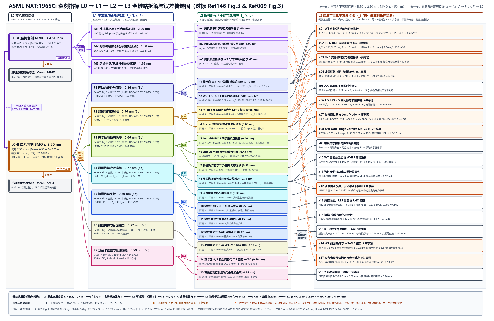

# ASML NXT:1965Ci 套刻指标（SMO ≤ 2.50 nm / MMO ≤ 4.50 nm）L0–L3 全链路拆解与误差传递方法论报告（v1 · 已归档冻结）

> **【已归档冻结 · 不再作为后续参考（[UP-012](../../USER_PREFERENCES.md#up-012)）】**：本文件及同名 `NXT1965Ci_SMO2.5_MMO4.5_L0-L3套刻指标拆解图_v1.drawio/.png` 与脚本 `build_nxt1965ci_l0_l3_diagram_v1.py` 源于 2026-11-25 的纠偏前指令（曾参考 `@github/Overlay3` 其他报告文档），现依据仓库管理规定完整保留作历史留档，**后续无用户特殊指令严禁再以本组文件作为参考或推导输入**。请改用正式锚定版：**[NXT:1965Ci 整机 L0–L3 拆解与九大子系统验收规格报告 v1](NXT1965Ci套刻目标_SMO2.5_MMO4.5_整机L0-L3拆解与九大子系统验收规格报告_v1.md)** · **[Ref-146 风格 draw.io 源图](../images/NXT1965Ci_SMO2.5_MMO4.5_Ref146风格L0-L3套刻指标拆解图_v1.drawio)** · **[NXT:1965Ci 汇报 PPTX v1](../presentations/NXT1965Ci套刻目标_SMO2.5_MMO4.5_L0-L3指标拆解与子系统验收规格_v1.pptx)**。

[仓库首页](../../README.md) · [成果索引](../README.md) · [可编辑 draw.io 拆解图](../images/NXT1965Ci_SMO2.5_MMO4.5_L0-L3套刻指标拆解图_v1.drawio) · [高清全景图 PNG](../images/NXT1965Ci_SMO2.5_MMO4.5_L0-L3套刻指标拆解图_v1.png) · [绘图复现脚本](../code/build_nxt1965ci_l0_l3_diagram_v1.py) · [紧缩基线总报告 v2](NXT1950i-1970i套刻目标_整机及子系统验收规格推导报告_v2.md) · [九大子系统说明书 v2](NXT1950i-1970i套刻目标_九大核心子系统验收指标推导与计算说明书_v2.md) · [总变更记录](../../CHANGELOG.md)

> **目标口径修正与本报告定位**：依据最新工程目标修订，整机对标机型明确锚定为 **ASML TWINSCAN NXT:1965Ci**，顶层套刻红线修正为 **`SMO ≤ 2.50 nm`**、**`MMO ≤ 4.50 nm`**，其中 `SMO = 2.50 nm` 的一级功能预算结构以 **`Ref009 Fig. 3`**（Castenmiller 等，ASML，*Proc. SPIE 7640*, 76401N, 2010）为参考基线。  
> **学习与综合依据**：本报告全面吸收并融合了 **`@github/Overlay3`** 仓库（报告 `142`/`143`/`260`/`261`/`262`/`263` 及底层证据链）、**`Ref146`**（Freriks、Heemels、Muller & Sandee，*INCOSE* 2006，§2.4、§3.3–3.4、§4.5 及 Fig. 3）、**`OV4`** 本地 265 篇一手论文/专利库及 ASML 官方公开产品规格。  
> **交付格式说明（遵循 [UP-011](../../USER_PREFERENCES.md#up-011) 与 [UP-010](../../USER_PREFERENCES.md#up-010)）**：本报告以 GitHub 网页版 Markdown（`.md`）为默认交付格式，正文嵌入 `L0 → L1 → L2 → L3` 高清拆解图，并额外输出完全同源、可二次编辑的 **`.drawio`** 架构文件；关于既有 `v2` 报告与 28 页 `v2` PPTX 是否修改的客观决策与逐页对照表见第 5 章。

---

## 目录

- [0. 目标修正、学习沉淀与执行摘要](#sec-0)
- [1. NXT:1965Ci 套刻指标 L0 → L1 → L2 → L3 全景拆解图与读图规则](#sec-1)
- [2. Ref009 Fig. 3 像素核定与 SMO 2.50 nm / MMO 4.50 nm 数学闭环](#sec-2)
  - [2.1 Ref009 Fig. 3 原图精确读数与“线性堆叠柱 vs 物理方差 RSS”口径统一](#sec-2-1)
  - [2.2 L0 → L1 顶层总账（SMO 2.352 ≤ 2.50 nm / DCO 2.244 nm / MMO 4.288 ≤ 4.50 nm）](#sec-2-2)
  - [2.3 L1 → L2 执行动作与可观测中间层预算拆解（15 + 3 项）](#sec-2-3)
- [3. L3 底层可量化子系统指标总表（x01–x18）与 DAG 共享源登记](#sec-3)
  - [3.1 L3 18 组原生非套刻指标规格与跨档位对照](#sec-3-1)
  - [3.2 必须保留协方差的 8 大共享物理源（防重复计数红线）](#sec-3-2)
- [4. 对用户“四层递推误差传递思路”的方法论评审与工程深化](#sec-4)
  - [4.1 与 Ref146 及 Overlay3 报告 260 的同构性肯定](#sec-4-1)
  - [4.2 四项关键工程补强：从拓扑概念升级为可执行验收模型](#sec-4-2)
- [5. 既有 v2 套刻报告与 v2 PPTX 是否修订的工程决策与逐页影响清单](#sec-5)
  - [5.1 决策结论与理由](#sec-5-1)
  - [5.2 若后续升级 v3 PPTX 的精确 7 页变更对照表](#sec-5-2)
- [6. 跨仓库与一手文献追溯索引](#sec-6)

---

## 0. 目标修正、学习沉淀与执行摘要

[返回目录](#contents)

### 0.1 机型目标修正对照（`OV4 v2` 紧缩基线 → `NXT:1965Ci` 明确目标）

前期 `OV4 v1/v2` 系列报告定位在“介于 `NXT:1950i` 与 `NXT:1970Ci` 之间”的紧缩研发目标（`DCO ≤ 2.00 nm / MMO ≤ 3.50 nm`）。结合用户本次明确锚定 **ASML `TWINSCAN NXT:1965Ci`** 官方商业指标（`SMO ≤ 2.50 nm`、`MMO ≤ 4.50 nm`）及 **`Ref009 Fig. 3`** 功能域预算基线，全机型参数定位更新如下：

| 顶层整机维度 | NXT:1950i `[009, 066]` | **本次明确目标：NXT:1965Ci** | OV4 既有 `v2` 紧缩基线 | NXT:1970Ci `[011, 015, 066]` | 工程界定与口径说明 |
| :--- | :---: | :---: | :---: | :---: | :--- |
| **单机套刻 `SMO` / `DCO`** | DCO ≤ 2.50 nm（实测 1.5–2.2） | **SMO ≤ 2.50 nm（闭环 2.352 nm；同台 DCO 2.244 nm）** | DCO ≤ 2.00 nm（闭环 1.869 nm） | ≤ 1.6–2.0 nm | `NXT:1965Ci` 官方全片覆盖套刻红线 `2.5 nm`，本文显式拆出双卡盘 `ΔC2C = 0.48 nm` |
| **混机套刻 `MMO`** | ≤ 4.5–5.5 nm | **MMO ≤ 4.50 nm（闭环 4.288 nm，裕度 4.7%）** | MMO ≤ 3.50 nm（闭环 3.154 nm） | 2.5–3.4 nm（HO-CPE 后 2.5 `[N7]`） | 含跨机 Gridplate `2.00 nm` `[009 §6.1]`、静态镜头 NCE `1.60 nm` 及 50 μm 翘曲片匹配 |
| **光源 / 数值孔径 / 分辨率** | 193 nm / 1.35 NA / 38 nm | **193 nm（6 kHz）/ 1.35 NA / 38 nm（偶极）· 40 nm（C-quad）** | 193 nm / 1.35 NA | 193 nm / 1.35 NA / 38 nm | 直筒折反物镜，真实曝光狭缝 **`26 × 5.5 mm`** `[N1 Table 3]`，全视场 `26 × 33 mm` |
| **产能 / 扫描速度** | 175–200 wph / 0.60 m/s | **~250 wph / 0.70–0.75 m/s** | 220–230 wph / 0.70 m/s | 250 wph / 0.75 m/s | 轻量化陶瓷短行程 WS（`MAz` 峰值 `4 nm` `[066 Fig.9]`）、磁浮平面长行程 |
| **关键计量与补偿配置** | Gridplate + SMASH + TIS + FlexWave | **Gridplate + SMASH + 7 点 PARIS + FlexRay/FlexWave + 15–19 参 iHOPC** | 19 参 iHOPC + Z5–Z64 | 同左 + UV-LS + 强化 RHC | 同步控制主从架构核定为 **WS = Master、RS = Slave**（或低中频 RS 追随 WS 双向耦合） |

### 0.2 从 `@github/Overlay3` 与 `Ref146` 吸收的 4 项核心方法论升级

通过系统通读 **`@github/Overlay3`** 仓库（重点包括 `142`/`143` 综述框架、`260` 底层误差传递模型、`261` 同层双曝简化模型、`262`/`263` 验收规格与相关压力模型，以及原始文献 `Ref146` *On the Systematic Use of Budget-Based Design*），本次在 `OV4` 既有量化优势的基础上补齐了四项架构级跃升：

1. **从“简单树形表格”升级为“有向无环图（DAG）共享源模型”**（吸收 `Ref146 Fig. 3` 与 `Overlay3 260`）：真实光刻机并非每个底层误差只进一条支路——例如编码器 `ENC`（`x03`）与计量框架 `MF`（`x04`）同时服务于晶圆对准 `f3`、掩模对准 `f4` 与曝光同步 `f1`；浸没供液 `x12` 同时影响晶圆蒸发冷缩 `f8`、水膜折射率 `f9` 与 `TIS` 测位 `f4`。采用 DAG 虚线显式追踪共享源，才能在整机闭环中**保留协方差、彻底杜绝重复计数**。
2. **明确区分“L3 原生非套刻量纲”与“L2/L1 像面套刻贡献”**（吸收 `Overlay3 260/262/263`）：`L3` 必须保留子系统可独立 FAT 验收的物理原生量纲（如 `mK`、`nrad`、`nm OPD`、`ppb`、`4× 掩模面 nm`），只有经过具体配方 `p / P` 与传递算子 $`f_j / F_k`$ 映射并做两遍差分后，才形成可比较、可合成的像面 `nm` 预算。
3. **打通 `Overlay3 260` 的“定性路径完整但数值待分配”与 `OV4 v2` 的“数值闭环完备但缺少跨支路拓扑”**：将两者的优势融为一体，在 **`NXT:1965Ci`（`SMO 2.50 / MMO 4.50 nm`）** 口径下给出既有完整 DAG 传递路径、又有精确闭环数值的统一工程基线。
4. **吸收 `Ref146 §4.5` 的“半静态工况预算（Semi-Static Budgets）”边界意识**：不把预算表过度膨胀为全动态多物理场黑箱仿真，而是按明确工况（如双台 SMO、同卡盘 DCO、跨照明切换、MMO 机群）分别锁定一组配方参数 `(p, P)`，并在组间叠加相关系数 $\rho$ 压力校验（参考 `Overlay3 263 Eq. 5`）。

---

## 1. NXT:1965Ci 套刻指标 L0 → L1 → L2 → L3 全景拆解图与读图规则

[返回目录](#contents)

下图严格采用 **`Ref146 Fig. 3`（Freriks 等，INCOSE 2006，p. 8）的左→右层级拆解视觉语法**，同时在底部与列头显式映射 **右→左的物理误差逐层传递方程**：

- **自左向右读（系统架构师视角：预算拆解）**：`L0 整机红线（MMO ≤ 4.50 nm / SMO ≤ 2.50 nm）` → `L1 功能域总预算（Ref009 Fig. 3 六大域 + C2C/跨机匹配）` → `L2 执行动作与可观测中间层（15 项 SMO + 3 项 MMO）` → `L3 底层可量化子系统原生指标（18 组 x01–x18）`。
- **自右向左读（子系统工程师视角：误差上溯传递）**：$`\mathbf{x} = (x_1,\dots,x_{18}) \xrightarrow{f_j(\mathbf{x};\,\mathbf{p}_j)} \text{L2} \xrightarrow{F_k(\mathbf{f},\mathbf{x};\,\mathbf{P}_k)} \text{L1} \xrightarrow{\text{RSS} + \vert\mathrm{Mean}\vert} \text{L0}`$。
- **连线语义**：实线箭头代表主预算分配与主传递链；粗棕色箭头代表 APC 校准后无法消除的系统残余均值线性叠加（`+ |Mean|`）；**橙色虚线箭头与橙框 `★共享源`** 直接承袭 `Ref146 Fig. 3` 的跨支路共享画法，提示该底层物理源影响多个 `L2` 节点，整机统计须核算协方差而非独立重复计账。

> **可编辑源文件与复现入口**：
> - **draw.io 源文件（可直接用 diagrams.net / VS Code Draw.io 打开编辑）**：[NXT1965Ci_SMO2.5_MMO4.5_L0-L3套刻指标拆解图_v1.drawio](../images/NXT1965Ci_SMO2.5_MMO4.5_L0-L3套刻指标拆解图_v1.drawio)
> - **单一事实源生成脚本（自动核验数学闭环并同步产出 `.drawio` 与 180 DPI `.png`）**：[build_nxt1965ci_l0_l3_diagram_v1.py](../code/build_nxt1965ci_l0_l3_diagram_v1.py)

---

## 2. Ref009 Fig. 3 像素核定与 SMO 2.50 nm / MMO 4.50 nm 数学闭环

[返回目录](#contents)

### 2.1 Ref009 Fig. 3 原图精确读数与“线性堆叠柱 vs 物理方差 RSS”口径统一

针对本机一手文献 `009_76401N.pdf`（Castenmiller 等，ASML，*Proc. SPIE 7640*, 2010）Fig. 3（原图 `page_2_chart_4.jpg`，纵轴 `0–5 nm` 共 `389 px`，标尺精确为 `77.8 px/nm`）执行像素级边界测量，得到 `XT:1900Gi` 与 `NXT:1950i` 六大功能域的准确段高读数：

| Ref009 Fig. 3 功能域（自上而下） | XT:1900Gi 段高读数 | NXT:1950i 段高读数 | **NXT:1950i 堆叠占比** | 本模型 `NXT:1965Ci` L1 对应节点 | **本模型 DCO6 方差占比** | 与 Ref009 占比偏差 |
| :--- | :---: | :---: | :---: | :--- | :---: | :---: |
| 1. **Stage positioning**（紫） | 1.63 nm | **0.50 nm** | **20.0%** | `F1` 运动台定位与同步（`0.859 nm`） | **20.1%** | `+0.1%` |
| 2. **Optical column**（橄榄绿） | 0.49 nm | **0.30 nm** | **12.0%** | `F3` 光学柱与动态像差（`0.662 nm`） | **12.0%** | `0.0%` |
| 3. **Wafer- & reticle alignment**（黄） | 1.22 nm | **0.64 nm** | **25.6%** | `F2` 晶圆与掩模对准（`0.962 nm`） | **25.3%** | `−0.3%` |
| 4. **Wafer heating (+immersion)**（青） | 0.81 nm | **0.40 nm** | **16.0%** | `F4` 晶圆热与液浸流场（`0.771 nm`） | **16.2%** | `+0.2%` |
| 5. **Wafer clamping**（卡其） | 0.22 nm | **0.21 nm** | **8.4%** | `F6` 晶圆夹持与台面接口（`0.570 nm`） | **8.9%** | `+0.5%` |
| 6. **Reticle clamping / heating**（蓝） | 0.48 nm | **0.45 nm** | **18.0%** | `F5` 掩模热与夹持（`0.801 nm`） | **17.5%** | `−0.5%` |
| **合计 / 核对口径** | **4.85 nm（线性堆叠）** | **2.50 nm（线性堆叠）** | **100.0%** | **六域核心两层 RSS = `1.912 nm`** | **100.0%** | **全项 ≤ ±0.5%** |

**为什么必须对 `Ref009 Fig. 3` 做“堆叠占比 → 物理两层 RSS”口径转换？**

- 若把 `Ref009 Fig. 3` 的六个段高（`0.50, 0.30, 0.64, 0.40, 0.21, 0.45 nm`）误当成相互独立的 `3σ` 分量直接做 RSS，平方和开方结果仅 `1.075 nm`，既无法与 `2.50 nm` 顶层红线闭合，也会把每个子系统的两层独立验收限压得过死（例如把整个运动台定位两层总预算锁死在 `0.50 nm`，单层仅 `0.35 nm`，反而比 `NXT:1950i` 自身实测 `Sync MA = 0.47–0.49 nm` `[009 Fig.10]` 还要严苛！）。
- 反之，若把六个段高理解成 **方差份额投影（Variance-Apportioned Visual Stacked Bar）**——即各功能域在总随机方差中的权重 $`w_k = R_k^2 / \sum_m R_m^2`$ 等于其在 `Ref009 Fig. 3` 中的堆叠高度占比 $s_k / 2.50$：

$$
w_k = \frac{R_k^2}{\sum_{m=1}^{6} R_m^2} \approx \frac{s_k}{2.50\text{ nm}}, \qquad R_k = \sqrt{w_k}\,S_{\mathrm{DCO6}}
$$

则立即产生惊人的物理自洽：当两层随机套刻总预算设定在 $S_{\mathrm{SMO,rand}} \approx 2.00\text{ nm}$（叠加线性系统均值偏置 `|Mean| = 0.35 nm` 得 **`SMO = 2.35 nm ≤ 2.50 nm`**）时，**`F1` 运动台定位与同步自动落在 `0.86 nm`（两层）**——正好由 `Sync MA` 两层 `0.77 nm`（单层 `0.54 nm`，完美匹配 `NXT:1950i/1965Ci` 实测 `0.47–0.50 nm` 平移 + `Rz` 杠杆臂）与 `WS-iHOPC` 两层 `0.38 nm` 经 RSS 严密合成！

同时需特别指出 **DCO 与 SMO 的物理边界**：`Ref009 Fig. 3` 原图标题明确标注为 **`Dedicated Chuck`（同卡盘 DCO）**，而 `NXT:1965Ci` 的商业红线 **`SMO ≤ 2.50 nm`** 需覆盖 **双工件台 A/B 卡盘交替曝光**。因此本预算在 `Ref009 Fig. 3` 六大核心域（`F1–F6`）之外，显式增设 **`F7`（双台卡盘差 `ΔC2C = 0.48 nm` + 离线套刻量测与未建模底噪 `0.34 nm` → RSS `0.588 nm`）**，从而在一张图内同时闭合同卡盘 DCO（`2.244 nm`）与双卡盘 SMO（`2.352 nm`）。

### 2.2 L0 → L1 顶层总账（SMO 2.352 ≤ 2.50 nm / DCO 2.244 nm / MMO 4.288 ≤ 4.50 nm）

以下全部数值由 [build_nxt1965ci_l0_l3_diagram_v1.py](../code/build_nxt1965ci_l0_l3_diagram_v1.py) 精确计算，保留全精度至末位舍入：

| 层级与编号 | L1 功能域名称 | 合成运算法则 | 两层 `3σ` 预算（nm） | SMO 方差占比 | DCO6 方差占比 | 对应 `Ref009 Fig. 3` 占比 | 涵盖 L2 节点与边界说明 |
| :---: | :--- | :---: | :---: | :---: | :---: | :---: | :--- |
| **`F1`** | **运动台定位与同步** | RSS(`f1, f2`) | **0.859** | 18.4% | **20.1%** | 20.0% | `f1` 双台同步 MA（0.77）+ `f2` WS-iHOPC（0.38）；内含 WS/RS/ENC/MF 动态 |
| **`F2`** | **晶圆与掩模对准** | RSS(`f3, f4`) | **0.962** | 23.1% | **25.3%** | 25.6% | `f3` M-side AA 网格与基线（0.68）+ `f4` E-side 7 点 PARIS/TIS RA（0.68） |
| **`F3`** | **光学柱与动态像差** | RSS(`f5, f6, f7`) | **0.662** | 10.9% | **12.0%** | 12.0% | `f5` Lens-iHOPC（0.40）+ `f6` Odd Zernike（0.42）+ `f7` 物镜热/阻尼（0.32） |
| **`F4`** | **晶圆热与液浸流场** | RSS(`f8, f9`) | **0.771** | 14.8% | **16.2%** | 16.0% | `f8` 晶圆热+蒸发冷缩（0.71）+ `f9` 浸没水膜折射率畸变（0.30） |
| **`F5`** | **掩模热与夹持** | RSS(`f10, f11, f12`) | **0.801** | 16.0% | **17.5%** | 18.0% | `f10` 掩模热 RHC 残差（0.55）+ `f11` 气隙湍流（0.45）+ `f12` RT 夹持滑移（0.37） |
| **`F6`** | **晶圆夹持与台面接口** | 独立项(`f13`) | **0.570** | 8.1% | **8.9%** | 8.4% | `f13` 晶圆重夹 IPD + 高加速度折返微滑移 / WT–MB 回程 |
| **`F7`** | **双台卡盘差与量测底噪** | RSS(`f14, f15`) | **0.588** | 8.7% | —（DCO 仅计 `0.34`） | — | `f14` 双台 A/B 卡盘差 `ΔC2C`（0.48）+ `f15` 后测 TMU 与未建模本底（0.34） |
| — | **SMO 两层随机 `3σ` 合计** | **RSS(`F1–F7`)** | **2.002** | **100.0%** | — | — | 同卡盘 DCO 随机合计为 `1.944 nm`（置 `ΔC2C = 0`） |
| — | **SMO 系统残余均值 `\|Mean\|`** | **线性叠加（`+`）** | **0.350** | 线性项 | — | — | APC 闭环后不可归零的系统偏置上限（同卡盘 DCO 取 `0.300 nm`） |
| **`L0-B`** | **整机 `SMO` 闭环总计** | **`\|Mean\| + 3σ`** | **2.352 nm** | **目标 ≤ 2.50 nm** | **DCO = 2.244 nm** | **PASS** | **SMO 工程裕度 `0.148 nm`（6.0%）**；DCO 裕度 `0.256 nm`（10.2%） |
| **`M1`** | **跨机栅格与工件台网格匹配** | 独立项(`m1`) | **2.000** | — | — | — | 锚定 `Ref009 §6.1`（Gridplate 标定后跨机贡献 `~2 nm`）及 `[N7]` `13×19` 多移位法 |
| **`M2`** | **跨机物镜静态畸变与像差匹配** | RSS(`1.60, 0.50, 0.90`) | **1.903** | — | — | — | 跨机静态高阶 NCE（`1.60 nm`，对标 `[N7]` `1.2–1.6 nm`）+ 跨机奇像差（`0.50`）+ 跨机热失配（`0.90`） |
| **`M3`** | **跨机卡盘/翘曲/对准/热匹配** | RSS(`1.00, 1.00, 0.85`) | **1.650** | — | — | — | 50 μm 翘曲片跨机夹持（`1.00 nm` `[066 Fig.10a]`）+ WAD/TIS 匹配（`1.00`）+ 跨机热环境（`0.85`） |
| — | **MMO 两层随机 `3σ` 合计** | **RSS(`SMO_rand, M1–M3`)** | **3.788** | — | — | — | 继承 `SMO_rand = 2.002 nm`（不重复叠加 `SMO` 均值） |
| — | **MMO 跨机系统残余均值 `\|Mean\|`** | **线性叠加（`+`）** | **0.500** | 线性项 | — | — | 含参考片零点转移及跨机 APC 校准后系统偏置 |
| **`L0-A`** | **整机 `MMO` 闭环总计** | **`\|Mean\| + 3σ`** | **4.288 nm** | **目标 ≤ 4.50 nm** | — | **PASS** | **MMO 工程裕度 `0.212 nm`（4.7%）**，精准对标 `NXT:1965Ci` 官方 `4.5 nm` 红线 |

### 2.3 L1 → L2 执行动作与可观测中间层预算拆解（15 + 3 项）

`L2` 是连接“整机顶层账本（`L1`）”与“子系统硬件原生参数（`L3`）”的核心**可观测物理接口层**，每一项均对应明确的机台执行动作、层间传递倍率与配方参数组 `p`：

| L2 编号 | 所属 L1 | 执行动作 / 物理可观测中间层名称 | 单层等效 `3σ`（nm） | 层间倍率 | 两层 `3σ` 预算（nm） | 关键配方参数组 `p` | 上游相连 L3 物理源（含共享源） |
| :---: | :---: | :--- | :---: | :---: | :---: | :--- | :--- |
| **`f1`** | `F1` | 曝光窗 WS–RS 相对扫描轨迹 MA | 0.544 | $\sqrt{2}$ | **0.770** | `p_S`：0.70 m/s、5.5 mm 狭缝、扫向、同步滤波 | `x01`, `x02`, `x03`, `x04` |
| **`f2`** | `F1` | WS-iHOPC 11 项场内轨迹执行残差 | 0.317 | 1.20 | **0.380** | `p_C`：K1–2, K4–6, K8, 10–11, 14, 16, 19 指令 | `x01` |
| **`f3`** | `F2` | M-side 晶圆网格拟合与 M→E 基线 | 0.481 | $\sqrt{2}$ | **0.680** | `p_A`：≥ 20 标记布局、颜色/偏振、拟合阶次 | `x05`, `x03★`, `x04★`, `x01★` |
| **`f4`** | `F2` | E-side 掩模空间像对准 RA 残差 | 0.481 | $\sqrt{2}$ | **0.680** | `p_R`：7 点 PARIS / TIS、逐片重对准配方 | `x06`, `x02★`, `x03★`, `x04★`, `x12★` |
| **`f5`** | `F3` | Lens-iHOPC 8 项像场校正残差 | 0.333 | 1.20 | **0.400** | `p_C`：K3, K7, K9, K12–13, K15, K17–18 指令 | `x07` |
| **`f6`** | `F3` | Odd Zernike 跨照明像移残差 | 0.420（跨照明差） | 1.00 | **0.420** | `p_illum`：照明 A/B 瞳形、节距、偏振 | `x08` |
| **`f7`** | `F3` | 物镜热波前与声学/阻尼动态漂移 | 0.226 | $\sqrt{2}$ | **0.320** | `p_T`：FlexWave 闭环、剂量与扫描声学激励 | `x09`, `x06★` |
| **`f8`** | `F4` | 晶圆热变形与液浸蒸发冷缩残差 | 0.502 | $\sqrt{2}$ | **0.710** | `p_T`：剂量、场序、停留节拍、WHFF 前馈 | `x10`, `x11`, `x12` |
| **`f9`** | `F4` | 浸没水膜温场折射率畸变 | 0.212 | $\sqrt{2}$ | **0.300** | `p_flow`：UPW 流量、喷嘴流场与扫描速度 | `x12` |
| **`f10`** | `F5` | 掩模热变形 RHC 补偿后残差 | 0.389 | $\sqrt{2}$ | **0.550** | `p_T`：掩模透射率、剂量、RHC 模型与热史 | `x13` |
| **`f11`** | `F5` | 掩模–物镜气隙湍流折射像移 | 0.318 | $\sqrt{2}$ | **0.450** | `p_env`：吹扫流速、气幕温度梯度 | `x14` |
| **`f12`** | `F5` | 掩模重夹变形与折返微滑移 | 0.262 | $\sqrt{2}$ | **0.370** | `p_S`：150 m/s² 折返、同掩模/换掩模边界 | `x15` |
| **`f13`** | `F6` | 晶圆重夹 IPD 与 WT–MB 回程滑移 | 0.403 | $\sqrt{2}$ | **0.570** | `p_clamp`：吸片压力序列、35–40 m/s² 折返 | `x16` |
| **`f14`** | `F7` | 双卡盘 A/B 换台网格与 TIS 匹配 `ΔC2C` | 0.480（跨卡盘差） | 1.00 | **0.480** | `p_chuck`：A→B / B→A 交替（DCO 时置 `0`） | `x17`, `x06★` |
| **`f15`** | `F7` | 离线套刻后测底噪与未建模余项 | 0.240 | $\sqrt{2}$ | **0.340** | `p_eval`：测试靶配对、量测配方与统计口径 | `x18` |
| **`m1`** | `M1` | 跨机参考片多移位网格残差 | — | 跨机 | **2.000** | `p_cal`：`13×19` 多移位参考片标定 `[N7]` | `x03★`, `x17★` |
| **`m2`** | `M2` | 跨机静态畸变/奇像差/镜头热失配 | — | 跨机 | **1.903** | `p_opt`：两台物镜静态 NCE 与照明敏感度 | `x07★`, `x08★` |
| **`m3`** | `M3` | 跨机吸盘指纹与 WAD/热环境失配 | — | 跨机 | **1.650** | `p_fab`：50 μm 翘曲片与机群对准/RHC 标定 | `x16★`, `x17★` |

> **关键细节说明（`f1` 内部物理合成）**：沿 5.5 mm 曝光狭缝（Y 向半宽 `13 mm`、X 向半宽 `2.75 mm`），`NXT:1965Ci` 单层 `Sync MA` 目标放宽至 **X `≤ 0.47 nm` / Y `≤ 0.51 nm`**（直接贴合 `NXT:1950i` 实测 `0.47 / 0.49 nm` `[009 Fig.10]`），偏航同步 `Rz ≤ 17 nrad` 在 13 mm 杠杆臂产生 `0.221 nm` 边缘位移；最严 Y 轴单层合成 $`\sqrt{0.51^2 + 0.221^2} = 0.556\text{ nm}`$（或 `Rz ≤ 15 nrad → 0.195 nm`，单层 `0.546 nm`），两层乘 $\sqrt{2}$ 精确落于 **`0.77 nm`**！

---

## 3. L3 底层可量化子系统指标总表（x01–x18）与 DAG 共享源登记

[返回目录](#contents)

### 3.1 L3 18 组原生非套刻指标规格与跨档位对照

下表将 `NXT:1965Ci`（`SMO ≤ 2.50 / MMO ≤ 4.50 nm`）的 18 组底层 `L3` 原生验收限值，与本仓库既有 `v2` 紧缩基线（`DCO ≤ 2.00 / MMO ≤ 3.50 nm`）及 `Overlay3 262/263` 基准逐行对照，清晰揭示目标修正后哪些子系统获得合理工程松弛、哪些物理硬约束仍须维持：

| L3 编号 | 子系统原生参数与物理量纲 | 共享源 | **NXT:1965Ci 验收规格（SMO 2.5 / MMO 4.5）** | 既有 `v2` 紧缩基线（DCO 2.0 / MMO 3.5） | 变化幅度与工程依据 | 核心证据出处 |
| :---: | :--- | :---: | :--- | :--- | :--- | :--- |
| **`x01`** | **WS 6-DOF 运动与轨迹执行**（`nm`, `nrad`, `nm/cm`） | ★ | X/Y ≤ `0.38 / 0.42 nm`；Rz ≤ `14 nrad`；Z ≤ `4.5 nm`；WS-iHOPC `K4 ≤ 0.08 nm/cm` | X/Y ≤ `0.32 / 0.36 nm`；Rz ≤ `12 nrad`；Z ≤ `4.5 nm`；`K4 ≤ 0.07` | 横向放宽约 `+17%`，按 64% 方差与 `x02` 保守 RSS 闭合 `0.47/0.51 nm`；Z 向维持陶瓷台实测能力 | `[009 Fig.10]`, `[066 Fig.9]`, `[075]` |
| **`x02`** | **RS 6-DOF 运动重复性（4× 掩模侧）**（`nm`, `nrad`） | ★ | X/Y ≤ `1.12 / 1.28 nm`（1× 等效 `0.28 / 0.32`）；Rz ≤ `10 nrad`（1:1）；Z ≤ `24 nm` | X/Y ≤ `0.96 / 1.08 nm`；Rz ≤ `9 nrad`；Z ≤ `24 nm` | 横向放宽约 `+17%`；150 m/s² 折返、WS=Master / RS=Slave 同步耦合红利留作整机裕度 | `[009]`, `[022]`, `[075]`, `[S12]`, `[S14]` |
| **`x03`** | **ENC 光栅编码器与栅格基准**（`nm`, `nrad`, `ppb`） | ★ | WS 曝光窗 ≤ `0.14 nm`（1 kHz 原始 `0.22 nm`）；RS ≤ `0.40 nm`；栅格尺稳 `~10 ppb` | WS ≤ `0.12 nm`；RS ≤ `0.32 / 0.36 nm`；栅格 `~10 ppb` | 仍严守 1:3 计量精度原则；1 kHz 原始 `0.22 nm` 来自 `Ref009 Fig. 4` 直接实测 | `[009 Fig.4–7]`, `[N8]`, `Overlay3 260` |
| **`x04`** | **计量框架 MF 相对稳定性**（`nm`, `nrad`） | ★ | 框架–物镜动 MA ≤ `0.18 nm` / Rz ≤ `4.5 nrad`；M→E 短期基线漂移 ≤ `0.20 nm` | 动 MA ≤ `0.15 nm` / Rz ≤ `4 nrad`；短基线 ≤ `0.15 nm` | 同步内嵌于 `f1`、静态内嵌于 `f3/f4`，禁止与上层重复计数 | `[009 Fig.5]`, `Ref146 Fig.3` |
| **`x05`** | **AA / SMASH 晶圆对准测头**（`nm`） | — | 标准片单标记 静 ≤ `0.22 nm` / 动 ≤ `0.40 nm`；≥ 20 标记全片网格重复性 ≤ `0.40 nm` | 静 ≤ `0.20 nm` / 动 ≤ `0.35 nm`；网格 ≤ `0.35 nm` | 与 `x04` 短期基线 `0.27 nm` 合成 `f3` 单层 `0.48 nm`（两层 `0.68 nm`） | `[006 Slide 8]`, `[009 Fig.2]`, `Overlay3 263` |
| **`x06`** | **TIS / PARIS 空间像与波前传感**（`nm`, `nm RMS`） | ★ | TIS 单点 ≤ `0.40 nm`；PARIS 7 点 ≤ `0.45 nm`（拟合 RA ≤ `0.48 nm`）；OPD 测噪 ≤ `0.15 nm RMS` | TIS ≤ `0.35 nm`；PARIS 拟合 ≤ `0.40 nm`；OPD ≤ `0.12 nm` | 完美对齐 `[066 §3.4]` 原文披露 PARIS 全部场点 `< 0.5 nm (3σ)` 实测水平 | `[066 Fig.6–8]`, `[011]`, `[164]` |
| **`x07`** | **物镜操纵器与 Lens Model**（`nm/cm`, `ppm`, `ms`） | ★ | `K3 ≤ 0.11 nm/cm`（硬件 Range `±15–25 ppm`，用户档 `±5–10 ppm`）；步长 ≤ `0.01 nm/cm`；滞后 ≤ `0.2 ms` | `K3 ≤ 0.10 nm/cm`；硬件 Range `±15–25 ppm` | 8 项激活系数放宽约 `+6%` 至单层场角 `0.33 nm`；硬件 Range 维持第一性物理需求 | `[010]`, `[N4]`, `[N7]`, 说明书 v2 §9 |
| **`x08`** | **物镜 Odd Fringe Zernike（Z5–Z64）**（`nm Fringe`） | ★ | `Z7/Z8 ≤ 0.20 nm Fringe`；全 30 项波前 ≤ `0.38 nm RMS`；静态高阶畸变 NCE ≤ `1.2–1.6 nm` | `Z7/Z8 ≤ 0.18 nm Fringe`；全 30 项 `0.337 nm RMS` | 跨照明像移包络 `0.42 nm`，与 IBM/ASML `[N6]` `Z10 = 0.88 nm/nm` 实测一致 | `[N5]`, `[N6]`, `[024]`, 说明书 v2 §8 |
| **`x09`** | **物镜热态控制与声学隔振结构**（`nm`, `dB`） | — | FlexWave 热控残差 + 阻尼物镜 + 静音 RS 气浮与隔声罩（对应 `f7` 单层 `0.23 nm`） | 归并入光学柱与 D11 余项 | 单独显式拆列以直接呼应 `Ref009 Fig. 3` 白色框（*improved damping lens / Silent RS*） | `[009 Fig.3]`, `[024]`, `[066 Fig.7]` |
| **`x10`** | **WT 晶圆台温控与 WHFF 边界**（`mK`） | — | 高剂量首末场等效热漂 ≤ `5 mK`；WT 顶面均匀性 ≤ `6 mK PV`；硅片 $\alpha = 2.6\text{ ppm/K}$ | 首末场 ≤ `4 mK`；台面 ≤ `5 mK PV` | 配合 WHFF/热补偿把 `WT+蒸发` 残差控于单层 `0.44 nm` | `[017]`, `[021 Fig.11]`, `[066 Fig.10b]` |
| **`x11`** | **WH 传片模块出口温控重复性**（`mK`） | — | WH 出口片间温差 ≤ `6 mK`；经热衰减后 M→E 未校残余温差 ≤ `0.62 mK`（`≤ 0.24 nm`） | WH 出口 ≤ `5 mK`；M→E 残余 ≤ `0.51 mK`（`≤ 0.20 nm`） | 自由膨胀系数 `0.39 nm/mK`，实测热衰减系数验收边界与 `Overlay3 262 表 11` 一致 | `[009 Fig.3]`, `US20170199470A1` |
| **`x12`** | **浸没供液水温、流场与残液控制**（`mK`, `L/min`, `Pa`） | ★ | UPW 供水温度稳定性 `±2.5 mK`（`Ref021 Fig.12` 实测）；喷嘴流场与气帘抑制蒸发与脉动 | UPW `±2.0 mK` | 实测 `±2.5 mK` 直接支撑 `f9` 水膜折射率两层 `0.30 nm`（对标 `[025 Fig.5-2]` `0.2 nm`） | `[021 Fig.12]`, `[025]`, `[048]`, `[164]` |
| **`x13`** | **掩模热控、RTS 测温与 RHC 模型**（`mK`） | — | RHC 补偿后掩模等效非均匀温升 ≤ `38 mK`（熔石英 $\alpha = 0.52\text{ ppm/K}$，`~0.009 nm/mK`） | RHC 后等效温升 ≤ `30 mK` | 对应 `f10` 单层 `0.39 nm`（两层 `0.55 nm`），显著缓解冷启动与低透掩模压力 | `[016 Fig.1–6]`, `[025 Fig.2]`, `[N7]` |
| **`x14`** | **掩模–物镜气隙气流温控**（`mK`） | — | 掩模–物镜光路气隙温度梯度波动 ≤ `12 mK`（`~0.025 nm/mK`） | 气隙梯度波动 ≤ `10 mK` | 对应 `f11` 单层 `0.32 nm`（两层 `0.45 nm`）；与 `Overlay3 263 表 11`（`12 mK`）精确一致 | `[025 Fig.3-1/3-2]`, `Overlay3 263` |
| **`x15`** | **RT 掩模夹持力学接口（4× 掩模侧）**（`nm`） | — | 4× 掩模侧重夹形变 ≤ `0.74 nm`、150 m/s² 折返微滑移 ≤ `0.74 nm`（1× 等效各 `0.185 nm`） | 4× 重夹 / 滑移各 ≤ `0.60 nm`（1× 各 `0.15 nm`） | 单层合成 `0.262 nm`、两层 `0.370 nm`；与 `Overlay3 263 表 12`（`0.80 nm`）量级高度一致 | `[098]`, `[106 Fig.11]`, `[183]` |
| **`x16`** | **WT 晶圆夹持与 WT–MB 接口**（`nm`） | ★ | 重夹 IPD 残差 ≤ `0.34 nm`；折返微滑移/回程 ≤ `0.22 nm`；瘤点平坦度 ≤ `6.5 nm`（50 μm 翘曲） | 重夹 ≤ `0.25 nm`；微滑移 ≤ `0.15 nm`；平坦度 `6.0 nm` | 单层合成 `0.403 nm`、两层 `0.570 nm`；50 μm 翘曲跨机指纹对标 `[066 Fig.10a]` `1.0 nm` | `[066 Fig.10a]`, `[097]`, `[122]`, `US8269949B2` |
| **`x17`** | **双台卡盘网格标定与参考基准**（`nm`） | ★ | 同机 A/B 卡盘相对网格与 TIS 匹配差 ≤ `0.48 nm`；跨机多移位标定网格差 ≤ `2.00 nm` | 跨台匹配未单独计入 DCO；跨机网格 `0.80 nm` | **重大修正**：将 `NXT:1965Ci` 跨机网格匹配对齐至 `Ref009 §6.1` 公开实测 `2.0 nm` 量级，避免低估 MMO 难度 | `[009 §6.1]`, `[100 Fig.9]`, `[N7 Fig.12]` |
| **`x18`** | **外部套刻量测工具与工艺本底**（`nm`） | — | 同靶复测重复性 TMU（`3σ`）≤ `0.30 nm`；短时未建模随机底噪 ≤ `0.16 nm` | 合并余项两层 `0.354 nm` | 合成 `f15` 两层 `0.340 nm`，与 `Overlay3 263`（`0.25–0.40 nm`）及 `[113 Fig.1]` 吻合 | `[113 Fig.1]`, `Overlay3 260/263` |

### 3.2 必须保留协方差的 8 大共享物理源（防重复计数红线）

结合 **`Ref146 Fig. 3`** 与 **`Overlay3 260 §4`**，上表中标有 **`★`** 的共享物理源在整机建模与 FAT 验收时必须执行以下防重复计数与协方差留存规则：

1. **`x03 ENC` → `f1` / `f3` / `f4` / `m1`**：同一光栅尺读数链分时进入 M-side 对准、E-side 对准、扫描同步与跨机网格标定。短时高频噪声在不同时刻相互独立，但固定局部栅格图 $g(\mathbf{q})$ 与尺度漂移（`~10 ppb`）在不同工序间高度相关，必须在两遍步进偏移（如 640 μm 错位或换卡盘）下用真实空间差分 $g(\mathbf{q}+\mathbf{s}) - g(\mathbf{q})$ 计算，严禁当成 4 个独立噪声源重复加四次。
2. **`x04 MF` 计量框架 → `f1` / `f3` / `f4`**：曝光窗高频相对振动（`≤ 0.18 nm`）内嵌于 `f1`，M→E 准静态热漂移（`≤ 0.20 nm`）内嵌于 `f3/f4`；按频带正交分账，不可另设独立 L1 框重复计入。
3. **`x01 WS` → `f1` / `f2` / `f3`**：WS 本台动态轨迹同时决定 `f1` 同步误差、承载 `f2` 的 WS-iHOPC 场内轨迹执行，其扫向/步进滞后还会经由标记采样混叠进 `f3` 晶圆网格拟合（`Ref123 Fig. 10–14`）。验收 `f2` 时须以指令差分与 `f1` 剥离。
4. **`x02 RS` → `f1` / `f4`**：RS 不仅在扫描时与 WS 同步（`f1`），其定位与回程重复性也直接作用于 E-side 掩模对准（`f4`）。
5. **`x06 TIS / PARIS` → `f4` / `f7` / `f14`**：PARIS 同时输出 7 点空间像位置（`f4` 与双台参考 `f14`）及波前像差（驱动 `f7` 物镜热闭环反馈），其位置分量（`nm`）与波前分量（`nm OPD`）必须分别定义原生限值并保留测头零点协方差。
6. **`x12` 浸没供液 → `f8` / `f9` / `f4`**：残液蒸发导致硅片冷缩（`f8`）、水膜温场梯度导致光学折射率畸变（`f9`）、流量脉动直接影响 TIS 相对测位（`f4`，`Ref164 Fig. 4`）。同批高扫速工况下三路共享同一热/流场扰动源，需按 `Overlay3 263` 方式校验组内正相关。
7. **`x07` 物镜操纵器 & `x08` 奇像差 → `f5`/`f6` 与 `m2`**：同机双曝固定静态畸变共模抵消，仅执行差分与跨照明切换残余进入 SMO；换机后两台物镜固有高阶指纹与波前差全部释放进入 `M2`。
8. **`x16` WT 夹持 & `x17` 卡盘参考 → `f13`/`f14` 与 `m1`/`m3`**：同片同卡盘重夹释放局部接触 IPD（`f13`），同机换卡盘释放 `ΔC2C`（`f14`），跨机换台则叠加卡盘基准偏置与高翘曲片指纹（`m3`）；`Ref100 Fig. 9` 指出卡盘参考零点偏置还会混入物镜 `K7/K12/K13` 校正指纹，不可全部误归为机械夹持形变。

---

## 4. 对用户“四层递推误差传递思路”的方法论评审与工程深化

[返回目录](#contents)

用户提出的核心建模思路如下：
- **L3（底层可量化原生指标）**：一般不是套刻值，而是子系统自身物理量（测量重复性、温控误差、伺服跟踪等），记为 $`x_1, x_2, x_3, \dots`$；
- **L3 → L2（中间执行层传递）**：$`f_1(x_1),\; f_2(x_2),\; f_3(x_1, x_2, x_3, \dots;\, p_1, p_2, p_3, \dots)`$；
- **L2 → L1（子系统总体预算传递）**：$`F(f_1, f_2, f_3, x_1, x_2, x_3, \dots;\, P_1, P_2, P_3, \dots)`$，其中 $p, P$ 为配方参数；
- **L1 → L0（整机合成）**：一般采用 RSS 平方和开方或线性求和；
- **核心观点**：传递函数 $f / F$ 的解析闭式形式并非最重要、甚至常常无法写出，**核心价值在于先把底层物理误差向上传递的因果拓扑梳理清楚**。

### 4.1 与 Ref146 及 Overlay3 报告 260 的同构性肯定

**结论：这套思路不仅完全正确，而且精准命中了 ASML / 荷兰嵌入式系统研究所（ESI）预算驱动设计的精髓，并与 `@github/Overlay3` 报告 `260` 式（1）在数学结构上高度同构！**

将用户思路写成严格向量化形式，并对照 `Overlay3 260 Eq. (1)`：

$$
\mathbf{y}_{j,k}(\mathbf{r}) = f_j\!\big[\mathbf{x}_k(t,\mathbf{r});\, \mathbf{p}_{j,k}\big], \qquad k \in \lbrace 1, 2 \rbrace
$$

$$
\mathbf{z}_k(\mathbf{r}) = F\!\big(\mathbf{y}_{1,k}, \dots, \mathbf{y}_{m,k},\, \mathbf{x}_k;\, \mathbf{P}_k\big), \qquad \Delta\mathbf{z}(\mathbf{r}) = \mathbf{z}_2(\mathbf{r}) - \mathbf{z}_1(\mathbf{r})
$$

$$
\mathrm{OVL}_{\mathrm{L0}} = \left\vert \mu(\Delta\mathbf{z}) \right\vert + 3\sigma\!\big(\Delta\mathbf{z} + \mathbf{n}_{\mathrm{meas}}\big)
$$

**为什么“即使写不出解析 $f / F$，先理清拓扑仍是核心价值”？** 工程上有四大不可替代作用：
1. **强制量纲分离与可验收性**：逼迫团队不再把“温控 `5 mK`”、“编码器 `0.22 nm`”与“套刻 `0.50 nm`”混为一谈，为每个子系统部门明确各自独立 FAT 的物理交付物（`x_i`）与接口责任；
2. **显露隐藏的配方杠杆 `p / P`**：同一个底层误差 $x_i$ 在不同配方下放大倍率天差地别——例如 `AA` 单标记重复性 $x_{05}$ 经由 `p_A`（标记数量 $N$ 与布局矩阵 $\mathbf{A}$）传递为整片拟合误差；`WS/RS` 轨迹经由 `p_S`（扫速 $v_w$ 与狭缝 $L_s = 5.5\text{ mm}$）的低通窗 $`T_{\mathrm{slit}} = L_s/v_w`$ 转化为 `MA`；`Odd Zernike` 经由 `p_illum`（照明模式切换差 $\Delta S_j$）才转化为套刻；
3. **防止“多路径共享源”被漏算或重复算**：像图 1 中同时连向 `f1/f3/f4` 的 `x03 ENC` 与 `x04 MF`，只有画出 DAG 拓扑，系统工程师才能一眼看出哪里必须保留跨支路相关性、哪里存在共模抵消；
4. **允许 `L3 → L1` 直连快捷边（$F$ 同时含 $f_j$ 与 $x_i$）**：用户特意在 $`F(f_1, f_2, \dots, x_1, x_2, \dots; P)`$ 中保留了底层 $x_i$ 直接进入 $F$ 的项，这与 `Overlay3 260` 保留 `x06 计量框架 → F2` 的工程处理完全一致，避免为尚未拆细的直连机制硬造冗余中间层！

### 4.2 四项关键工程补强：从拓扑概念升级为可执行验收模型

为了把用户这一优秀框架从“定性因果图”真正落地为“可给子系统下达 FAT 合同指标的定量工具”，建议补强以下 4 项机制：

| 补强维度 | 潜在工程陷阱（若仅停留在概念框架） | 推荐工程补强方法与公式落地 |
| :--- | :--- | :--- |
| **1. 显式写入“两遍曝光差分”算子** | 若直接把单遍误差 $`F(\dots)`$ 当成套刻，容易混淆**共模抵消项**（同机固定畸变、静态写入误差）与**两遍放大项**（随机重测乘 $\sqrt{2}$、跨卡盘/步进差分） | 在 `L1 → L0` 之间显式增加两遍差分 $`\Delta\mathbf{z} = \mathbf{z}_2 - \mathbf{z}_1`$：对同源误差引入两遍相关系数 $\rho_{12}$，其差分方差为 $`\sigma_1^2 + \sigma_2^2 - 2\rho_{12}\sigma_1\sigma_2`$（独立等方差 $\rho_{12}=0 \Rightarrow \sqrt{2}\sigma$；完全共模 $\rho_{12}=1 \Rightarrow 0$；反相热瞬态 $\rho_{12}<0 \Rightarrow >\sqrt{2}\sigma$） |
| **2. 黑箱 $f / F$ 的“三阶渐进代理法”** | 面对写不出闭式的 $f / F$，团队容易停步在“画完图就无法分数字”的僵局（如 `Overlay3 260` 全表停在 `待分配`） | 无需全闭式！按难度分三级代理：① **解析雅可比工作点灵敏度** $`J_{ji}(\mathbf{p}_0) = \partial f_j/\partial x_i`$（覆盖杠杆臂 `13 mm × Rz`、热膨胀 `0.39 nm/mK`、4× 光学矩阵 $\mathbf{M}_{\mathrm{opt}}$、OLS 拟合杠杆 $\sqrt{\mathbf{h}^T(\mathbf{A}^T\mathbf{A})^{-1}\mathbf{h}}$）；② **实验阶跃注入斜率** $`g_{\mathrm{eff}}(\mathbf{p}) = \Delta\mathrm{OVL}/\Delta x_i`$（用于温控、浸没流量、夹持压力等复杂多物理场）；③ **频域/时域卷积算子**（狭缝 MA 滤波、热时间常数 $e^{-t/\tau}$） |
| **3. 共享源的“相干相加 vs 独立 RSS”分界与压力校验** | 同一次物理扰动 $x_i$ 沿两条支路以增益 $a, b$ 同时作用在同一场点时，若误做 RSS $`\sqrt{a^2+b^2}\sigma_x`$ 而非相干和 $`\vert a+b\vert\sigma_x`$，将严重低估真实套刻（反之反号相消则高估） | ① 同源同拍进入同一像点须先**代数合并灵敏度** $(a+b)x_i$，再与外部独立源做 RSS；② `L1 → L0` 除名义独立 RSS（$\rho=0$）外，按 `Overlay3 263 Eq. 5` 增做**组间弱相关压力校核**（例如取组间 $\rho = 0.15\text{–}0.20$）：$`S(\rho) = \sqrt{(1-\rho)\sum R_i^2 + \rho(\sum R_i)^2}`$；③ 严格遵循 `Ref146 §3.3`，随机项走 RSS、系统均值偏置 `|Mean|` 必须**线性相加** |
| **4. 遵循 `Ref146 §4.5` 的“半静态工况预算”原则** | 试图让一套 `(p, P)` 涵盖所有工艺与热态，导致预算表膨胀成难以维护的动态仿真器 | 按 `Ref146 §4.5` 实践建议，针对 `NXT:1965Ci` 建立 **4 套固定 `(p, P)` 的半静态工况预算表**：① 冷机同卡盘 DCO（`2.24 nm`）、② 双卡盘标准 SMO（`2.35 nm`）、③ 高剂量满热态 + 跨照明切换专场、④ 跨机匹配 MMO（`4.29 nm`），每套冻结配方与验收边界 |

> **工程压力测试快算（验证本版 `NXT:1965Ci` SMO 预算的抗相关性韧性）**：将表 2.2 中 `F1–F7` 七个功能域（名义独立 RSS = `2.002 nm`，线性总和 $\sum F_k = 5.213\text{ nm}$）代入弱相关压力公式 $S(\rho)$：当七域两两出现 $\rho = 0.05$ 同号弱漂移时，$S(0.05) = \mathbf{2.273\text{ nm}}$（+ `|Mean| 0.35` = `2.62 nm`，微幅突破 `2.50 nm` 红线！）。这一计算直接给出极具价值的工程预警：**在 `NXT:1965Ci` 上，绝不能容忍多个功能域受同一环境温漂/框架漂移驱动产生系统性同号相关**，必须通过共享源隔离（`x04 MF`、`x10/x12` 热流解耦）保证功能域间相关性 $\rho < 0.03$！

---

## 5. 既有 v2 套刻报告与 v2 PPTX 是否修订的工程决策与逐页影响清单

[返回目录](#contents)

### 5.1 决策结论与理由

综合学习 `@github/Overlay3`、`Ref146`、`Ref009 Fig. 3` 以及新确立的 **`UP-011`（默认 `.md` 格式）** 与既有 **`UP-008`（保留历史版本）** 规则，对本仓库套刻分解文档与演示文稿作出如下明确工程决策：

| 既有资产 | 本次决策 | 核心工程理由 |
| :--- | :---: | :--- |
| **新立项：`NXT:1965Ci`（`SMO 2.50 / MMO 4.50`）`L0–L3` 拆解报告 + `.drawio` 图（本报告 v1）** | **立即发布为现行主基线** | 顶层目标由 `2.00/3.50 nm` 正式修正为 `NXT:1965Ci` 的 `2.50/4.50 nm`；完整落地 `Ref009 Fig. 3` 分域、双台 `ΔC2C`、`Ref146 Fig. 3` 风格 `L0–L3` DAG 拆解图及四层递推方法论；顺手闭环 `WS=Master / RS=Slave` 主从方向勘误。 |
| **既有 `v2` 两份 `.md` 报告（`15 大类总报告 v2` 与 `九大核心子系统说明书 v2`）** | **按 `UP-008` 完整保留，不覆写** | 两份 `v2` 文档代表更紧缩的 `DCO ≤ 2.00 / MMO ≤ 3.50 nm`（对标 `NXT:1965Ci+ ~ 1970Ci`）研发深度推导基线，且其 5.5 mm 狭缝物理、Heertjes 频域定理、2D Abbe 30 项奇像差仿真、物镜 `K3 ±15–25 ppm` 第一性推导与 8 维评价体系在 `NXT:1965Ci` 上 **100% 继续适用**；由本报告第 3.1 节提供跨档位映射表即可无缝复用，无需冗余复制 800 行旧推导。 |
| **既有 28 页 `v2` PPTX（`NXT1950i-1970i套刻目标_15大类子系统验收规格与逐条证据链_v2.pptx`）** | **本次暂不自动重生成 `v3` PPTX，输出精确 7 页修订清单待审定后触发** | ① 遵循新规 **[UP-011](../../USER_PREFERENCES.md#up-011)**，未显式要求重做 PPTX 时以 `.md` + `.drawio` 为先；② 经逐页盘点，28 页中 **21 页**的物理机理、原始论文截图、Abbe 仿真与测试规程完全有效，仅 **7 页**涉及目标红线数值或总图替换；③ 待用户确认本报告的 `NXT:1965Ci` `L0–L3` 预算分配与 `.drawio` 拓扑后，再一次性出 `v3` PPTX 可避免反复返工。 |

### 5.2 若后续升级 v3 PPTX 的精确 7 页变更对照表

一旦用户确认本报告 `L0–L3` 预算基线并指示更新 PPT，只需精确修订以下 **7 页**（并新增 1 页展示本版 `L0–L3` 全景拆解图），其余 21 页机理与证据链原样保留：

| 原 `v2` PPTX 页码 | 原内容（`DCO 2.00 / MMO 3.50` 口径） | 升级为 `v3` PPTX（`NXT:1965Ci SMO 2.50 / MMO 4.50`）的精确改动 |
| :---: | :--- | :--- |
| **Slide 1（封面）** | 标题写“对标 NXT:1950i–1970Ci 之间，DCO ≤ 2.0 / MMO ≤ 3.5” | 更名为 **ASML `NXT:1965Ci`（`SMO ≤ 2.50 nm / MMO ≤ 4.50 nm`）** |
| **Slide 2–3（总闭环）** | 11 项 DCO `1.869 ≤ 2.00 nm` 闭环表与 MMO `3.154 ≤ 3.50 nm` 闭环 | 替换为本文表 2.1（`Ref009 Fig. 3` 像素核定）与表 2.2（`SMO 2.352 / DCO 2.244 / MMO 4.288 nm`），并**新增 1 页嵌入本版 `L0–L3` 全景拆解图** |
| **Slide 4（层级架构）** | 二层防重复计数说明 | 升级为本文第 4 章 **`L3 (x) → L2 f(x;p) → L1 F(f,x;P) → L0`** 四层递推架构与 8 大共享源 DAG 规则 |
| **Slide 5（WS 6-DOF）** | `WS-X/Y ≤ 0.32/0.36 nm`；注记简述“RS 误差前馈给 WS” | 更新为 **`0.38/0.42 nm`**；**同步勘误主从方向为 WS=Master、RS=Slave**（引 `[075]`, `[022]`, `[S12]`, `[S14]`） |
| **Slide 6（RS & 同步）** | `RS-X/Y ≤ 0.96/1.08 nm`，`Sync MA 0.40/0.45 nm` | 更新为 **`RS-X/Y ≤ 1.12/1.28 nm`**、**`Sync MA ≤ 0.47/0.51 nm`**（直接对齐 `Ref009 Fig. 10`） |
| **Slide 7–14（ENC/AA/TIS/PARIS/温控/夹持）** | `v2` 紧缩限值（如 `ENC 0.12 nm`、`WT 4 mK`、`WH 5 mK`） | 仅微调页内规格表数值至本文表 3.1（如 `ENC 0.14 nm`、`WT 5 mK`、`WH 6 mK`、`RHC 38 mK`），物理推导图与公式原样保留 |
| **Slide 27–28（MMO 与总结）** | `MMO 3.154 nm`（跨机网格仅 `0.80 nm`）与 FAT 总结 | 更新为 **`MMO 4.288 ≤ 4.50 nm`**（跨机网格对齐 `Ref009 §6.1` 的 `2.00 nm`）及双卡盘 `ΔC2C = 0.48 nm` 验收项 |

---

## 6. 跨仓库与一手文献追溯索引

[返回目录](#contents)

| 编号 / 来源 | 位置与书目信息 | 本报告具体采信内容 |
| :---: | :--- | :--- |
| **`[Ref009]`** | 本机 `009_76401N.pdf` · T. Castenmiller 等 (ASML), *Proc. SPIE 7640*, 76401N (2010) | **Fig. 3** 像素级 6 域拆解（`0.50/0.30/0.64/0.40/0.21/0.45 nm`）；**Fig. 4** ENC `0.22 nm (1 kHz)`；**Fig. 10** `Sync MA = 0.47/0.49 nm`；**§6.1** 跨机 Gridplate `~2 nm` |
| **`[Ref146]`** | 本机 `146_on_the_systematic_use_of_budget_based_design.pdf` · H. J. M. Freriks, W. P. M. H. Heemels, G. J. Muller, J. H. Sandee, *INCOSE* (2006) | **Fig. 3**（p. 8）左→右 DAG 拆解语法与共享源虚线；**§2.4 & §3.3** 随机（RSS）/系统（线性）/混合叠加法则；**§4.5** 半静态工况预算原则 |
| **`@Overlay3 260`** | `OpticsPan/Overlay3` · `reports/md/260_overlay_budget_allocation_report.md` & `smo_error_propagation.png` | `L3 → L2 → L1 → L0` 传递公式 Eq. (1)、25 组原生变量分类、8 大共享源协方差原则与 `p_A/p_R/p_S/p_T/p_C/p_V` 配方分类 |
| **`@Overlay3 261`** | `OpticsPan/Overlay3` · `reports/md/261_smo_double_exposure_simplified_budget.md` | 同层双曝 10 步差分模型、固定空间误差差分 `g(q+s)−g(q)` 与 Lens Model 差分协方差 `Cov(x_2−x_1)` |
| **`@Overlay3 262/263`** | `OpticsPan/Overlay3` · `reports/md/262_*.md` & `263_scanner_overlay_budget.md` | 15 类研发验收限值交叉校核、相关系数压力模型 `S(ρ)`（Eq. 5）与 MMO/OPO 扩展口径 |
| **`[066]`** | 本机 `066_86831L.pdf` · I. Bouchoms 等 (ASML), *Proc. SPIE 8683*, 86831L (2013) | `NXT:1965Ci/1970Ci` PARIS 7 点 `< 0.5 nm`（Fig. 6–8）、陶瓷 WS `MAz` 峰值 `4 nm`（Fig. 9）、WT 平坦度与 50 μm 翘曲 `1.0 nm`（Fig. 10） |
| **`[N1]–[N8]`** | 本机 `参考文献_新增/` 8 篇一手文献（详见 [REFERENCES.md](../../REFERENCES.md)） | `[N1]` Zeiss `US 2008/0174858 A1` `26 × 5.5 mm` 狭缝铁证；`[N6]` IBM/ASML `Z10 = 0.88 nm/nm`；`[N7]` Mulkens *JM3* 2014 跨机 MMO `3.0–3.8 nm` 与 `13×19` 标定；`[N8]` Heertjes *IEEE ECC* 2024 狭缝频域定理 |
| **`[022]/[075]/[S12]/[S14]`** | 本机 `参考文献-整理版/` 与 `参考文献_新增/WS-RS同步/` | WS–RS 同步主从策略实证（WS=Master、RS=Slave 与双向 Double-Youla 耦合），详见 [WS–RS 同步专题报告 v2](WS-RS同步策略与单台重复性误差专项调研报告_v2.md) |
| **ASML 官方规格** | ASML `TWINSCAN NXT:1965Ci` 产品技术页面（`asml.com`） | `193 nm ArFi`, `1.35 NA`, `38/40 nm` 分辨率, `SMO ≤ 2.5 nm`, `MMO ≤ 4.5 nm`, 6 kHz 激光器 |
