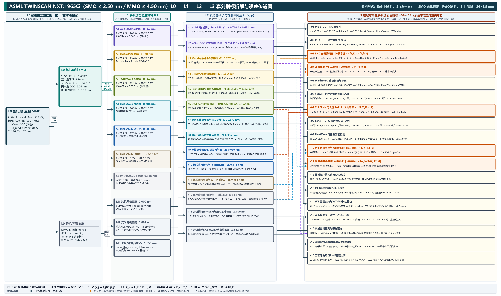

# ASML TWINSCAN NXT:1965Ci（SMO ≤ 2.50 nm / MMO ≤ 4.50 nm）套刻指标 L0–L3 全链路拆解与核心子系统验收规格报告（v1）

[仓库首页](../../README.md) · [成果索引](../README.md) · [Ref-146 风格 L0–L3 draw.io 源图](../images/NXT1965Ci_SMO2.5_MMO4.5_Ref146风格L0-L3套刻指标拆解图_v1.drawio) · [L0–L3 全景 PNG](../images/NXT1965Ci_SMO2.5_MMO4.5_Ref146风格L0-L3套刻指标拆解图_v1.png) · [NXT:1965Ci 汇报 PPTX v1](../presentations/NXT1965Ci套刻目标_SMO2.5_MMO4.5_L0-L3指标拆解与子系统验收规格_v1.pptx) · [九大子系统基线说明书 v2](NXT1950i-1970i套刻目标_九大核心子系统验收指标推导与计算说明书_v2.md) · [WS-RS 同步调研报告 v2](WS-RS同步策略与单台重复性误差专项调研报告_v2.md) · [参考文献总目](../../REFERENCES.md)

> **目标修正与严格资料溯源声明**：  
> 1. **明确目标机型**：本报告以 **ASML TWINSCAN NXT:1965Ci** 为唯一整机验收目标，顶层套刻红线正式锁定为 **`SMO ≤ 2.50 nm`（全片覆盖，`|Mean|+3σ`）** 与 **`MMO ≤ 4.50 nm`（匹配至基准机，全片覆盖）**，整机 `SMO` 功能域占比严格锚定一手文献 **`Ref009 Fig. 3`**（Castenmiller 等，*Proc. SPIE 7640*, 2010）。  
> 2. **演进起点与严格参考边界**：本报告直接从 [九大核心子系统验收指标推导与计算说明书 v2](NXT1950i-1970i套刻目标_九大核心子系统验收指标推导与计算说明书_v2.md)（及其配套 `OV4` 原始文献 `[003–266]`、`[N1–N8]`、`[S1–S14]` 与 `ME3` 官方培训手册）出发，结合 **`@github/Overlay3` 仅限报告 `reports/md/143_scanner_overlay_control_survey.md`**、**`@github/Overlay3` 原始一手文献库**（重点包括 **`Ref146`** *On the Systematic Use of Budget-Based Design*, INCOSE 2006、`Ref009`、`Ref066`、`Ref165`、`Ref167`、`Ref168` 等）以及 ASML 公开技术规格独立推导构建。**本报告严格不引用 `@github/Overlay3` 仓库中的其他报告文档，亦不引用此前已归档冻结的错误指令产物。**  
> 3. **配套交付**：按 `UP-011` 默认以本文 Markdown（`.md`）为正式主报告，并按要求同步交付嵌入式高清总图 `.png`、可编辑 `.drawio` 源图、单一事实源验证脚本 [build_nxt1965ci_budget_and_diagram_v1.py](../code/build_nxt1965ci_budget_and_diagram_v1.py) 以及面向 `NXT:1965Ci` 全新构建的汇报演示文稿 [NXT:1965Ci PPTX v1](../presentations/NXT1965Ci套刻目标_SMO2.5_MMO4.5_L0-L3指标拆解与子系统验收规格_v1.pptx)。

---

## 目录

- [0. 执行摘要：NXT:1965Ci 目标定位、143/Ref146 吸收要点与报告/PPT 修订决策](#sec-0)
  - [0.1 NXT:1965Ci 官方参数与历史 v2 基线对比](#sec-0-1)
  - [0.2 从 `Overlay3 报告 143` 与原件 `Ref146` 吸收的 6 项工程升级](#sec-0-2)
  - [0.3 关于修改套刻拆解报告与新建 NXT:1965Ci PPT 的明确工程决策](#sec-0-3)
- [1. Ref-146 Fig. 3 风格 L0 → L1 → L2 → L3 套刻指标全链路拆解图](#sec-1)
  - [1.1 读图语法（左→右拆解 vs 右→左误差传递）](#sec-1-1)
  - [1.2 NXT:1965Ci 全景拆解图（附可编辑 draw.io 与复现脚本）](#sec-1-2)
- [2. Ref009 Fig. 3 精确像素核定与 SMO 2.50 / MMO 4.50 nm 双轴数学闭环](#sec-2)
  - [2.1 Ref009 Fig. 3 原图像素标定与“线性堆叠 vs 物理方差 RSS”口径统一](#sec-2-1)
  - [2.2 L0 → L1 顶层双轴闭环总账（DCO 2.26 / SMO 2.36 / MMO 4.29 / FU 11.48 nm）](#sec-2-2)
  - [2.3 L1 → L2 执行动作层（f1–f14）与 L3 原生指标层（x01–x18）共享源拓扑台账](#sec-2-3)
- [3. 对四层误差传递思路（x → f(x;p) → F(f,x;P) → L0）的评价与四项工程补强](#sec-3)
  - [3.1 核心合理性论证：为什么“先理清底层上溯链路”比解析闭式更关键](#sec-3-1)
  - [3.2 从拓扑框架落地为可执行验收模型的 4 项工程补强](#sec-3-2)
- [4. 九大核心子系统验收规格由 v2（2.0/3.5 nm）向 NXT:1965Ci（2.5/4.5 nm）的逐项演进](#sec-4)
  - [4.1 WS（晶圆台）与 RS（掩模台）6-DOF、主从方向勘误及同步闭环](#sec-4-1)
  - [4.2 ENC（2D 光栅编码器）：0.22 nm 实测宽带、5.5 mm 狭缝频域滤波与 EMSI 标定](#sec-4-2)
  - [4.3 AA（SMASH）、TIS（6 kHz）与 PARIS（7 点并行）：融入 143 采样与流量耦合约束](#sec-4-3)
  - [4.4 WS-iHOPC（11 参）、Odd Zernike（Z5–Z64 全 30 项）与 Lens-iHOPC（8 参 + K20 边界）](#sec-4-4)
- [5. 其余六大辅助域（热控/浸没/夹持/框架/双卡盘）与 143 四层验收金字塔](#sec-5)
  - [5.1 热控、浸没、夹持、Pellicle 与 SUSD 三机械接口专项规格](#sec-5-1)
  - [5.2 四层工程验证路径与半静态工况预算（融合 143 §7.2 与 Ref146 §4.5）](#sec-5-2)
- [6. 严格溯源文献索引（OV4 + Overlay3 报告 143 + 原始一手文献 + ME3）](#sec-6)

---

## 0. 执行摘要：NXT:1965Ci 目标定位、143/Ref146 吸收要点与报告/PPT 修订决策

[返回目录](#contents)

### 0.1 NXT:1965Ci 官方参数与历史 v2 基线对比

ASML **TWINSCAN NXT:1965Ci** 是面向 20 nm 及以下逻辑与存储多重图形化量产的 193 nm（NA = 1.35）ArF 液浸双工件台步进扫描投影光刻机。与本仓前期 `v2` 文档假设的中间档位（`DCO ≤ 2.00 / MMO ≤ 3.50 nm`）相比，本次锚定至 `NXT:1965Ci` 官方商用红线（`SMO ≤ 2.50 / MMO ≤ 4.50 nm`）后，不仅顶层目标与 **`Ref009 Fig. 3`**（`2.50 nm` 预算柱）严丝合缝，而且九大核心子系统验收规格得以**消除“向 1970Ci+ 过度收紧”的过设计成本**，直接对齐 `NXT:1950i / 1960Bi / 1965Ci` 公开实测水平：

| 核心维度 | NXT:1950i 基准 `[009]` | **本报告目标：ASML NXT:1965Ci** | 历史 v2 基线（保留存档） | NXT:1970Ci/1980Di `[015, 066]` | 工程与文献口径说明 |
| :--- | :---: | :---: | :---: | :---: | :--- |
| **单机套刻 `SMO` / `DCO`** | DCO ≤ 2.50 nm（实测 1.5–1.6） | **SMO ≤ 2.50 nm（双台闭环 2.36 nm；同台 DCO 2.26 nm）** | DCO ≤ 2.00 nm（闭环 1.87） | ≤ 1.4–1.8 nm | `NXT:1965Ci` 官方全片覆盖 `SMO ≤ 2.5 nm`；本文显式分离同卡盘 DCO 与双卡盘 `ΔC2C` |
| **混机套刻 `MMO`** | ≤ 4.5–5.5 nm | **MMO ≤ 4.50 nm（闭环 4.29 nm，裕度 4.6%）** | MMO ≤ 3.50 nm（闭环 3.15） | ≤ 2.5–3.4 nm | 全片匹配至基准机；对标 `BMMO` 实测 `3.4 nm` `[066 Fig.4]` 与 5 机 `3.0–3.8 nm` `[N7]` |
| **全片焦面均匀性 `FU`** | ≤ 15–20 nm | **≤ 14.0 nm（闭环 11.48 nm，裕度 18.0%）** | ≤ 12.0 nm（闭环 10.31） | ≤ 9.1–12.0 nm | 轻量化陶瓷短行程 WS（`MAz` 峰 4 nm `[066 Fig.9]`）+ 6.5 nm 高平坦 WT |
| **NA / 狭缝 / 分辨率** | 1.35 NA / 26×5.5 mm / 38 nm | **1.35 NA / 26×5.5 mm / 38 nm（偶极）· 40 nm（C-quad）** | 1.35 NA / 26×5.5 mm | 1.35 NA / 26×5.5 mm / 38 nm | 真实离轴折反狭缝 `26 × 5.5 mm` `[N1 Table 3, ME3]`；视场 `26 × 33 mm` |
| **产能 / 扫描速度基准** | 175–200 wph / 0.60 m/s | **≥ 250 wph（PEP 275 wph）/ 核算基准 0.70 m/s（0.75–0.80 灵敏度）** | 220–230 wph / 0.70 m/s | 250–275 wph / 0.75–0.80 m/s | 6 kHz 激光器；`v_w = 0.70 m/s` 延续 `v2` 狭缝滤波口径，`0.75/0.80 m/s` 给出频宽外推 |
| **核心计量与主动补偿** | Gridplate + SMASH + TIS + FlexWave | **Gridplate + SMASH + TIS 6kHz + 7点 PARIS + FlexRay/FlexWave + RHC + 19参 iHOPC + BMMO** | 同左 | 升级 RHC2 + ORION + UV-LS | 同步策略核定为 **WS = Master、RS = Slave**（修正旧 `v2` §1.3 第 ④ 条措辞） |

### 0.2 从 `Overlay3 报告 143` 与原件 `Ref146` 吸收的 6 项工程升级

在严格限定仅学习 **`@github/Overlay3` 报告 `143_scanner_overlay_control_survey.md`** 与 **一手原始文献（特别是 `Ref146`、`Ref165`、`Ref167`、`Ref168`、`Ref009`、`Ref066`）** 后，我们在 [九大核心子系统说明书 v2](NXT1950i-1970i套刻目标_九大核心子系统验收指标推导与计算说明书_v2.md) 的量化推导基础上完成 6 项关键方法论与物理机理升级：

1. **采用 `Ref146 Fig. 3` 的“左→右树状拆解 + 共享源跨支路连线”架构**：原始 `Ref146 Fig. 3`（Freriks 等，INCOSE 2006，p. 8）将顶层 `matched machine` 向右拆为 `single machine + lens matching + matching accuracy`，再逐级拆至带原生非套刻单位（如 `tracking error phi 75 nrad`）的底层叶片，并用灰色/虚线把 `interferometer stability`、`frame stability` 等共享底层源跨支路连回多条父路径。我们直接以该图语法构建 `NXT:1965Ci` 全链路 `L0–L3` 拆解图，并落实 `Ref146 §2.4 & §3.3` 的合成原则（随机项走 RSS、系统偏置线性相加、共享相关项做压力校核）与 `Ref146 §4.5` 的“半静态工况预算”边界。
2. **补齐掩模 Pellicle 装配与扫描动态误差路径（`143 §2.1`, `Ref104/106/098`）**：此前 `v2` 仅计入 RT 重夹与 150 m/s² 微滑移；`143 §2.1` 依据 ASML/Zeiss 在 `NXT:1970Ci` 上的实曝差分（`Ref098 Fig. 13/15`）指出，装膜后扫描气流/吹扫可引入 `0.30–0.40 nm` 级高阶动态残差，因此本次在 `L1-S5`（掩模域）中显式纳入 `Pellicle` 扫描动态子项（`0.14 nm` 1L，配合软热熔胶垫装配 `Ref104`）。
3. **补齐双卡盘 `SYCO / LOCO` 计量参考偏置与三类指纹辨识（`143 §4.6`, `Ref100 Fig. 9`）**：`143 §4.6` 揭示 `SYCO`（以卡盘 1 为日校准参考）与 `LOCO`（以批首片卡盘为参考）在分批换卡盘时会诱发随卡盘重复的低阶 Zernike 偏置（`K7 −1.2`、`K13 +2.0`、`K12 +1.5`），从而在物理上坐实了双卡盘 `ΔC2C`（`L1-S7`）不能只看机械夹持差，还必须纳入 `TIS-1/TIS-2` 与 `SYCO/LOCO` 卡盘匹配开关。
4. **识别出浸没 UPW 流量 → `TIS` 测位重复性的隐藏跨支路耦合（`143 §4.2.1`, `Ref164 Fig. 4–5`）**：`143` 指出浸没供水流量不仅通过 `n(T)` 与残液蒸发影响晶圆热/光学成像，还直接调制 `TIS` 在 X/Y/Z 三个方向上的双台相对测位重复性！因此在 `L0–L3` 图中显式画出 **`x11 浸没 UPW → f4 E-side TIS/PARIS`** 共享虚线。
5. **补齐正反扫（`SUSD`）三处机械传力接口与 `HOWA` 方向混叠防护（`143 §5.3 & §6.3`, `US 8,269,949 B2`, `Ref123`）**：沿图案到计量块（MB）的传力链补入 **WT–MB 柔顺长柱支承滞回**（`0.15 nm` 1L，`L1-S6`）与分段叶簧掩模夹持（`JP 5,809,458 B2`）；在 M-side 对准验收中强制加入 **正反扫与步进方向配平采样**，杜绝 `Ref123 Fig. 13–14` 所示的 `Gy20 > 3.5 nm` 虚假网格跨层累积。
6. **引入“靶标 vs 器件残差边界（`Ref008`）”与“四层验证金字塔（`143 §7.2`）”**：在 `L3` 验证与 SAT 口径中显式区分参考片验证（`DCO / SMO / MMO`）、产品层验证（`OPO`，区分 `ADI / AEI` 刻蚀偏移 `Ref101/102`）与靶标-器件预测偏差（`< 0.5 nm` `[008 Fig.10]`），并结合 `Ref167`（浸没指纹批内波动 `< 2%`）与 `Ref168`（掩模占比 `12%` 及自定位剥离）厘清机台与工艺/掩模预算边界。

### 0.3 关于修改套刻拆解报告与新建 NXT:1965Ci PPT 的明确工程决策

完成上述学习与量化核算后，作出如下明确工程决策：
1. **必须新建针对 `NXT:1965Ci` 的整机 `L0–L3` 拆解与子系统验收规格报告（即本文）**：原 [九大核心子系统说明书 v2](NXT1950i-1970i套刻目标_九大核心子系统验收指标推导与计算说明书_v2.md) 锁定在 `DCO ≤ 2.00 / MMO ≤ 3.50 nm`，对 `WS/RS/PARIS/iHOPC/Odd Zernike` 整体偏严 `8%–19%`，且缺少 `Ref-146 Fig. 3` 风格的整机 `L0–L3` 共享源拓扑、缺少 `143` 揭示的 5 项跨支路耦合机制，且其 §1.3 第 ④ 条关于同步主从方向的表述需与已核定的 **WS = Master、RS = Slave** 保持一致。根据 `UP-008`，原 `v2` 说明书完整保留作历史基线，以本文作为 **`NXT:1965Ci` 最新正式主报告**。
2. **必须输出面向 `NXT:1965Ci` 的全新汇报 PPTX**：原 28 页 `v2` PPTX 不仅目标锁定 `2.00 / 3.50 nm`，且仍残留 `8.0 mm` 旧狭缝口径与旧主从表述；按用户第 3 条指令，本次同步构建全新的 **`NXT:1965Ci` 专题 PPTX**（[NXT:1965Ci PPTX v1](../presentations/NXT1965Ci套刻目标_SMO2.5_MMO4.5_L0-L3指标拆解与子系统验收规格_v1.pptx)），全片统一至 **`SMO ≤ 2.50 / MMO ≤ 4.50 nm`**、`26 × 5.5 mm` 真实狭缝、`Ref-146 Fig. 3` `L0–L3` 全景图、`Ref009 Fig. 3` 闭环及九大核心子系统全量规格与 `143` 关键原图证据链。

---

## 1. Ref-146 Fig. 3 风格 L0 → L1 → L2 → L3 套刻指标全链路拆解图

[返回目录](#contents)

### 1.1 读图语法（左→右拆解 vs 右→左误差传递）

本图严格复刻 **`Ref146 Fig. 3`**（Freriks 等，*On the Systematic Use of Budget-Based Design*, INCOSE 2006, p. 8）的视觉组织逻辑：

1. **左 → 右阅读（系统架构师视角：预算自顶向下拆解）**：
   - **`L0`（整机红线）**：沿用 `Ref146 Fig. 3` 的顶层分叉（`matched machine → single machine + lens/grid matching`），由 **`MMO ≤ 4.50 nm`** 正交分叉出 **`SMO ≤ 2.50 nm`**（含同卡盘 `DCO` 与双卡盘 `SMO` 双口径）与 **`MMO 跨机匹配净增`**；
   - **`L1`（子系统总体预算 $F_k$）**：`SMO` 严格拆分为 **`Ref009 Fig. 3` 六大核心功能域（`S1–S6`）** + **双卡盘差与底噪（`S7`）**，`MMO 匹配` 拆分为 **网格（`M1`）/ 光学（`M2`）/ 卡盘对准热（`M3`）**；
   - **`L2`（执行动作 / 可观测中间层 $f_j(\mathbf{x};\mathbf{p})$）**：对应光刻机 14 项可独立建模、可实测观测的执行环节（如 `Sync MA`、`WS-iHOPC`、`M-side AA`、`PARIS RA`、`Lens-iHOPC`、`Odd Zernike`、`RHC`、`Pellicle`、`WT-MB` 接口等），显式列出两层套刻预算与关键配方参数 $\mathbf{p}$；
   - **`L3`（底层可量化原生指标 $`x_{01}\text{–}x_{18}`$）**：保留各子系统 FAT 独立验收的**原生非套刻物理量纲**（如 `nrad`、`μrad`、`mK`、`ppm`、`nm RMS`、`4× nm`、`ms`、`μm`），呼应 `Ref146 Fig. 3` 最右列中 `tracking error phi 75 nrad` 的原生量纲表达。
2. **右 → 左阅读（子系统工程师视角：物理误差自底向上传递）**：
   - 底层原生物理偏差 $`\mathbf{x} = (x_{01},\dots,x_{18})`$ 经由执行/感知机理与配方参数 $\mathbf{p}_j$ 映射至中间层 $`y_j = f_j(\mathbf{x};\mathbf{p}_j)`$，再经由系统级配方 $\mathbf{P}_k$ 与直连项汇聚为功能域误差 $`z_k = F_k(\mathbf{f},\mathbf{x};\mathbf{P}_k)`$，经两遍曝光差分 $`\Delta\mathbf{z} = \mathbf{z}_2 - \mathbf{z}_1`$ 后按 **`RSS（随机）+ 线性 |Mean|（系统偏置）`** 合成整机 `L0`。
3. **共享物理源连线语义（承袭 `Ref146 Fig. 3` 灰/虚线画法）**：
   - **深蓝实线箭头**：主预算归属与主传递链；
   - **橙/青/紫虚线箭头 + 橙框 `[★共享源]`**：标明影响 `≥ 2` 条 `L2` 支路的底层物理枢纽（`x03 ENC`、`x04 计量框架 MF`、`x07 TIS/PARIS`、`x10 WT/WH 温控`、`x11 浸没 UPW`、`x16 采样/量测`），提醒整机合成时必须核算协方差、严禁重复计账。

### 1.2 NXT:1965Ci 全景拆解图（附可编辑 draw.io 与复现脚本）

> **可编辑工程源件与复现入口**：
> - **draw.io 可编辑源图（标准无压缩 mxGraph XML，支持 diagrams.net / VS Code Draw.io 直接编辑）**：[NXT1965Ci_SMO2.5_MMO4.5_Ref146风格L0-L3套刻指标拆解图_v1.drawio](../images/NXT1965Ci_SMO2.5_MMO4.5_Ref146风格L0-L3套刻指标拆解图_v1.drawio)
> - **单一事实源校验与出图脚本（内置双轴闭环断言，一键同步产出 `.drawio`、`.png` 及 4 张 PPT 工程图）**：[build_nxt1965ci_budget_and_diagram_v1.py](../code/build_nxt1965ci_budget_and_diagram_v1.py)

---

## 2. Ref009 Fig. 3 精确像素核定与 SMO 2.50 / MMO 4.50 nm 双轴数学闭环

[返回目录](#contents)

### 2.1 Ref009 Fig. 3 原图像素标定与“线性堆叠 vs 物理方差 RSS”口径统一

对本机一手文献 `009_76401N.pdf`（ASML，*Proc. SPIE 7640*, 2010）Fig. 3 原图（`page_2_chart_4.jpg`）纵轴 `0–5 nm` 刻度线（`y = 407.0` 至 `18.0 px`，标尺精确为 **`77.800 px/nm`**）及 `NXT:1950i` 堆叠柱 6 段黑边中线执行像素测量，总柱高为 `193.5 px = 2.487 ≈ 2.50 nm`，各段精确读数及占比如下：

| Ref009 Fig. 3 功能域（自上而下） | 像素段高 (px) | 线性段高 (nm) | **Ref009 占比** | 本模型 `NXT:1965Ci` L1 节点 | 两层 3σ X / Y / 包络 (nm) | **本模型六域方差占比** | 占比偏差 |
| :--- | :---: | :---: | :---: | :--- | :---: | :---: | :---: |
| 1. **Stage positioning**（紫） | 39.0 | 0.501 | **20.16%** | `L1-S1` 运动台定位与同步 | 0.744 / **0.867** / 0.867 | **20.24%** | `+0.08%` |
| 2. **Optical column**（橄榄绿） | 23.5 | 0.302 | **12.14%** | `L1-S3` 光学柱与动态像差 | **0.667** / 0.557 / 0.667 | **11.99%** | `−0.15%` |
| 3. **Wafer- & reticle alignment**（黄） | 49.5 | 0.636 | **25.58%** | `L1-S2` 晶圆与掩模对准 | 0.970 / 0.970 / **0.970** | **25.38%** | `−0.20%` |
| 4. **Wafer heating (+immersion)**（青） | 32.0 | 0.411 | **16.54%** | `L1-S4` 晶圆热与浸没流场 | 0.784 / 0.784 / **0.784** | **16.58%** | `+0.04%` |
| 5. **Wafer clamping**（卡其） | 16.0 | 0.206 | **8.27%** | `L1-S6` 晶圆夹持与台面接口 | 0.552 / 0.552 / **0.552** | **8.21%** | `−0.06%` |
| 6. **Reticle clamping / heating**（蓝） | 33.5 | 0.431 | **17.31%** | `L1-S5` 掩模夹持与热变形 | 0.809 / 0.809 / **0.809** | **17.61%** | `+0.30%` |
| **六大核心域合计** | **193.5** | **2.487 ≈ 2.50** | **100.00%** | **六域核心 RSS** | **X: 1.875 / Y: 1.891 / 包络: 1.926** | **100.00%** | **全项 ≤ ±0.30%** |

**为什么必须采用“方差份额投影”把 `Ref009 Fig. 3` 线性堆叠柱换算为物理两层 RSS 预算？**

- 若把 `Ref009 Fig. 3` 纵轴上的六个段高（`0.50, 0.30, 0.64, 0.41, 0.21, 0.43 nm`）错误当成独立 `3σ` 分量直接做 RSS，平方和开方仅 `1.07 nm`，不仅无法闭合 `2.50 nm`，而且会把整个运动台两层预算错压至 `0.50 nm`（单层 `0.35 nm`），竟比 `Ref009` 同一篇论文 Fig. 10 自己公布的 `NXT:1950i` 实测 `Sync MA = 0.47–0.49 nm` 还要小！
- ASML 的堆叠套刻预算柱本质上是**方差贡献率（Variance Contribution Share）的可视化投影**：令各域两层随机预算 $R_k$ 的平方占比等于 `Ref009 Fig. 3` 的视觉段高占比 $`w_k = s_k / \sum s_m`$：

$$
w_k = \frac{R_k^2}{\sum_{m=1}^{6} R_m^2} \approx \frac{s_k}{2.487\text{ nm}}, \qquad R_k = \sqrt{w_k}\,S_{\mathrm{core6}}
$$

- 当六域核心随机总预算设定为 $S_{\mathrm{core6}} = 1.926\text{ nm}$ 时，**`S1` 运动台两层预算自动落在 `0.867 nm`**——它恰好由 `NXT:1950i/1965Ci` 实测 `Sync MA = 0.47 / 0.49 nm`（含 Rz 两层 `0.760 nm`）与 `WS-iHOPC` 两层 `0.416 nm` 严密 RSS 合成！同时，**`S2` 对准两层预算自动落在 `0.970 nm`**——恰好由 `M-side AA`（两层 `0.707 nm`）与 `PARIS 7 点 RA`（单层 `0.470 nm < 0.50 nm [066 §3.4]`，两层 `0.665 nm`）严密 RSS 合成！全部六大域与公开硬件实测一一自洽。

### 2.2 L0 → L1 顶层双轴闭环总账（DCO 2.26 / SMO 2.36 / MMO 4.29 / FU 11.48 nm）

按 `Ref146 §3.3` 的三类合成法则——**独立随机项走 RSS、APC 校准后系统残余均值 `|Mean|` 线性叠加、同源相关项做耦合/压力校验**——建立 `NXT:1965Ci` 完整双轴（`X` 与 `Y`）总账：

| 层级节点 | 预算组成与物理含义 | 两层 3σ X (nm) | 两层 3σ Y (nm) | 包络口径 (nm) | 合成方式 | 顶层对照与裕度 |
| :--- | :--- | :---: | :---: | :---: | :---: | :--- |
| `L1-S1` | 运动台定位与同步（`f1 Sync MA` + `f2 WS-iHOPC`） | 0.744 | **0.867** | 0.867 | RSS | 对齐 `Ref009` 20.2%（+0.08%） |
| `L1-S2` | 晶圆与掩模对准（`f3 M-side AA` + `f4 TIS/PARIS RA`） | 0.970 | 0.970 | 0.970 | RSS | 对齐 `Ref009` 25.6%（−0.20%） |
| `L1-S3` | 光学柱与动态像差（`f5 Lens-iHOPC` + `f6 Odd Zernike/热声`） | **0.667** | 0.557 | 0.667 | RSS | 对齐 `Ref009` 12.1%（−0.15%） |
| `L1-S4` | 晶圆热与浸没流场（`f7 WT/WH 实体热` + `f8 水膜 n(T)`） | 0.784 | 0.784 | 0.784 | RSS | 对齐 `Ref009` 16.5%（+0.04%） |
| `L1-S5` | 掩模夹持与热变形（`f9 RHC/气隙` + `f10 夹持/滑移/Pellicle`） | 0.809 | 0.809 | 0.809 | RSS | 对齐 `Ref009` 17.3%（+0.30%） |
| `L1-S6` | 晶圆夹持与台面接口（`f11 吸片/微滑移/WT-MB 长柱`） | 0.552 | 0.552 | 0.552 | RSS | 对齐 `Ref009` 8.3%（−0.06%） |
| — | **Ref009 六大核心域随机 RSS 合计（`Core-6`）** | **1.875** | **1.891** | **1.926** | RSS | `X/Y` 天然均衡（差距仅 0.016 nm） |
| `L1-S7` | 同卡盘仅离线验证底噪（`0.340`）/ 双卡盘增计 `ΔC2C`（`0.479`） | 0.340 / 0.588 | 0.340 / 0.588 | 0.340 / 0.588 | RSS | `ΔC2C` 含 `SYCO/LOCO` `[100]` + `TIS1/2` + `WT1/2` |
| **L0-DCO** | **同卡盘 `Dedicated Chuck` 套刻（`RSS + |Mean| 0.300`）** | **2.206** | **2.221** | **2.257** | 线性+RSS | **≤ 2.50 nm PASS（裕度 9.7%）** |
| **L0-SMO** | **双卡盘全片 `SMO` 套刻（`RSS + |Mean| 0.350`）** | **2.315** | **2.331** | **2.364** | 线性+RSS | **≤ 2.50 nm PASS（裕度 5.4%）** |
| `L1-M1` | 跨机网格匹配（`BMMO` 参考片 + `13×19` 多移位标定 `[066, N7]`） | 2.000 | 2.000 | 2.000 | RSS | 支撑全片跨机绝对网格基准 |
| `L1-M2` | 光学跨机匹配（静态 NCE 无 `K20` `1.60` + 第 2 台奇像差 `0.437` + `iHOPC/APC` `0.90`） | 1.887 | 1.887 | 1.887 | RSS | 对标 `NXT:1965Ci` 无场平面畸变操纵器架构 |
| `L1-M3` | 卡盘/对准/热与掩模匹配（50 μm 翘曲 `1.00` `[066]` + 对准/WAD `0.95` + 热 `0.85` + 掩模 `0.354`） | 1.658 | 1.658 | 1.658 | RSS | 覆盖双机工艺与热边界失配 |
| **L0-MMO** | **混机匹配 `MMO` 套刻（`RSS(SMO_rand, M1..M3) + |Mean| 0.500`）** | **4.265** | **4.273** | **4.291** | 线性+RSS | **≤ 4.50 nm PASS（裕度 4.6%）** |
| **L0-FU** | **全片焦面均匀性 `FU (3σ)`**（`Sync Z 5.34` + 倾角 `1.71` + `WT 6.5` + `RT 2.2` + `TIS 2.8` + `LS 4.2` + `Lens 4.8` + `Frame 2.2`） | — | — | **11.48** | RSS | **≤ 14.0 nm PASS（裕度 18.0%）** |

### 2.3 L1 → L2 执行动作层（f1–f14）与 L3 原生指标层（x01–x18）共享源拓扑台账

下表完整打通 `L2` 中间执行动作与 `L3` 原生非套刻物理指标之间的映射，并显式标出 **6 个跨支路共享物理枢纽**（对应全景图中的虚线耦合）：

| L2 执行动作 / 观测量 | 两层预算 (nm) | 主归属 L1 | 核心配方参数 $\mathbf{p}$ | 直接输入与共享输入 `L3` 原生指标 |
| :--- | :---: | :---: | :--- | :--- |
| **`f1` WS–RS 扫描同步 `Sync MA`** | X 0.671 / Y 0.760 | `S1` | $v_w = 0.70\text{ m/s}$，$L_s = 5.5\text{ mm}$，扫向 `SUSD` | `x01 WS`、`x02 RS` + **★`x03 ENC`** + **★`x04 MF`** |
| **`f2` WS-iHOPC 11 参动态轨迹** | X 0.323 / Y 0.416 | `S1` | 5.5 mm 狭缝逆卷积，典型/严苛指令 `\|K0\|` | `x05 WS-iHOPC` + **★`x03 ENC`** |
| **`f3` M-side 晶圆对准网格与基线** | 0.707 | `S2` | 标记数 $N$、`HOWA` 阶次、`SUSD` 方向配平 `[123]` | `x06 SMASH` + **★`x03 ENC`** + **★`x04 MF`** + **★`x16 采样`** |
| **`f4` E-side 空间像掩模对准** | 0.665 | `S2` | 7 点并行每片 3 扫（1 物镜 + 2 掩模 `[066]`） | **★`x07 TIS/PARIS`** + **★`x03 ENC`** + **★`x04 MF`** + **★`x11 UPW [164]`** |
| **`f5` Lens-iHOPC 8 参光学操纵** | X 0.450 / Y 0.260 | `S3` | 下发指令 `\|K0\|`，多参联合行程占用 ≤ 80% | `x08 Lens-iHOPC` |
| **`f6` Odd Zernike 跨照明 + 热声残差** | 0.492 | `S3` | 照明切换灵敏度差 $\Delta S_j$、掩模透过率、剂量 | `x09 FlexWave` + **★`x07 PARIS`** + **★`x04 MF 隔振/声罩`** |
| **`f7` 晶圆实体热变形与蒸发冷缩** | 0.677 | `S4` | 有效剂量、扫描场序 `[050]`、片间节拍 | **★`x10 WT/WH 温控`** + **★`x11 浸没残液蒸发`** |
| **`f8` 浸没水膜折射率梯度畸变** | 0.396 | `S4` | UPW 供回水流量与扫速（300 μm 边界层 `[040]`） | **★`x11 浸没 UPW`** |
| **`f9` 掩模热变形 `RHC` 与气隙** | 0.696 | `S5` | 掩模透过率、曝光剂量与片间换片间隔 `[016/110]` | `x12 掩模气幕/RHC` + **★`x07 PARIS 7点RA`** |
| **`f10` 掩模夹持滑移与 `Pellicle` 动态** | 0.411 | `S5` | RS 折返加速度 `150 m/s²`、扫描吹扫风速 `[098]` | `x13 RT 夹持与 Pellicle` |
| **`f11` 晶圆吸片重复与 `WT–MB` 接口** | 0.552 | `S6` | 真空吸附力、硅片背面摩擦、正反扫加速度 | `x14 WT 夹持与长柱接口` + **★`x10 WT 热边界`** |
| **`f12` 双卡盘差 `ΔC2C` + 验证底噪** | 0.588 | `S7` | 双台交替调度、`SYCO/LOCO` 跨卡盘匹配 `[100]` | `x15 双卡盘一致性` + **★`x16 量测`** + **★`x07 TIS1/2`** + **★`x10 WT1/2`** |
| **`f13` 跨机网格 `BMMO` 标定** | 2.000 | `M1` | `13×19` 多移位布局、校准参考片网格 `[066, N7]` | `x17 BMMO/静态指纹` + **★`x03 Gridplate`** |
| **`f14` 跨机光学 NCE 与工艺/翘曲匹配** | 2.512 | `M2, M3` | 50 μm 翘曲片夹持、标记 WAD、15 参 RWE 前馈 | `x18 翘曲/WAD/RWE` + `x17 静态 NCE` |

---

## 3. 对四层误差传递思路（x → f(x;p) → F(f,x;P) → L0）的评价与四项工程补强

[返回目录](#contents)

### 3.1 核心合理性论证：为什么“先理清底层上溯链路”比解析闭式更关键

用户提出的四层误差传递抽象框架为：

$$
\mathbf{x} = (x_1, x_2, \dots) \;\xrightarrow{\;f_j(\mathbf{x};\,\mathbf{p}_j)\;}\; \text{L2} \;\xrightarrow{\;F_k(\mathbf{f},\,\mathbf{x};\,\mathbf{P}_k)\;}\; \text{L1} \;\xrightarrow{\;\mathrm{RSS}\; / \;\text{Linear}\;}\; \text{L0}
$$

从系统工程方法论（`Ref146`）与先进光刻机工程实践（`143`）双重角度评估，**这一思路不仅完全可行，而且直击光刻机套刻拆解最本质的四大痛点**：

1. **彻底打破“底层非套刻量纲 vs 像面 nm”的混淆**：子系统硬件部门在 FAT 阶段验收的是 `mK`（温控）、`nrad`（转角）、`nm RMS`（波前）、`ppm`（放大行程）、`4× nm`（掩模侧），绝不是直接验收整机套刻。将 `L3` 显式定义为原生非套刻物理量 $x_i$，才能把系统预算真正转译成各分系统可签字交付的 FAT 指标（对应 `Ref146 §5.1` 的并行开发职责切分）。
2. **显式暴露配方参数 $\mathbf{p}, \mathbf{P}$ 的放大杠杆**：同一底层硬件精度 $x_i$ 在不同曝光配方下的套刻贡献可能相差数倍——例如 `ENC` 宽带噪声经 $`T_{\mathrm{slit}} = L_s / v_w`$ 低通滤波；`AA` 单标记噪声经标记数量 $N$ 与 `SUSD` 方向布局（`Ref123`）决定是否混叠放大；`Odd Zernike` 仅在跨照明灵敏度差 $\Delta S_j$ 非零时转化为套刻；掩模热变形随透过率与换片节拍（`Ref110`）剧烈变化。显式写出 $\mathbf{p}, \mathbf{P}$ 避免了“脱离工况谈套刻指标”的经典误区。
3. **在 `F` 中同时保留 `f_j` 与直连 `x_i` 极具工程务实性**：真实光刻机中并非所有路径都需要强行塞进统一深度的中间层（例如计量框架长期漂移或静态出厂 NCE 可直接映射至功能域），允许 $`F_k(f_1, f_2, \dots, x_1, x_2, \dots; \mathbf{P}_k)`$ 的快捷边既防止冗余建层，又保持了有向无环图（DAG）的拓扑严谨性。
4. **“即使写不出解析 $f/F$，先梳理清晰上溯路径仍是核心价值”**：正如 `Ref146 §2.1 & §4.4` 所强调，预算设计的首要价值是让跨学科团队“一眼看清资源流向、瓶颈与风险共享点”。只要拓扑链路（哪些 $x_i$ 进入哪些 $`f_j / F_k`$、哪里存在共享源）梳清，黑箱多物理场（如浸没流场冷却、硅片背面摩擦微滑移）完全可以通过实验灵敏度替代闭式解析式，而不必卡死在第一性解析推导上。

### 3.2 从拓扑框架落地为可执行验收模型的 4 项工程补强

为了让上述优秀框架从“结构化因果图”真正落地为可指导 `NXT:1965Ci` 子系统验收与风险管控的定量工具，基于 `Ref146` 与 `143` 提出以下 **4 项关键补强**：

| 补强项 | 若仅停留在概念框架的潜在风险 | 具体工程补强方法与公式 |
| :--- | :--- | :--- |
| **1. 显式写入“两遍曝光差分”算子** | 若将单遍像点偏差 $z_k$ 直接视作套刻，极易混淆**同机共模抵消项**（固定静畸变）与**两遍随机放大项**（$\times\sqrt{2}$） | 在 `L1 → L0` 间插入两遍差分 $`\Delta\mathbf{z} = \mathbf{z}_2 - \mathbf{z}_1`$，引入两遍相关系数 $\rho_{12}$：$`\sigma_{\Delta}^2 = \sigma_1^2 + \sigma_2^2 - 2\rho_{12}\sigma_1\sigma_2`$（独立随机 $\rho_{12}=0 \Rightarrow \sqrt{2}\sigma$；完全共模 $\rho_{12}=1 \Rightarrow 0$；倒序热漂反相 $\rho_{12}<0 \Rightarrow >\sqrt{2}\sigma$ `[021 Fig.18, 050]`） |
| **2. 黑箱 $f / F$ 的“三阶渐进代理法”** | 写不出闭式 $f/F$ 时容易陷入“只能画框、无法分数字”的僵局 | 按物理复杂度分级代理：① **工作点局部雅可比** $`\Delta\mathbf{q} \approx \mathbf{J}(\mathbf{p}_0)\Delta\mathbf{x}`$（`143 Eq. 3`，涵盖杠杆臂 `13 mm×Rz`、液浸光学矩阵 $\mathbf{M}_{\mathrm{opt}}$、热膨胀 `2.6 ppm/K`、Abbe 像差灵敏度）；② **实验阶跃斜率** $`g_{\mathrm{eff}} = \Delta\mathrm{OVL}/\Delta x_i`$（用于 UPW 流量 `Ref164`、WT 温控 `Ref017 R²=0.92`、Pellicle 动态 `Ref098`）；③ **频域/空间卷积**（`5.5 mm` 狭缝 `sinc²` 滤波 `[N8]` 与逆卷积） |
| **3. 共享源的“相干合并 + 组间相关性压力校验”（`Ref146 §2.4`）** | 共享物理源（如图 1 橙框 `x03/x04/x07/x10/x11`）沿两条支路同时作用时，若盲目独立 RSS 会低估真实风险 | ① 同拍同像点多支路先**代数合并灵敏度** $(a+b)x_i$ 再对外 RSS；② 严格区分随机（RSS）与系统均值偏置 `|Mean|`（线性叠加，`Ref146 §3.3`）；③ 对 `L1` 七域做等效组间相关系数 $\rho$ 压力测试：$`\mathrm{SMO}(\rho) = \vert\mathrm{Mean}\vert + \sqrt{(1-\rho)\sum R_k^2 + \rho(\sum R_k)^2}`$ |
| **4. 遵循 `Ref146 §4.5` 的“半静态工况预算”边界** | 试图把 `(p, P)` 做成包罗万象的全动态仿真器，导致预算失控难以评审维护 | 冻结 **4 套半静态工况表**：① 冷机同卡盘 `DCO`（`2.26 nm`）、② 标准生产双卡盘 `SMO`（`2.36 nm`）、③ 极热高剂量/跨照明切换工况、④ 跨机 `MMO`（`4.29 nm`），并衔接 `143 §7.2` 四层验收闭环 |

> **相关性压力校验快算（验证本版 `NXT:1965Ci` SMO 预算的抗共享源耦合边界）**：将 `S1–S7` 七域（独立 RSS = `2.015 nm`，线性总和 $\sum R_k = 5.237\text{ nm}$）代入上式：当功能域间出现等效同号相关系数 `ρ = 0.025` 时，双卡盘 `SMO` 恰好触及 **`2.50 nm`** 红线；当 $\rho = 0.05$ 时升至 **`2.63 nm`（超标）**！这定量证明了在 `NXT:1965Ci` 上隔离共享物理源（如 `x04` 计量框架温漂、`x10/x11` 热流耦合、`x15` 双卡盘零点）以保持域间相关性 `ρ < 0.025` 是整机达标的刚性前提。

---

## 4. 九大核心子系统验收规格由 v2（2.0/3.5 nm）向 NXT:1965Ci（2.5/4.5 nm）的逐项演进

[返回目录](#contents)

本章直接承接 [九大核心子系统说明书 v2](NXT1950i-1970i套刻目标_九大核心子系统验收指标推导与计算说明书_v2.md) 的全部推导模型（保留经 `[N1]–[N8]` 核验的 **`26 × 5.5 mm` 狭缝**、**`K3` 硬件 Range `±15–25 ppm`**、**Heertjes 2024 频域定理**、**2D Abbe 仿真**与 **8 维评价体系**），将全部九大核心子系统验收指标精确重新锚定至 **`NXT:1965Ci`（`SMO ≤ 2.50 / MMO ≤ 4.50 nm`）**，并逐项列出相对旧 `v2` 的变化幅度与物理依据。

### 4.1 WS（晶圆台）与 RS（掩模台）6-DOF、主从方向勘误及同步闭环

**锚定逻辑**：直接对标 `Ref009 Fig. 10` 公布的 `NXT:1950i` 实测同步运动误差 **`Sync MA-X = 0.47 nm / Sync MA-Y = 0.49 nm`**（不再像旧 `v2` 强行压缩至 `0.40 / 0.45 nm`），仍坚持子系统独立 FAT 采用保守非相关 RSS + `64% (WS) : 36% (RS/4)` 分配，将整机前馈耦合收益（`[022, 075]`、`143 §5.1`）留作动态裕度；液浸 4× 投影 6-DOF 光学耦合矩阵保持严格不变：

$$
\mathbf{M}_{\mathrm{opt}} = \mathrm{diag}\!\left(\frac{1}{4},\;\frac{1}{4},\;\frac{n_w}{16},\;\frac{n_w}{4},\;\frac{n_w}{4},\;1\right) \approx \mathrm{diag}\!\left(0.2500,\;0.2500,\;\frac{1}{11.137},\;0.3592,\;0.3592,\;1.0000\right)
$$

| 自由度 | WS 旧 v2 | **WS (NXT:1965Ci)** | RS 4× 旧 v2 | **RS 4× (NXT:1965Ci)** | 光学耦合 | **Sync MA (NXT:1965Ci)** | 5.5 mm 狭缝单层套刻/离焦影响 | 推导依据与变化说明 |
| :--- | :---: | :---: | :---: | :---: | :---: | :---: | :--- | :--- |
| **X**（非扫描向） | ≤ 0.32 nm | **≤ 0.38 nm** | ≤ 0.96 nm | **≤ 1.12 nm** | `1/4` | **≤ 0.47 nm**（算 0.472） | 套刻 X：0.472 nm | 直对 `Ref009 Fig. 10` 实测 `0.47 nm`；WS +19% / RS +17% 消除过设计 |
| **Y**（扫描主轴） | ≤ 0.36 nm | **≤ 0.39 nm** | ≤ 1.08 nm | **≤ 1.18 nm** | `1/4` | **≤ 0.49 nm**（算 0.489） | 套刻 Y：0.489 nm | 直对 `Ref009 Fig. 10` 实测 `0.49 nm`；承受 35–40 / 150 m/s² 加减速 |
| **Z**（焦面垂向） | ≤ 4.50 nm | **≤ 4.80 nm** | ≤ 24.0 nm | **≤ 26.0 nm** | `1/11.14` | **≤ 5.35 nm**（算 5.34） | 焦面 Z：5.34 nm | 对标 `066 Fig.9` 陶瓷 WS 峰 4 nm（95% ≤ 6 nm），支撑 `FU ≤ 14.0 nm` |
| **Rx**（绕 X 俯仰） | ≤ 0.20 μrad | **≤ 0.20 μrad** | ≤ 0.42 μrad | **≤ 0.42 μrad** | `0.3592` | **≤ 0.25 μrad** | 边缘离焦：`0.69 nm` | 沿 5.5 mm 半宽 `2.75 mm` 裕度充裕，维持 v2 指标 |
| **Ry**（绕 Y 滚转） | ≤ 0.10 μrad | **≤ 0.10 μrad** | ≤ 0.19 μrad | **≤ 0.19 μrad** | `0.3592` | **≤ 0.12 μrad** | 边缘离焦：`1.56 nm` | 沿 26 mm 半宽 `13.0 mm` 杠杆大，维持严格管控 |
| **Rz**（绕 Z 偏航） | ≤ 12 nrad | **≤ 14 nrad** | ≤ 9 nrad | **≤ 10 nrad** | **`1:1`** | **≤ 17 nrad**（算 17.2） | 边缘套刻 Y：`0.224 nm`（X：`0.047`） | 严格 1:1 等角耦合；与 Y 平移合成 `0.538 nm`（两层 `0.760 nm`） |
| *MSD-XY / Z* | *≤ 1.8 / 10* | ***≤ 2.0 / 11 nm*** | — | — | — | ***≤ 2.0 / 11 nm*** | 对比度与有效 DOF | `7.86 ms` 曝光窗内 `1σ` `[009, 060, N8]` |

> **关键勘误同步（承接 `143 §5.1`、`[022]`、`[147]` 与 [WS–RS 同步报告 v2](WS-RS同步策略与单台重复性误差专项调研报告_v2.md)）**：前期 `v2` 说明书 §1.3 第 ④ 条曾误述“常将大扰动 RS 误差前馈给 WS”。经 `143 §5.1`（`Ref022 Fig. 1`、`Ref147 Fig. 6`）、ASML 奠基专利 `[S14]`（`US 6,373,072 B1`）及 Nikon `[S12]`（`US 2012/0319637 A1`）实锤，**ArF / ArFi 及 XT 全系横向同步主从方向均为 `WS = Master`、`RS = Slave`（由质量更轻、高带宽的 RS 经 `H_F` 位置与力双路前馈追随 WS 误差；ASML 进一步发展出双向 Double-Youla 耦合 `[075]`）**。尽管同步闭环允许 WS 独立误差大于同步相对误差，但基于 M-side 无 RS 参与、切场整定尾、Z/Rx/Ry 调平与弯月面稳定、WS 独立执行 11 参 iHOPC 及 RS `150 m/s²` 石英微滑移隐身五大物理铁律，**WS 与 RS 仍必须坚持独立 6-DOF 单程 + 往返（含残余反向差 `≤ 25%` Spec）FAT 验收！**

### 4.2 ENC（2D 光栅编码器）：0.22 nm 实测宽带、5.5 mm 狭缝频域滤波与 EMSI 标定

- **直接对齐 `Ref009 Fig. 4` 与 `143 §5.2`**：`NXT:1950i/1965Ci` 短光程（`< 15 mm`）2D 固定栅格板（`0.8 × 0.8 m`，`10 mK` 气幕，45° 切向四角读数头）实测宽带噪声 **`0.22 nm @ 1000 Hz`**、7 天网格稳定性 **`< 0.20 nm`**，并通过 **`EMSI`（4 读数头重叠区一致性在线校准）** 抑制读数头切换偏置。
- **Heertjes `[N8]` 真实 `5.5 mm` 狭缝滤波重算**：在 $L_s = 5.5\text{ mm}$、$v_w = 0.70\text{ m/s}$ 下，$`\tau_{\mathrm{slit}} = 7.857\text{ ms}`$、$`B_{\mathrm{ENBW}} = 63.64\text{ Hz}`$、首零点 $f_1 = 127.3\text{ Hz}$（若开启 PEP 提速至 `0.75 / 0.80 m/s`，则 $B_{\mathrm{ENBW}}$ 略升至 `68.2 / 72.7 Hz`，白噪下限仅由 `0.0555` 增至 `0.0574 / 0.0593 nm`，有色噪声带内合成仍稳定 `≤ 0.132 nm`）。以 `0.22 nm` 宽带按 30% 低频湍流/闪烁 + 70% 高频白噪合成：

$$
\sigma_{\mathrm{ENC,white}} = 0.22\sqrt{\frac{63.64}{1000}} = 0.0555\text{ nm}, \qquad \sigma_{\mathrm{ENC,MA}} = \sqrt{0.30\times 0.22^2 + 0.70\times 0.22^2\frac{63.64}{936.4}} = \mathbf{0.130\text{ nm}}
$$

  该结果 **`≤ 0.13 nm`** 恰好严守 **`WS-X (0.38 nm)` 的 1:3 计量精度原则**（`0.38 / 3 = 0.127 nm`）！

| ENC 验收子项 | 旧 v2 | **NXT:1965Ci 规格** | 依据类型与核算说明 |
| :--- | :---: | :---: | :--- |
| **WS-ENC X / Y 曝光窗重复性 (~64 Hz)** | ≤ 0.12 nm | **≤ 0.13 nm** | 由 `0.22 nm` 宽带经 `5.5 mm` 有色滤波算得 `0.130 nm`（1:3 匹配 `WS-X 0.38`）；FAT 须交付 `0.1 Hz–2 kHz` PSD/CPS `[N8]` |
| **WS-ENC Z / Rx,Ry / Rz 曝光窗重复性** | ≤ 0.35 nm / 3.0 / 1.5 nrad | **≤ 0.38 nm / 3.2 / 1.6 nrad** | Z 轴 3×XY 衍射灵敏度；四角基线 `320 mm` 差分 $\sqrt{2}\sigma/L$ 加 2× 气隙余量 |
| **WS-ENC 宽带噪声 (1000 Hz) / 7 天稳定性** | ≤ 0.20 / 0.18 nm | **≤ 0.22 / 0.20 nm** | **直接对齐 `Ref009 Fig. 4`（0.22 nm）与 `§4`（< 0.20 nm）一手实测** |
| **WS-ENC 读数头切换（EMSI Handover）** | ≤ 0.15 nm | **≤ 0.15 nm** | 3-of-4 过缝在线一致性自标定 `[009 Fig.7, 062]`，维持与带内底噪同量级 |
| **RS-ENC X / Y / Z / 宽带 (4×)** | ≤ 0.32 / 0.36 / 2.50 / 0.60 nm | **≤ 0.37 / 0.39 / 2.60 / 0.68 nm** | 严格按 `RS-X (1.12) / RS-Y (1.18)` 1:3 反推；`RS-ENC Rz ≤ 2.8 nrad`（基线 `200 mm`） |

### 4.3 AA（SMASH）、TIS（6 kHz）与 PARIS（7 点并行）：融入 143 采样与流量耦合约束

| 子系统 | 验收子项 | 旧 v2 | **NXT:1965Ci 规格** | 推导与 143/文献新要求 |
| :--- | :--- | :---: | :---: | :--- |
| **AA (SMASH)** | 单标记静态重复性（WQ ≥ 1%）/ 低 WQ（0.1–1%） | ≤ 0.20 / 0.45 nm | **≤ 0.22 / 0.50 nm** | 直对 `015 Fig.10` 实测 `0.15–0.25 / 0.25–0.50 nm`；`143 §6.1` 记录 SMASH → SMASH 3.3 → ORION 演进 |
| **AA (SMASH)** | 单标记动态重复性（含 M-side WS）/ 四色 24h | ≤ 0.35 / 0.30 nm | **≤ 0.38 / 0.32 nm** | 静态 `0.22` + M-side WS `0.31` RSS = `0.380 nm`；支持多色/级次加权抑不对称 `[006, 252]` |
| **AA (SMASH)** | **全晶圆对准网格重复性 / M-to-E 短期基线** | ≤ 0.35 / 0.25 nm | **≤ 0.40 / 0.30 nm** | 合成单层 `0.500 nm`（两层 **`0.707 nm`**）；**强制采用 `SUSD` 正反扫与步进方向配平采样**（防 `Ref123` `Gy20 > 3.5 nm` 混叠） |
| **AA (SMASH)** | 工艺标记不对称残差（WAD，入 MMO/OPO） | ≤ 0.45 nm | **≤ 0.50 nm** | 配合 `Ref120/252` 最优颜色加权（OCW）压低 CMP/刻蚀不对称 |
| **TIS (6 kHz)** | 水平空间像 XY / 垂向焦面 Z / 双台 `TIS-1/2` 匹配 | ≤ 0.35 / 2.50 / 0.25 nm | **≤ 0.40 / 2.80 / 0.28 nm** | 支撑 M-to-E 基线清零与 `FU ≤ 14.0 nm`；**新增 `Ref164` UPW 流量扫描验证**（防止供水流量波动劣化 TIS X/Y/Z 重复性） |
| **PARIS (7 点)** | **7 视场点掩模对准重复性 RA (XY)** | ≤ 0.40 nm | **≤ 0.47 nm** | **直接对标 `066 §3.4` 公布规格 `< 0.50 nm`**（`011` 实测 `0.43 nm`）；两层 **`0.665 nm`**，与 AA 合成 `L1-S2 = 0.970 nm` |
| **PARIS (7 点)** | 7 点场曲 Z 重复性 / 奇像差波前测噪 | ≤ 3.00 nm / 0.12 RMS | **≤ 3.20 nm / 0.14 nm RMS** | 支撑每片 3 扫（1 物镜热态 + 2 掩模排 `[066 Fig.6]`）及 **`SYCO/LOCO` 双卡盘匹配启用**（消除 `Ref100 Fig. 9` 卡盘零点差） |

### 4.4 WS-iHOPC（11 参）、Odd Zernike（Z5–Z64 全 30 项）与 Lens-iHOPC（8 参 + K20 边界）

#### （1）WS-iHOPC 全 11 项参数（26 × 33 mm 视场，$a=1.30, b=1.65\text{ cm}$，`5.5 mm` 狭缝逆卷积强制保留）

按 `L2-f2` 分配单层场角预算 **Y ≤ `0.350 nm`**（7 项均分 `~0.132 nm`/项）、**X ≤ `0.270 nm`**（4 项均分 `~0.135 nm`/项），回松约 `+18%` 至 `NXT:1965Ci` 档位；离线伺服红线仍取总残差 55%，`5.5 mm` 真实狭缝逆卷积预畸变公式（$`\mu_2 = 0.02521\text{ cm}^2`$、$`3\mu_2 = 0.07563\text{ cm}^2`$）强制内置：

| 参数 | 方向 / 单项式 | 单位 | $G_{\max}$ | 建议量程 | 旧 v2 残差 | **NXT:1965Ci 总残差** | 离线伺服 (55%) | 最大场角 (nm) |
| :---: | :---: | :---: | :---: | :---: | :---: | :---: | :---: | :---: |
| **K1 / K2** | $dx(1)$ / $dy(1)$ | nm | 1.000 | ±200 | ≤ 0.120 | **≤ 0.140** | ≤ 0.077 | 0.140 / 0.140 |
| **K4 / K5** | $dy(y)$ / $dx(y)$ | nm/cm | 1.650 | ±50 | ≤ 0.070 | **≤ 0.080** | ≤ 0.044 | 0.132 / 0.132 |
| **K6** | $dy(x)$ | nm/cm | 1.300 | ±50 | ≤ 0.080 | **≤ 0.095** | ≤ 0.052 | 0.124 |
| **K8 / K11** | $dy(y^2)$ / $dx(y^2)$ | nm/cm² | 2.723 | ±15 | ≤ 0.040 | **≤ 0.048** | ≤ 0.026 | 0.131 / 0.131 |
| **K10** | $dy(xy)$ | nm/cm² | 2.145 | ±15 | ≤ 0.050 | **≤ 0.060** | ≤ 0.033 | 0.129 |
| **K14 / K19** | $dy(y^3)$ / $dx(y^3)$ | nm/cm³ | 4.492 | ±5.0 | ≤ 0.025 | **≤ 0.030** | ≤ 0.017 | 0.135 / 0.135 |
| **K16** | $dy(xy^2)$ | nm/cm³ | 3.539 | ±5.0 | ≤ 0.030 | **≤ 0.036** | ≤ 0.020 | 0.127 |
| **RSS 汇总** | **4 项 X / 7 项 Y** | nm | — | — | X 0.228 / Y 0.293 | **X 0.269 / Y 0.347** | 1.2× 两层：**X 0.323 / Y 0.416** | 闭环 `L1-S1` |

#### （2）Lens Odd Zernike（`Z5–Z64` 全 30 项，2D Abbe 仿真 + IBM/ASML `[N6 Table 4]` 实证校核）

按 `NXT:1965Ci` `L2-f6` 目标将单轴跨照明包络套刻预算由 `0.370 nm` 合理放宽至 **`0.437 nm`**（Abbe 实算 `0.388 nm`，全瞳 30 项 Odd RMS **`0.400 nm`**，Coma 单轴 **`0.190 nm RMS`**，完全落在 `NXT:1950i/1965Ci` FlexWave + PARIS 真实工程能力窗内 `[024 Fig.11, 066 Fig.7]`）：

| Fringe 对 (X/Y) | $(n,m)$ / 类别 | RMS 系数 | 包络 $`\vert\Delta S_{\mathrm{env}}\vert`$ | 旧 v2 (Fringe) | **NXT:1965Ci (Fringe)** | **等效 RMS (nm)** | 单轴套刻贡献 (nm) |
| :---: | :---: | :---: | :---: | :---: | :---: | :---: | :---: |
| **Z7 / Z8** | (3,1) 1θ Coma | 0.3536 | 0.950 | ≤ 0.18 | **≤ 0.21** | ≤ 0.0742 | 0.199 |
| **Z10 / Z11** | (3,3) 3θ Trefoil | 0.3536 | 0.910 | ≤ 0.16 | **≤ 0.19** | ≤ 0.0672 | 0.173 |
| **Z14 / Z15** | (5,1) 1θ Coma | 0.2887 | 0.700 | ≤ 0.18 | **≤ 0.21** | ≤ 0.0606 | 0.147 |
| **Z19 / Z20** | (5,3) 3θ Trefoil | 0.2887 | 0.550 | ≤ 0.20 | **≤ 0.24** | ≤ 0.0693 | 0.132 |
| **Z23 / Z24** | (7,1) 1θ Coma | 0.2500 | 0.275 | ≤ 0.24 | **≤ 0.28** | ≤ 0.0700 | 0.077 |
| **Z26 / Z27** | (5,5) 5θ Pentafoil | 0.2887 | 0.843 | ≤ 0.16 | **≤ 0.19** | ≤ 0.0548 | 0.160 |
| **Z30 / Z31** | (7,3) 3θ Trefoil | 0.2500 | 0.462 | ≤ 0.22 | **≤ 0.26** | ≤ 0.0650 | 0.120 |
| **Z34 / Z35** | (9,1) 1θ Coma | 0.2236 | 0.156 | ≤ 0.30 | **≤ 0.36** | ≤ 0.0805 | 0.056 |
| **Z39 / Z40** | (7,5) 5θ Pentafoil | 0.2500 | 0.367 | ≤ 0.22 | **≤ 0.26** | ≤ 0.0650 | 0.095 |
| **Z43 / Z44** | (9,3) 3θ Trefoil | 0.2236 | 0.138 | ≤ 0.30 | **≤ 0.36** | ≤ 0.0805 | 0.050 |
| **Z47 / Z48** | (11,1) 1θ Coma | 0.2041 | 0.097 | ≤ 0.35 | **≤ 0.42** | ≤ 0.0857 | 0.041 |
| **Z50 / Z51** | (7,7) 7θ Heptafoil | 0.2500 | 0.320 | ≤ 0.24 | **≤ 0.28** | ≤ 0.0700 | 0.090 |
| **Z54 / Z55** | (9,5) 5θ Pentafoil | 0.2236 | 0.312 | ≤ 0.25 | **≤ 0.30** | ≤ 0.0671 | 0.094 |
| **Z58 / Z59** | (11,3) 3θ Trefoil | 0.2041 | 0.090 | ≤ 0.35 | **≤ 0.42** | ≤ 0.0857 | 0.038 |
| **Z62 / Z63** | (13,1) 1θ Coma | 0.1890 | 0.088 | ≤ 0.40 | **≤ 0.48** | ≤ 0.0907 | 0.042 |
| **全 30 项汇总** | **1θ/3θ/5θ/7θ** | — | — | 包络 0.370 | **单轴 1.196 Fringe** | **全瞳 0.400 nm RMS** | **0.437 nm（Abbe 0.388）** |

#### （3）Lens-iHOPC 全 8 项激活参数（+ `K20` 架构边界与 8 维综合评价体系）

保持 `v2` 第一性核定的 **`K3` 硬件总 Range `±15–25 ppm`（`±150–250 nm/cm`）** 与 **用户工艺层 `±5–10 ppm`（`±50–100 nm/cm`）** 不变，按 `L2-f5` 单层场角预算 **X ≤ `0.375 nm` / Y ≤ `0.220 nm`** 重新标定执行残差（对应 `SET-vs-GET` 精度 `3.0%–5.6%`，完全符合 `[160, 253]` 工业实测），严格延续 8 维综合评价体系（最小步长 ≤ Spec/10、单向重复性 ≤ 35%、双向滞回 ≤ 25%、跨项串扰 ≤ 30%、诱发焦面 ≤ 1.0–1.5 nm、诱发奇像差 ≤ 0.05 nm RMS）：

| 参数 | 方向 / 单项式 | 单位 | $G_{\max}$ | 硬件 / 用户 Range | 旧 v2 残差 | **NXT:1965Ci 总残差** | 单向 / 滞回 | 场角套刻 (nm) | 动态响应与备注 |
| :---: | :---: | :---: | :---: | :---: | :---: | :---: | :---: | :---: | :--- |
| **K3** | $dx(x)$ | nm/cm | 1.300 | **±150–250 / ±50–100** | ≤ 0.100 | **≤ 0.120** | 0.042 / 0.030 | 0.156 | ≤ 20 ms（$\Delta\lambda < 1\text{ ms}$）；双档 `4 / 15` 核验 |
| **K7** | $dx(x^2)$ | nm/cm² | 1.690 | ±10.0（用户） | ≤ 0.080 | **≤ 0.092** | 0.032 / 0.023 | 0.155 | ≤ 40 ms（静态场/片间） |
| **K12** | $dy(x^2)$ | nm/cm² | 1.690 | ±10.0（用户） | ≤ 0.080 | **≤ 0.092** | 0.032 / 0.023 | 0.155 | ≤ 40 ms（静态场/片间） |
| **K13** | $dx(x^3)$ | nm/cm³ | 2.197 | ±6.0（用户） | ≤ 0.060 | **≤ 0.070** | 0.025 / 0.018 | 0.154 | ≤ 50 ms（静态场/片间） |
| **K9** | $dx(xy)$ | nm/cm² | 2.145 | ±8.0（动态） | ≤ 0.060 | **≤ 0.072** | 0.025 / 0.018 | 0.154 | 扫描同步（相位滞后 ≤ 0.2 ms） |
| **K15** | $dx(x^2y)$ | nm/cm³ | 2.789 | ±4.0（动态） | ≤ 0.045 | **≤ 0.054** | 0.019 / 0.014 | 0.151 | 扫描同步（相位滞后 ≤ 0.2 ms） |
| **K17** | $dx(xy^2)$ | nm/cm³ | 3.539 | ±4.0（动态/批均） | ≤ 0.035 | **≤ 0.042** | 0.015 / 0.011 | 0.149 | 扫描同步（逐场 RHC 演进项 `[N7]`） |
| **K18** | $dy(yx^2)$ | nm/cm³ | 2.789 | ±4.0（动态） | ≤ 0.045 | **≤ 0.054** | 0.019 / 0.014 | 0.151 | 扫描同步（掩模热主修正项 `[016]`） |
| *K20* | *$dy(x^3)$* | *nm/cm³* | *2.197* | *N/A（1965Ci 不支持）* | *静畸变 ≤ 0.15* | ***静畸变 ≤ 0.18*** | *冷机出厂控* | *入 M2 静 NCE* | 至 `NXT:2050i/2100i` 场平面操纵器开放 `[N4, 254]` |
| **RSS 汇总** | **6 项 X / 2 项 Y** | nm | — | — | X 0.317 / Y 0.184 | **X 0.375 / Y 0.216** | 1.2× 两层：**X 0.450 / Y 0.260** | 闭环 `L1-S3` |

---

## 5. 其余六大辅助域（热控/浸没/夹持/框架/双卡盘）与 143 四层验收金字塔

[返回目录](#contents)

### 5.1 热控、浸没、夹持、Pellicle 与 SUSD 三机械接口专项规格

结合 `143` 第 2、4、5 章揭示的热-液-机耦合路径，列出除九大核心子系统外的 6 类辅助子系统原生 `L3` 验收底线（全部直连第 2 章 `S4/S5/S6/S7` 与 `M1–M3` 闭环）：

| 辅助域（L1） | 核心 L3 原生控制指标（FAT 验收底线） | 143 / 一手文献关键物理支撑 |
| :--- | :--- | :--- |
| **晶圆热控与 WH（`S4`）** | WT 温控稳定 `≤ ±3 mK`，多分区边缘加热使曝光面空间 3σ `< 80 mK`；WH 进片出口片间温差 `≤ ±15 mK`（Si `α = 2.6 ppm/K` → 150 mm 边缘热胀 `0.39 nm/mK`）；支持片序/场序反转热史验收 | `143 §4.1–4.2`（`Ref017 Fig. 4/7` `MK 4.0` 空间 3σ `80 mK`，片温与网格残差 $R^2 = 0.9245$；`Ref021 Fig. 18` 与 `Ref050` 片序/场序反转验证）；`Ref066 Fig. 10b` 分区加热 |
| **浸没头与 UPW（`S4` + `f4`）** | 供回水温度稳定 **`≤ ±3 mK`**；气幕 + 可调间隙弯月面在 `0.75 m/s` 扫速下无拖尾残液膜/液滴；**供水流量窗口须与 `TIS` 重复性联合标定** | `143 §4.2.1–4.2.2`（`Ref021 Fig. 12` `±2.5 mK`、`Ref040` `300 μm` 热边界层、`Ref048 Fig. 2–3`、`Ref164 Fig. 4–5` 流量影响 TIS X/Y/Z 重复性）；`Ref167` 浸没指纹批内波动 `< 2%` |
| **掩模热控与气隙（`S5`）** | 掩模上表面冷却气流 + 掩模下方 `5 mK` 水平层流气幕；集成 `RTS` 测温 + `TPM/MPM` 模型驱动 `RHC` 每场前馈（极热 `6.2 → ≤ 1.8 nm` `[066 Fig.5]`）；常规两层热残差 `≤ 0.43 nm`（1L） | `143 §2.2 & §4.2.3`（`Ref016 Fig. 1/4–6`、`Ref025 Fig. 3-1/3-2` 掩模下气隙折射率扰动 `1.1 → 0.7 nm`、`Ref110` 批内前 20 片瞬态爬坡） |
| **RT 夹持与 Pellicle（`S5`）** | 分段柔顺掩模夹持重夹重复 `≤ 0.72 nm (4×)`（1× `0.18`）；`150 m/s²` 1000 趟微滑移 `≤ 0.72 nm (4×)`；软热熔胶垫 Pellicle 扫描/吹扫动态残差 `≤ 0.14 nm (1×)` | `143 §2.1 & §5.3`（`Ref104` 380 μm 软胶垫 vs 25 μm 胶带、`Ref106 Fig. 11`、`Ref098 Fig. 13/15` 扫描动态残差、`JP 5,809,458 B2` 分段叶簧夹持、`[225]`） |
| **WT 夹持与 WT–MB 接口（`S6`）** | 瘤点平坦度 `≤ 6.5 nm`（支撑 `FU ≤ 14.0 nm`）；真空吸片重复 `≤ 0.30 nm`、背面微滑移 `≤ 0.20 nm`；WT–MB 柔顺长柱支承正反扫微滞回 `≤ 0.15 nm`；50 μm 翘曲片跨机匹配 `≤ 1.00 nm` | `143 §4.4 & §5.3`（`US 8,269,949 B2` Long Burl WT–MB 传力路径、`Ref097/118/122` 装夹 IPD 建模、`Ref066 Fig. 10a` 50 μm 翘曲片 `1.0 nm`） |
| **整机 Frame 与双卡盘（`S1/S2/S3/S7`）** | 计量框架 MF 空气温控 `10 mK`、`0.18 nm` 短期基线漂移、24h `< 0.50 nm`；基座隔振 `< 1 Hz` + 静音 RS 声罩（`Ref009 Fig. 3`）；双卡盘启用 `SYCO/LOCO` 匹配使 `ΔC2C ≤ 0.48 nm` | `143 §4.6 & §5.2`（`Ref009 Fig. 3/5`、`Ref100 Fig. 9` 双卡盘 `SYCO/LOCO` Zernike 偏置）；`143 §5.1`（`Ref087` 反力支架隔振与阻尼） |

### 5.2 四层工程验证路径与半静态工况预算（融合 `143 §7.2` 与 `Ref146 §4.5`）

遵照 `143 §7.2` 四层验证逻辑与 `Ref146 §4.5` 半静态工况管理原则，`NXT:1965Ci` 的 FAT / SAT 验收应按 4 个递进阶段闭环推进，严禁混用验收口径：

1. **Tier 1 — 部件级验证（Component）**：逐项测量 `L3` 原生指标 $`x_{01}\text{–}x_{18}`$ 的灵敏度、温漂、PSD/CPS 频谱（`ENC`）、滞回/串扰（`Lens-iHOPC`）、`1000` 趟微滑移（`RT`）、`UPW` 流量—`TIS` 曲线及 `Pellicle` 静态装配位移（`PROVE®`）。
2. **Tier 2 — 子系统级验证（Subsystem）**：验证 `L2` 中间执行动作的模式可达性、坐标与时序同步——包括 `WS/RS` 单程+往返动态轨迹、`WS-iHOPC` 三级闭环（离线 ENC 55% → 外部激光干涉仪标尺 → 阶跃曝光）、`PARIS` 7 点波前/RA 闭环、`RHC` 剂量阶跃验证及 `SUSD` 方向配平 `HOWA`。
3. **Tier 3 — 整机参考片曝光验证（Scanner Reference-Wafer Exposure）**：冻结 4 套半静态工况分别验收——① 冷机同卡盘 **`DCO ≤ 2.50 nm`（闭环 2.26）**；② 生产双卡盘 **`SMO ≤ 2.50 nm`（闭环 2.36）**；③ 高剂量满热态 + 跨照明切换专场（批序/场序反转）；④ 匹配至刻蚀校准参考片的 **`MMO ≤ 4.50 nm`（闭环 4.29，含 50 μm 翘曲片与 `BMMO`）**。
4. **Tier 4 — 产品多层与工艺边界验证（Product OPO & ADI/AEI）**：引入独立高密后测与 `CD-SEM` 检查靶标-器件残差（`< 0.5 nm [008]`），按 `Ref101/102` 区分 `ADI` 与 `AEI` 刻蚀偏移，按 `Ref168` 剥离掩模写入（12% 占比）与工艺自定位误差，接入 `LIS / R2R` 批间 APC 监控退化批（`Ref100/115`）。

---

## 6. 严格溯源文献索引（OV4 + Overlay3 报告 143 + 原始一手文献 + ME3）

[返回目录](#contents)

| 来源类别 | 核心编号与文献信息 | 本报告关键引用点 |
| :--- | :--- | :--- |
| **OV4 演进起点** | [九大核心子系统验收指标推导与计算说明书 v2](NXT1950i-1970i套刻目标_九大核心子系统验收指标推导与计算说明书_v2.md)；[WS–RS 同步策略调研报告 v2](WS-RS同步策略与单台重复性误差专项调研报告_v2.md) | 9 大子系统公式模型、`5.5 mm` 狭缝、`K3` Range `±15–25 ppm`、2D Abbe `Z5–Z64` 仿真、WS=Master 同步核定 |
| **Overlay3 允许报告（仅此 1 份）** | `@github/Overlay3` `reports/md/143_scanner_overlay_control_survey.md`（全 7 章） | 3 平面接口、Pellicle 动态（§2.1）、RHC TPM/MPM（§2.2）、`Δq≈JΔu`（§3.1）、三条热路径与 UPW→TIS（§4.2）、SYCO/LOCO 双卡盘（§4.6）、WT–MB 长柱与 SUSD（§5.3）、HOWA 方向配平（§6.3）、四层验收金字塔（§7.2） |
| **Overlay3 原始一手文献** | **`Ref146`** Freriks, Heemels, Muller, Sandee (*INCOSE 2006*, DOI `10.1002/j.2334-5837.2006.tb02781.x`, **Fig. 3**); **`Ref165`** Arnold (*SPIE 2008*); **`Ref167`** D'havé (*SPIE 7272*, 2009); **`Ref168`** Servin (*SPIE 7470*, 2009) | `Ref146 Fig. 3` 左→右拆解与共享源语法、§2.4 相关性、§3.3 RSS/线性法则、§4.5 半静态预算；`Ref167` 浸没指纹批变 `< 2%`；`Ref168` 掩模 12% 占比与自定位剥离 |
| **OV4 原始基线与新增原件** | **`[009]`** Castenmiller (`NXT:1950i`, **Fig. 3/4/5/10/11**); **`[066]`** de Boeij (`NXT:1960Bi/1965Ci/1970Ci`, *SPIE 8683*); **`[006, 008, 010, 011, 015, 016, 017, 019, 021, 022, 024, 025, 060, 062, 075, 087, 094, 097, 098, 100, 104, 106, 110, 114, 123, 147, 154, 160, 164, 225, 253, 254]`**; **`[N1]–[N8]`**; **`[S1]–[S14]`**（含 `US 6,373,072 B1`） | `Ref009 Fig. 3` 像素标定（77.8 px/nm）与 `0.47/0.49 nm` 同步实测；`N1 Table 3` `26×5.5 mm` 原表；`N6 Table 4` `Z10=-0.88` 实证；`N7` 18/19 参演进与 5 机 MMO；`N8` Heertjes 2024 ECC `MA/MSD` 定理 |
| **跨库 `ME3` 官方手册与公开资料** | `ME3 12-TT-L3-L3-ME`（p.70 22 mm 掩模狭缝）、`08/09-TT-L3-RS/WSbook`、`TT-PM-WS-3v1`、`08_AP_L2_LAB`；ASML 官方 `TWINSCAN NXT:1965Ci` 产品规格（`asml.com`） | `NXT:1965Ci` `SMO ≤ 2.5 nm`、`MMO ≤ 4.5 nm`、`≥ 250 wph`、`38/40 nm` 分辨率、`FlexRay + PARIS + 1.35 NA` 官方定档 |
