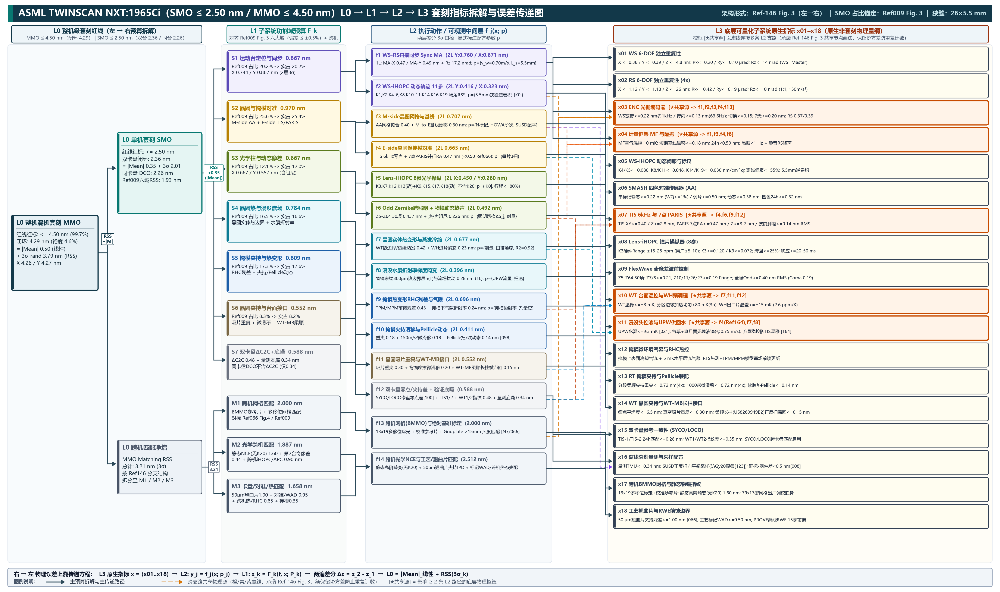

# ASML TWINSCAN NXT:1965Ci（SMO ≤ 2.50 nm / MMO ≤ 4.50 nm）套刻指标 L0–L3 拆解与九大核心子系统分级验收规格报告（v2）

[仓库首页](../../README.md) · [成果索引](../README.md) · [Ref-146 风格 L0–L3 draw.io 源图](../images/NXT1965Ci_SMO2.5_MMO4.5_Ref146风格L0-L3套刻指标拆解图_v1.drawio) · [L0–L3 全景 PNG](../images/NXT1965Ci_SMO2.5_MMO4.5_Ref146风格L0-L3套刻指标拆解图_v1.png) · [ENC/AA/WS-RS 专项验收答复](ENC_AA_WS-RS重复性与分级验收专项答复_v1.md) · [WS-RS 同步调研报告 v2](WS-RS同步策略与单台重复性误差专项调研报告_v2.md) · [v1 历史存档](NXT1965Ci套刻目标_SMO2.5_MMO4.5_整机L0-L3拆解与九大子系统验收规格报告_v1.md) · [参考文献总目](../../REFERENCES.md)

> **本版定位与阅读说明（独立完整版 `v2`）**：
> 1. **唯一目标机型与红线**：本报告独立面向 **ASML TWINSCAN NXT:1965Ci** 浸没式光刻机，整机套刻验收红线为 **单机套刻 ≤ 2.50 nm**（涵盖 ASML 官方公开的单卡盘 `DCO ≤ 2.5 nm` 口径，以及更严格的双卡盘 `SMO ≤ 2.50 nm` 工程控制口径）与 **混机匹配套刻 `MMO ≤ 4.50 nm`**（匹配至校准参考晶圆，全片覆盖），另独立设置 **全片焦面均匀性 `FU ≤ 14.0 nm`** 作为独立焦面红线（不混入套刻预算）。
> 2. **证据与预算严格区分**：凡来自 ASML 官方规格页或一手论文/专利实测的数据，均直接标注为 **【一手公开/实测】**；凡 `NXT:1965Ci` 原厂未公开的内部子系统门限，均明确标注为 **【OV4 工程预算】**，绝不把工程分配混同为原厂官方承诺。
> 3. **面向现场工程人员**：全篇采用直白工程语言定义每一项指标，统一引入 **`T1 / T2a / T2b / T2联试 / T3 / T4`** 分级验收体系，并全面理顺简洁、无歧义的指标命名（例如把编码器本底与工件台闭环稳定性彻底分开命名）。
> 4. **参考边界**：严格基于一手论文与专利（`[003–266]`、`[N1–N8]`、`[S1–S14]`、`Ref146/009/066/165/167/168`）、`ME3` 官方培训手册、ASML 公开规格及 `@github/Overlay3` 报告 `143_scanner_overlay_control_survey.md`。

---

<a name="contents"></a>

## 目录

- [0. 整机定位、工程师速懂术语与 `L0–L3` / `T1–T4` 双轨体系](#sec-0)
  - [0.1 NXT:1965Ci 整机核心参数与验收红线](#sec-0-1)
  - [0.2 现场工程师 5 分钟读懂套刻核心名词](#sec-0-2)
  - [0.3 预算怎么分（`L0–L3`）与现场怎么验（`T1–T4`）对照总表](#sec-0-3)
- [1. `L0 → L1 → L2 → L3` 全链路套刻拆解图与上溯排查思路](#sec-1)
  - [1.1 一张图看懂左→右分预算、右→左查根因](#sec-1-1)
  - [1.2 NXT:1965Ci 全景拆解图（附可编辑 draw.io 与复现脚本）](#sec-1-2)
  - [1.3 底层指标怎么一层层传成整机套刻（四条落地原则）](#sec-1-3)
- [2. `SMO ≤ 2.50 nm` / `MMO ≤ 4.50 nm` / `FU ≤ 14.0 nm` 整机总账闭环](#sec-2)
  - [2.1 `Ref009 Fig. 3` 六大功能域占比核定（为什么按“方差份额”折算）](#sec-2-1)
  - [2.2 `L0 → L1` 双轴闭环总账（DCO 2.26 / SMO 2.36 / MMO 4.29 / FU 11.48 nm）](#sec-2-2)
  - [2.3 `L2` 执行动作（`f1–f14`）与 `L3` 原生指标（`x01–x18`）对照台账](#sec-2-3)
- [3. 九大核心子系统分级验收规格（`T1 / T2 / T3`）](#sec-3)
  - [3.1 ENC（2D 光栅编码器测量系统）：尺子本底、曝光窗滤波与栅格板边界](#sec-3-1)
  - [3.2 WS（晶圆台）与 RS（掩模台）6-DOF、单程/往返图示及双台同步](#sec-3-2)
  - [3.3 AA（SMASH 四色对准）、TIS（透射空间像）与 PARIS（7 点并行空间像）](#sec-3-3)
  - [3.4 WS-iHOPC（11 项轨迹校正）、物镜奇像差（Z5–Z64 全 30 项）与 Lens-iHOPC（8 项 + K20 边界）](#sec-3-4)
- [4. 六大辅助子系统分级验收规格与四套冻结整机验机工况](#sec-4)
  - [4.1 热控、浸没、夹持、Pellicle 与双卡盘框架分级规格](#sec-4-1)
  - [4.2 四套冻结的 `T3` 整机验机工况与 `T4` 产品片边界](#sec-4-2)
- [5. 九大核心子系统 `T1–T4` 放行总卡与一手文献索引](#sec-5)
  - [5.1 一页看全：九大核心子系统 `T1–T4` 验收放行总卡](#sec-5-1)
  - [5.2 一手文献与资料溯源索引](#sec-5-2)

---

<a name="sec-0"></a>

## 0. 整机定位、工程师速懂术语与 `L0–L3` / `T1–T4` 双轨体系

[返回目录](#contents)

<a name="sec-0-1"></a>

### 0.1 NXT:1965Ci 整机核心参数与验收红线

**ASML TWINSCAN NXT:1965Ci** 是面向 20 nm 及以下逻辑与存储多重曝光量产的 193 nm（NA = 1.35）液浸式双工件台步进扫描投影光刻机。下表只列出本机型本身的规格边界，并明确标出哪些为原厂公开规格、哪些为本项目冻结的工程验收口径：

| 整机维度 | NXT:1965Ci 指标口径 | 公开/预算属性 | 现场验收与物理说明 |
| :--- | :--- | :---: | :--- |
| **光源与光学投影** | 193.368 nm（6 kHz 激光），NA 1.35 折反物镜，4:1 缩小 | 一手公开 | 液浸超纯水折射率 1.4366；全视场 **26 × 33 mm**，真实曝光狭缝 **26 × 5.5 mm** `[N1 Table 3, ME3]` |
| **生产分辨率与产能** | ≤ 38 nm（偶极）/ 40 nm（C-quad）；产能 **≥ 250 wph**（PEP 275 wph） | 一手公开 | 本报告统一按晶圆扫描速度 **0.70 m/s** 核算滤波带宽（同时给出 0.75 / 0.80 m/s 复核值） |
| **单机单卡盘套刻（`DCO`）** | **≤ 2.50 nm**（本预算闭环 **2.26 nm**，裕度 9.7%） | **一手公开** | ASML 官网标明为“单机、专用卡盘、全晶圆覆盖”；建议两只卡盘分别独立验收 |
| **单机双卡盘套刻（`SMO`）** | **≤ 2.50 nm**（本预算闭环 **2.36 nm**，裕度 5.4%） | **OV4 工程预算** | 原厂产品页未单列双卡盘值；本项目额外纳入双卡盘差（`ΔC2C ≤ 0.48 nm`），按双卡盘混用仍不超 2.50 nm 从严控制 |
| **混机匹配套刻（`MMO`）** | **≤ 4.50 nm**（本预算闭环 **4.29 nm**，裕度 4.6%） | **一手公开** | 相对校准参考晶圆的全晶圆覆盖套刻；对标同代 `BMMO` 实测 3.4 nm `[066 Fig.4]` |
| **全片焦面均匀性（`FU`）** | **≤ 14.0 nm**（本预算闭环 **11.48 nm**，裕度 18.0%） | **OV4 工程预算** | 原厂产品页未公开；作为**独立焦面验收项**单独签字，**不并入套刻误差平方和** |
| **核心传感器与补偿架构** | 2D 栅格板编码器（ENC）+ SMASH 四色对准（AA）+ 6 kHz TIS + **7 点并行 PARIS** + FlexRay/FlexWave + 19 参 iHOPC + RHC | 一手公开 / 同代确认 | 同步扫描横向主从方向为 **WS 主台、RS 从台**（掩模台高速追随晶圆台误差）；支持 19 项场内校正（不含 `K20` 主动操纵器） |

<a name="sec-0-2"></a>

### 0.2 现场工程师 5 分钟读懂套刻核心名词

为了避免后续章节出现“公式看着懂、上机不知道测什么”的情况，先把整份报告反复用到的 6 个基础概念用大白话讲透：

1. **`1×`（晶圆面尺度）与 `4×`（掩模面尺度）**：
   - 掩模上的图形比硅片大 4 倍，经过物镜 4:1 缩小打到硅片上。
   - **掩模台自己标指标时**常写 `4×` 原值（因为传感器就装在掩模台边上），但**汇总整机套刻总账时**，所有子系统误差都必须折算到**硅片表面（`1×`）**才能相加。具体折算倍数很简单：水平 X/Y **除以 4**，垂直 Z **除以 11.14**，俯仰/滚转（Rx/Ry）**乘 0.359**，绕竖轴旋转（Rz）**1:1 不缩小**。
2. **单层位置误差（1L）与两层套刻误差（2L）**：
   - 套刻测的是**第二层图形相对第一层图形偏了多少**（两遍曝光做减法）。
   - 如果一个误差两遍曝光完全一样（比如同一台物镜固定不变的静态畸变），一减就**抵消成 0**；
   - 如果一个误差每次曝光都在随机乱抖且互不相关（比如工件台扫描抖动、对准噪声），两遍做差后波动会放大为单层的 **1.414 倍**（即 $\sqrt{2}$ 倍）。本报告所有整机总账（`L0/L1/L2`）统一按**两层套刻 `1×` 晶圆尺度**记账，各子系统验收表（`L3`）写的是单机单次实测门限。
3. **固定偏置（`|Mean|`）直接加，随机抖动（`3σ`）平方和开方（`RSS`）**：
   - 总是朝同一个方向偏的误差（比如没校准干净的零点偏置、正反扫系统差），会实打实叠在总误差上，所以用**直接相加**；
   - 左右乱晃、彼此独立的随机误差，不可能每次都同时偏到同一边的极值，所以按**各随机项平方相加再开方（RSS）**合成：

$$
\mathrm{Total} = \vert\mathrm{Mean}\vert + \sqrt{R_1^2 + R_2^2 + \dots + R_n^2}
$$

   > **白话解读**：如果总预算像一笔固定经费，用 `RSS` 合成意味着“老大（最大误差项）一超标，全盘立刻爆表；小项省一点点，对总账帮助很小”。另外，**由同一个源头引起的两处误差（比如计量框架热漂同时带偏了晶圆台和对准镜头）不能当作独立随机项反复记账**。
4. **曝光窗口（`7.86 ms`）里的 `MA` 和 `MSD`**：
   - 扫描曝光时，硅片上任意一点穿过 `5.5 mm` 宽的狭缝大约只需要 **7.86 毫秒**（按 `0.70 m/s` 扫速算，狭缝长度除以扫速）。
   - **`MA`（移动平均误差）**：在这 7.86 毫秒里，图形位置偏差的**平均值**。它会把整条光刻胶线条**整体搬偏**，直接变成**套刻误差**。
   - **`MSD`（移动标准差）**：在这 7.86 毫秒里，图形位置来回快抖的**剧烈程度（`1σ`）**。它不会把线条中心搬偏，但会把线条边缘**震毛、震虚**，拉低成像对比度和焦深。
5. **重复性、跟随误差、在位稳定性——三者别混为一谈**：
   - **在位稳定性**：台子停在原地不动，自己在目标点附近有多稳；
   - **跟随误差**：台子跑起来时，任意一瞬间“实际在哪”减“指令让它去哪”的瞬时差值（跑得越快、拐弯越急越大）；
   - **重复性**：让台子按同样配方反复跑几十趟，每次经过同一个点时，位置偏差**相互之间散开了多少**（哪怕每次都固定偏 10 nm，只要次次一模一样，重复性就是 0；但套刻验收既要看固定偏置小，更要看重复性小）。
6. **`|Mean| + 3σ` 口径**：
   - 本文整机套刻闭环采用半导体行业通用的 **偏置绝对值加 3 倍标准差（覆盖约 99.7% 测点）** 核算，实机验收签字前需与客户协议同步冻结抽样点数、边缘剔除规则及分位数口径。

<a name="sec-0-3"></a>

### 0.3 预算怎么分（`L0–L3`）与现场怎么验（`T1–T4`）对照总表

工程团队最容易踩的坑，是把**“自顶向下分预算的层级（`L`）”**和**“自底向上做试验验收的层级（`T`）”**混成一套编号。本报告将两套编号彻底解耦：

- **`L0 → L1 → L2 → L3`** 回答的是 **“钱怎么分”**（系统架构师把 `2.50 / 4.50 nm` 从整机一路拆到各子系统零件）；
- **`T1 → T2 → T3 → T4`** 回答的是 **“货怎么验”**（测试与集成工程师从单件台架一路验到整机打片实曝）。

| 验收分级 | 名称与测试场所 | 到底在验什么（大白话） | 常见必查项目 | 放行红线与防呆提醒 |
| :---: | :--- | :--- | :--- | :--- |
| **`T1`** | **部件与测量链本体级**<br>（离线台架 / 单件出厂） | 把单个零件或传感器拿出来，单独验“尺子准不准、底噪低不低、零件有没有先天硬伤” | ENC 原始宽带与曝光窗底噪、栅格板出厂精校、AA 静态单标记信噪/色差、物镜静态像差与操纵器单件滞回、掩模装膜静态变形 | **只证明零件自己不拖后腿**；绝不能拿 `T1` 传感器底噪冒充装机后的台体稳度 |
| **`T2a`** | **装机闭环自读级**<br>（整机装好、不曝光、看机内读数） | 子系统装上整机通电运行，看**机内自带传感器**报出来的闭环跟踪稳不稳、校准漂不漂 | ENC 闭环下 WS/RS 自读误差、过缝切头（EMSI）、AA 扫片网格（HOWA）、TIS/PARIS 在机读数、物镜操纵器 `SET-vs-GET` | **存在“自己查自己”的盲区**：如果尺子装歪了或结构发软，自读可能很漂亮、实际硅片已经偏了 |
| **`T2b`** | **装机外部标尺核验级**<br>（整机装好、不曝光、上外接独立标尺） | 用**独立于机内传感器的外部标尺**（外接激光干涉仪、差分测头、校准参考片）复核曝光点真实到底动了多少 | WS/RS 外部真值单程与往返重复性、反向差与停位误差、栅格板 7 天热漂、掩模 1000 趟微滑移、WS-iHOPC 外部轨迹核验 | **破除“好尺子配差伺服”或“坏尺子配好伺服”的假象**；`T2a` 与 `T2b` 必须成对记录 |
| **`T2 联试`** | **跨子系统不曝光联调级**<br>（多子系统一起跑、仍不打胶） | 两个以上子系统拉手一起干活，看配合默不默契、有没有互相打架 | **WS–RS 全速同步扫描（`Sync MA / MSD`）**、浸没供水流量扫频验 `TIS`、`SYCO/LOCO` 双卡盘对齐、掩模热负荷模拟 | 可提前暴露 80% 的跨系统耦合问题，但仍不含光刻胶成像和真实曝光热负荷 |
| **`T3`** | **整机参考片曝光级**<br>（涂胶、走水、真实曝光、离线套刻仪实测） | 用标准无图案/参考硅片跑完真实全流程曝光，拿套刻仪量出真正的全片套刻数字 | 冻结 4 套工况：同卡盘 **`DCO ≤ 2.50 nm`**、双卡盘 **`SMO ≤ 2.50 nm`**、满热/跨照明专场、参考片 **`MMO ≤ 4.50 nm`** 与 `FU ≤ 14.0 nm` | **整机出厂/装机签字的唯一最终裁判！**`T1/T2` 全部绿灯、预算表全部闭合，都**不能替代 `T3` 实曝** |
| **`T4`** | **客户产品片工艺级**<br>（量产膜层、刻蚀/CMP 工艺片，选配边界） | 带上真实芯片前道/后道工艺层、变形标记、不同产品掩模与产线 APC，验真实产品良率套刻（`OPO`） | 工艺标记不对称（WAD）、显影后（ADI）与刻蚀后（AEI）偏移、靶标与真实器件位置差（`< 0.5 nm`）、掩模写入误差剥离 | **明确划在整机出厂 `2.5 / 4.5 nm` 合同边界之外**，归属工艺集成联合优化 |

---

<a name="sec-1"></a>

## 1. `L0 → L1 → L2 → L3` 全链路套刻拆解图与上溯排查思路

[返回目录](#contents)

<a name="sec-1-1"></a>

### 1.1 一张图看懂左→右分预算、右→左查根因

下图沿用系统工程经典预算树 **`Ref146 Fig. 3`**（INCOSE 2006）的画法，把 `NXT:1965Ci` 的套刻指标从左到右拆成四层，现场不同岗位可以按两个相反方向读图：

1. **从左往右看（分任务 / 定指标）**：
   - **`L0` 整机总目标**：最左侧是 `MMO ≤ 4.50 nm`，向右分成 **`SMO ≤ 2.50 nm`**（同机套刻）和 **跨机匹配净增** 两条干路；
   - **`L1` 子系统大包预算**：`SMO` 按 `Ref009 Fig. 3` 拆成 6 个核心物理域（`S1–S6`）+ 双卡盘与量测底噪（`S7`），`MMO` 拆成网格（`M1`）、光学（`M2`）、卡盘热对准（`M3`）；
   - **`L2` 执行动作层（`f1–f14`）**：落地到机台上 14 个看得见、测得到的具体动作（比如双台同步扫、晶圆对准、掩模对准、镜片调畸变、浸没水膜控温等）；
   - **`L3` 底层零件指标（`x01–x18`）**：最右侧是各硬件部门真正能签字的**原生单位指标**（温度看 `mK`、转角看 `nrad`、波前看 `nm RMS`、行程看 `ppm`、掩模台看 `4× nm`）。
2. **从右往左看（查故障 / 追根因）**：
   - 当某块硅片套刻超标时，看它属于哪种图形特征，就能顺着箭头一路倒查是哪个 `L2` 动作没做好，再追到是哪个 `L3` 零件温控漂了、水流量抖了还是传感器切头跳了。
3. **重点盯紧 6 个橙框 `[★共享源]` 和虚线箭头**：
   - 蓝实线表示主归属链路；**橙/青/紫虚线**表示“一个底盘出问题，会同时拖累两三条支路”。全机一共标出 6 个共享物理枢纽：**`x03` 光栅编码器、`x04` 计量框架、`x07` TIS/PARIS、`x10` 晶圆台温控、`x11` 浸没超纯水、`x16` 采样与量测**。现场排错和预算合账时，这 6 处必须重点盯着，既不能漏查耦合，也不能重复算钱。

<a name="sec-1-2"></a>

### 1.2 NXT:1965Ci 全景拆解图（附可编辑 draw.io 与复现脚本）



> **可编辑源件与数据一致性校验脚本**：
> - **draw.io 源图（支持 diagrams.net / VS Code Draw.io 直接打开修改）**：[NXT1965Ci_SMO2.5_MMO4.5_Ref146风格L0-L3套刻指标拆解图_v1.drawio](../images/NXT1965Ci_SMO2.5_MMO4.5_Ref146风格L0-L3套刻指标拆解图_v1.drawio)
> - **预算校验与一键出图脚本**：[build_nxt1965ci_budget_and_diagram_v1.py](../code/build_nxt1965ci_budget_and_diagram_v1.py)

<a name="sec-1-3"></a>

### 1.3 底层指标怎么一层层传成整机套刻（四条落地原则）

在工程实践中，底层原生指标（`x01–x18`）经过具体执行动作（`f`）和配方参数（如扫速、剂量、标记数、照明模式）传到功能域（`F`），最后合成整机套刻 `L0`。**写不出精确的解析公式完全没关系——先把“谁传给谁、谁和谁共用同一块底板”理清楚，就已经解决了 80% 的工程问题。** 要让这套思路真正在机台上用起来，只需守住 4 条朴素的现场原则：

| 现场原则 | 不注意会踩什么坑 | 现场工程师怎么落地 |
| :--- | :--- | :--- |
| **1. 先做“两层相减”，再谈套刻** | 把单遍曝光的静态畸变也算进同机套刻，导致预算算重、指标定得过死 | 两遍条件一样、固定不变的误差，在同机重曝里会相减抵消；每次随机乱抖的误差，两遍相减会放大 `1.414` 倍；如果两遍热漂方向正好相反（比如正序/倒序曝光 `[021, 050]`），误差甚至比 `1.414` 倍还大 |
| **2. 写不出公式，就用“调参测斜率”替代** | 碰到浸没水流、硅片背面摩擦这类复杂多物理场，想靠手推导公式会直接卡死 | 简单几何/热胀直接算比例（如绕 Z 旋转 × 13 mm 半场宽、硅片热胀 `0.39 nm/mK`）；复杂黑箱直接上机做阶跃实验——把水流量或温控故意调偏一点，量出套刻变了多少，算出“灵敏度斜率”就能立刻分预算（如 `Ref017`、`Ref164`、`Ref098`） |
| **3. 共享源绝不重复记账，防“同向齐偏”** | 同一块计量框架热漂同时带偏了晶圆台和对准镜头，如果当成两件独立小事分别平方和开方，会严重低估真实风险 | 经本预算灵敏度快算：在 `S1–S7` 七大域里，只要各域之间因为共享热漂/振动产生了哪怕 **2.5% 的同向联动相关性**，双卡盘 `SMO` 就会从 `2.36 nm` 直接撞上 **`2.50 nm`** 红线；到 5% 就会飙到 `2.63 nm` 超标！因此必须把 6 个共享源隔离稳住，且同一误差源只在主归属域记一次账 |
| **4. 冻结 4 套典型验机配方，不做无穷仿真** | 不同剂量、不同扫速、不同照明组合下误差千差万别，试图给每种组合都算一张预算表根本维护不动 | 遵循 `Ref146 §4.5` 半静态预算方法：全机只冻结 **4 套代表性验机工况**（冷机单卡盘、生产双卡盘、高剂量满热/跨照明、跨机参考片），每套工况锁死固定配方参数，照表签字（详见第 4.2 节） |

---

<a name="sec-2"></a>

## 2. `SMO ≤ 2.50 nm` / `MMO ≤ 4.50 nm` / `FU ≤ 14.0 nm` 整机总账闭环

[返回目录](#contents)

<a name="sec-2-1"></a>

### 2.1 `Ref009 Fig. 3` 六大功能域占比核定（为什么按“方差份额”折算）

ASML 在 `NXT:1950i` 奠基论文 **`Ref009 Fig. 3`**（Castenmiller 等，*Proc. SPIE 7640*, 2010）中，把 `2.50 nm` 单机套刻预算按堆叠柱状图分成了六大功能域。通过对原图纵轴刻度（`77.80 px/nm`）做像素实测，六段合计高度为 `193.5 px = 2.487 ≈ 2.50 nm`。

**这里有一个现场最容易算错的坑**：不能把堆叠柱上每一段的视觉高度（例如运动台那一段 `0.50 nm`）直接当成子系统的 `3σ` 上限。因为把那 6 个数直接做平方和开方只有 `1.07 nm`（根本凑不够 `2.50 nm`），而且 `0.50 nm` 两层误差折合单层才 `0.35 nm`，比同一篇论文 Fig. 10 自己公布的实测同步误差（`0.47 / 0.49 nm`）还要小！

正确的工程解读是把堆叠柱的视觉高度比例当成各功能域的**方差份额**（即各域预算的平方占总方差的比例）。按六大核心域随机合计 **`1.926 nm`** 还原后，六大域预算与 `Ref009` 原图占比偏差全项控制在 **±0.30%** 以内，且运动台（`0.867 nm`）和对准（`0.970 nm`）刚好严丝合缝匹配论文公布的实测硬件能力：

| `Ref009 Fig. 3` 六大功能域 | 原图高度占比 | 本报告 `L1` 预算节点 | 两层 `1×` 预算 X / Y / 包络 (nm) | 本预算方差占比 | 与原图占比差 |
| :--- | :---: | :--- | :---: | :---: | :---: |
| 1. **运动台定位**（Stage positioning） | 20.16% | `L1-S1` 运动台定位与同步 | 0.744 / **0.867** / 0.867 | **20.24%** | `+0.08%` |
| 2. **光学柱**（Optical column） | 12.14% | `L1-S3` 光学柱与动态像差 | **0.667** / 0.557 / 0.667 | **11.99%** | `−0.15%` |
| 3. **晶圆与掩模对准**（Wafer & reticle alignment） | 25.58% | `L1-S2` 晶圆与掩模对准 | 0.970 / 0.970 / **0.970** | **25.38%** | `−0.20%` |
| 4. **晶圆加热与浸没**（Wafer heating + immersion） | 16.54% | `L1-S4` 晶圆热与浸没流场 | 0.784 / 0.784 / **0.784** | **16.58%** | `+0.04%` |
| 5. **晶圆夹持**（Wafer clamping） | 8.27% | `L1-S6` 晶圆夹持与台面接口 | 0.552 / 0.552 / **0.552** | **8.21%** | `−0.06%` |
| 6. **掩模夹持与加热**（Reticle clamping / heating） | 17.31% | `L1-S5` 掩模夹持与热变形 | 0.809 / 0.809 / **0.809** | **17.61%** | `+0.30%` |
| **六大核心域合计** | **100.00%** | **六域核心随机 RSS** | **X 1.875 / Y 1.891 / 包络 1.926** | **100.00%** | **全项 ≤ ±0.30%** |

<a name="sec-2-2"></a>

### 2.2 `L0 → L1` 双轴闭环总账（DCO 2.26 / SMO 2.36 / MMO 4.29 / FU 11.48 nm）

下表所有套刻数字均已统一折算到**晶圆表面（`1×`）、两层重曝套刻（`3σ`）**口径，X 轴（非扫描向）与 Y 轴（扫描向）分开算清，并给出与红线的裕度：

| 层级节点 | 涵盖内容（大白话） | 两层 X (nm) | 两层 Y (nm) | 包络口径 (nm) | 合成方式 | 红线核对与裕度 |
| :--- | :--- | :---: | :---: | :---: | :---: | :--- |
| `L1-S1` | 运动台定位与同步（双台同步扫 + WS 11 项场内轨迹） | 0.744 | **0.867** | 0.867 | RSS | 占比 20.2%，锚定 `Ref009` |
| `L1-S2` | 晶圆与掩模对准（M 侧 AA 对准 + E 侧 TIS/PARIS 7 点对准） | 0.970 | 0.970 | 0.970 | RSS | 占比 25.4%，锚定 `Ref009` |
| `L1-S3` | 光学柱与动态像差（物镜 8 项校正 + 奇像差 + 热/声振残余） | **0.667** | 0.557 | 0.667 | RSS | 占比 12.0%，锚定 `Ref009` |
| `L1-S4` | 晶圆热与浸没流场（晶圆热胀冷缩 + 浸没水膜折射率波动） | 0.784 | 0.784 | 0.784 | RSS | 占比 16.6%，锚定 `Ref009` |
| `L1-S5` | 掩模夹持与热变形（掩模热控残余 + 重夹/滑移 + 薄膜动态） | 0.809 | 0.809 | 0.809 | RSS | 占比 17.6%，锚定 `Ref009` |
| `L1-S6` | 晶圆夹持与台面接口（真空吸片重复 + 背面微滑移 + 台面滞回） | 0.552 | 0.552 | 0.552 | RSS | 占比 8.2%，锚定 `Ref009` |
| — | **六大核心域随机合计（`Core-6`）** | **1.875** | **1.891** | **1.926** | RSS | X 与 Y 十分均衡（仅差 0.016 nm） |
| `L1-S7` | 离线量测底噪（0.340）；双卡盘模式再加双台差 `ΔC2C`（0.479） | 0.340 / 0.588 | 0.340 / 0.588 | 0.340 / 0.588 | RSS | `ΔC2C` 含 `SYCO/LOCO` + `TIS1/2` + `WT1/2` |
| **`L0-DCO`** | **单机单卡盘套刻（`RSS + 固定偏置 0.300`）** | **2.206** | **2.221** | **2.257** | 线性+RSS | **≤ 2.50 nm 通过（余量 9.7%）** |
| **`L0-SMO`** | **单机双卡盘套刻（`RSS + 固定偏置 0.350`）** | **2.315** | **2.331** | **2.364** | 线性+RSS | **≤ 2.50 nm 通过（余量 5.4%）** |
| `L1-M1` | 跨机网格匹配（参考片 + 多移位栅格标定 `[066, N7]`） | 2.000 | 2.000 | 2.000 | RSS | 跨机大尺度网格绝对坐标对齐 |
| `L1-M2` | 跨机光学匹配（静态指纹无 `K20` 1.60 + 第 2 台奇像差 0.437 + 校正残余 0.90） | 1.887 | 1.887 | 1.887 | RSS | 贴合 `NXT:1965Ci` 无 `K20` 操纵器架构 |
| `L1-M3` | 跨机卡盘/对准/热与掩模（50 μm 翘曲片 1.00 + 对准/WAD 0.95 + 热 0.85 + 掩模 0.354） | 1.658 | 1.658 | 1.658 | RSS | 覆盖双机工艺与热状态差异 |
| **`L0-MMO`** | **混机匹配套刻（`RSS(SMO随机, M1..M3) + 固定偏置 0.500`）** | **4.265** | **4.273** | **4.291** | 线性+RSS | **≤ 4.50 nm 通过（余量 4.6%）** |
| **`L0-FU`** | **全片焦面均匀性（独立红线，不并入套刻）** | — | — | **11.48** | RSS | **≤ 14.0 nm 通过（余量 18.0%）** |

> **说明**：`L0-FU` 焦面均匀性由 8 项独立垂向误差平方和开方合成：同步垂向 `Sync Z 5.34 nm`、倾角边缘离焦 `1.71 nm`、吸盘平坦度 `6.50 nm`、掩模平整 `2.20 nm`、TIS 测焦 `2.80 nm`、调平测量 `4.20 nm`、物镜场曲与像散 `4.80 nm`、框架漂移 `2.20 nm`，合计 `11.48 nm ≤ 14.0 nm`。

<a name="sec-2-3"></a>

### 2.3 `L2` 执行动作（`f1–f14`）与 `L3` 原生指标（`x01–x18`）对照台账

下表把全景图里的 14 个执行动作（`L2`）与 18 项底层指标（`L3`）一一对上号，并标出最关键的配方旋钮和 **6 个共享物理源（带 ★ 标注）**：

| `L2` 执行动作 | 两层 `1×` 预算 (nm) | 归属 `L1` | 影响大小的关键配方参数 | 对应的 `L3` 底层原生指标（★为共享源） |
| :--- | :---: | :---: | :--- | :--- |
| **`f1` WS–RS 双台同步扫描** | X 0.671 / Y 0.760 | `S1` | 扫速 0.70 m/s、狭缝 5.5 mm、正反扫向 | `x01 WS`、`x02 RS` + **★`x03 ENC`** + **★`x04 框架 MF`** |
| **`f2` WS-iHOPC 11 项场内轨迹** | X 0.323 / Y 0.416 | `S1` | 5.5 mm 狭缝预补偿、下发指令幅度 | `x05 WS-iHOPC` + **★`x03 ENC`** |
| **`f3` M 侧晶圆对准与基线** | 0.707 | `S2` | 标记数量、网格拟合阶次、正反扫配平 `[123]` | `x06 AA(SMASH)` + **★`x03 ENC`** + **★`x04 框架 MF`** + **★`x16 采样`** |
| **`f4` E 侧空间像掩模对准** | 0.665 | `S2` | 7 点并行每片 3 扫（1 物镜 + 2 掩模 `[066]`） | **★`x07 TIS/PARIS`** + **★`x03 ENC`** + **★`x04 框架 MF`** + **★`x11 UPW`** |
| **`f5` Lens-iHOPC 8 项镜片校正** | X 0.450 / Y 0.260 | `S3` | 下发指令幅度、联合行程占用 ≤ 80% | `x08 Lens-iHOPC` |
| **`f6` 奇像差跨照明 + 热声残差** | 0.492 | `S3` | 照明模式切换、掩模透射率、曝光剂量 | `x09 物镜奇像差` + **★`x07 PARIS`** + **★`x04 框架隔振/声罩`** |
| **`f7` 晶圆热膨胀与蒸发冷缩** | 0.677 | `S4` | 曝光剂量、扫描场序 `[050]`、片间节拍 | **★`x10 晶圆温控/WH`** + **★`x11 浸没蒸发`** |
| **`f8` 浸没水膜折射率波动** | 0.396 | `S4` | 供回水流量与扫速（300 μm 热边界层 `[040]`） | **★`x11 浸没 UPW`** |
| **`f9` 掩模热变形与下方气隙** | 0.696 | `S5` | 掩模透射率、曝光剂量、换片间隔 `[016/110]` | `x12 掩模气幕/RHC` + **★`x07 PARIS RA`** |
| **`f10` 掩模夹持滑移与薄膜动态** | 0.411 | `S5` | 150 m/s² 折返加速度、扫描吹扫风速 `[098]` | `x13 掩模夹持/Pellicle` |
| **`f11` 晶圆吸片与台面传力接口** | 0.552 | `S6` | 真空吸力、硅片背面摩擦、正反扫加速度 | `x14 晶圆夹持/WT–MB 接口` + **★`x10 晶圆台热边界`** |
| **`f12` 双卡盘差 `ΔC2C` + 量测底噪** | 0.588 | `S7` | 双台交替调度、`SYCO/LOCO` 双卡盘匹配 `[100]` | `x15 双卡盘一致性` + **★`x16 量测`** + **★`x07 TIS1/2`** + **★`x10 WT1/2`** |
| **`f13` 跨机绝对网格标定（BMMO）** | 2.000 | `M1` | 13×19 多移位布局、校准参考片 `[066, N7]` | `x17 跨机网格/静指纹` + **★`x03 栅格板`** |
| **`f14` 跨机光学指纹与翘曲/工艺匹配** | 2.512 | `M2, M3` | 50 μm 翘曲片夹持、标记不对称、掩模前馈 | `x18 翘曲/WAD/RWE` + `x17 静态物镜指纹` |

---

<a name="sec-3"></a>

## 3. 九大核心子系统分级验收规格（`T1 / T2 / T3`）

[返回目录](#contents)

本章逐项列出九大核心子系统的**简洁无歧义指标名**、**验收分级（`T1 / T2a / T2b / T2联试 / T3 / T4`）**、**指标限值**、**大白话物理含义**与**具体测试方法**，并明确区分一手公开实测与本项目工程预算。

<a name="sec-3-1"></a>

### 3.1 ENC（2D 光栅编码器测量系统）：尺子本底、曝光窗滤波与栅格板边界

#### （1）先划清 3 条现场防混淆红线

1. **ENC 验的是“尺子自己准不准”，不是“工件台停得稳不稳”**：
   - 把 `ENC-WS` 简写成 `WS-ENC X` 时，很多工程师容易误以为这是“晶圆台在位稳度”。实际上，ENC 指标只考核**编码器测量链自身的底噪与标定精度**；**台子闭环后真实有多稳，看第 3.2 节的 WS / RS 指标（`T2a + T2b`）**。
   - 反例很好理解：就算配了一把零噪声的完美光栅尺（`T1` 满分），只要伺服刚度不够或导轨共振，工件台照样剧烈晃动；反之，如果只看机内编码器读数（`T2a`），尺子整体热漂或阿贝臂倾角偏了，编码器自己根本看不出来，必须用外部标尺（`T2b`）复核。
2. **栅格板（Gridplate）、对准标记（AA Mark）、晶圆网格——三样东西完全不同**：
   - **栅格板（Gridplate）**：装在机台上方计量框架上的大块零膨胀微晶玻璃光栅尺（约 `0.8 × 0.8 m`，短光程 `< 15 mm`，配 `10 mK` 气幕 `[009]`），由工件台四角的读数头去扫它，用来知道“台子此刻在机台里跑到了哪”。
   - **对准标记（AA Mark）**：刻在每一片硅片上的微小光栅图形，由 M 侧对准镜头（AA）去扫它，用来知道“硅片本身相对于工件台偏了多少、胀了多少”。
   - **晶圆拟合网格（HOWA Grid）**：测完硅片上几十个对准标记后，用数学模型算出来的全片坐标变形图，用来指挥曝光时工件台往哪微调。
3. **不重复计账铁律**：编码器底噪已经吃进了 WS/RS 闭环定位和同步误差里，**在算整机 `L0` 套刻总账时，绝对不能把 ENC 单独再做一次 RSS 叠加**。

#### （2）为什么既要看 1000 Hz 原始底噪，又要算 7.86 ms 曝光窗底噪？

- **原始宽带底噪（`1 kHz`）**：直接看传感器有没有电子干扰、高频共振或气隙风噪；ASML 一手实测 `NXT:1950i` 为 **`0.22 nm (3σ)`** `[009 Fig. 4]`。
- **曝光窗底噪（`7.86 ms`，等效带宽 `63.64 Hz`）**：光刻曝光时，硅片每个点要在 `5.5 mm` 狭缝下积分约 `7.86 ms`，高频乱抖会被平均掉一大半，只剩低频抖动真正把图形搬偏。如果把 `0.22 nm` 全部当成纯高频白噪声，曝光窗里只剩 `0.056 nm`（过于乐观）；工程上按 **30% 低频气流/热慢漂 + 70% 高频白噪** 折算 `[N8]`：

$$
\sigma_{\mathrm{ENC,MA}} = \sqrt{0.30 \times 0.22^2 + 0.70 \times 0.22^2 \times \frac{63.64}{936.4}} = \mathbf{0.130\text{ nm}}
$$

  > **白话解读**：即使把扫速提到 PEP 档 `0.75–0.80 m/s`，曝光窗内底噪也稳在 `≤ 0.132 nm`，刚好满足“尺子精度至少比被测台子（`WS-X ≤ 0.38 nm`）高 3 倍”的行业通则。出厂测试（FAT）必须**用同一组原始时序**同时交付宽带值、曝光窗值以及 `0.1 Hz–2 kHz` 频谱（PSD/CPS），防止高频毛刺被平均掉后漏检。

#### （3）ENC 分级验收规格表

| 指标名称（简洁无歧义） | 验收分级 | NXT:1965Ci 指标限值 | 大白话工程含义 | 怎么测与依据属性 |
| :--- | :---: | :---: | :--- | :--- |
| **ENC-WS 宽带底噪 (1 kHz)** | **`T1`** | **≤ 0.22 nm**（`3σ`） | 晶圆台编码器在 1000 Hz 原始采样下的自身测量抖动 | 静止零位移夹具或基准台架采样；**【一手实测】**对齐 `Ref009 Fig. 4` |
| **ENC-WS 曝光窗底噪 (X / Y)** | **`T1`** | **≤ 0.13 nm**（`3σ`） | 把原始读数按 `5.5 mm / 7.86 ms` 曝光窗口滑动平均后的残余底噪 | 由同一组 `T1` 原始时序按配方窗滤波，并附 `0.1 Hz–2 kHz` 频谱 `[N8]`；**【OV4 工程预算】** |
| **ENC-WS 曝光窗底噪 (Z / Rx,Ry / Rz)** | **`T1`** | **≤ 0.38 nm / 3.2 nrad / 1.6 nrad** | 垂向高度、俯仰滚转角、绕竖轴偏航角在曝光窗内的测量底噪 | 按四角 `320 mm` 基线差分折算（Z 向衍射灵敏度约为 XY 3 倍）；**【OV4 工程预算】** |
| **ENC-WS 过缝切头跳变 (EMSI)** | **`T2a`** | **≤ 0.15 nm**（`3σ`） | 台子跑过栅格板接缝、4 个读数头切为 3 个在线接力时的位置跳变 | 全行程往返跨缝测试，利用 3-of-4 重叠区一致性校核 `[009 Fig.7]`；**【OV4 工程预算】** |
| **栅格板 7 天网格漂移** | **`T2b`** | **≤ 0.20 nm**（`3σ`） | 整块大光栅尺连续运行 7 天的热胀冷缩与零点慢漂 | 独立参考片或 `13×19` 多移位标定复核 `[N7]`；**【一手实测参考】**对齐 `Ref062 Fig. 11` |
| **ENC-RS 曝光窗底噪 (X / Y / Z / Rz)** | **`T1`** | **≤ 0.37 / 0.39 / 2.60 nm / 2.8 nrad**<br>（`4×` 原值；`1×` 折算 `0.09 / 0.10 / 0.23 nm`） | 掩模台编码器在曝光窗内的测量底噪（按 `RS` 指标 1:3 反推） | 静态台架/零位移测噪，`Rz` 按 `200 mm` 基线核验；**【OV4 工程预算】** |
| **ENC-RS 宽带底噪 (1 kHz)** | **`T1`** | **≤ 0.68 nm**（`4×` 原值；`1×` 折算 `0.17 nm`） | 掩模台编码器在 1000 Hz 原始带宽下的自身测量抖动 | 同步交付 `0.1 Hz–2 kHz` 频谱，排查高频电噪与气隙风振；**【OV4 工程预算】** |

---

<a name="sec-3-2"></a>

### 3.2 WS（晶圆台）与 RS（掩模台）6-DOF、单程/往返图示及双台同步

#### （1）先看懂两件最关键的事：单程 vs 往返怎么分、掩模误差传到硅片打几折

在步进扫描光刻机里，为了提高产能，工件台不是每次都从头单向扫，而是像割草一样**一趟向上扫（正向 `↑`）、下一趟向下扫（反向 `↓`）**。验收时必须把**同向单程**和**交替往返**分清，把正向、反向、正反差、闭合漂移、停位误差一次测明白（详细测试规程见 [专项验收答复 §3.1](ENC_AA_WS-RS重复性与分级验收专项答复_v1.md#sec-stage-1)）：

```text
  【同向单程测试（只看同方向多次重跑）】            【交替往返测试（真实割草扫描工况）】
   每次都按“正向 ↑”扫过匀速区，空跑回起点重来           一趟正向 ↑、紧接一趟反向 ↓，连续跑 N 个来回
       第1趟  第2趟  ...  第N趟                            第1来回           第2来回
        ↑      ↑           ↑                              ↑     ↓           ↑     ↓
     ---|------|-----------|---  同一空间坐标 y_m      ---|-----|---|---|---|-----|---  同一空间坐标 y_m
        o      o           o                              o     x           o     x
     同一点 y_m 处 N 次偏差的散度                     1. 正向单程重复 R↑ : 所有 o 点的散度
     = 同向单程重复性 R↑（只验随机稳不稳）            2. 反向单程重复 R↓ : 所有 x 点的散度
                                                      3. 正反均值差 B_res : (o均值 - x均值)，即反向差！
   ※ 停位误差 e_stop：台子停在目标点不动时的偏差     4. 往返总重复 R_bi  : 含 R↑/R↓ 与反向差 B_res
   ※ 验收统一配准到同一物理坐标 y_m，仅截取稳态匀速段 5. 闭合漂移 Δ_close : 跑完一圈回到原点后漂了多少
```

另外，掩模台装在物镜上方（`4×` 放大面），它的 6 个自由度误差传到硅片（`1×` 像面）上分别要乘以不同的折算比例（按 193 nm 浸没超纯水折射率 1.4366 计算）：

| 自由度 | 运动方向（大白话） | 掩模误差 → 硅片折算倍数 | 折算后的直观后果 |
| :---: | :--- | :---: | :--- |
| **X / Y** | 水平左右（非扫描向）/ 水平前后（扫描向） | **除以 4**（`× 0.25`） | 掩模偏 `1.12 nm`，硅片只偏 `0.28 nm` |
| **Z** | 上下高度（焦面） | **除以 11.14**（`× 0.0898`） | 掩模上下抖 `26 nm`，硅片焦面只抖 `2.33 nm` |
| **Rx / Ry** | 绕 X 轴前后点头 / 绕 Y 轴左右歪头 | **乘 0.359** | 引起狭缝或视场边缘离焦（`Ry` 杠杆臂长达 `13 mm`，最敏感） |
| **Rz** | 绕竖轴水平转一个小角度（偏航） | **1 : 1 不缩小！** | **掩模转 10 nrad，硅片同样转 10 nrad**，在 13 mm 场边变成 `0.13 nm` 套刻！ |

#### （2）同步主从方向与“不能随便放宽单台指标”的 5 条铁律

- **同步主从方向**：经 ASML/Nikon 专利（如 `[S14]` `US 6,373,072 B1`、`[S12]` `US 2012/0319637 A1`）与控制论文（`[022, 075, 147]`）确认，ArF/ArFi 与 XT 全系横向同步均为 **`WS = 主台（Master）`、`RS = 从台（Slave）`**——由惯量更轻、带宽更高的掩模台实时追随晶圆台误差（ASML 进一步引入了双向耦合 `[075]`）。
- **能不能因为同步误差比单台小，就大幅放宽 WS/RS 单台验收指标？结论：绝不能无条件放宽！** 原因有 5 条现场硬约束：
  1. **测量侧（M 侧）没有掩模台帮忙**：晶圆在 M 侧做对准（AA）时只有晶圆台自己干活，WS 自身抖大了一点都补不回来；
  2. **同步只能抵消“两台同步的误差”，抵消不了“两台一起偏离物镜/水膜”**：如果 WS 和 RS 一起漂移，图形虽然相对掩模对齐了，但硅片相对浸没头和物镜已经偏了，会引发边缘残液、场边畸变和整定超调；
  3. **Z 轴和倾角（Rx/Ry）以及高频抖动（MSD）不能靠放宽换收益**：过激的高频追随会触发“水床效应”，把 `MA` 压低一点却把 `MSD` 抬高、把线条震虚；
  4. **WS 还要自己独立走 11 项场内校正轨迹（WS-iHOPC）**，台子本身底子不稳根本走不准弯曲轨迹；
  5. **掩模台 `150 m/s²` 急停急启引起的石英微滑移，编码器完全看不见**，必须单独用外部标尺验。
  > **有条件放宽边界**：在没有拿到本台实机“单台 + 联机”配对测试数据之前，**不预设任何单台放宽倍数**；若后续实机配对数据证明 E 侧匀速横向存在稳定正相关且留有足够余量，须按 [专项验收答复 §3.2](ENC_AA_WS-RS重复性与分级验收专项答复_v1.md#sec-stage-2) 的 6 关审核流程逐项评审，且绝不放宽 M 侧工况、`Z/Rx/Ry`、反向差、整定时间与微滑移底线。

#### （3）WS、RS 及双台同步分级验收规格表

**测试通用工况冻结**：晶圆扫速 `0.70 m/s`（加减速 `35–40 m/s²`）、掩模扫速 `2.80 m/s`（加减速 `150 m/s²`）、步进整定 `≤ 15 ms`、截取稳态匀速段按 `7.86 ms` 曝光窗统计 `3σ`；单台测试关闭双台同步耦合（`Sync Off`），联机同步打开耦合（`Sync On`）；所有单台扫描验收均同时记录 **`T2a`（编码器自读）+ `T2b`（外接独立干涉仪/标尺真值）**，且正反扫残余反向差不超过该项限值的 **25%**。

##### 表 3-2A：晶圆台（WS）独立 6-DOF 验收规格（`Sync Off`）

| 指标名称 | 验收分级 | NXT:1965Ci 指标限值 | 大白话工程含义 | 怎么测与依据属性 |
| :--- | :---: | :---: | :--- | :--- |
| **WS 单台扫描误差 X** | **`T2a + T2b`** | **≤ 0.38 nm** | 沿非扫描左右方向，晶圆台高速扫过同一位置时的稳态定位重复性（含往返） | `0.70 m/s` 交替往返 `≥ 30` 趟，正向/反向/反向差（≤ 0.10 nm）分开出数；**【OV4 工程预算】** |
| **WS 单台扫描误差 Y** | **`T2a + T2b`** | **≤ 0.39 nm** | 沿扫描主轴方向，承受 `35–40 m/s²` 加减速折返后的匀速区定位重复性 | 同上，同步核查启停整定 `≤ 15 ms` 与闭合漂移；**【OV4 工程预算】** |
| **WS 静止停位稳度 XY** | **`T2a + T2b`** | **≤ 0.30 nm** | 晶圆台停稳不动时的原地微抖（保障 M 侧静态对准与基准点读数） | 多点停位各保压采样 `≥ 10 s`，同时记机内读数与外部标尺；**【OV4 工程预算】** |
| **WS 单台扫描误差 Z** | **`T2a + T2b`** | **≤ 4.80 nm** | 扫描过程中晶圆台上下高度的垂向重复性（直接决定焦面均匀性） | `0.70 m/s` 恒速扫；对标陶瓷台 `MAz` 峰 4 nm `[066 Fig.9]`；**【同代实测参考 / OV4 预算】** |
| **WS 单台扫描误差 Rx** | **`T2a + T2b`** | **≤ 0.20 μrad** | 绕 X 轴前后点头倾角误差（在 `2.75 mm` 半狭缝处折算边缘离焦 `0.55 nm`） | 6-DOF 外部干涉仪同步记录；**【OV4 工程预算】** |
| **WS 单台扫描误差 Ry** | **`T2a + T2b`** | **≤ 0.10 μrad** | 绕 Y 轴左右歪头倾角误差（在 `13 mm` 半场宽处折算边缘离焦 `1.30 nm`，需严控） | 6-DOF 外部干涉仪同步记录；**【OV4 工程预算】** |
| **WS 单台扫描误差 Rz** | **`T2a + T2b`** | **≤ 14 nrad** | 绕竖轴水平微小扭转（在 `13 mm` 场边直接变成 `0.18 nm` Y 向套刻） | 6-DOF 外部干涉仪同步记录；**【OV4 工程预算】** |

##### 表 3-2B：掩模台（RS）独立 6-DOF 与微滑移验收规格（`Sync Off`）

| 指标名称 | 验收分级 | `4×` 掩模原值限值 | 折算硅片 `1×` 等效 | 大白话工程含义与测试要求 |
| :--- | :---: | :---: | :---: | :--- |
| **RS 单台扫描误差 X** | **`T2a + T2b`** | **≤ 1.12 nm** | 0.28 nm | 掩模台非扫描向稳态重复性（`2.80 m/s`，往返反向差 ≤ 25%）；**【OV4 工程预算】** |
| **RS 单台扫描误差 Y** | **`T2a + T2b`** | **≤ 1.18 nm** | 0.30 nm | 掩模台扫描主轴承受 `150 m/s²` 急加减速后的稳态重复性；**【OV4 工程预算】** |
| **RS 单台扫描误差 Z** | **`T2a + T2b`** | **≤ 26.0 nm** | 2.33 nm | 掩模台上下垂向重复性（光学折算除以 `11.14`）；**【OV4 工程预算】** |
| **RS 单台扫描误差 Rx** | **`T2a + T2b`** | **≤ 0.42 μrad** | 0.151 μrad | 掩模台前后点头倾角（乘 `0.359` 传至像面）；**【OV4 工程预算】** |
| **RS 单台扫描误差 Ry** | **`T2a + T2b`** | **≤ 0.19 μrad** | 0.068 μrad | 掩模台左右歪头倾角（乘 `0.359` 传至像面）；**【OV4 工程预算】** |
| **RS 单台扫描误差 Rz** | **`T2a + T2b`** | **≤ 10 nrad** | **10 nrad（1:1）** | 掩模台水平扭转（1:1 原样传到硅片，不能缩水！）；**【OV4 工程预算】** |
| **RS 高加减速微滑移** | **`T1 / T2b`** | **≤ 0.72 nm** | **0.18 nm** | 掩模以 `150 m/s²` 往返狂扫 `1000` 趟前后，用空间像/外部标尺测石英板实际滑移量 `[225]`；**【OV4 工程预算】** |

##### 表 3-2C：WS–RS 双台同步扫描验收规格（`Sync On`，WS 主台 / RS 从台）

| 指标名称 | 验收分级 | NXT:1965Ci 指标限值（`1×`） | 单层场边影响 | 大白话工程含义与依据属性 |
| :--- | :---: | :---: | :--- | :--- |
| **Sync MA-X** | **`T2 联试 / T3`** | **≤ 0.47 nm**（合成 `0.472`） | 套刻 X：`0.47 nm` | 开同步后两台在 X 向相对偏差的曝光窗平均值；**【同代一手实测】**直对 `Ref009 Fig. 10`（`0.47 nm`） |
| **Sync MA-Y** | **`T2 联试 / T3`** | **≤ 0.49 nm**（合成 `0.489`） | 套刻 Y：`0.49 nm` | 开同步后两台在 Y 向相对偏差的曝光窗平均值；**【同代一手实测】**直对 `Ref009 Fig. 10`（`0.49 nm`） |
| **Sync MA-Z** | **`T2 联试 / T3`** | **≤ 5.35 nm**（合成 `5.34`） | 焦面 Z：`5.34 nm` | 两台相对垂向离焦平均值，支撑全片焦面 `FU ≤ 14.0 nm`；**【OV4 工程预算】** |
| **Sync MA-Rx** | **`T2 联试 / T3`** | **≤ 0.25 μrad** | 狭缝边离焦 `0.69 nm` | 两台相对前后点头倾角（`2.75 mm` 半狭缝杠杆）；**【OV4 工程预算】** |
| **Sync MA-Ry** | **`T2 联试 / T3`** | **≤ 0.12 μrad** | 场边离焦 `1.56 nm` | 两台相对左右歪头倾角（`13 mm` 半场宽杠杆）；**【OV4 工程预算】** |
| **Sync MA-Rz** | **`T2 联试 / T3`** | **≤ 17 nrad**（合成 `17.2`） | 场边套刻 Y `0.22 nm` | 两台相对水平扭转；与 `MA-Y` 合成单层 `0.538 nm`（两层 `0.760 nm`，严丝合缝闭环 `L1-S1`） |
| **Sync MSD-XY / Z** | **`T2 联试 / T3`** | **≤ 2.0 nm / ≤ 11.0 nm**（`1σ`） | 线条清晰度与有效焦深 | 曝光窗 `7.86 ms` 内两台相对高频抖动标准差 `[009, 060, N8]`；**【同代参考 / OV4 预算】** |

---

<a name="sec-3-3"></a>

### 3.3 AA（SMASH 四色对准）、TIS（透射空间像）与 PARIS（7 点并行空间像）

#### （1）现场验收必须搞清的 3 个关键层次（避免拿假数据过关）

1. **为什么 AA 扫一趟采 100 个点不能算“重复测 100 次”？**
   - SMASH 是靠晶圆台带着硅片标记**匀速扫过**对准镜头、读出干涉条纹相位来定位的。同一趟扫描里采到的很多数据点，共用的是同一次起停轨迹、同一段风振和同一次相位误差。因此，**必须完整进出标记重扫 `≥ 25` 趟**，才算真正的独立重复测试（详参 [专项验收答复 §2.2](ENC_AA_WS-RS重复性与分级验收专项答复_v1.md#sec-aa-2)）。
2. **分清三层动作：`FIWA`（扫标动作）→ `HOWA`（全片网格拟合）→ `T3` 曝光套刻**：
   - **单标记层（`T1` 静态 / `T2` 动态）**：先验绿/红/近红外 4 种颜色各自能不能稳稳读出单个标记，弱光下有没有丢通道；
   - **全片网格层（`T2` 离线仿整机 `FIWA → HOWA`）**：跑完一整片晶圆上几十个标记拟合出全片变形网格。验收必须拆成**“不重装片重复测”**（看对准和台子本身稳不稳）和**“卸片重装后再测”**（带入吸片重复性）；并且**必须留出 20% 没参与拟合的标记（尤其硅片边缘）当“考题”**，查拟合出来的网格预测得准不准；同时**必须正反扫与步进方向配平采样**，杜绝 `Ref123` 报道的 `> 3.5 nm` 方向混叠虚假网格！
   - **整机实曝层（`T3`）**：把 M 侧算出的网格换台传到 E 侧真正曝光，检验 M–E 坐标零点搬移和光刻机全链路是否真对齐。
3. **多波长（SMASH 四色）真正解决的是什么？**
   - 一手论文（`[015, 006, 120, 252]`）证明，多色（532 / 635 / 780 / 850 nm）一方面防止某层薄膜把单一颜色的光吸收干了导致读不出信号，另一方面靠不同波长对工艺不对称（标记被刻歪/磨歪）的敏感度不同做加权抵消。因此验收不能只看合成后的一个总数字，必须**分别盯住：每色各自重复性、每色信号可用率（WQ）、四色之间漂移差、融合后输出**四件事。

#### （2）AA、TIS 与 PARIS 分级验收规格表

| 子系统 | 指标名称（简洁无歧义） | 验收分级 | NXT:1965Ci 指标限值 | 大白话工程含义 | 怎么测与依据属性 |
| :--- | :--- | :---: | :---: | :--- | :--- |
| **AA (SMASH)** | **AA 单标静噪（强光）** | **`T1`** | **≤ 0.22 nm** | 信号很强（`WQ ≥ 1%`）的标准刻蚀标记下，对准传感器自身的测位重复性 | 参考扫描台架或低噪恒速扫标准标 `≥ 25` 趟，分 4 色逐一报数；**【一手实测参考】**`Ref015 Fig. 10`（`0.15–0.25 nm`） |
| **AA (SMASH)** | **AA 单标静噪（弱光）** | **`T1`** | **≤ 0.50 nm** | 信号很弱（`WQ 0.1%–1%`）时模拟厚膜/工艺损耗，确认低光强下仍不发散 | 衰减光强或低反差标准标记 `≥ 25` 趟，同时报出通道可用率；**【一手实测参考】**`Ref015 Fig. 10`（`0.25–0.50 nm`） |
| **AA (SMASH)** | **AA 四色 24 h 色差稳度** | **`T1 / T2a`** | **≤ 0.32 nm** | 4 种颜色测同一个标记，彼此读数之差在 24 小时内的慢漂 | 同一标准标记 24 h 周期复测，监测色间偏移，防止切色引入跳变；**【OV4 工程预算】** |
| **AA (SMASH)** | **AA 单标动态重复** | **`T2a + T2b`** | **≤ 0.38 nm** | 装机后晶圆台按生产真实加速/扫描轨迹带标记扫过镜头时的单点重复性 | 真实生产运动轨迹扫标准片 `≥ 25` 趟（含静态 `0.22` + M 侧 WS `0.31` 合成）；**【OV4 工程预算】** |
| **AA (SMASH)** | **AA 全片网格重复 (HOWA)** | **`T2a + T2b`** | **≤ 0.40 nm** | 扫完一整片拟合高阶变形网格后，全片预测位移的重复性（含边缘留出点） | 离线/在机仿 `FIWA` 流程，区分不重装 vs 重装，**强制正反扫方向配平 `[123]`**；**【OV4 工程预算】** |
| **AA (SMASH)** | **M–E 对准基线短期漂移** | **`T2a / T3`** | **≤ 0.30 nm** | 测量侧（M）换台到曝光侧（E）的坐标零点在批内短期的飘动 | 与上项合成单层 `0.50 nm`（两层 `0.707 nm`）；靠 `TIS` 周期清零监控；**【OV4 工程预算】** |
| **AA (SMASH)** | **AA 工艺不对称残差 (WAD)** | **`T4`** | **≤ 0.50 nm** | 芯片厂刻蚀/CMP 把标记搞歪后，多色加权融合仍残余的偏置（属产品片 `T4`） | 仅在产品工艺片评估（配合最优颜色加权 `[120, 252]`），不计入标准参考片 `T3`；**【OV4 工程预算】** |
| **TIS (6 kHz)** | **TIS 水平对准重复 (XY)** | **`T2a`** | **≤ 0.40 nm** | 曝光侧（E 侧）工件台透射空间像基准对准掩模标记的水平重复性 | 6 kHz 曝光态实测，**必须附做浸没水流量扫频核验（防供水波动带偏 TIS `[164]`）**；**【OV4 工程预算】** |
| **TIS (6 kHz)** | **TIS 焦面重复 (Z)** | **`T2a`** | **≤ 2.80 nm** | 曝光侧查找最佳焦面的垂向重复性（直接进入焦面均匀性 `FU`） | 同步复核浸没水流量窗口对 Z 重复性的影响；**【OV4 工程预算】** |
| **TIS (6 kHz)** | **双台 TIS 匹配差 (TIS1/2)** | **`T2a / T2 联试`** | **≤ 0.28 nm** | 1 号晶圆台和 2 号晶圆台各自 TIS 零点在 24 小时内的相对漂移差 | 直接决定双卡盘套刻差 `ΔC2C`，须连续 24 h 交叉比对；**【OV4 工程预算】** |
| **PARIS (7 点)** | **PARIS 7 点掩模对准 (RA XY)** | **`T2a`** | **≤ 0.47 nm** | 沿狭缝 7 个视场点并行测掩模位置的水平重复性（两层 `0.665 nm`，闭环 `L1-S2`） | 每片 3 扫（1 物镜 + 2 掩模 `[066 Fig.6]`）；**【同代一手规格】**直接对齐 `Ref066 §3.4`（`< 0.50 nm`、`011` 实测 `0.43 nm`） |
| **PARIS (7 点)** | **PARIS 7 点场曲重复 (Z)** | **`T2a`** | **≤ 3.20 nm** | 7 个视场点并行监测投影物镜焦面弯曲变化的重复性 | 配合 `SYCO/LOCO` 双卡盘匹配开关验证（消除 `Ref100 Fig. 9` 卡盘零点差）；**【OV4 工程预算】** |
| **PARIS (7 点)** | **PARIS 奇像差波前测噪** | **`T2a`** | **≤ 0.14 nm RMS** | 用 PARIS 实时反演物镜高阶波前像差时的测量噪声底线 | 支撑逐片闭环盯住 `0.40 nm RMS` 奇像差红线；**【OV4 工程预算】** |

---

<a name="sec-3-4"></a>

### 3.4 WS-iHOPC（11 项轨迹校正）、物镜奇像差（Z5–Z64 全 30 项）与 Lens-iHOPC（8 项 + K20 边界）

这三个子系统名字听起来偏专业，其实干的活非常直白——它们都是专门修补**“单个 `26 × 33 mm` 曝光场内部歪斜、缩放、弯曲”**的纠偏工具，只是动手的对象不一样：
- **`WS-iHOPC`（11 项）**：让**晶圆台/掩模台**在扫描途中故意走一点微米/纳米级的平滑弯路，修正沿扫描方向（`y`）的变化；
- **`物镜奇像差`（30 项）**：把**物镜本身不对称的波前瑕疵**压平，防止切换照明形状时线条跑偏；
- **`Lens-iHOPC`（8 项）**：挪动**物镜内部的可动镜片 + 微调激光波长**，拉正沿狭缝方向（`x`）的变化。

#### （1）WS-iHOPC 场内轨迹校正（全 11 项明细）

**白话原理与三步验法**：
- 曝光狭缝沿扫描方向有 `5.5 mm` 宽，就像一把宽刷子扫过地面——如果你想让涂出来的轨迹有二次弯曲（`y²`）或三次弯曲（`y³`），宽刷子会把曲线略微“磨平”一点。因此控制系统必须按 `5.5 mm` 狭缝宽度提前多给一点指令（工程上叫**狭缝预补偿/逆卷积**，二次/三次项预留量由狭缝二阶矩 `0.0252 cm²` 精确算出）。
- **三级闭环验收**：先在 **`T2a`** 查机内编码器离线跟随误差（不超过总限值的 **55%**）；再在 **`T2b`** 用外接激光干涉仪核对真实台面轨迹没滞后；最后在 **`T3`** 上打“指令阶跃曝光片”，看光刻胶上印出来的图形歪斜量跟指令对不对得上。

| 校正项 | 图形怎么变（大白话 / 单项式） | 单位 | 场角杠杆 | 建议指令量程 | **`T3` 总残差限值** | **`T2a` 离线伺服 (55%)** | 最大场角误差 (nm) |
| :---: | :--- | :---: | :---: | :---: | :---: | :---: | :---: |
| **K1 / K2** | 整场整体平移 `dx(1)` / `dy(1)` | nm | 1.000 | ±200 | **≤ 0.140** | ≤ 0.077 | 0.140 / 0.140 |
| **K4 / K5** | 沿扫向缩放 `dy(y)` / 整场斜切 `dx(y)` | nm/cm | 1.650 | ±50 | **≤ 0.080** | ≤ 0.044 | 0.132 / 0.132 |
| **K6** | 绕竖轴转角斜切 `dy(x)` | nm/cm | 1.300 | ±50 | **≤ 0.095** | ≤ 0.052 | 0.124 |
| **K8 / K11** | 沿扫向二次拉伸 `dy(y²)` / 弓形弯曲 `dx(y²)` | nm/cm² | 2.723 | ±15 | **≤ 0.048** | ≤ 0.026 | 0.131 / 0.131 |
| **K10** | 梯形扩张 `dy(xy)` | nm/cm² | 2.145 | ±15 | **≤ 0.060** | ≤ 0.033 | 0.129 |
| **K14 / K19** | 沿扫向三次 S 弯 `dy(y³)` / `dx(y³)` | nm/cm³ | 4.492 | ±5.0 | **≤ 0.030** | ≤ 0.017 | 0.135 / 0.135 |
| **K16** | 高阶枕形/桶形 `dy(xy²)` | nm/cm³ | 3.539 | ±5.0 | **≤ 0.036** | ≤ 0.020 | 0.127 |
| **RSS 汇总** | **4 项 X 向 / 7 项 Y 向合成** | nm | — | — | **单层 X 0.269 / Y 0.347** | **两层(1.2×)：X 0.323 / Y 0.416** | **闭环 `L1-S1`（OV4 工程预算）** |

#### （2）投影物镜奇像差（`Z5–Z64` 全 30 项明细）

**白话原理与三级验法**：
- 投影物镜的波前误差分“偶对称”（主要影响焦面和线宽）和“奇对称”（彗差、三叶草、五叶草、七叶草，共 15 对 = 30 项）。**奇像差会直接把精细线条往一边推**；如果第一层用环形照明、第二层换成偶极照明，同一份奇像差把两层线条推偏的距离不一样，多出来的差值就变成了**跨照明套刻误差**。
- **分级验证**：**`T1`** 物镜出厂干涉仪全瞳逐项检验 → **`T2a`** 装机后用 `PARIS` 7 点波前在线复核与热漂闭环 → **`T3`** 跨照明（偶极 vs 环形）参考片实曝验证单轴套刻不超过 **`0.437 nm`**（2D Abbe 仿真核算 `0.388 nm`，经 IBM/ASML `[N6 Table 4]` 实证校核；全瞳 30 项总和 `≤ 0.400 nm RMS`，彗差单轴 `≤ 0.190 nm RMS`，完全贴合 `FlexWave + PARIS` 同代工程能力 `[024 Fig.11, 066 Fig.7]`）。

| Fringe 对 (X / Y) | 像差类型（通俗名） | RMS 换算系数 | 跨照明最大灵敏度 | **`T1/T2a` Fringe 限值 (nm)** | **等效 RMS (nm)** | **`T3` 单轴套刻贡献 (nm)** |
| :---: | :--- | :---: | :---: | :---: | :---: | :---: |
| **Z7 / Z8** | 一阶彗差 `(3,1)` 1θ Coma | 0.3536 | 0.950 | **≤ 0.21** | ≤ 0.0742 | 0.199 |
| **Z10 / Z11** | 一阶三叶草 `(3,3)` 3θ Trefoil | 0.3536 | 0.910 | **≤ 0.19** | ≤ 0.0672 | 0.173 |
| **Z14 / Z15** | 二阶彗差 `(5,1)` 1θ Coma | 0.2887 | 0.700 | **≤ 0.21** | ≤ 0.0606 | 0.147 |
| **Z19 / Z20** | 二阶三叶草 `(5,3)` 3θ Trefoil | 0.2887 | 0.550 | **≤ 0.24** | ≤ 0.0693 | 0.132 |
| **Z23 / Z24** | 三阶彗差 `(7,1)` 1θ Coma | 0.2500 | 0.275 | **≤ 0.28** | ≤ 0.0700 | 0.077 |
| **Z26 / Z27** | 一阶五叶草 `(5,5)` 5θ Pentafoil | 0.2887 | 0.843 | **≤ 0.19** | ≤ 0.0548 | 0.160 |
| **Z30 / Z31** | 三阶三叶草 `(7,3)` 3θ Trefoil | 0.2500 | 0.462 | **≤ 0.26** | ≤ 0.0650 | 0.120 |
| **Z34 / Z35** | 四阶彗差 `(9,1)` 1θ Coma | 0.2236 | 0.156 | **≤ 0.36** | ≤ 0.0805 | 0.056 |
| **Z39 / Z40** | 二阶五叶草 `(7,5)` 5θ Pentafoil | 0.2500 | 0.367 | **≤ 0.26** | ≤ 0.0650 | 0.095 |
| **Z43 / Z44** | 四阶三叶草 `(9,3)` 3θ Trefoil | 0.2236 | 0.138 | **≤ 0.36** | ≤ 0.0805 | 0.050 |
| **Z47 / Z48** | 五阶彗差 `(11,1)` 1θ Coma | 0.2041 | 0.097 | **≤ 0.42** | ≤ 0.0857 | 0.041 |
| **Z50 / Z51** | 一阶七叶草 `(7,7)` 7θ Heptafoil | 0.2500 | 0.320 | **≤ 0.28** | ≤ 0.0700 | 0.090 |
| **Z54 / Z55** | 三阶五叶草 `(9,5)` 5θ Pentafoil | 0.2236 | 0.312 | **≤ 0.30** | ≤ 0.0671 | 0.094 |
| **Z58 / Z59** | 五阶三叶草 `(11,3)` 3θ Trefoil | 0.2041 | 0.090 | **≤ 0.42** | ≤ 0.0857 | 0.038 |
| **Z62 / Z63** | 六阶彗差 `(13,1)` 1θ Coma | 0.1890 | 0.088 | **≤ 0.48** | ≤ 0.0907 | 0.042 |
| **全 30 项汇总** | **1θ / 3θ / 5θ / 7θ 合成** | — | — | **单轴 1.196 Fringe** | **全瞳 ≤ 0.400 nm RMS** | **≤ 0.437 nm（Abbe 0.388，OV4 工程预算）** |

#### （3）Lens-iHOPC 物镜场内校正（全 8 项激活 + `K20` 架构边界 + 8 维直白体检）

**白话原理与量程口径**：
- 沿狭缝宽方向（`x`）的场内缩放、弯曲和梯形，工件台扭不出来，必须靠物镜内部的压电/气动可动镜片和激光波长微调来拉正。
- **看懂 `K3` 的两档量程**：`1 ppm = 10 nm/cm`。物镜硬件总调焦缩放行程为 **`±15–25 ppm`（`±150–250 nm/cm`）**（用来同时兜底气压/温漂、物镜加热和出厂匹配），其中开放给日常工艺层用的安全行程为 **`±5–10 ppm`（`±50–100 nm/cm`）**。
- **`K20`（`dy(x³)`）架构边界**：`NXT:1965Ci` 硬件未配备专门的场平面高阶畸变操纵器，**不支持 `K20` 主动微调**（该项直到 `NXT:2050i/2100i` 才开放 `[N4, 254]`）；本机仅管控其出厂静态残差 `≤ 0.18 nm/cm³` 并归入跨机光学匹配 `M2`。

| 校正项 | 图形怎么变（大白话 / 单项式） | 单位 | 场角杠杆 | 硬件 / 用户量程 | **`T3` 总残差限值** | **`T1` 单向 / 滞回** | 最大场角 (nm) | **`T1/T2a` 响应速度与作用** |
| :---: | :--- | :---: | :---: | :---: | :---: | :---: | :---: | :--- |
| **K3** | 沿狭缝缩放 `dx(x)` | nm/cm | 1.300 | **±150–250 / ±50–100** | **≤ 0.120** | 0.042 / 0.030 | 0.156 | ≤ 20 ms（调波长 `< 1 ms`）；分 4 / 15 两档核验 |
| **K7** | 沿狭缝二次拉伸 `dx(x²)` | nm/cm² | 1.690 | ±10.0（用户） | **≤ 0.092** | 0.032 / 0.023 | 0.155 | ≤ 40 ms（逐场或逐片静态调整） |
| **K12** | 沿狭缝弓形弯曲 `dy(x²)` | nm/cm² | 1.690 | ±10.0（用户） | **≤ 0.092** | 0.032 / 0.023 | 0.155 | ≤ 40 ms（逐场或逐片静态调整） |
| **K13** | 沿狭缝三次 S 弯 `dx(x³)` | nm/cm³ | 2.197 | ±6.0（用户） | **≤ 0.070** | 0.025 / 0.018 | 0.154 | ≤ 50 ms（逐场或逐片静态调整） |
| **K9** | 梯形扩张 `dx(xy)` | nm/cm² | 2.145 | ±8.0（动态） | **≤ 0.072** | 0.025 / 0.018 | 0.154 | 边扫边调（相对台子相位滞后 `≤ 0.2 ms`） |
| **K15** | 高阶枕形/桶形 `dx(x²y)` | nm/cm³ | 2.789 | ±4.0（动态） | **≤ 0.054** | 0.019 / 0.014 | 0.151 | 边扫边调（相位滞后 `≤ 0.2 ms`） |
| **K17** | 逐场热胀演进 `dx(xy²)` | nm/cm³ | 3.539 | ±4.0（动态/批均） | **≤ 0.042** | 0.015 / 0.011 | 0.149 | 边扫边调（用于掩模热变形补偿 `[N7]`） |
| **K18** | 掩模热主修正 `dy(yx²)` | nm/cm³ | 2.789 | ±4.0（动态） | **≤ 0.054** | 0.019 / 0.014 | 0.151 | 边扫边调（掩模加热核心修正项 `[016]`） |
| *K20* | *沿狭缝 Y 向三次弯 `dy(x³)`* | *nm/cm³* | *2.197* | *不支持主动调* | ***静指纹 ≤ 0.18*** | *出厂静态控* | *归入 M2* | *`NXT:1965Ci` 无此操纵器，出厂静态管控* |
| **RSS 汇总** | **6 项 X 向 / 2 项 Y 向合成** | nm | — | — | **单层 X 0.375 / Y 0.216** | **两层(1.2×)：X 0.450 / Y 0.260** | — | **闭环 `L1-S3`（SET-vs-GET 精度 3.0%–5.6% `[160, 253]`，OV4 预算）** |

**物镜操纵器 8 维直白体检清单（`T1 / T2a / T3` 逐项勾检）**：

| 检查维度 | 验收分级 | 合格红线 | 大白话检查什么（防掉坑要点） |
| :--- | :---: | :---: | :--- |
| 1. 行程余量 | `T1 / T2a` | 多项联调行程占用 ≤ 80% | 几个参数一起调时，镜片不能顶到机械限位 |
| 2. 最小步长 | `T1` | ≤ 该项残差限值的 1/10 | 电机/压电能走足够细的微步，不会“一动就跳一大格” |
| 3. 单向重复性 | `T1 / T2a` | ≤ 该项残差限值的 35% | 每次从同一方向调到目标位置，落点都得稳在同一处 |
| 4. 双向滞回（死区） | `T1 / T2a` | ≤ 该项残差限值的 25% | 往左推和往右拉回到同一指令值，不能留机械旷量 |
| 5. 跨项串扰 | `T2a / T3` | ≤ 目标项残差限值的 30% | 调了 `K3` 缩放，不能顺带把 `K7/K12` 搞歪 |
| 6. 诱发焦面变化 | `T2a / T3` | ≤ 1.0–1.5 nm | 拉正套刻时，不能把焦面带跑导致图形虚焦 |
| 7. 诱发奇像差变化 | `T2a` | ≤ 0.05 nm RMS | 挪完镜片后用 PARIS 复查，不能把本来平的波前拉坏 |
| 8. 动态滞后与双档线性 | `T2a / T3` | 滞后 ≤ 0.2 ms；小/大档误差 3%–5.6% | 边扫边调不能慢半拍；下发小指令和大指令都成比例到位 |

---

<a name="sec-4"></a>

## 4. 六大辅助子系统分级验收规格与四套冻结整机验机工况

[返回目录](#contents)

<a name="sec-4-1"></a>

### 4.1 热控、浸没、夹持、Pellicle 与双卡盘框架分级规格

除了上述九大核心机电光子系统外，液浸光刻机的“热、水、夹持、机械框架”四个底盘稍有波动就会让九大子系统前功尽弃。下表给出其余六大辅助域的分级验收底线（直连第 2 章 `S4–S7` 与 `M1–M3` 总账）：

| 辅助子系统（归属域） | 指标名称 | 验收分级 | NXT:1965Ci 指标限值 | 大白话工程含义与测试要求 |
| :--- | :--- | :---: | :---: | :--- |
| **晶圆热控与传片机（`S4`）** | 晶圆台面温控稳度 / 空间均匀性 / 进片温差 | **`T1 / T2a / T3`** | **≤ ±3 mK** / **< 80 mK (`3σ`)** / **WH ≤ ±15 mK** | 硅片受热每升 1 mK，边缘就会多胀 `0.39 nm`；`T1/T2a` 测台面分区温稳（对标 `Ref017` `80 mK`、相关度 `R²=0.92`），`T3` 须做**正序/倒序扫描热史验证 `[021, 050]`** |
| **浸没头与超纯水（`S4` + `f4`）** | 供回水稳温 / 高速控液 / 流量–TIS 联动 | **`T1 / T2 联试`** | **≤ ±3 mK** / `0.75 m/s` 无拖液滴 / **TIS 无跳变** | `T1` 验水温稳度（对标 `Ref021` `±2.5 mK`）与 `0.75 m/s` 弯月面不留残水膜；**`T2 联试` 必做供水流量扫频验 `TIS`（防流量扰动带偏 `TIS` `[164]`）**；批内浸没指纹波动 `< 2%` `[167]` |
| **掩模热控与气幕（`S5`）** | 掩模下气幕稳温 / RHC 满热补偿 / 常规热残差 | **`T1 / T2a / T3`** | **5 mK 层流气幕** / 极热 `6.2 → ≤ 1.8 nm` / 常规 **≤ 0.43 nm (1L)** | 掩模下方气隙吹 5 mK 水平层流，防热空气扭曲光线 `[025]`；集成测温与每场前馈模型，**`T3` 须连续打片覆盖前 20 片升温爬坡段 `[016, 066 Fig.5, 110]`** |
| **掩模夹持与薄膜（`S5`）** | 重夹重复性 / 1000 趟微滑移 / Pellicle 扫描动态 | **`T1 / T2b / T3`** | **≤ 0.72 nm (`4×`)** / **≤ 0.72 nm (`4×`)** / **≤ 0.14 nm (`1×`)** | 分段柔顺夹持防夹歪掩模（`JP 5,809,458 B2`）；装防尘膜（Pellicle）选用软热熔胶垫 `[104]`，`T1` 先用 `PROVE®` 测静态装配变形，`T3` 实曝差分确认高速气流吹扫不超 `0.14 nm` `[098]` |
| **晶圆夹持与接口（`S6`）** | 吸盘平坦度 / 吸片重复 / 背面微滑移 / WT–MB 接口 / 翘曲片 | **`T1 / T2b / T3`** | **≤ 6.5 nm** / **≤ 0.30 nm** / **≤ 0.20 nm** / **≤ 0.15 nm** / 50 μm 翘曲 **≤ 1.00 nm** | `T1` 测吸盘瘤点平坦度（兜底焦面 `FU`）；`T2b/T3` 验二次吸片与背面摩擦微滑移、验晶圆台-计量块长柱支承正反扫滞回（`US 8,269,949 B2`）及 `50 μm` 翘曲片跨机匹配 `[066 Fig.10a]` |
| **整机框架与双卡盘（`S7`）** | 框架控温 / 短期与 24 h 漂移 / 隔振 / 双卡盘差 `ΔC2C` | **`T1 / T2 联试 / T3`** | **10 mK** / **≤ 0.18 nm (短) & < 0.50 nm (24 h)** / **< 1 Hz** / **`ΔC2C ≤ 0.48 nm`** | 隔振系统配静音掩模台声罩 `[009, 087]`；双卡盘联试启用 `SYCO/LOCO` 跨卡盘匹配消除卡盘间零点偏置 `[100 Fig.9]`，实曝验收 `ΔC2C ≤ 0.48 nm` |

<a name="sec-4-2"></a>

### 4.2 四套冻结的 `T3` 整机验机工况与 `T4` 产品片边界

为了防止验收现场“换个配方就扯皮”，整机 `T3` 实曝签字只冻结以下 **4 套标准参考片工况**；签字前需书面锁死每套工况的测点分布、边缘场规则、扫描与步进方向、参考晶圆编号、离线量测机编号及异常点剔除规则：

| 工况编号 | 工况名称 | 冻结测试条件（怎么做） | `T3` 放行红线 | 核心考核目的 |
| :---: | :--- | :--- | :---: | :--- |
| **工况 1** | **冷机单卡盘专用套刻（`DCO`）** | 同一台机、同一只卡盘、标准低翘曲参考片、常规剂量、同掩模两层重曝全片覆盖（建议 1 号/2 号卡盘各跑一套） | **≤ 2.50 nm**<br>（预算闭环 **2.26 nm**） | 直接对齐 ASML 官方公开的 `NXT:1965Ci` 单机单卡盘指标，检验本机最纯粹的重复精度 |
| **工况 2** | **生产双卡盘混用套刻（`SMO`）** | 两层分别在 1 号、2 号卡盘交叉曝光，开启 `SYCO/LOCO` 双卡盘匹配与常规在线校准，连续批曝全片覆盖 | **≤ 2.50 nm**<br>（预算闭环 **2.36 nm**） | 暴露双卡盘夹持差异、`TIS1/2` 零点差与双台热态差，确认真实高产能双台轮转不超红线 |
| **工况 3** | **满热高剂量 + 跨照明切换专场** | 连续高剂量批曝（覆盖前 20 片掩模/物镜升温爬坡 `[110]`）+ 场序/片序反转 `[050]` + 偶极/环形跨照明切换重曝 | 单卡盘/双卡盘不破红线；跨照明奇像差贡献 **≤ 0.44 nm** | 专抓“冷机表现完美、满负荷连续生产就飘”的热控、浸没、RHC 与物镜奇像差短板 |
| **工况 4** | **参考片跨机匹配（`MMO`）与焦面（`FU`）** | 本机在有溯源标定记录的标准参考晶圆上曝光全片匹配（含 `50 μm` 翘曲测试片抽检与 `BMMO` 校准），另独立测全片焦面 | **`MMO ≤ 4.50 nm`**（闭环 **4.29 nm**）<br>**`FU ≤ 14.0 nm`**（闭环 **11.48 nm**） | 验收整机绝对网格、静态物镜指纹及多机互换能力，并独立签收焦面均匀性 |

> **`T4` 产品片边界声明（与出厂合同清晰切割）**：一旦进入晶圆厂真实产品片验证（`OPO`），薄膜应力、刻蚀导致的显影后（`ADI`）与刻蚀后（`AEI`）图形偏移 `[101, 102]`、标记不对称（`WAD`）、靶标与真实晶体管器件间的位置预测差（控制目标 `< 0.5 nm` `[008 Fig.10]`）、以及两张不同产品掩模本身的写入误差（在产品总套刻中约占 `12%` `[168]`），均属于**机台 + 工艺 + 掩模联合课题**，应单列为 **`T4` 工艺联调阶段**（接入产线 `R2R / APC` 闭环），不与出厂 `T3` 验收的 `2.50 / 4.50 nm` 混为一谈。

---

<a name="sec-5"></a>

## 5. 九大核心子系统 `T1–T4` 放行总卡与一手文献索引

[返回目录](#contents)

<a name="sec-5-1"></a>

### 5.1 一页看全：九大核心子系统 `T1–T4` 验收放行总卡

下表将九大核心子系统的核心限值与各阶段放行重点浓缩为一页速查卡，方便装机、测试与项目经理现场逐项打勾签收：

| 序号 | 核心子系统 | `T1` 部件本体必查 | `T2a` 装机自读必查 | `T2b / T2联试` 外部标尺与联调 | `T3` 整机实曝放行 | `T4` 产品工艺边界 |
| :---: | :--- | :--- | :--- | :--- | :--- | :--- |
| **1** | **ENC（光栅编码器）** | WS 1 kHz `≤ 0.22` / 曝光窗 `≤ 0.13 nm` + 频谱；RS 窗 `0.37/0.39 nm` (`4×`) | 过缝切头跳变 `EMSI ≤ 0.15 nm` | 栅格板 7 天漂移 `≤ 0.20 nm`（参考片/多移位） | 已含在 `DCO/SMO/MMO` 中，**不重复入账** | — |
| **2** | **WS（晶圆台 6-DOF）** | 静/动刚度与吸盘平坦 `≤ 6.5 nm` | 闭环自读 `X≤0.38 / Y≤0.39 / Z≤4.8 nm`，停位 `≤ 0.30 nm` | **外接 6-DOF 干涉仪核对真值**、往返反向差 `≤ 25%`、WT–MB 滞回 `≤ 0.15 nm` | 与 RS 联机闭环 `L1-S1` 及 `FU ≤ 14.0 nm` | 承受高翘曲工艺片装夹 |
| **3** | **RS（掩模台 6-DOF）** | `150 m/s²` 1000 趟微滑移 `≤ 0.72 nm (4×)`、装膜静变形 | 闭环自读 `X≤1.12 / Y≤1.18 / Z≤26 nm / Rz≤10 nrad` (`4×`) | **外接标尺核对真值与滑移**；**`T2联试`：WS 主 / RS 从同步 `MA ≤ 0.47/0.49 nm`、`MSD ≤ 2.0 nm`** | 同上，并验 Pellicle 扫描动态 `≤ 0.14 nm (1×)` | 不同产品掩模写入误差剥离（~12%） |
| **4** | **AA（SMASH 四色对准）** | 强光 `≤ 0.22` / 弱光 `≤ 0.50 nm`（分 4 色报数与 WQ） | 四色 24 h `≤ 0.32 nm`；单标动态 `≤ 0.38 nm`；HOWA 网格 `≤ 0.40 nm` | 离线仿 `FIWA` 拆不重装/重装、**20% 留出点考边缘**、正反扫配平 `[123]` | M–E 短期基线 `≤ 0.30 nm`，闭环 `L1-S2` | 工艺不对称残差 `WAD ≤ 0.50 nm` + 最优颜色加权 |
| **5** | **TIS（透射空间像）** | 狭缝基准件光学检测 | XY `≤ 0.40 nm` / Z `≤ 2.80 nm` / 双台 `TIS1/2 ≤ 0.28 nm` | **`T2联试`：浸没水流量扫频核验 TIS 重复性 `[164]`** | 支撑 M–E 清零、双卡盘 `ΔC2C ≤ 0.48 nm` 与 `FU` | — |
| **6** | **PARIS（7 点并行）** | 7 通道传感器静校 | 7 点 RA `≤ 0.47 nm` / 场曲 Z `≤ 3.20 nm` / 波前测噪 `≤ 0.14 nm RMS` | **`T2联试`：每片 3 扫 + `SYCO/LOCO` 双卡盘匹配 `[100]`** | 闭环 `L1-S2` 掩模对准与物镜/掩模热在线反馈 | — |
| **7** | **WS-iHOPC（11 项轨迹）** | 5.5 mm 狭缝预补偿算法核验 | 11 项离线伺服残差 `≤ 55%` 限值 | **外接干涉仪核对真实扫描弯曲轨迹无滞后** | 指令阶跃曝光单层 `X 0.269 / Y 0.347 nm` | 对接产线 APC/HO-CPE 逐场补偿 |
| **8** | **物镜奇像差（30 项）** | 出厂干涉仪全瞳 30 项 `≤ 0.400 nm RMS`（Z7/8 `≤ 0.21`） | PARIS 7 点波前在线复核与热漂闭环 | 照明切换 + 高剂量热漂稳定性联试 | **跨照明实曝套刻 `≤ 0.437 nm`**（Abbe `0.388`） | 结合特定产品图形灵敏度核对 |
| **9** | **Lens-iHOPC（8 项 + K20）** | 8 维体检：最小步长、单向 `≤ 35%`、滞回 `≤ 25%`、`K3` 硬件 `±15–25 ppm` | PARIS 核验串扰 `≤ 30%`、诱发焦面 `≤ 1.5 nm`、奇像差 `≤ 0.05 RMS`、滞后 `≤ 0.2 ms` | 多项联调行程占用 `≤ 80%`、`K3` 双档线性（`3%–5.6%`）；`K20` 静态 `≤ 0.18` | 指令阶跃曝光单层 `X 0.375 / Y 0.216 nm`（`L1-S3`） | 支撑跨机光学匹配 `M2` 与产线 APC |

<a name="sec-5-2"></a>

### 5.2 一手文献与资料溯源索引

| 资料类别 | 核心文献编号、DOI / 专利号与出处 | 本报告关键采用点 |
| :--- | :--- | :--- |
| **官方产品规格与配套手册** | ASML 官方 `TWINSCAN NXT:1965Ci` 产品规格页（`asml.com`）；`ME3` 官方培训手册（`12-TT-L3-L3-ME` p. 70 掩模 22 mm 狭缝、`08/09-TT-L3-RS/WSbook`、`TT-PM-WS-3v1`） | `DCO ≤ 2.5 nm`、`MMO ≤ 4.5 nm`、`≥ 250 wph`、`38/40 nm`、`NA 1.35`、`26×5.5 mm` 狭缝、`FlexRay + PARIS` 官方配置 |
| **整机架构与核心实测一手论文** | **`[009]`** Castenmiller 等 (*Proc. SPIE 7640*, 2010, DOI `10.1117/12.847025`, Fig. 3/4/5/7/10)；**`[066]`** de Boeij 等 (*Proc. SPIE 8683*, 2013, DOI `10.1117/12.2021397`, §3.4 & Fig. 4–10)；**`[062]`** (*SPIE 7973*, DOI `10.1117/12.814254`, Fig. 11)；**`[015]`** (*SPIE 9780*, DOI `10.1117/12.2220589`, Fig. 10)；**`[011]`** (*SPIE 11147*, DOI `10.1117/12.2535900`) | `Ref009 Fig. 3` 六域占比、`0.22 nm @ 1 kHz` 编码器实测、`0.47/0.49 nm` 同步实测、`PARIS RA < 0.50 nm`、`4 nm` 陶瓷台 Z 峰、`50 μm` 翘曲片 `1.0 nm`、SMASH 强/弱光重复性、7 天栅格板 `< 0.20 nm` |
| **预算方法论与控制/同步一手文献** | **`Ref146`** Freriks 等 (*INCOSE 2006*, DOI `10.1002/j.2334-5837.2006.tb02781.x`, Fig. 3 / §2.4 / §3.3 / §4.5)；**`[N8]`** Heertjes 等 (*IEEE ECC 2024*, DOI `10.23919/ECC64448.2024.10591183`)；**`[022]`** (*Control Eng. Pract.* 2013, DOI `10.1016/j.conengprac.2013.08.007`)；**`[075]`** (*Control Eng. Pract.* 2018, DOI `10.1016/j.conengprac.2018.10.011`)；**`[094]`** Butler (*IEEE CSM* 2011, DOI `10.1109/MCS.2011.941653`)；**`[147]`** (*IFAC* 2016, DOI `10.1016/j.ifacol.2016.07.918`)；**`[S14]`** `US 6,373,072 B1`；**`[S12]`** `US 2012/0319637 A1` | `Ref146` 左→右拆解与共享源语法、半静态预算边界；`5.5 mm` 狭缝 `MA/MSD` 频域定理与 FAT PSD/CPS 条款；`WS = Master / RS = Slave` 及双向同步控制机制 |
| **光学、热控、浸没、夹持与对准一手文献** | **`[N1]`** `US 2008/0174858 A1` Table 3；**`[N6]`** IBM/ASML (*SPIE 8326*, Table 4)；**`[N7]`** (*JM3* 2014, DOI `10.1117/1.JMM.13.1.011006`)；**`[008, 016, 017, 021, 024, 025, 040, 050, 060, 087, 098, 100, 101, 102, 104, 110, 120, 123, 160, 164, 167, 168, 225, 252, 253, 254]`**；`US 8,269,949 B2`；`JP 5,809,458 B2` | `26×5.5 mm` 狭缝原表、奇像差 Abbe 校核、19 参 iHOPC 演进与 `K20` 边界、`RHC` 与热气隙、Pellicle 软胶垫动态、UPW 流量影响 TIS、`SYCO/LOCO` 双卡盘、`HOWA` 正反扫配平、靶标-器件 `< 0.5 nm` 与掩模 12% 占比 |
| **专题综述与本仓配套深挖报告** | `@github/Overlay3` `reports/md/143_scanner_overlay_control_survey.md`；[ENC、AA 与 WS/RS 重复性及分级验收专项答复](ENC_AA_WS-RS重复性与分级验收专项答复_v1.md)；[WS–RS 同步策略与单台重复性误差专项调研报告 v2](WS-RS同步策略与单台重复性误差专项调研报告_v2.md) | 跨支路耦合综述、ENC 测量链与闭环解耦、AA 静态/动态与离线 `FIWA/HOWA` 规程、WS/RS 单程/往返统计量与 6 关审核流程 |
